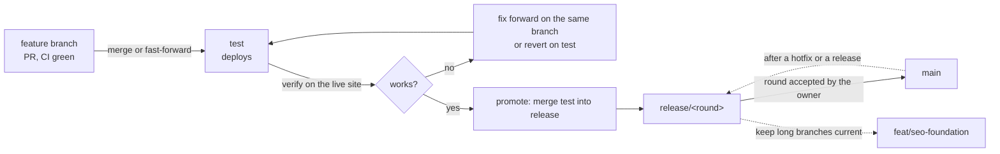

# Branches and where code must end up (agent reference)

Proposed 2026-11-12, awaiting the owner's confirmation. Until then treat it as
the working rule for this round.

## What each branch means

| Branch | Meaning | Who moves it |
|---|---|---|
| `test` | Exactly what is deployed to the one environment (supplychainsai.com). Pushing it deploys | Any session, one at a time, after telling the others |
| `release/<round>` | Everything **verified on the live site** in this round, plus this round's documents. The candidate for `main` | The session that owns the round; today `release/assistant-seo-20261104` |
| `main` | The accepted baseline | Only by merging the release PR, after the owner accepts the round |
| `feat/…`, `fix/…`, `perf/…` | One piece of work | Its author |
| `feat/seo-foundation` | Long-running SEO work | The SEO session |

## The two rules

1. **Nothing reaches `main` except through the release branch.**
2. **Everything that was deployed must be on the release branch soon after.**
   A commit that is on `test` but not on `release/<round>` is a debt: it is
   live, and the next release would silently drop it.

## How a change travels



- **Deploy first, promote second.** A pull request may target `test` directly.
  After it is verified live, merge `test` into the release branch (a merge
  commit, never a squash, so the deployed commits keep their ids).
- A pull request may also target the release branch first (documents, changes
  that need no live check). Then fast-forward `test` to the release tip to
  deploy it. Do not leave code on release that is not deployed for longer than
  the round of work it belongs to.
- **One stream verifies at a time.** There is one environment and one deploy
  queue. Before pushing `test`, tell the other sessions; do not promote `test`
  into release while someone else's unverified commit sits on it.
- **Long branches take from release, not from `test`.** `feat/seo-foundation`
  merges the release branch in regularly, so it builds on verified code.
- **After `main` moves** (the release PR, or a hotfix), merge `main` back into
  the release branch the same day.
- **Starting the next round:** cut `release/<next>` from `main` after the
  release PR merges.

## Checking the debt

```bash
git fetch origin
R=origin/release/assistant-seo-20261104
echo "deployed but not on release: $(git rev-list --count $R..origin/test)"
echo "on release but not deployed: $(git rev-list --count origin/test..$R)"
git diff --stat origin/test $R -- . ':!docs' | tail -1   # undeployed code on release
```

The first number should be zero outside a verification window. The second may
be non-zero only for documents; code that shows up in the last line is
undeployed code waiting on a decision.

## State on 2026-11-12

- `test` is 258 commits ahead of `main`; the release PR (#71) is open.
- The release branch holds 30 commits that are not on `test`, and they are not
  only documents: the assistant widget (`apps/site/src/islands/ai/…`,
  `ChatComposer`, `ChatPanel`) differs. That code has never been deployed.
- Pull requests #81 (public knowledge, assistant fixes) and #83 (CI crash-dump
  fix) target `test` directly. After they are verified live they must be
  merged into the release branch.
- `feat/seo-foundation` has 7 commits of its own and is 169 behind `test`.
