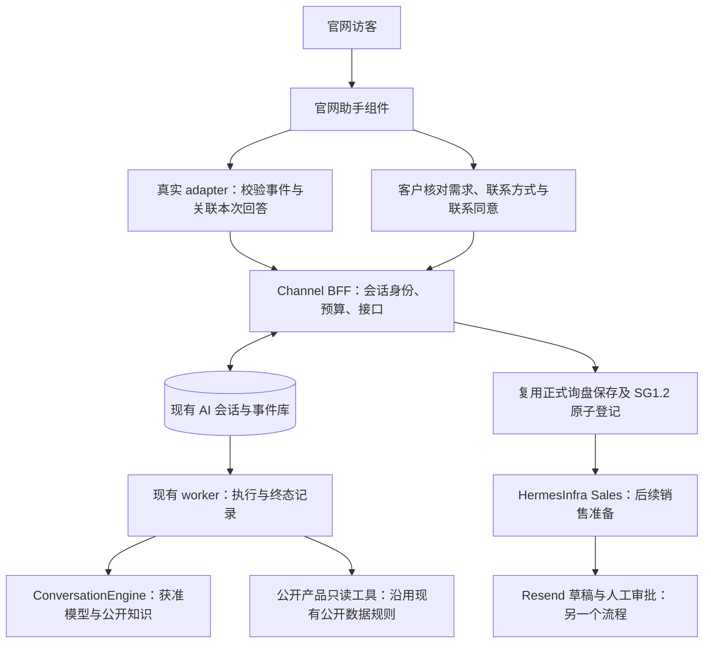

# 官网助手后端：下一次实施顺序

2026-10-30：MIU 4／5a 与 11 的产品查询、卡片、实时比较已完成本地接线，详见 [本轮交付](PRODUCT-SLICE-DELIVERY.md)；真实模型与生产目录待验收。历史恢复暂不实施；正式询盘保存仍是下一段。

当前实现进度见 [提问和停止交付](CHAT-SLICE-DELIVERY.md)。v2 协议、运行状态、精确停止及真实 adapter 的首段已实现；历史恢复暂缓。下文保留最初的整体设计，不能把其计划状态当作最新完成清单。

这份方案是 29 屏前端的后端交接。2026-10-30 只做设计；下面每项都还没有在本分支实现。沿用原有 MIU 号，不拆出新的 SG 编号。原架构的生产门禁继续有效，前端预览通过不代表这些项目完成。

## 服务怎么分工

官网助手继续通过 Channel 的 BFF 接待访客。BFF 保存对话与任务事实、核对会话凭据、处理限流；worker 执行受控的模型和工具步骤；数据库维护消息、事件与取消状态。模型判断需求和整理文字，不决定授权、价格、提交成功或是否已停止。

正式询盘保存后，现有 Sales 链路才会把任务交到 HermesInfra。官网客服接待和 Hermes 销售跟进保留各自的生命周期。今晚不把官网聊天接进定海群聊，也不另建一套询盘存储或邮件发送。

## 先复用什么

| 实际代码 | 已有能力 | 需要补的地方 |
| --- | --- | --- |
| `apps/ai-bff/src/server.ts` | 创建会话、受控追加、取消受理、SSE、限流 | 版本／能力协商、运行身份、状态与历史读接口、明确的提交结果接口 |
| `packages/ai-store/src/store.ts` | 对话、运行、消息、事件、授权和事务基础 | 快照分页、运行级取消比较、提交身份与正式询盘回执关联；先查现有方法，避免重复建表 |
| `apps/ai-worker/src/worker.ts` | 从已登记任务启动引擎、记录结果、取消和恢复基础 | 有界工具步骤、结构化产品和可见结果事件、超时后必有终态 |
| `packages/ai-engine/src/port.ts` | 供应商无关的 ConversationEngine、能力与预算描述 | 按真实可观测能力扩展，保持当前调用者兼容 |
| `packages/ai-engine-anythingllm/src/*` | 真实知识引擎、推理内容过滤、工具面拒绝检查 | 继续支持现有检索模式。当前明确禁止 agent 工具，不能直接打开厂商工具开关来满足新 UI |
| `apps/functions/public-api/src/handler.ts`、`catalog-detail.ts` | 已批准产品、公开版本、字段投影与图片入口 | 新工具通过服务器受控调用这些公开能力；模型没有 DB／OSS 凭据，不传入管理员或 VIP 会话 |
| Sales 分支的正式询盘与 SG1.2 登记 | 已有审核和测试过的正式询盘事件链路 | 先核对分支整合依赖，再复用；未并入本 main 时不在本分支复制实现 |

实际查阅了上述源码及 PublicSseEvent。BFF 当前仅有四类公开操作；完整状态与历史读接口尚未提供。现有 adapter 的零工具限制是有意的安全门禁。

## MIU 5f：先约定新旧接口怎样共存

依赖：现有 LLD-001／002、上表的实际接口，以及本轮前端 `model.ts`。先更新正式架构、LLD 和测试策略中涉及的规范，再动代码；本文件是下一轮变更提案。

执行范围：`packages/ai-contracts/src/index.ts`、BFF、worker 的生产者／消费者测试及新的浏览器 adapter。增加明确的协议版本／能力字段，保留 v1 Widget。新公开事件必须能关联 conversation、run、message、controlVersion 和 sequence；进度只表示获准动作，不展示模型推理。

前端的 TurnEvent 是展示类型，不直接放到线上。adapter 必须严格解码 JSON，核对消息和运行归属后映射；未知事件、无效序号、错运行不得推进 cursor 或触发成功。`idempotencyKey` 只表示重试身份，不能作为权限。

验收：旧 Widget／新 adapter 各消费对应版本；字段缺失、跨 run、重复与乱序、未知类型、错误 Retry-After 均有测试。先写失败断言，再做最小修改；定向移除一个归属或解码检查，断言必须失败。

## MIU 6a／6b／7：读取真实状态，恢复真实对话

依赖：MIU 5f；延续已有会话凭据与限流。

执行范围：BFF 的状态读路由、store 的只读分页查询、SSE 事件读取和真实 adapter。提议 `GET /api/ai/conversations/:id/state` 返回有界消息页、当前运行状态、恢复 cursor 和过期事实。每次先核验凭据与会话所有权，浏览器不能只凭会话 ID 读取记录。

已有 SSE 继续只读已提交事件。重连用同一运行与最后已应用 cursor；保留期已过或 cursor 太旧时明确要求重新取快照。网络失败和会话已失效分开返回，不能把暂时失败伪装为没有历史。恢复返回的产品也必须是批准公开字段。

验收：真实 BFF＋临时 PostgreSQL 中途断流后不丢不重；同一会话多运行不串消息；他人／过期凭据读不到历史；删除后保留顺序而不恢复内容。代理环境的流式／缓冲行为仍留到线上验收。

## MIU 6c／5d：停止本次回答

依赖：MIU 5f 及当前取消、reaper 和事务能力。不是 Sales 暂停或人工接管。

取消请求绑定 runId、expected controlVersion、稳定 requestId；服务器做条件写入。202 只代表请求受理。只有数据库中该 run 已终止，并通过 state 或终态事件观察到，adapter 才返回 stopped；引擎未知或网络中断时保持 unknown。已完成的回答仍显示完成，旧取消不能作用于下一条新回答。

验收：在真实 store／worker 上用屏障控制取消与 final、旧按钮与新 run 的竞争；重复取消不产生额外副作用；未知取消不会让前端假装已停止。现有引擎无法确认停止时如实保留未知和后续恢复路径。

## MIU 4／5a：让对话能澄清并完成有界的产品查询

依赖：前述协议、真实 engine 能力、公开产品投影与现有预算。

实施选择：先保留目前可用的检索 adapter；为新 profile 增加服务器拥有的公开产品执行步骤。优先复用现有 ConversationEngine 与 worker。若供应商不能可靠报告／约束工具，服务器自己验证计划、执行白名单只读工具并把结果交回模型；不关闭原有零工具检查，不默认接入另一个供应商或 Hermes 运行时。

首批只读动作限定为 `searchPublicProducts`、`getPublicProduct`，再由模型作答、澄清或整理未提交的询盘。工具输入用固定 schema；服务器限制搜索长度、结果数量、产品归属、轮数、总工具数、墙钟时间和可执行预算。模型无权访问任意 URL、shell、数据库、私人知识、发信或保存正式询盘。

价格／MOQ／交期来自获准的实时产品接口，带版本与查询时间；无法核实时表达不确定，不能从文字猜数值。客户最终提交前重新读取必要信息，保留提交时的业务事实，不把历史快照当实时库存或保证。

验收：真实模型完成澄清 → 查询 → 比较 → 草案；查无匹配、越界、空结果、超时、工具不可用、预算耗尽都有可见答复，下一次普通提问可继续。注入请求越权参数或私有字段时系统拒绝；模型输出再合理也不能绕过门禁。产出只含用户可见结论，沿用推理过滤与新的结构化输出约束。

## MIU 8a／6d：把核对后的草案变成正式询盘

依赖：正式询盘／SG1.2 已批准的整合顺序；不能仅依赖前端按钮禁用。

BFF 绑定固定网站／业务身份，接收 submissionKey、客户核对后的资料、公开产品引用和本次联系同意文本版本。联系方式独立存放并从默认模型上下文、日志中脱敏。服务器复用同一正式保存入口；采用冻结内容指纹与 key 记录原结果，重复相同请求返回原回执，换内容沿用 key 必须拒绝。

结果查询可以是原提交的受控 GET，或同 key 的安全重试；具体 wire 形状在 MIU 5f 一起定。无回执不显示成功，不额外建立第二条询盘。成功事实提交后再触发 Sales；确认邮件统一路径继续属于后续已约定的 Resend 集成。

验收：未勾同意／缺联系方式不保存；网络在事务提交后断开，核对原 key 返回同一询盘和同一事件；并发重复、换内容、错误会话都不能产生新记录或读到别人的回执。客户继续聊天不改变已冻结提交的结果。

## MIU 11c／11e：接回真实 UI，并独立做线上验收

依赖：相应后端项目已通过；不因模拟组件验收通过而跳过。

在原 `/`、`/headphones`、`/oem` 路由挂载新真实 adapter。adapter 一生对应一个会话／配置边界，边界切换时重新挂载 Experience，避免继承旧消息或草案；公共外壳不存身份。采用可回退的功能开关保留旧 Widget，确保构建不引用预览 adapter。

验收：先真 BFF／store、有界模型、合成询盘和禁止真实邮件的环境 E2E；再按既有 CloudRun runbook 部署／线上核验，另取授权。检查流式、移动端焦点和滚动、取消竞争、历史恢复、产品变更、一次正式询盘只触发一次 Sales。通过后才称“新 AI chat 已接入真实后端”；本地模拟只能称“前端组件交互通过”。
