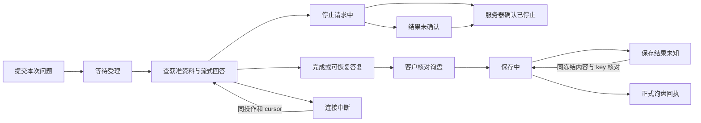

# 官网助手：29 状态、前端组件与后端接线设计

2026-10-30。本轮按用户要求先完成设计、MIU 和前端组件，真实后端及新模型对话留到下一次实施。不是 Resend 对接，也不改 Hermes 销售任务控制。

## 已核对的实际基线

工作树从新抓取的 `origin/main b3d63ac1` 创建，独立分支 `feat/website-assistant-ui-foundation`。原设计工作区未提交的文件、Sales、pricing 和 SEO 分支不合并、不修改。UI 依据 2026-10-29 的 `assistant-ui-spec.md`、29 状态清单和桌面／手机截图；本目录 `screens.json` 保存状态编号和交互依据，不复制另一套 HTML 原型。

现有 `AssistantWidget.tsx` 是 React island，沿用 `brand-950` 头部、`brand-700` 用户气泡、`accent-500` 入口、24rem 桌面面板和固定输入区。当前只有 ready／streaming／unavailable 三种状态；任何单次错误都会隐藏输入；关闭会中断浏览器读取；取消不核对返回结果；重连没有可靠去重；每次内容变化都强制滚到底部。

当前 BFF 实际提供创建会话、追加消息、取消、读取 SSE 四类接口。`PublicSseEvent` 没有 run 身份、工具状态或产品卡片；`CancelResponse.cancelled` 是取消请求受理结果，不能当执行已终止。store 有会话／消息／事件基础，但缺少完整的公开历史快照接口。旧架构与 MIU 对这些已有规划，29 屏还没有完整落实。

## 今晚选择与不实施的部分

选择：在现有 React／Astro／Tailwind 和 token 上抽取小型共用聊天外壳、输入与滚动钩子；官网业务组件负责产品、询盘、错误及状态；所有 IO 经可注入 adapter。开发用 Vite 独立入口挂载实际组件，模拟完整旅程，避免把样例路由或模拟 adapter 接进公开网站。

没有选择一次性重写线上 Widget：后端事件身份及取消语义还不匹配。没有选择新建通用聊天 SDK：目前只有这一个已验证消费者，不把产品询盘逻辑塞进公共 UI。现有 Widget 只复用无业务副作用的外壳／安全链接能力，其传输逻辑暂时保留。公共组件不认识 Hermes、Resend、数据库或询盘保存。

今晚不实现 API、数据库迁移、真实模型调用、发信、联网搜索、持久历史或真实询盘提交；不启动部署。Stop 指本次官网回答，和 Sales 任务暂停／接管无关。

## 前端结构与数据边界

| 文件组 | 责任 |
| --- | --- |
| `components/chat/ChatPanel.tsx` | 现有面板外观、入口、头部、收起与打开；不决定取消业务 |
| `components/chat/ChatComposer.tsx` | Enter／Shift+Enter、IME、长度限制、发送／停止的可访问交互 |
| `components/chat/useChatViewport.ts` | 只滚动 transcript；上滚阅读时停止跟随，提供最新消息入口 |
| `islands/ai/assistant/model.ts` | 内部 view state／event／adapter 类型；不是新的服务端 wire 协议 |
| `islands/ai/assistant/state.ts` | 纯 reducer：本次任务身份、序号去重、状态转移、停止与完成竞争 |
| `islands/ai/assistant/useAssistantSession.ts` | 调用 adapter、稳定提交身份、取消／恢复／询盘结果，隔离过期异步回调 |
| `AssistantExperience/AssistantMessages/InquiryReview` | 官网特有文案、产品／比较／来源、明确同意的表单 |
| `islands/ai/preview/*` | 仅开发的场景与模拟 IO；29 个状态和连续旅程都用同一产品组件 |

对话 key、turn key、消息 key 只用于前端关联，不是权限。未来真实 adapter 负责会话凭据；view state 和展示组件不接收服务密钥。adapter 与 Experience 的配置／会话边界固定，边界变化时由调用方重新挂载，不把旧消息带到新的配置里。消息用 React 文本节点渲染，不接受原始 HTML；链接限制 HTTP／HTTPS。产品示例不用远端图片或对象存储。浏览器不保存联系人、本次内容或授权事实到 localStorage。

核心形状：

```ts
interface TurnRequest {
  conversationKey: string;
  turnKey: string;
  idempotencyKey: string;
  message: string;
}
interface AssistantAdapter {
  run(request: TurnRequest, cursor: number, emit: (event: TurnEvent) => void,
      signal: AbortSignal): Promise<void>;
  stop(request: TurnRequest, signal: AbortSignal): Promise<'stopped' | 'unknown'>;
  restore(signal: AbortSignal): Promise<RestoredConversation | null>;
  submitInquiry(draft: InquiryDraft, submissionKey: string,
      signal: AbortSignal): Promise<InquiryReceipt | null>;
}
```

null 代表结果未确认／服务器明确会话不可恢复；临时恢复失败通过错误返回，前端保留当前聊天并允许重试，不伪称过期。adapter 的 stop 只有在观察到相应 run 的权威终止后才返回 stopped。重复保存只用同一冻结 draft 和 submissionKey；普通提问不会调用 submitInquiry。

## 29 屏对应到少量状态

屏幕编号沿用原稿，完整进入／退出条件见 screens.json。不是写 29 份独立页面。

| 屏幕 | 前端状态／组件 | 当前后端缺口及下一步 |
| --- | --- | --- |
| 01–03 收起、欢迎、输入 | open、空 transcript、composer | 既有创建／消息接口可复用；IME 与键盘由前端负责 |
| 04–07 受理、查资料、逐步回答、多步工具 | turn queued／reading／streaming，工具摘要 | 受理存在；需关联 run 的工具事件、真实即时流和预算，不展示模型推理 |
| 08–10 产品、比较、澄清 | 结构化产品块、比较选择、澄清文本 | 公开产品只读工具、多轮计划及字段投影需补，不能从模型文本提取报价 |
| 11–13 查不到、越界、失败 | 可恢复的单条结果／错误 | 一次越界不把助手设为全局 unavailable；后端须始终返回可见终态 |
| 14–15 重连、限流 | 同 turn/cursor 重连；Retry-After | 现有 sequence 基础可复用；补 run 归属、严格事件解码和真实重试时间 |
| 16–19 停止受理、未知、确认、重答 | stopping／stop_unknown／stopped，重答确认 | 现取消仅受理；须终态确认与 run CAS，重答建新操作，旧结果保留 |
| 20–22 历史、长对话、过期 | restoring／ready／expired，滚动钩子 | 需身份校验的分页会话快照，不能只凭本地 ID 取历史 |
| 23–27 核对、错误、保存、未知、成功 | InquiryReview，冻结提交和稳定 key | 需可信 BFF 到现有正式询盘保存的桥接、幂等与查询结果；不自动发邮件 |
| 28 团队跟进 | 留资／异步联系说明 | 不宣称真人已接入；正式留资仍须核对和提交 |
| 29 产品更新 | revision 提醒，重新核对 | server 重新查批准产品，过期事实不沿用为商务承诺 |

## 状态转移与不变条件



1. 只接受当前 conversation／turn 的事件；序号不前进的重复事件忽略。新问题不能消费旧回答的延迟回调。
2. 完成、确认停止后不再拼接晚到 token。请求停止不等于已停止；final 先到时按完成展示，不伪称取消了已完成内容。
3. 收起不调用 adapter.stop；卸载只断开本地读取，不声称撤销后台操作。
4. 重试用同一请求身份与已有 cursor，不清空局部文本或追加第二份问题；确认重新回答才新建一次操作。
5. 核对询盘时显示独立表单区域，聊天记录保留在状态中，返回聊天后恢复展示。表单不跟随新消息滚到底部；未完成核对或保存结果未知时不切换历史，避免丢失资料。询盘同意默认不勾选。校验失败保留其他字段；saving／unknown 锁定冻结内容和 key。只有回执才显示保存成功。
6. 队列序号、百分比、倒计时只在真实服务器提供时展示，本轮不造数。

## 明天的后端实施设计

逐项文件范围、依赖和验收详见 [BACKEND-MIUS.md](BACKEND-MIUS.md)。

这些是待实现的提案，不修改 packages/ai-contracts 或现有 handler 来假装已支持。

- **MIU 5f／6／7，先修接口事实。** 保留 v1 兼容，为新 adapter 增加明确的版本／能力协商。公开事件需要 runId、messageId、controlVersion 及单调 sequence；工具状态只含允许展示的动作摘要。前端展示类型不直接充当 wire 类型，所有外部 JSON 先严格解码。
- **MIU 6／7，当前状态与历史。** 提案 `GET /api/ai/conversations/:id/state` 返回已授权消息分页、当前 run、状态和最新 sequence。凭据校验、过期／撤销及会话所有权由 BFF 和数据库判定。cursor 太旧时返回快照重建信号；不得悄悄换新会话拼旧内容。
- **MIU 3／6，精确取消。** 取消请求增加 expected runId、controlVersion 和稳定 requestId；事务只针对该 run。202 仍是请求受理；由带 run 身份的终态事件／state 确认 cancelled。旧按钮不能取消下一条新任务。关闭浏览器不是取消。
- **MIU 4／5a，新的模型交互。** 继续使用 ConversationEngine 边界，模型可澄清、只读查询批准产品、整理询盘草案。先做获准产品查找／详情，不开放任意 URL、shell、数据库、私人知识库或发送。每次任务设轮数、工具次数和时间／费用上限；服务器逐项核对工具参数和公开字段。普通越界、无依据、空输出和失败都要有可见终态，助手保持可以继续提问。
- **MIU 8／11e，正式询盘桥接。** 提案 POST conversation inquiries 加 submissionKey、确认后的需求／产品及本次联系同意版本；BFF 固定网站／业务身份，复用正式 OEM 或单品保存及 SG1.2 的原子登记。资料更改后的 key 不可复用，结果未知查询／重试原提交；保存成功后才触发 Sales。SG1.2 位于 Sales 分支，尚未并入本 main 基线，实施时明确整合依赖，不复制第二套保存逻辑。
- **MIU 11c／11e，替换前端 adapter。** 新 IO 适配器通过旧／新事件映射接入本轮组件，再在原有三个允许路由灰度；不可把开发用模拟 adapter 放进生产。只有通过真服务、取消竞争、恢复和正式询盘幂等验收后才替换现有 Widget。

一期不做真人实时客服台、Sales 暂停／接管、邮件外发或全网自由搜索。文案“交给团队”表示客户核对留资后的异步跟进。接入模型账号、KB、数据库和线上 CloudRun 时使用已有 runbook 与门禁，不能以本地模拟关闭生产 gate。

## 后端验收条件与最强反例

必须覆盖：空输出仍可见回复；无依据和越界后能继续问；工具参数／私有字段拒绝；同一会话两请求及旧 run 事件；取消／final／下一条消息竞争；断网重连不丢不重；历史过期／他人凭据／保留期限；同意未勾选不保存；保存成功回执丢失后不重复询盘；实时产品变更后重新核对；预算耗尽时保留人工询盘路径。

反例：本地 reducer 忽略旧 token，不能证明服务器没写入旧内容；模拟已停止，不能证明模型或工具实际中断；前端禁用提交，不能替代后端幂等。明天必须在真实 BFF／store 与有界模型、合成询盘上重新证明这些边界。
