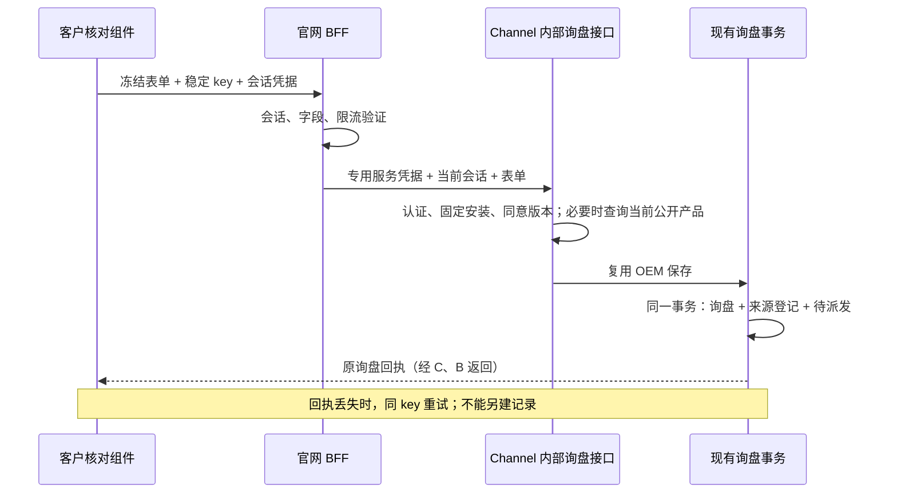

# MIU 8a／6d：确认询盘后统一保存

2026-10-30，执行中。复用 SG1.2 的 OEM 正式保存事务、来源登记和待派发记录；不改原首页／产品表单，不发送邮件，不部署。历史恢复继续暂缓。

## 实际问题与选择

`InquiryReview` 和 `useAssistantSession` 已有核对、冻结提交、结果未知和原提交重试；`http-adapter.submitInquiry()` 仍会抛出未启用。Sales 分支已经有 `saveFinalizedOemInCloud()`，能把 `oemProjects`、来源登记和待派发记录一起提交。当前 UI 分支没有这些实现，不能在 AI PostgreSQL 中另建一套询盘。

选用内部 HTTP 接口衔接两条现有分支。官网 BFF 先验证会话凭据，再调用固定 Channel 询盘接口；该接口的专用凭据绑定当前安装、客户和环境。浏览器／模型不能指定这些身份、目标 URL 或发送动作。共享契约通过独立提交整合到两条已有分支，不合并 pricing／SEO 的代码。

```ts
// 当前
async submitInquiry() { throw new Error('Inquiry submission is not enabled'); }
// 接线后：只传客户确认的表单和公开产品 ID，不传模型权限或产品报价
POST /api/ai/v2/conversations/:id/inquiries
{ submissionKey, requirement, name, email, company, consent: true,
  consentVersion: 'inquiry-contact-v1', productId?: string }
```

## 身份与数据

| 数据 | 归属／寿命 | 用途 |
| --- | --- | --- |
| 会话凭据 | 浏览器本次挂载，仅内存；服务器核对有效期 | 授权当前会话提交，不作客户登录 |
| submissionKey | 一份冻结表单的稳定身份 | 相同内容重试返回同一记录；改内容复用 key 拒绝 |
| 安装／客户／环境 | Channel 服务配置与现行安装登记 | 服务器决定，调用者不能覆盖 |
| 需求、联系同意与产品读取留档 | 原 `oemProjects` | 销售看到完整需求；不把联系方式加入模型上下文 |
| 来源登记与 pending delivery | SG1.2 既有集合 | 保存成功后等待现有派发器自动处理 |

项目 ID 由安装身份、会话 ID 与 key 的 SHA-256 决定。完整表单的规范化指纹另外保存；数据库事务中检查旧记录与指纹，冲突不能覆盖。明确同意文本版本必须匹配。不能只靠浏览器禁用按钮。

## 运行流程与技术约束



CloudBase 事务与 HTTP 回执不原子；以数据库记录为准。事务中不访问产品服务、Hermes 或邮件提供商。重复请求优先找回原记录，不让后来产品下架阻止查询已成功的结果。新提交只引用当前已批准公开产品，留存读取时间和必要公开事实，后续报价仍需实时读取。

助手入口保存到既有 OEM 询盘集合，带 `assistantSubmission` 明确来源和完整需求。业务事件沿用现有 `website_oem` 合同；不能声称已增加 Hermes 尚未支持的 `website_assistant` 类型。产品 ID 作为需求依据留档，不伪造单品报价请求、选项、价格或数量。

## 知识路径纠正

SSH 已确认 VibeKB 的旧聊天 HTTP 服务与 Hermes 的 `mcp-kb` 是两个存储路径。不能再把旧 AnythingLLM adapter 称为已经接入 Hermes 知识。官网模型与检索接线需要分别验收；公开检索必须由服务端固定工作区，缺范围拒绝。本轮确定性表单保存与检索无依赖，不调用任何知识服务，也不扩大现有工具权限。

## 验证与评审

- 共用契约：缺同意、错版本、额外身份、错误 key、过长需求／换行邮箱拒绝。
- 事务：保存与来源／派发记录一起写；后一步写失败全部回滚；相同提交并发、丢回执、重启恢复只有一条；同 key 改内容返回 409；不同会话／安装各自独立。
- HTTP：错误／重复认证头拒绝；禁用默认 404；固定 URL／HTTPS、超时、有限响应、禁止重定向；错误回执不能显示成功。
- 浏览器：普通需求与产品卡片均可核对提交；丢回执后恢复原回执；未同意不提交；移动端表单和失败恢复。
- 定向缺陷注入：移除会话认证、同意、指纹／归属和回执身份检查，分别确认行为断言失败；环境故障不计 caught。
- 分两轮自查源码与测试有效性。CloudBase 本地使用事务测试替身，不冒充真实云库验收；真实云库、真实模型、Hermes 自动派发与上线验收另报。

不选直接调用原公开 OEM 表单处理器：它有自己的邮件动作和随机 ID，不满足本次去重边界。不整条合并 Sales 分支：避免带入其他 workstream。不建立 AI 专用询盘库：避免分裂业务事实。
