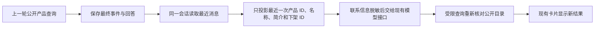

# MIU 4／5a：接着问上一轮产品

这次补上了现有聊天系统缺失的一段资料传递：上一轮查出的产品卡片，现在会作为公开资料交给下一轮模型。原来的提问、回答、停止和产品组件继续复用。

例如，访客先问“有没有适合办公室的耳机”，接着说“再核对刚才那两款”。后台会把最近一次卡片中的产品 ID、名称、简介交给模型；需要核对当前情况时，模型可以请求现有的有限 lookup，重新读取公开目录。旧卡片里的描述不能直接当成当前库存、报价或交期。

## 接线与边界

- Store 按会话、事件序号和回答对应的 run 连接资料；不会扫描其他会话找产品。
- 只携带最近一次有效产品结果，最多 6 项、简介最多 500 字；下架 ID 最多 2 项。新的下架结果会取代旧卡片上下文。
- 字段逐项重建；私有备注、额外属性和附件不进入模型。名称、简介继续脱敏；公开产品 ID 原样保留，避免长数字 ID 被误当作电话号码。
- AnythingLLM 连接复用现有 HTTP 接口，明确标记这些是历史公开资料。服务器的查询白名单、来源检查、取消和任务版本检查继续生效。
- 没有新增浏览器历史恢复、正式询盘提交、任意联网工具、私有数据库或邮件发送权限。

## 验证与复核

本轮针对 store、policy、AnythingLLM adapter、BFF、worker 的 271 项测试通过，无跳过。覆盖同会话产品关联、其他会话隔离、私有字段剔除、长数字 ID、下架结果替换，以及真实 HTTP 请求中历史资料的位置。6 个相关包的类型检查、聊天联调类型检查、AI 服务构建和修改文件的 Biome 检查通过。

桌面和 Chromium 手机尺寸共 20 项浏览器测试通过。其中新增两项连续产品追问：第一轮查出卡片，测试目录更新产品描述，第二轮根据实际传入的上一轮 ID 再查询并显示更新。实际运行的是 React、BFF、PostgreSQL 和 worker；模型及目录内容是明确标识的本地测试数据，不能据此证明真实模型的理解效果。

8 处定向缺陷注入全部被测试抓到，存活、无效和超时均为 0。新增检查包括历史产品私有字段泄漏，以及产品 ID 被错误脱敏；源码只在临时副本中修改。可重跑 `scripts/verify-chat-slice-guards.mjs`，结果见 [PRODUCT-CONTEXT-GUARDS.json](PRODUCT-CONTEXT-GUARDS.json)。

第一轮复核检查 store 查询、事件关联、engine port、policy 和供应商请求构造，发现卡片没有进入后续模型请求，补齐白名单投影。第二轮检查上限、下架结果、隐私字段、浏览器连续操作、测试运行器与 CI；补了最新下架结果替换旧卡片的断言，清理本地测试运行取消时遗留的 Map 项。复核均由本会话完成，不冒充独立审查。

本地第一次全量运行有一项既有的工具状态探测测试失败；单项及随后完整 271 项复跑均通过。未复现，也未改动该探测逻辑；暂不能归因于某个已修复的问题。

文字复核涉及本记录、计划及 README。将“模型记住产品”改为“服务器把最近一次公开产品资料交给下一轮模型”，核对了字段上限、SQL 归属条件、测试数量和 fake model 标识，避免把资料接线说成真实模型效果已验收。

## 使用与下一步

本机入口仍为 `http://127.0.0.1:62058/assistant-chat.html`，使用测试模型。正式启用仍依赖已有 `PUBLIC_AI_CHAT_V2` 与固定公开目录配置。本轮未部署或连接客户账号。

下一段沿用 MIU 8a／6d：客户核对需求、填写联系方式、确认提交，再接入 Sales 分支已有的统一询盘保存和事件路径。当前两条分支尚未完成这段集成，联调页继续隐藏正式提交，避免另建一套询盘库。
