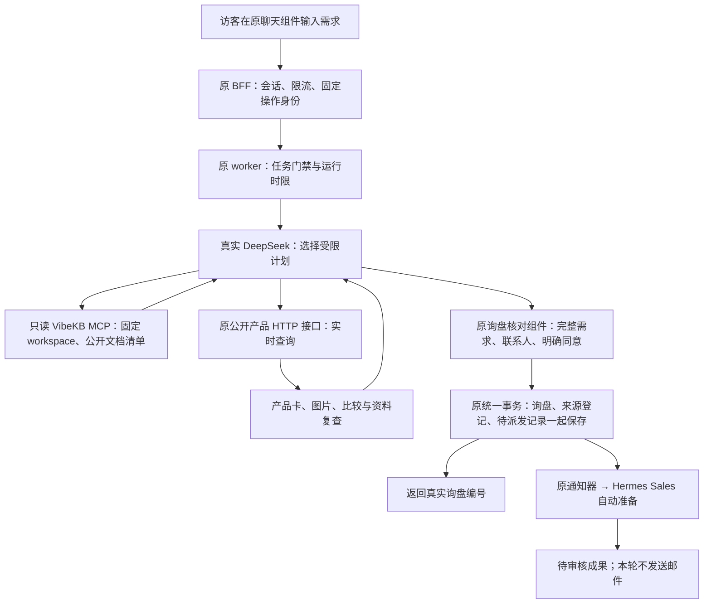

# 官网助手：真实模型、知识库与询盘交付

2026-11-02。沿用 `feat/website-assistant-ui-foundation`，保存端沿用 `feat/sales-agent-integration`。本轮先本地开发和验收，未发布官网、未重启 Hermes Agent、未发送邮件。

## 现在可以怎样使用

访客可以直接咨询公司和 OEM 服务、描述采购用途、查找当前公开产品，查看图片、比较两款并复查资料。明确提出跟进时，助手整理多轮需求，在聊天面板内打开原询盘核对组件。访客可以修改需求、填写邮箱；只有勾选同意并确认后，才通过原 BFF 和 Channel 事务保存，返回真实询盘编号。

例如，先问“500 份员工礼品耳机，要 logo 和零售包装，发德国”，再改成 700 件，核对表单会保留 logo、包装和目的地，数量变成 700。已填邮箱保留，原先的同意会清除，需要再次确认。保存中或结果未知的提交不允许换身份重新创建。

模型判断只产生受限计划。系统执行固定范围的查询、投影公开字段并核对归属；模型不能直接写库、提交表单、挑任意 URL、读取其他 workspace 或发送邮件。

## 复用了什么，补了什么

保留 `ChatPanel`、`ChatComposer`、`AssistantMessages`、`InquiryReview`、原会话 hook、HTTP adapter、BFF、PostgreSQL、PublicCatalog 与 Channel 保存事务。没有重做聊天系统或调度器。

新增独立 VibeKB engine adapter 和受限模型计划；补充可信查询进度、多轮询盘建议、确认后回执留在聊天中、需求更新后的表单同步、产品说明失败时保留卡片、真实目录与云保存的超时设置。修改仅作用于本工作流；旧调用仍有兼容入口，新流程不使用 AnythingLLM。

## 已核对的真实配置

Hermes 实际使用 TokenHub `deepseek/deepseek-v4-pro`。VibeKB 的 `vibekb-kb` MCP 是 Streamable HTTP，原服务仍在运行。本轮通过 SSH 调用，原有模型／MCP Key 留在服务器，没有复制现有 Agent 的整份配置或密钥。

workspace 2 同时有公开、内部及草稿资料，不能整体交给官网。当前只启用明确带“对外公开”标签的最终品牌文档 12；搜索结果与完整文档都复核清单和归属，其他资料在进入模型前已排除。完整知识库的内容整理与扩充仍可后续进行，不能把“98 篇资料存在”说成“98 篇都适合公开回答”。

公开产品来自原 CloudBase public-api，询盘保存到现有 `diversity-123-d9grnqfux221323bb`。测试只使用 `[TEST ...]` 公司和 `acceptance@example.invalid`，独立的验收安装归属及本地聊天数据库，不接触原客户记录、现有 Agent 任务库或发送配置。

## 原 29 屏与真实服务的关系

| 原屏号 | 当前情况 |
| --- | --- |
| 1–5、7–12 | 原组件已接实际问答、可信进度、产品、比较、澄清、无结果和越界答复；真实浏览器已覆盖核心流程 |
| 6 | 渲染组件支持文本事件；当前先检查最终依据，再展示答案，不声称供应商逐字即时输出 |
| 13–19 | 错误、恢复、限流、停止及重新回答沿用原组件；确定性故障在本地／CI 注入，真实模型另测停止与后续提问 |
| 20–22 | 历史恢复仍按用户决定暂缓；仅设计预览，不开放跨浏览器／跨设备历史 |
| 23–27 | 原核对、验证、保存中、原提交核对和成功回执均已接原服务；真实云库保存和读回另有证据 |
| 28 | 留资与异步跟进；没有伪装成真人已在线接入 |
| 29 | 原目录更新／下架处理复用，受控变更在 HTTP fixture 中测；不为测试修改真实产品 |

## 检查与证据

已完成两轮自查：先查权限、公开资料、取消和资源释放，再查实际界面与多轮业务。修正了真实目录超过旧 5 秒截止时间、云保存超过旧 10 秒截止时间、需求改动后旧表单未同步，以及异步停止过早显示未知结果等问题。取消未开始的模型 run 也会释放本地句柄，防止异常写入后累积占满容量。

- 真实浏览器主流程 7 项通过，见 `output/assistant-real-20261102/final-run/results.json`；同目录有桌面／手机截图和独立云库读回。该轮使用提交前的工作树，记录的 `sourceCommit` 是开发基点，最终交付提交和远端 CI 另行记录。
- 确定性前后端浏览器 24 项通过；原 29 屏及交互在桌面／手机共 90 项通过。预览测试使用受控 IO，不冒充真实模型或云库。
- BFF 15 项、worker 40 项、store 42 项、前端 23 项、新 VibeKB adapter 8 项通过，均无跳过；运行库测试使用独立数据库，按 CI 顺序串行。
- 定向缺陷注入 17 项被预期断言抓到，原源码保持不变；包含 workspace、公开清单、工具预算、截断输出、客户同意、回执归属和任务身份。
- 前端构建通过，19 个 HTML 页面和站点 SEO 门禁通过，测试预览没有进入正式构建。网站构建使用原 SEO fixture，不改变定价／SEO 实现。冷启动运行包检查单独记录结果。

初次并行数据库检查曾误用本轮自己的聊天测试库，导致干扰；那次结果已作废，后续真实聊天库与串行回归库分开，未涉及生产数据。英文重新回答曾遇到一次不合法模型计划，按原错误组件可恢复地拒绝；没有将失败算成通过。后续补充问题与联动结果继续记录。

当前未部署生产入口、未迁移账号、未测试真实 Resend 发信；历史恢复、任意联网搜索、下单和正式报价承诺均不在这次开放的能力中。

文字复核实际读取 `REAL-CHAT-IMPLEMENTATION.md`、本文件、原询盘交付、配置步骤、adapter／worker／hook 代码和浏览器结果。把“仍缺独立云环境”改成“用户已授权使用现有云库”；把“真实完整线上验收”明确分为本地真实模型／云保存、受控故障回归及尚未部署三种事实。
