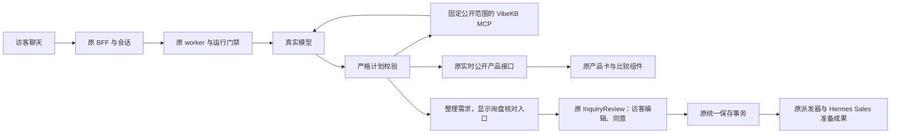

# MIU 4／5a／11：真实模型、VibeKB 与官网完整交互

2026-11-02。沿用 `feat/website-assistant-ui-foundation`，保存端沿用原 Sales 分支。先本地开发和验收，现有 Channel 云库仅写带 TEST 标记的新询盘；不发送真实邮件，不更新现有 Hermes 配置、机器人或其他工作树。

## 实际问题与已核对的代码

实施前 `engineFromEnvironment()` 只构造 fake／旧适配；Hermes 的实际配置已是腾讯 TokenHub DeepSeek 和 `vibekb-kb` Streamable HTTP MCP。当前已新增 VibeKB 构造路径和独立适配，继续实现 ConversationEngine；启动配置的测试不依赖旧 KB 凭据。实际主机连通、MCP service active，不把旧官网代码误说成基础设施仍使用 AnythingLLM。

现有前端 `ChatPanel`、`ChatComposer`、`useAssistantSession`、`AssistantMessages`、`InquiryReview`、产品卡／比较／停止／失败恢复已存在。现有 worker 可以将严格产品计划交给 PublicCatalog，但真实模型尚未驱动验收，询盘缺模型整理的多轮需求。复用这些模块，只补缺口；历史恢复仍按用户此前决定暂缓，不擅自开放跨设备历史。

## 本轮界面约束

沿用已批准的 ChatPanel、brand-950／brand-700／accent-500、原字体与固定输入区，不更换视觉风格。真实产品摘要在卡片和比较区最多显示三行，完整内容继续使用原 View product 入口，避免供应商长描述把操作挤出视野。联调页说明由实际运行模式决定，真实模型／云库模式不能继续显示“测试替身”文案。组件仍由原会话 hook 和请求适配器连接。

## 数据与流程

| 内容 | 生命周期与范围 |
| --- | --- |
| 访客消息／run／取消身份 | 原 BFF 和 PostgreSQL；模型不决定权限 |
| 模型计划 | 单次回答内严格解析；只读产品、公开知识、澄清、建议核对询盘 |
| VibeKB workspace 与允许公开的文档 | 服务器固定；模型不能改 workspace、选任意文档或调用写工具 |
| 询盘建议 | 不含联系人，最多 4,000 字；访客可修改，必须核对和明确同意 |
| 已确认表单 | 原 BFF → 原 Channel 事务 → 原询盘／来源／pending；不经过模型，不发邮件 |

## 实施顺序与技术约束

### 2026-11-04：等待气泡与正文流式交付

复核了 `AssistantMessages.tsx`、助手 reducer、VibeKB engine、worker、catalog answer 和公开资料校验。等待时保留原状态提示，隐藏没有正文、产品或回执的 assistant 占位消息。模型调用启用 SSE；仅提取 answer 正文中的完整句子，经过公开来源及商业承诺检查后逐句提交。最终事件补足剩余正文，不重复已送达的句子；产品与询盘动作仍等完整结构化结果校验。其他字段顺序和没有句末标点的正文保留完整结果回退，不输出 JSON 参数。

本轮把“已有 SSE，所以已经逐字流式显示”纠正为实际行为说明：此前模型请求 `stream:false`，worker 也等最终校验后整段提交；现已接通模型流式接收和校验后的句子交付，没有前端打字机延时。

263 项相关测试通过：engine 23、worker 75、BFF 97、policy 25、助手界面状态／保存 43；相关类型检查通过。等待气泡及运行中提交测试均先复现失败。真实本地网站重新录制桌面 106.96 秒、手机 55.52 秒；桌面观察到正文完成前多次变化、零空白气泡、零页面错误，并读回同一条已保存询盘。使用真实模型、VibeKB 和公开产品；聊天及询盘保存为本地演示存储，未写生产或发送邮件。

全库尚未全通过：site 1545 项中，1532 通过、10 失败、2 取消、1 跳过，涉及商品后台编辑、下载和会话恢复；下载用例独立重跑仍报 `download.path: canceled`。内部盘曾出现 ENOSPC，切换外盘临时目录后仍有失败，未把它们全部归因于磁盘，也未改动这些模块。真实模型另有一次询盘计划格式不合法被门禁拒绝，后续完整重跑成功；偶发格式失败仍须另查。

Resend Key 已成功解密并仅保存于 Git 外的受保护文件。真实只读查询 `GET /inboxes`、`GET /domains` 均为 200，但列表为空，说明认证与 API 连接成功，域名与 Inbox 配置仍缺。没有创建邮箱／域名／草稿或调用发送接口。Key 的创建步骤无需重做；待补的是域名验证和草稿所属 Inbox。

### 2026-11-04：客户授权说明、下载和连续输出复验

复核 Resend 官方团队角色、域名验证、Inbox 条件，以及 DNSPod 部分记录共享说明。更新原 `RESEND-OWNER-SETUP.zh-CN.md`：客户邀请技术邮箱为 Member，由技术人员用自己的账号接手配置；不索取客户密码。Member 能管理邮件、域名和 Webhook，Admin 多出的账单和团队管理权限本次不需要。官方未列出配置可写、邮件／客户资料不可见的单独角色，不声称已实现这种隔离。2026-11-04 公开 NS 查询为 `ns3.dnsv4.com`、`ns4.dnsv4.com`，表明当前解析使用 DNSPod，不能据此认定已知道实际持有账号的人。

本轮实际阅读了 `AGENTS.md`、全局 `~/.codex/AGENTS.md`、上述交接文档、`answer-prefix.ts`、engine、worker 公开资料检查与产品说明路径、原录像观察记录和交付 HTML。把“交给域名管理员添加 DNS”改为“客户介绍原建站人员或云账号负责人；技术侧取得实际记录并与他完成授权”，解释在 Resend 添加网址与证明公司同意代发是两个步骤。两处 AGENTS 记录用户要求的 OOODA 和人话规则；这只是明确的表达约定，不推断缩写全称或声称以后不会再出表达问题。

本轮未改聊天代码，未合并或部署。恢复自己的本地演示服务后，用真实模型和 VibeKB 重跑浏览器：普通 OEM/ODM 合作流程问题在完成前发生 11 次正文更新，首末相隔约 5.4 秒；产品推荐说明为 2 次、相隔约 0.36 秒，仍可能看起来一次出现。两次均无空白气泡、无页面异常；保留产品与操作结果的完整校验，不用人为延时制造流式效果。记录和原速视频留在忽略提交的 `output/assistant-demo-20261104/revised/recheck/`。

原视频服务已停止，已恢复本机下载入口并为文件设置下载响应；浏览器实际点击桌面视频、手机视频、双视频 ZIP，保存后逐个核对 SHA-256 与原文件一致。文件均在 Lexar-Mac，`127.0.0.1` 入口只在当前这台电脑可用。未写入 Resend、未发送邮件，真实草稿测试仍待客户授权配置。

1. 核对现有远端实际协议、只读搜索结果、workspace 和模型调用；凭据不进日志、群聊、Git 或浏览器。优先通过 SSH 临时调用／转发，不复制现有 Agent 的整份环境配置或重启服务。
2. 新 VibeKB adapter 使用官方 MCP SDK 完成 initialize／callTool／关闭；固定只读工具和 workspace，并复核文档归属。模型 API 使用现有 chat-completions 协议，限制时间、轮数、输出和工具次数；不假报供应商端幂等或跨进程停止。会话／重试／取消继续由原 store 和 worker 控制。
3. 增加严格的询盘建议形状，接到原 Review inquiry 与原确认表单。普通咨询不保存，不直接创建 Sales 任务。产品选择与多轮需求可以由模型整理，实际提交权只在人。
4. 使用真实模型、真实 VibeKB MCP、真实公开目录，以及现有 CloudBase 的真实保存。端到端从浏览器输入问题开始；覆盖推荐／澄清／FAQ／无匹配／越界／改需求／比较／确认／重复提交／停止与后续提问。旧 29 屏逐项标明实际服务覆盖与仅预览，不把样例屏当真实后端能力。
5. 两轮代码与业务复核、缺陷注入、原测试和构建、实际浏览器点击与后端读回；通过后分段提交推送原分支，并核对同一 SHA 的远端 CI。

不另造聊天状态机、保存库或 Sales 派发器。MCP 的工具注解不能作为授权；真实门禁是服务器固定工具、参数、范围与结果校验。公开知识不足时给出可继续使用的回答或询盘入口，不能沉默，也不能把内部知识交给模型后仅隐藏引用。
