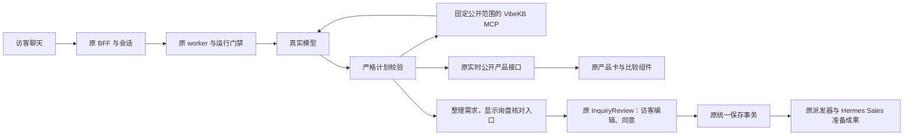

# MIU 4／5a／11：真实模型、VibeKB 与官网完整交互

2026-11-02。沿用 `feat/website-assistant-ui-foundation`，保存端沿用原 Sales 分支。先本地开发和验收，现有 Channel 云库仅写带 TEST 标记的新询盘；不发送真实邮件，不更新现有 Hermes 配置、机器人或其他工作树。

## 实际问题与已核对的代码

`engineFromEnvironment()` 当前只构造 fake／旧适配；Hermes 的实际配置已是腾讯 TokenHub DeepSeek 和 `vibekb-kb` Streamable HTTP MCP。当前主机连通、MCP service active。不能把旧官网代码误说成基础设施仍使用 AnythingLLM。本轮新增独立 VibeKB 适配，继续实现 ConversationEngine；不在通用 port 中放供应商逻辑。

现有前端 `ChatPanel`、`ChatComposer`、`useAssistantSession`、`AssistantMessages`、`InquiryReview`、产品卡／比较／停止／失败恢复已存在。现有 worker 可以将严格产品计划交给 PublicCatalog，但真实模型尚未驱动验收，询盘缺模型整理的多轮需求。复用这些模块，只补缺口；历史恢复仍按用户此前决定暂缓，不擅自开放跨设备历史。

## 本轮界面约束

沿用已批准的 ChatPanel、brand-950／brand-700／accent-500、原字体与固定输入区，不更换视觉风格。真实产品摘要在卡片和比较区最多显示三行，完整内容继续使用原 View product 入口，避免供应商长描述把操作挤出视野。联调页说明由实际运行模式决定，真实模型／云库模式不能继续显示“测试替身”文案。组件仍由原会话 hook 和请求适配器连接。

## 数据与流程

| 内容 | 生命周期与范围 |
| --- | --- |
| 访客消息／run／取消身份 | 原 BFF 和 PostgreSQL；模型不决定权限 |
| 模型计划 | 单次回答内严格解析；只读产品、公开知识、澄清、建议核对询盘 |
| VibeKB workspace 与允许公开的文档 | 服务器固定；模型不能改 workspace、选任意文档或调用写工具 |
| 询盘建议 | 不含联系人，最多 4,000 字；访客可修改，必须核对和明确同意 |
| 已确认表单 | 原 BFF → 原 Channel 事务 → 原询盘／来源／pending；不经过模型，不发邮件 |

## 实施顺序与技术约束

1. 核对现有远端实际协议、只读搜索结果、workspace 和模型调用；凭据不进日志、群聊、Git 或浏览器。优先通过 SSH 临时调用／转发，不复制现有 Agent 的整份环境配置或重启服务。
2. 新 VibeKB adapter 使用官方 MCP SDK 完成 initialize／callTool／关闭；固定只读工具和 workspace，并复核文档归属。模型 API 使用现有 chat-completions 协议，限制时间、轮数、输出和工具次数；不假报供应商端幂等或跨进程停止。会话／重试／取消继续由原 store 和 worker 控制。
3. 增加严格的询盘建议形状，接到原 Review inquiry 与原确认表单。普通咨询不保存，不直接创建 Sales 任务。产品选择与多轮需求可以由模型整理，实际提交权只在人。
4. 使用真实模型、真实 VibeKB MCP、真实公开目录，以及现有 CloudBase 的真实保存。端到端从浏览器输入问题开始；覆盖推荐／澄清／FAQ／无匹配／越界／改需求／比较／确认／重复提交／停止与后续提问。旧 29 屏逐项标明实际服务覆盖与仅预览，不把样例屏当真实后端能力。
5. 两轮代码与业务复核、缺陷注入、原测试和构建、实际浏览器点击与后端读回；通过后分段提交推送原分支，并核对同一 SHA 的远端 CI。

不另造聊天状态机、保存库或 Sales 派发器。MCP 的工具注解不能作为授权；真实门禁是服务器固定工具、参数、范围与结果校验。公开知识不足时给出可继续使用的回答或询盘入口，不能沉默，也不能把内部知识交给模型后仅隐藏引用。
