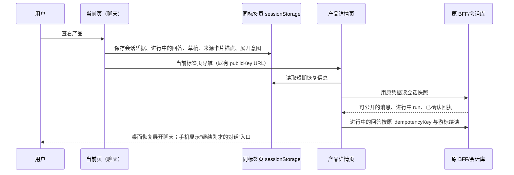

# 官网助手第二轮：整改设计、执行顺序与剩余工作（定稿）

2026-11-02，日本时间。状态：**定稿，负责人已确认（2026-11-02 第二轮讨论后），按 §10 顺序实施**。本版由 Claude 在 Codex 草稿基础上按负责人逐条意见修订，取代草稿，不再交 Codex 复核。

代码基点：channel 整合分支 `feat/sales-assistant` `765c4a65`（= 官网助手 `46895b62` 合并 Channel Sales `e2f55b7c`，见 §12）；Hermes Sales `9c30d4b`（`hermesinfra` `feat/sales-agent-runtime`）。

本版相对草稿的改动：

- §6 点产品：同标签页打开完整产品页并恢复聊天（桌面自动展开，手机显示“继续刚才的对话”入口）。曾评估的页内半屏／侧栏速览因手机上必然遮挡聊天而放弃，不做 Sheet 组件。
- MIU 17 保留“跳页时正在生成的回答接着续上”：现有接口已按幂等键去重并支持 `Last-Event-ID` 续读，成本低于草稿评估。
- MIU 16 冲突处理简化为“显示改了什么＋整体采用或保留＋手改”；MIU 19 用模型返回用量＋保守估算，重点放在结构化需求摘要；MIU 20 的缺陷注入只覆盖七道关键门禁。
- 新增 §12 仓库／分支整合与整理方案（含 Hermes 202 个文件的审计）、§13 环境与权限方案、§14 待确认项。

## 1. 结论与优先级

本轮先把“正常填写能完成询盘”和“点开产品还能接着聊”补成完整体验，再改候选产品的展示和引导。原来的模型、VibeKB、产品 API、会话库、询盘事务、Sales 队列继续复用。

| 用户遇到的事 | 本轮决定 | 优先级 |
| --- | --- | --- |
| 提交后只看到结果未知 | 区分明确拒绝、明确成功、真正未知；测试身份由服务器标记，正常公司名不承担测试开关作用 | P0 |
| 表单遮住整段聊天 | 询盘作为一条可编辑的聊天消息；保留上下文和输入框，取消 Back to chat | P0 |
| 点产品后聊天消失 | 同标签页打开完整产品页，并恢复同一会话、草稿和进行中的回答 | P0 |
| 刷新／跳页丢会话 | 同标签页恢复原会话、草稿和正在生成的回答，不重复调用模型 | P0 |
| 卡片向下堆积 | 每批最多五张，消息内横向浏览；桌面箭头和圆点，手机滑动和下一张边缘提示 | P1 |
| 不知道接下来怎么问 | 每次回答后最多三个与当前需求有关的建议，点击后显示为用户自己的新问题 | P1 |
| 结果不稳定、可能很多 | 限定检索、按可核实条件排序、固定每批顺序；更多结果由用户明确请求 | P1 |
| 记忆和费用不清楚 | 结构化需求摘要＋近期对话；按模型返回用量记账，输入先按 8–16K 预算 | P1 |
| 两个 channel 分支分叉、Hermes 文件过多 | 已建整合分支；Hermes 先整理文档／证据与注册方式，代码结构暂不推倒 | 本轮前置／并行 |
| 当前还有哪些没做完 | 本文件第 8 节统一列出，不将“有代码”“已实测”“已上线”混在一起 | 发布前核对 |

P0 是完整试用的前置条件。P1 同样属于本轮确认后的整改范围，不表示可以一直跳过。

## 2. 提交问题：已核对的原因和改法

### 2.1 当前实际行为

本地聊天在 `127.0.0.1:62683`，保存端在 `127.0.0.1:51184`。本轮只读核对了进程入口与源码。保存端使用 `assistant-inquiry-live.mts`，其包裹原保存事务的规则是：

```ts
// 当前验收 helper 的真实规则，非生产表单规则。
if (!email.endsWith('@example.invalid') || !company.startsWith('[TEST'))
  throw new Error('Live acceptance refuses real customer data');
// 只有通过后才调用原 store.submit(input)。
```

截图中的公司名是 VibeLingan，按此规则会在入库前被拒绝。公司名本身有效；问题在于把内部验收限制带进了人工试用入口。没有取得该次请求的原始网络追踪，也没有为本次诊断写入云库，因此不将“截图里的请求已经保存”当成事实。

异常又经过三层处理：验收入口将非冲突错误统一转成 503；BFF 统一提示无法确认原提交；前端把提交异常放进 unknown。于是，一个明确发生在保存前的拒绝，看起来像网络断开后可能已经写入。这是独立的错误分类和交互缺陷。

### 2.2 测试模式的正确位置

正常填写自己的公司名和邮箱应该能完成手工验收。测试模式由服务器固定的安装身份、`environment=test` 和无发送配置决定，不能由公司名、邮箱后缀或模型猜测决定。

继续使用现有 CloudBase，不要求另开环境。记录归属沿用当前验收 installation；如增加 testRunId，也只能由服务器生成。测试标记与真实业务字段分开，不能悄悄把用户公司名改成 `[TEST]`。后台如何显示测试标记，以现有询盘界面的最小改动实现，不新增任务管理台。

本轮测试服务仍没有邮件发送实现和权限；后续任何真实发送验收另设明确收件地址白名单与独立开关。取消内容层面的 TEST 限制，不等于开启对外发送。

### 2.3 三种结果与恢复方式

| 结果 | 判断依据 | 用户看到什么 | 表单是否可改 |
| --- | --- | --- | --- |
| 明确未提交 | 本地校验失败，或服务明确返回保存前拒绝 | 具体字段／原因；保留输入，可修正后提交 | 可以 |
| 明确已保存 | 校验后的真实回执 | 聊天内的单号与需求摘要 | 原提交只读，可另起新询盘 |
| 暂时无法确认 | 请求可能已到达写入端，但未取得可信回执 | 正在核对这一次提交；显示核对状态，不声称失败或成功 | 原提交冻结，仍可继续聊天 |

200 成功回执形状继续复用。错误沿用现有 error 包装，增加受限的公开分类和结果性质；不把原始数据库异常或凭据交给前端。模型不参与判断是否已入库。

真正未知时，按原 conversation、submissionKey、冻结内容核对。复用原保存层确定性的记录 ID 和 fingerprint，不另建一套询盘库。不存在记录只能说“暂未查到”，不能排除原请求稍后提交。需要重试时也使用同一个 key 和相同内容，不能重新随机生成一条。

建议增加只读结果查询，复用现有归属、回执和 fingerprint 校验。查询记录前核验原会话与可信服务身份。自动核对次数有上限；服务持续不可用时保留原提交标识，给出明确的后续途径，不让按钮无限空转。

## 3. 产品查找与横向卡片

### 3.1 五张是一个批次，不是全部匹配结果

每次先展示最多五款。只有三款就展示三款，不补假卡片。圆点表示当前这批卡片，不表示全站结果数；计数显示“2 / 5”。只有接口提供可信总数时才显示总数，没有时只说“先看这五款”。

不能一次拉回一百款，再在浏览器里藏掉九十五款。复用现有公开目录分页，在服务端执行有上限的候选检索。初始建议最多读取二十个候选用于筛选；是否需要更低上限，由真实延迟验收决定。这是本项目的提议值，不是现在已经实现的行为。

首批结果按照可核实的匹配程度排序：

1. 公开资料明确支持客户已说明的必要条件。
2. 产品类别匹配，但某项能力需要进一步确认；明确标成候选，不能冒充完全符合。
3. 明确不符合必要条件的产品不进入推荐卡片。

同层保持稳定次序。当前接口以关键词查询为主，不能直接宣称已经是全目录语义排名最高的五款。初版不为此另做向量库或把全部产品搬进 VibeKB。

“降噪”需要区分主动降噪 ANC 与通话降噪 ENC。标题中的笼统描述不自动证明两者都支持。必要时先提供耳机候选，同时提示需确认降噪方式；不能因为搜到了耳机就答应某种降噪、认证、logo 工艺或交期。

更具体的问题会形成新的条件版本，结果可能减少；放宽条件时也可能增多。不是每次都强制变少。用户没有改的数量、用途和定制要求要保留。

### 3.2 结果批次保持稳定

建议内部返回形状如下，属于设计 DTO，不是现有接口声明：

```ts
type ProductResultSet = {
  resultSetId: string;
  criteriaVersion: number;
  items: PublicProductCard[]; // 最多 5
  hasMore: boolean;
  nextCursor?: string;
};
```

resultSetId 对应这次用户问题和筛选条件。左右滑动、点圆点、点箭头只是浏览已经取得的数据，不再调用模型、不重新排序、不触发询盘。

用户主动点“再看几款”才取下一批，排除已看过的 ID。cursor 由服务器固定关联查询及会话，不能由模型指定 URL 或其他客户身份。若既有目录只提供 page/pageSize，就在受控宿主中封装，不要求重建目录 API。

后续一批作为下一条正常回答出现；不把同一个轮播无限追加到一百张，也不自动连续加载。旧消息保留原产品和位置；产品更新／下架继续用现有复查逻辑提示，不能把旧卡当成当前报价。

### 3.3 桌面和手机的表现

| 项目 | 桌面 | 手机 |
| --- | --- | --- |
| 排列 | 消息内横向轮播，一张主卡；聊天本身仍纵向滚动 | 同一数据与组件，触摸横滑 |
| 后续提示 | 下一张露出约 12–20px | 下一张露出约 16–24px，形成用户说的叠放边缘感 |
| 控制 | 上一张／下一张箭头，加最多五个圆点 | 滑动与圆点；不依赖鼠标悬停 |
| 高度 | 图片、标题与摘要限高，翻卡不把对话推走 | 短卡片，纵向聊天手势仍可用 |
| 边界 | 到第一／最后一张停住，不循环伪装有更多结果 | 相同 |

不自动轮播。箭头和圆点有键盘／读屏标签，视觉圆点虽小，点击区域至少 44px；支持减少动画设置。横向滚动只存在于消息内，不能把整页撑出横向滚动条。采用原生横向滚动与吸附，避免拦住手机所有触摸事件。

“2 / 5” 放在卡片图片角落，不与五个圆点、两个箭头挤在同一行。窄屏优先保留圆点和滑动；桌面控制行容纳不下时调整布局，不缩小触控区域。

产品卡保留两个动作：查看产品、询这款。去掉 Compare／Selected 选择按钮和单独的 Compare options 区域。已有当前产品读取能力继续复用；用户主动在对话中问差别时仍可回答，不要求先学会勾选两张卡。

视觉沿用现有 ChatPanel、brand 色、字体、边框、ProductThumbnail 和按钮规范，不重做网站风格。不要靠三维堆叠或卡片互相覆盖来实现边缘提示。

## 4. 回答后的三个建议

每次有效回答后最多三个建议，不强行凑满。建议跟随当前缺少的条件变化，不反复问已经确认的东西。

例如首次问“有没有降噪耳机”，可以提供“我更看重主动降噪”“我更看重通话降噪”“先看常见款式”。已经明确 ANC 后，可以改成“需要定制 logo”“我更在意轻便”“再看几款”。这只是交互例子，不能据此说仓库一定有对应库存或工艺。

模型可在同一次计划中提出建议，服务器限制数量、长度和动作种类。点击后展示为用户发出的可见问题，沿用原消息接口和去重；不额外同时请求三个模型回答。若输入框已有文字，不直接覆盖，先把建议放入草稿由人确认。

建议能做的是提问、调整条件、请求下一批。不能把“获取报价”解释成已提交询盘，更不能直接发邮件、下单或批准价格。请求报价最多打开聊天内核对卡，最终提交仍须人明确确认。

建议内部携带 baseCriteriaVersion，旧消息下的建议若已过时，先解释正在针对哪批结果，不把旧筛选条件覆盖最新需求。

## 5. 询盘成为聊天的一部分

当前并没有真的打开另一个网页，但 `inquiryOpen` 会把聊天主体隐藏，换成整块 InquiryReview，所以看起来像去了另一页。设计要改这个交互，不另写一套表单。

复用 InquiryReview 字段、校验、提交 key 和真实保存接口，将其作为一条 InquiryMessage 放进原消息流：

```text
客户：我要 700 件，印 logo，发德国。
助手：已整理。请核对后确认。
[ 询盘核对卡：产品、需求、联系人、同意、确认询盘 ]
客户：包装也要定制。
助手：已更新包装要求，数量仍为 700。请重新核对。
[ 同一张核对卡更新；明确显示变化，不再开第二张 ]
```

聊天输入框保持可用，没有 Back to chat。可用卡片自身的折叠控制收起长表单；不是再新增一个“表单页面”。勾选与提交是业务动作，不能被普通聊天的 Send 替代。

当前活跃草稿用稳定 draftId/revision 关联；产品和需求变化时保留联系人，撤销旧同意。客户自己编辑的内容不能被模型无提示覆盖：显示更改摘要，冲突字段让客户选择。保存中／未知结果时原草稿冻结，但不遮住整个聊天。

产品卡里的“询这款”直接带入该产品。已有另一款未提交草稿时，清楚提示更换产品，不能静默把 A 的询盘改成 B；提交过程中不切换原提交身份。成功后核对卡变成紧凑回执，显示单号、产品和已确认需求；AI 后续说“好的”不会再创建一条询盘。

## 6. 点开产品：同标签页打开完整产品页，聊天接着用

### 6.1 当前缺口

- 产品按钮显式设置 `target="_blank"`，当前确实打开新标签页，原聊天留在旧标签。
- v2 adapter 的会话凭据只在闭包内，页面刷新／跳转会重新创建；`restore()` 现在直接报 "History restore is not enabled"。
- AssistantWidget 只挂在首页、OEM 和耳机页；两类产品详情页没有挂助手。
- 本地 Vite 聊天验收页没有整站路由，`/products/item/?id=...` 返回 404；这不是数据缺失。

已有可复用的能力：回答按 `idempotencyKey` 建立，BFF 返回同一 operation 时不新建 run（`http-adapter.ts` 校验 `operationKey`），事件流用 `Last-Event-ID` 从游标续读；产品详情页 `SkuDetailPage` 已能按 `productId` 读取公开商品。

### 6.2 方案比较与决定（负责人确认）

| 方案 | 做法 | 结论 |
| --- | --- | --- |
| A 同标签页跳完整产品页，聊天恢复 | 保存会话与锚点 → 当前标签页跳转 → 新页面验证后恢复 | **采用** |
| B 页内半屏／侧栏产品速览 | 不跳页，在当前页拉起产品面板 | 不采用，原因见下 |
| C 新标签页（现状） | `target="_blank"` | 不采用：用户感觉聊天消失，回不去 |

不采用 B 的原因（按实际尺寸核对）：

- 手机上聊天面板宽为 `100vw - 2rem`、高为 `min(38rem, 100svh - 7rem)`，几乎是全屏。半屏产品面板只能盖住聊天下半截，恰好是输入框和最新回答；如果改为把聊天顶上去，两边都只剩半屏，都看不全。手机上无论怎样都只能一次看一样，半屏只是多出一个不上不下的状态。
- 桌面上聊天是右下角 24rem 浮窗。跳到完整产品页再展开聊天，左边是产品、右边是聊天，本身就能边看边问，不需要另做侧栏。
- 会话恢复（MIU 17）无论如何都要做（刷新也会丢会话），A 的增量成本小；B 还要另做一份缩略产品视图和叠层管理，没有其他使用方。

因此本轮**不做** Sheet、ProductPeek、叠层栈，`CatalogQuoteSheet` 保持不变。

### 6.3 交互规则

| 情况 | 桌面（≥1024px） | 手机／平板（<1024px） |
| --- | --- | --- |
| 点卡片上的“查看产品” | 当前标签页跳到产品页，聊天自动展开，停在来源卡片 | 当前标签页跳到产品页，聊天收成启动按钮，按钮显示“继续刚才的对话”；不自动展开，以免挡住产品 |
| 在产品页再打开聊天 | — | 点按钮即全屏恢复，停在来源卡片 |
| 离开期间回答写完 | 直接显示最终回答 | 启动按钮上显示提示点 |
| 浏览器返回上一页 | 上一页恢复聊天，停在来源卡片 | 同左，按离开时的展开状态恢复 |
| 浮窗挡住产品右栏 | 1024–1440px 宽度会挡住部分规格／价格，可随时收起；试用后若仍觉得挡，再评估“贴边停靠”（页面让出聊天宽度） | — |

- 不做“把聊天滑到屏幕边缘”的手势：iOS 和 Android 都把边缘滑动当作返回，容易冲突；收起成按钮就是贴边状态。
- 跳页时回答还在生成：到新页面后用原 idempotencyKey 与游标续读，不再调用一次模型（MIU 17）。
- 询盘草稿填到一半：随会话恢复，不丢失。
- 用户长按或用快捷键在新标签页打开：新标签没有本标签页的 sessionStorage，按新对话处理，原标签不受影响。这是有意的，避免凭据跨标签共享。
- 每次跳页要重新读取产品数据，海外访客在 CloudBase 网关上每次多 0.6–3 秒。缓解方式不是另做速览，而是让 MIU 14 的卡片本身带足比较信息（图片、名称、关键规格、MOQ、公开价格档），横滑即可比较，只有要细看某一款才跳页。

### 6.4 完整详情页：同标签页跳转并续聊



- 新增薄的 `AssistantHost`，由首页、OEM、耳机和两类产品页复用；每页只挂一个助手。不改 SEO 共用的 BaseLayout，不在 admin 挂公共客服。URL 复用既有 publicKey 规则，不改 canonical、sitemap、pricing。
- sessionStorage 按站点／业务／协议版本分区，只保存凭据、expiresAt、最后事件序号、进行中回答的 idempotencyKey 与游标、展开意图、来源消息和卡片 ID、必要的未提交草稿。消息正文以服务端会话库为准。凭据不进 URL、日志或模型；服务器仍校验凭据和会话归属。有效期以服务端 expiresAt 为准（默认 24 小时）。恢复只执行一次，找不到锚点时恢复到最新位置并说明。跨设备、跨浏览器、清除存储后的恢复与登录账号历史继续后置。

## 7. Conversation Memory 与成本

### 7.1 先分清三件事

| 内容 | 当前情况 | 提议 |
| --- | --- | --- |
| 浏览器是否接回同一会话 | v2 仅内存，跳页会丢凭据 | 采用第 6 节的短期匿名恢复 |
| 服务端保存了哪些聊天 | 原 PostgreSQL 已存消息／事件 | 继续复用，不因模型少读就删除历史 |
| 每次模型读多少内容 | 查询近 30 条消息，再截最近 20 条；没有长期摘要或输入 token 硬预算 | 最近对话＋结构化需求＋相关资料，按 token 预算选择 |

20 条是消息条数，通常约十轮问答，不是 20K，也不是 256K。目前 1200 的设置是单次模型最大输出，不是会话记忆。

DeepSeek chat-completions 是无状态调用，应用需要把需要的上下文放进每次请求。[官方多轮说明](https://api-docs.deepseek.com/guides/multi_round_chat/)。腾讯标准模型列表当前把同名 V4 Pro 系列列为 1M 上下文；这不是本项目必须使用的容量，也不能单凭标准目录证明当前 plan 账号的实际额度。[模型列表](https://cloud.tencent.com/document/product/1823/130051)。

### 7.2 本项目建议的起始预算

- 普通请求以 8–12K 输入为目标，单次模型输入硬上限先设 16K。
- 一次用户提问可能触发多次模型调用。沿用最多四次的既有上限；整个用户问题的输入累计先限 32K，不能误以为“一轮”只付一次调用。
- 当前每次模型输出约束仍为最多 1200，四次合计上限 4800。正常答案不为凑容量变长。
- 这些是待实现和校准的本项目预算，不是“业界统一客服标准”，也不是已经配置生效。

上下文按以下优先级组织：安全与业务规则、当前用户消息、已经确认的需求和当前草稿、近期对话、这次相关产品／公开知识。历史产品只保留少量 ID 与必要摘要；当前价格、版本和可用性按原接口复查。

摘要保留数量、用途、目的地、预算状态、定制条件、已选产品和仍缺的信息，并记录来源消息。700 替代旧 500；后续聊三十轮也应保留 700。用户明确提供的事实、模型推测和系统已验证事实分开，模型不能通过“写记忆”改变租户、授权、同意或提交状态。

达到阈值时再整理摘要，不每个聊天气泡都额外调一次模型。摘要与产品数据仍按原客户／会话分开；Sales 只接收最终确认的询盘快照，不直接继承官网访客的所有聊天或其他客户的记忆。

发请求前用保守估算决定裁剪（见 MIU 19），实际用量以模型返回的 usage 为准；估算只用于裁剪，不用于计费。预算不足时减少低优先级旧资料，必要时展示已有产品卡／邀请核对询盘；不默默截断当前需求，也不让请求一直等待。

成本示例仅作假设：每天一百个问题、每题两次模型调用、每次八千输入 token，输入合计约 160 万；若每题合计输出八百 token，则输出约八万。最终金额还取决于套餐、模型、缓存和实际调用次数，不把原厂按量价直接套给现有 plan 入口。[腾讯计费方式](https://cloud.tencent.com/document/product/1823/130054)。

缓存可以减少重复前缀开销，但不是应用的永久记忆，不能代替会话库或安全边界。[DeepSeek 缓存说明](https://api-docs.deepseek.com/guides/kv_cache/)。

## 8. 合并后的剩余工作

旧 plan.json 与早期交付有历史状态，不能只读某个 planned 字段就说代码不存在。以下按当前源码与保存的真实验收证据区分。

| 模块 | 已有内容 | 尚未完成 |
| --- | --- | --- |
| 官网问答与工具 | 真实 DeepSeek、VibeKB 只读公开资料、产品 API、停止／错误恢复已有代码和真实测试证据 | 本轮展示、引导、表单、导航、记忆整改；真实整站人工验收 |
| 公开知识 | 固定 workspace、公开文档清单与归属核对 | 目前只启用已确认公开的品牌文档 12；仍需补齐客户认可的 FAQ／服务资料，不直接开放全部内部文档 |
| SG0／SG2 授权与隔离 | 系统门禁、任务授权、客户运行边界、队列／恢复／归档已有实现及测试 | 客户生产身份、独立服务连接、运行账户和部署演练；不把本地隔离运行等同现网已启用 |
| SG1.2 统一保存与通知 | 原事务保存、来源登记、去重通知；真实云库与本地 Hermes 联动已有证据 | 本轮人工提交缺陷、生产开关和定时补偿入口、三种官网入口在发布环境的一致性验收 |
| SG3.2 Sales 准备 | 自动读取询盘／当前产品、真实模型计划、受控模板正文与归档已实测 | 生产接入现网调度与运行账户；更丰富的邮件文案、内容工厂协作不能说已经完成 |
| SG4.1 Resend 草稿 | `resend_drafts.py` 已有固定 Inbox 的 draft-only 适配与消费接线，不是完全没代码 | 客户真实账号连接、发件身份、真实草稿／附件／界面预览验证；无真实发送验收 |
| SG4.2 回信与多渠道联系人 | 已有设计及身份／事件合同 | Webhook 签名、去重、回信关联、新邮件使旧批准失效、多渠道来源与订阅状态同步等正式接线 |
| SG5 审核与发送 | 任务／收件人／版本等合同与规则已设计 | 具体操作者权限、完整预览、企微精确任务操作、网页／企微批准共用状态、真正的发送门禁及结果核对 |
| SG4.3 确认信 | 唯一 Resend 路径与预批准模板的方向已确定 | 模板、唯一发送、旧官网路径切换及双发检查；当前不自动发确认信 |
| SG8 运维与上线 | 代码测试、CI、合成与部分真实链路证据 | 发布迁移顺序、生产接线、告警／用量与成本记录、持久成果保存、灰度及回滚演练 |
| SG6 Apollo | 隔离、客户授权与交接方案已有调研设计 | 实际客户工作环境／授权、活动、回复分类、停发和 Resend 交接实现及账号验收 |
| SG7 其他渠道／客户维护 | 与官网询盘分开、共用底座的设计方向 | 渠道连接、联系人和来源映射、同意／退订规则及维护活动实现 |
| 明确后置 | 之前的暂停／继续／人工接管交互设计保留 | 不因本轮整改重新把这些控制列为首期必做；跨设备历史和完整 Agent 管理台也不顺手扩建 |

官网整改可以先推进，不依赖 Resend／Apollo 的账号。后者进入各自真实接入阶段时再处理授权；不以缺这些账号为由停住当前可做的模块。

## 9. MIU 12–20 执行方案

延续原 MIU 1–11，新增 12–20 表示本轮独立可验收的改动；原 SG 模块不重新编号。每项都完成前后端相关部分、源码复核、针对性测试和浏览器验证，再推进下一项。以下均为计划，不是本轮已执行结果。

### MIU 12：正常填写与明确的提交结果

- 场景／缺陷：截图里的正常公司名触发验收 guard，却被统一显示为 unknown。
- 数据与归属：测试安装由服务器固定；业务字段原样保存；原 submissionKey、fingerprint、回执继续使用。
- 改动位置：Sales `assistant-inquiry-live.mts`、`assistant-intake.ts`；原 BFF inquiry-client／server；前端 adapter、useAssistantSession 和错误展示。
- 核心接口形状：成功沿用原 receipt；错误增加受限 code、`outcome=not_started|unknown`、可选 field、requestId。未知不默认当作未保存。
- 选择：修正测试模式与结果分类，不直接放开任何对外发送，不删除原幂等逻辑。
- 验收：`ordinary_company_in_test_scope_can_submit`、`known_rejection_stays_editable`、`lost_receipt_recovers_same_submission`、`repeated_confirm_has_one_record`；含正常人工资料、提交前拒绝和真实事务读回。
- 依赖：无，第一项。

### MIU 13：候选批次、匹配依据与更多结果

- 场景：一百个匹配不能变成一百张卡；“降噪”不能混淆 ANC／ENC。
- 数据：受控 criteriaVersion、resultSetId、最多五张卡、hasMore／cursor；具体产品事实保留来源和查询时间。
- 改动位置：原 product-workflow、公开 DTO 投影、model plan／prompt、BFF 公开事件及前端结果模型。公开目录若已有分页，直接复用。
- 核心形状：`execute(criteria, cursor) -> ProductResultSet`；最多二十个检索候选、首批五款为待校准起始值。不是遍历全库的承诺。
- 选择：当前目录受控筛选，不新建产品向量库；未知能力明示待确认，不自动扩充成硬事实。
- 验收：`hundred_matches_show_at_most_five`、`next_batch_deduplicates_seen_ids`、`unknown_total_is_not_fabricated`、`anc_is_not_inferred_from_enc`、`swiping_does_not_requery`。
- 依赖：原公开产品接口；不依赖真实邮件账号。

### MIU 14：横向产品卡与操作精简

- 场景：现有 products.map 垂直堆积，Compare 的后果不清楚。
- 数据：每个 resultSet 的 activeProductId／index 属于 UI 状态，不是新的模型消息。
- 改动位置：复用 AssistantMessages、ProductThumbnail 和现有 tokens；抽出薄的 ProductCarousel，业务过滤仍在功能模块。
- 核心形状：`ProductCarousel(items, activeId, onView, onInquiry)`；去掉手工比较选择与固定比较区，卡片保留两个业务动作。
- 选择：原生横滑／吸附，不引入自动播放或整个页面的横向滚动；单卡不显示多余导航。
- 验收：桌面箭头／圆点／键盘、320/390/430px 手机滑动、纵向聊天仍能滚动、减少动画；1／3／5 张卡、长标题、坏图、末张、旧卡下架和无横向页面溢出。
- 依赖：MIU 13 的批次形状。

### MIU 15：情境追问建议

- 场景：回答后用户不知道怎么继续，不能靠增加一排业务按钮解决。
- 数据：最多三条 `{id,label,utterance,kind,baseCriteriaVersion}`，kind 只允许 ask/refine/more；模型不能指定工具或发送动作。
- 改动位置：原 engine plan、公开事件合同、AssistantMessages／会话 hook、现有 composer。
- 选择：同一次模型结果可附建议，点击才发一条可见用户消息；输入框已有内容时不覆盖。过时建议不能回写旧条件。
- 验收：`suggestion_uses_current_missing_need`、`existing_composer_is_not_overwritten`、`suggestion_click_has_one_turn`、`quote_suggestion_never_submits`。
- 依赖：MIU 13；与 MIU 19 的需求记忆字段共用，不另外存一份业务事实。

### MIU 16：聊天内询盘卡

- 场景：当前 inquiryOpen 隐藏消息区；客户不能自然补充需求。
- 数据：一张活跃草稿的 draftId／revision；提交后是不可变回执。联系人与同意有自己的生命周期。
- 改动位置：AssistantExperience、AssistantMessages、InquiryReview、原 inquiry helpers／hook；原保存接口继续复用。
- 核心形状：`messages = [...conversation, InquiryMessage(draft)]`；同一草稿更新，不反复新增表单。Back to chat 不再出现。
- 模型更新草稿时的处理（简化版，已确认）：卡片上显示“本次更新了哪些内容”（旧值 → 新值）；客户可以**整体采用更新**、**保留我填的**，或直接在卡片里手改。不做逐字段的冲突选择界面。客户手改过的字段不会被模型静默覆盖；任何需求变化都撤销已勾选的同意，联系人保留。
- 选择：表单留在聊天内；模型只建议草稿，确认与同意仍由人完成。保存中允许继续问答，不切换原提交内容。
- 验收：`inquiry_is_inside_transcript`、`chat_remains_visible_during_edit`、`model_update_shows_change_summary`、`manual_edit_not_overwritten_silently`、`changed_need_preserves_contact_and_clears_consent`、`two_products_do_not_silently_swap_draft`、`saved_receipt_does_not_resubmit`。
- 依赖：MIU 12；不等 Resend。

### MIU 17：匿名会话恢复与进行中回答续读

- 场景：页面刷新或跳到完整详情页会丢掉仅内存保存的凭据、消息、原提交 key 和正在生成的回答。
- 数据：短期凭据／expiresAt／事件序号、进行中回答的 idempotencyKey＋turnKey＋游标、未提交草稿在本标签页；消息和实际运行状态在原 SQL 库；身份仍由服务器验证。
- 改动位置：原 BFF 增加受保护的只读 snapshot，复用 store 查询与公开投影；adapter 实现 `restore()`，加严格版本化的 sessionStorage helper。
- 核心接口形状：`GET conversations/{id}/snapshot?anchor=messageId`，使用原授权头；不把 credential 放 URL。实际路由沿用现有 `/api/ai/v2` 风格。
- 进行中回答（保留，负责人确认）：恢复后用原 idempotencyKey 调用现有 turn 接口，BFF 返回同一 operation／run，再用 `Last-Event-ID` 从保存的游标续读。不新建模型任务。实现时先补 BFF 测试锁定“同 key 不新建 run”，再接前端。run 已结束则直接显示结果；已失败／取消则显示原状态和重试。
- 选择：同标签页恢复，不接入登录／跨设备历史；未知提交在刷新后仍使用冻结的原身份。没有凭据不能查询记录。
- 验收：`refresh_resumes_same_conversation`、`foreign_credential_cannot_read_snapshot`、`expired_session_is_not_silently_resubmitted`、`inflight_reply_resumes_without_second_model_run`、`finished_run_during_navigation_shows_final_answer`、`unknown_submission_survives_refresh_with_same_key`。
- 依赖：MIU 12 的提交身份与结果模型。

### MIU 18：同标签页打开产品页并续聊

- 场景：现有链接开新 tab，产品页未挂助手；Vite 人工入口产品路由 404。
- 数据：导航意图含来源消息／产品／批次锚点和展开意图，授权来自原凭据（MIU 17 的恢复数据）。
- 改动位置：AssistantMessages 产品按钮改为同标签页导航并先保存锚点；薄的 AssistantHost 与五个挂载页；ChatPanel 启动按钮的“继续刚才的对话”状态和提示点；真实 Astro 手工入口和固定公开读取配置。
- 核心流程：`saveAnchor -> sameTabNavigate -> verifySnapshot -> restore -> scrollToAnchor`。单纯看产品不请求模型。
- 选择：见 §6。不通过全局重写 BaseLayout 改动 SEO；每页一个 widget；不做 Sheet／速览；CatalogQuoteSheet 不变。
- 验收：`product_link_navigates_same_tab`、`desktop_restores_expanded_at_source_card`、`mobile_shows_continue_launcher_not_expanded`、`launcher_marks_answer_finished_while_away`、`back_restores_previous_page_chat`、`navigation_mid_answer_has_no_second_model_run`、`navigation_mid_save_keeps_same_submission`、`new_tab_starts_fresh_conversation`、`direct_product_visit_has_single_widget`、`missing_anchor_restores_latest_with_notice`；320/390/430/768/1024/1440px 截图核对；公开页 SEO 合同与构建。
- 依赖：MIU 17。与 MIU 14 共享按 productId 的卡片锚点。

### MIU 19：结构化需求摘要、有效上下文与用量

- 场景：早期需求落出近 30 条消息窗口后会丢；目前没有输入预算。
- 数据：按 conversation 隔离的结构化需求（数量、用途、目的地、预算状态、定制条件、已选产品、缺失项，每项带来源 turn 与“客户明确／模型推测／系统核实”标记）、当前版本、每次调用的 provider usage；联系人和权限不进入业务摘要。
- 改动位置：ai-policy 的上下文组装、ai-store 最小持久化扩展、VibeKB engine 输入／usage、worker 的每问题累计预算。复用已有事件和 run 标识。
- 计量（简化版，已确认）：发请求前用保守估算（按字符估，中日韩字符按 1 字 ≈ 1 token 上限计，其余按约 3 字符 ≈ 1 token），只用来决定裁剪哪些低优先级内容；实际费用以模型返回的 usage 记账。不接入专门的分词器。
- 核心形状：`buildContext(current, needState, recent, evidence, budget)`；已确认与推测分开，按优先级裁剪：规则 → 当前消息 → 需求摘要与草稿 → 近期对话 → 相关产品／资料。
- 选择：8–16K 有效输入起点，单问题累计 32K；摘要在阈值触发时整理，不是每条消息都多调一次模型；如需模型整理，计入同一费用记录。先不新增跨客户画像或通用长期记忆。
- 验收：三十轮后仍保留数量／目的地、700 不变回 500、不同访客不串记录、长资料不会挤掉当前需求、每问题 2–4 次调用的 usage 累计正确、预算耗尽有可继续的降级结果。
- 依赖：原会话库；与 MIU 13／15 使用同一份需求结构。

### MIU 20：按真实使用路径整合验收

- 场景：此前技术链路通过，却漏掉正常公司名、产品跳页及试用入口差异。
- 范围：真实 Astro 首页 → 真实提问 → 五张以内卡片 → 横滑／追问 → 同标签页打开完整详情页并续聊 → 聊天内询盘 → 后台读回 → 自动 Sales 待审核成果。
- 选择：自动化和人工试用分开记录；人工入口不再用只有聊天页的测试壳冒充整站。
- 必测：正常公司名、已知拒绝、回执丢失、重复确认、导航时还在回答／保存、切换产品、报价／交期不瞎承诺、产品下架、移动端键盘、20/30 轮记忆、不同访客与租户隔离。
- 缺陷注入（只做关键门禁，已确认）：目的是证明“测试真的会抓到问题”。做法是一个脚本对代码打一个很小的补丁，故意拆掉一道保护，只跑对应的测试文件，期望它失败，然后还原。测试失败记为 killed（测试有效）；测试仍通过记为 survived（这道保护其实没被测到，必须补测试）。只做以下七项，每次发布前手动跑一次，不放进每次 CI：
  1. 去掉五张上限 → `hundred_matches_show_at_most_five` 必须失败。
  2. 重试时改用新的 submissionKey → `repeated_confirm_has_one_record`、`lost_receipt_recovers_same_submission` 必须失败。
  3. 快照接口不校验凭据归属 → `foreign_credential_cannot_read_snapshot` 必须失败。
  4. 需求摘要用旧数量覆盖新数量，或需求变化不撤销同意 → 700/500 与同意撤销测试必须失败。
  5. 去掉单问题预算门禁 → 预算测试必须失败。
  6. 测试身份改回按公司名／邮箱判断 → `ordinary_company_in_test_scope_can_submit` 必须失败。
  7. 恢复时不带原 idempotencyKey → `inflight_reply_resumes_without_second_model_run` 必须失败。
  记录每项的 killed／survived／invalid（补丁没打上），不只报测试总数。全模块的变异测试不做。
- 依赖：12–19。发布另需 SG8 的生产部署与回滚验收，本单元不自动发邮件。

## 10. 实施顺序与交付门槛

0. 已完成：channel 整合分支 `feat/sales-assistant`（§12.2）。
1. 整理提交：§12.3 的 channel 部分；§12.4 的 H1、H2 在 hermesinfra 分支。
2. MIU 12，解除当前无法提交的阻塞。
3. MIU 17 → MIU 16 → MIU 18。
4. MIU 13 → 14 → 19 → 15。
5. MIU 20 整站回归与七项缺陷注入。
6. Sales 流程开发完成并可部署后，再做 H3（登记 Sales agent）。

每个单元都要说明实现位置、复用部分、实际通过的检查、尚未实测的边界；通过后提交并推送 `feat/sales-assistant`。遇到 pricing／SEO 的不可兼容冲突，先停止这部分整合，不改他人工作。全部完成后从 `feat/sales-assistant` 向 main 开一个 PR。

拟复用检查包括：site 单测／typecheck、assistant 浏览器套件、worker／BFF／store 测试、Sales 保存与 SDK 合同、函数打包 smoke、定向缺陷注入、公开页 SEO gate 和构建。测试运行库与人工会话库继续分开；真实邮件发送保持关闭。

## 11. 核对资料与文字复核

本轮实际查阅：ConnectedAssistant、AssistantWidget、AssistantExperience、AssistantMessages、InquiryReview、useAssistantSession、http-adapter、BFF inquiry 分支、Channel assistant-intake／assistant-inquiry／live helper、ai-policy、store 上下文查询、产品页与公开 SEO 合同、Sales 当前真实验收清单、Resend draft-only 代码及旧模块计划。旧计划与新证据冲突时采用源码和较新的真实记录，并保留历史文档。

具体措辞修正：把“数据库里可能没有产品”改为“当前 Vite 聊天入口的产品路由实测 404”；把“所有提交异常结果未知”分为明确未写入、已保存与真正未知；把“20 轮记忆”校正为“20 条消息”。

UI/UX Pro Max 的本地检索用于核对错误反馈、键盘和触摸操作。其避免整页横向滚动的建议不禁止用户指定的消息内轮播。参考 [W3C 轮播交互规范](https://www.w3.org/WAI/ARIA/apg/patterns/carousel/) 中的控制、可访问标签与位置说明；本产品选择不自动轮播。

定稿修订：第 6 节、MIU 16–20、第 10 节按负责人 2026-11-02 意见重写；第 12–14 节为新增，依据整合分支合并结果、Hermes 分支逐文件统计和源码核对。

## 12. 仓库、分支与整理

### 12.1 各部分在哪里

| 部分 | 仓库／分支 | 内容 |
| --- | --- | --- |
| 官网助手（询盘前半段：客户与我们的第一轮交互） | channel `feat/website-assistant-ui-foundation` | 前端组件、BFF、worker、会话库、VibeKB engine |
| Channel 侧 Sales 落盘 | channel `feat/sales-agent-integration` | `apps/functions/sales-integration`、`packages/sales-contracts`、`packages/db` 的 sales-inquiry-*、后台询盘摘要 |
| Sales Agent 运行时（处理落盘记录、生成内容） | hermesinfra `feat/sales-agent-runtime` | `deploy/hub/sales_flow`，独立 HTTP 服务＋worker＋专用 MySQL |
| VibeEntAgentsFoundation | 独立仓库，与 hermesinfra 没有共同提交历史 | “Vibelingan Enterprise Brain” 需求文档与 `feature/phase1-mvp`（Go 控制面，最后提交 2026-08-20）；无 Sales 代码，不引用 channel，本轮不涉及。交接里说的 “Foundation／Hermes Infra” 指 hermesinfra（负责人另一台机器上的本地目录名） |

### 12.2 channel 分支决定（已执行）

两个 channel 分支严重分叉：官网助手分支基于当前 main，Sales 分支基于 10-21 的 main，落后 668 个提交。MIU 12 要同时改两边，分开做必然重复解决冲突。

决定：新建 `feat/sales-assistant` = 官网助手分支 **merge**（不 rebase）Sales 分支，已推送远端（`765c4a65`）。用 merge 是因为两个分支都已推送，rebase 42 个提交会在每个提交上反复解决冲突并改写他人可见历史。之后 MIU 12–20 都只在这个分支上做，两个旧分支冻结保留作参考；全部完成后一个 PR 合入 main。

合并结果：

- 9 个冲突文件（admin handler／入口、public-api、local-server、后台 RecordForm、db 导出、锁文件、一份计划文档），都是两边各加了不同内容，保留双方。
- 合并暴露两个真实问题并已修：`sales-contracts` 引入的 `jsonc-parser` 默认入口是 UMD 构建，打进 admin 云函数包后冷启动报 `Cannot find module './impl/format'`，改为引入它的 ESM 构建；admin 入口合同测试补上新的 sales 配置依赖。
- 检查：全仓 typecheck 通过；根目录与各包单测 1264 项通过；`apps/site` 当时有 103 项失败，后查明是本机未安装 Playwright 的 Chromium／WebKit；安装后 1506 项全部通过，不是代码问题。

### 12.3 channel 侧整理（已确认，第一个提交）

- 先在整理前的提交上打归档 tag `archive/process-evidence-2026-11-02`，再从分支删除过程文件；需要时用 `git show <tag>:<path>` 取回。
- 删除被强制提交、但本在 `.gitignore` 里的文件：`output/` 下 93 个设计截图／PDF（约 11MB）和 `.claude/` 下两份本地复核记录。
- 归档 `docs/sales-agent/evidence/`、`docs/sales-agent/diagrams/*.visual-check.*` 截图，以及 `docs/sales-agent`、`docs/ai-platform/assistant-ui` 里逐轮的计划／交付／验证文件；各目录 README 改为“当前状态＋设计索引＋归档说明”。
- 让脚本不再往 `docs/` 写证据：Sales 的两个缺陷注入脚本默认写到 `output/sales-agent/`，CI 上传路径同步改。
- `AGENTS.md` 与 `CLAUDE.md` 写明不提交本地产物；CI 增加检查：`git ls-files -ci --exclude-standard` 有输出即失败。

### 12.4 Hermes 202 个文件的审计

| 类别 | 文件 | 行数 | 说明 |
| --- | --- | --- | --- |
| 验收证据 `docs/sales-agent/evidence` | 74 | 12.5K | 每轮测试的 JSON 报告 |
| 计划／交付文档 `docs/sales-agent` | 31 | 1.8K | 每个 SG 一份计划、一份验证、一份交付 |
| 测试 `deploy/hub/tests` | 37 | 9.7K | 单测、MySQL 事务、端到端 |
| 代码 `deploy/hub/sales_flow` | 54 | 11.6K | 约 30 个 Python 模块；约 20 个是从 channel 按 sha 固定复制的合同 schema／fixture；一个 1.8K 行的测试用例 JSON |
| 工具与 CI | 5 | 1.9K | E2E、缺陷注入、真实 channel 验收脚本、独立 CI |

结论：

1. **没有动 main 的架构。** 对已有文件的改动只有 `regression.yml` 加两行依赖安装和 `.gitignore`；Hub server、agent 注册表、dispatcher、现有 14 个 agent 都没改。
2. **一半以上是过程文件。** 105 个文件是文档和证据，这是 Codex“每步都留证据”的工作方式造成的，不该进 main。
3. **代码量对需求来说不算离谱，但它是一套平行系统。** Hub 现有的 `hubkit/taskqueue` 是按聊天消息判断忙闲的轻量队列，不适合需要幂等、可审计、按客户隔离的询盘处理，所以单独做服务有道理。问题是 Sales 没有作为 agent 登记到 `deploy/hub/agents/*.json`，现有协调层看不到它。
4. **授权层偏重。** 5 个 sales-auth-* schema 加 lease／permit／handoff 多层授权，是为多客户、多运行账户设计的；当前只有一个负责人部署，偏重。但它已有测试、涉及安全，本轮不推倒。

整理方案（在 hermesinfra `feat/sales-agent-runtime` 做，负责人已确认）：

- H1（现在做）：先打归档 tag `archive/sales-agent-evidence-2026-11-02`，再删除证据与逐轮文档，只保留 `sales_flow/README.md`、一份 `IMPLEMENTATION.md`、一份证据索引（写明 tag）；预计减少约 100 个文件。从 channel 固定复制的合同文件是代码在用的，保留。
- H2（现在做）：`preparation-cases.json` 等测试数据移到 `tests/fixtures`。
- H3（Sales 流程开发完成、可部署后再做）：按平台标准 `deploy/create_agent.py` 登记 Sales agent（分配端口、起容器、写 `hub/agents/{id}.json`、注册进 Hub）。现在只登记 JSON 会让 @ 提及和协调路由指向一个没人接的目标，所以推迟；之前只用 `--dry-run` 核对与标准接入的差距。事务处理仍走它自己的服务，不改走 taskqueue。
- H4（后置）：等 SG8 确定真实部署形态后，再评估把多层授权合并简化。

## 13. 环境与权限

原则：能本地就本地；真实云端只在需要真实读回时使用；密钥尽量不离开原主机。

| 组件 | 现在怎么做 | 什么时候要真实环境 | 需要你做什么 |
| --- | --- | --- | --- |
| 助手会话库 Postgres | 我在本机 Docker 起一个专用容器（与 kidsbuddy／coachflow 的容器分开） | 不需要 | 无 |
| 询盘保存 | 开发和测试走 local-server 的本地 JSON 库（`LOCAL_DB_FILE`）＋测试替身 | MIU 20 后台读回 | 见下方 CloudBase |
| 产品数据 | 公开 API 只读，沿用 `.env` 里已有的 `PUBLIC_CB_PROXY` | 不需要登录 | 无 |
| 模型（DeepSeek）与 VibeKB | 测试用假 engine；真实问答沿用 Codex 的方式：经 SSH 连到 Hermes 主机，密钥留在那台机器上，不复制到本机 | MIU 13／19 检索验收、人工试用 | 明天给一个 SSH 主机别名（在 `~/.ssh/config` 里配好，加上本机公钥） |
| Hermes Sales 运行时 | 本机 Docker MySQL 跑它的测试 | 全链路时与 channel 联调 | 无 |
| CloudBase 账号 | 暂不需要 | MIU 20、或需要查真实询盘记录时 | 一次浏览器登录，见下 |

CloudBase 账号与环境（负责人确认）：

- channel 使用的是挂在环境所有者主账号下的**协作者账号**，权限由主账号授予；本机 CloudBase CLI 用这个协作者账号在浏览器登录一次，凭据保存在本机。无法也不需要另建子用户。登录后先确认 CLI 能看到环境；看不到时显式传环境 ID。
- 不能新建 CloudBase 环境，所以**继续只用现有一个环境**（它同时是线上站）。CloudBase 是无服务器的：云函数、NoSQL 和静态托管都绑在环境 ID 上，没有“实例”和“端口”可以另开。因此：
  - 日常开发与测试全部在本地完成（local-server JSON 库、本机 Postgres、测试替身），线上产品数据只读。
  - 写入线上库只通过已部署的函数，测试数据由服务器端测试身份标记（MIU 12），写入前后做只读核对，写入需负责人点头。
  - 部署照旧只靠快进 `test` 分支；不用 CLI 部署。
- Hermes 在另一个账号的服务器上，本身就是每个 agent 一个容器、一个端口。需要测试实例时，在同一台机器上另起一套 sales_flow（另一个端口、独立 MySQL 库、独立配置），不影响线上 agent。经 SSH 访问，不需要那边的云控制台。

## 14. 确认记录

2026-11-02 负责人第二轮确认：

1. §6 产品交互：同标签页打开完整产品页并续聊；不做页内半屏／侧栏速览。
2. §12.3／§12.4 的整理：channel 移除强制提交的 `output/` 等文件并归档过程文件；Hermes 现在做 H1、H2，H3 推迟到 Sales 流程完成，H4 后置；AGENTS.md／CLAUDE.md 增加不提交本地产物的规则并由 CI 检查。
3. §13：CloudBase 用协作者账号登录；不新建环境，谨慎使用现有环境；Hermes 测试实例可用另一端口。
4. §10 的顺序。MIU 20 缺陷注入按七项执行。

本文件即为最终版本；后续变化直接修改本文件并在此追加记录。

## 15. 执行记录

每个单元完成后在此追加：做了什么、改在哪里、实际跑过的检查、没有实测的边界。不另建逐轮文件。

### MIU 12（2026-11-02）

- 测试身份：去掉验收入口里“公司名以 `[TEST` 开头、邮箱以 `@example.invalid` 结尾”的限制。测试状态只来自服务器固定的测试安装：新增 `testScopeInquiryStore`（`apps/functions/sales-integration/src/assistant-intake.ts`），非 test 安装直接拒绝启动。业务字段原样保存。
- 结果分类：保存层只在写入前的确定性拒绝时抛 `AssistantInquiryRejected`（`INVALID_DETAILS`／`PRODUCT_UNVERIFIED`／`NOT_ACCEPTING`，`packages/db/src/assistant-inquiry.ts`）；保存端返回 422 `not_started`，其余失败一律 `unknown`。BFF 只在收到格式正确的 `not_started` 时转发 422 `INQUIRY_REJECTED`，错误包装增加可选的 `outcome`／`reason`（`packages/ai-contracts`）。
- 页面：明确未提交 → 表单重新可改，显示原因，同一 key 可提交修正后的内容；结果未知 → 冻结原内容，按 3s／8s／20s 自动用同一 key 和内容核对三次，之后显示核对码并保留“Check again now”。一旦某次尝试结果未知，之后即使收到拒绝也不解冻。
- 与设计的差别：没有另做只读查询接口。保存按 key 幂等，“用同一 key 和相同内容再提交”本身就是核对，已有归属、指纹校验，少一条路由。后台测试标记推迟到 MIU 20：当前项目行没有 environment 字段，加字段会改动 Sales 合同。
- 检查：db 2485、sales-integration 115、ai-bff 17（本机 Postgres）、ai-contracts 6、site 1506、根目录脚本 1264、助手浏览器 90 项全部通过；site typecheck 和改动文件 biome 通过。新增测试：`ordinary_company_in_test_scope_can_submit`、`known_rejection_stays_editable`、`lost_receipt_recovers_same_submission`，以及拒绝原因、未知不解冻、BFF 422／503 映射。`repeated_confirm_has_one_record` 由原有的并发重试与浏览器账本测试覆盖。
- 未实测：真实 CloudBase 读回与正常资料的人工试用，等 MIU 20 用协作者账号登录后做。

