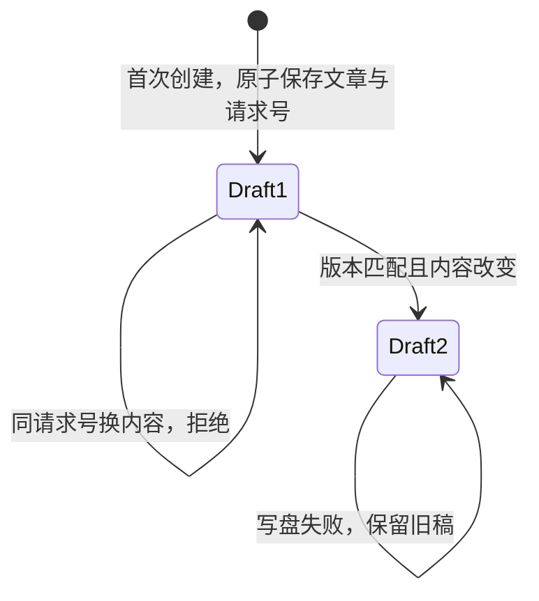

# 后台草稿保存：本轮结果

2026-10-22，沿用 `feat/seo-foundation`。本轮从 `cbe38b9dbeffdf90ec86d12ae09a720818d97cc9` 开始，没有合并 main 或 pricing。

## 现在能做什么

管理员可以通过现有 `/api/admin` 的 `articleDrafts` action 创建、读取、列出、保存和预览草稿。权限仍由原有 JWT 和当前账号记录决定；本地存储在实际读写时再次检查账号。普通会员、停用或删除的账号会被拒绝。

创建请求按操作者和 requestId 去重。两个请求同时创建同一篇草稿，只得到一篇；重启后重试也一样。重用请求号却改了正文会冲突。再次发送旧创建请求会返回当前草稿，不会把正文恢复成第一版。

保存使用 expectedRevision。在同一文件锁内读取旧版本、调用文章核心、原子写回；两个旧版本保存只能有一个成功。冲突返回当前版本；相同正文不会增加版本。写文件失败会保留旧稿，可以重试。

列表只返回摘要，按唯一编号翻页，游标绑定查询条件。预览只返回指定修订的正文 JSON 和媒体编号。文章集合未加入通用 CRUD，客户端不能借另一个入口绕过权限或版本检查。

文章请求数据限 256 KiB，本地单条记录限 384 KiB。读取时重新校验存储数据；损坏记录会明确报错，失败读取或重试不会清空、覆盖原文件。这些是本轮保守限制，不能代替 CloudBase 平台上限核对。

## 实际修改

- `packages/articles` 增加文章存储接口、服务、摘要、运行时校验和安全错误识别。
- 本地 JSON 适配器复用已有文件互斥和原子替换，没有另建锁或内存数据库。公开版本引用和旧快照在编辑草稿后保持不变。
- admin handler 在原有身份复核后接入操作；本地入口注入真实本地适配器。未配置文章存储的云函数入口返回明确错误。
- 本地文章响应禁用缓存，并按错误返回 400/401/403/404/409/500；其余旧操作不改 HTTP 行为。
- admin 函数把文章工作区包打进产物，新增检查会遍历每个函数的全部工作区依赖，防止遗漏。

真实 HTTP 测试发现过一次单元测试没发现的问题：CJS 后台和 ESM 本地模块分别加载错误类，`instanceof` 没认出版本冲突，返回了 500。现在用共享 Symbol 标记及错误码、修订号校验识别这类错误；真实 HTTP 请求已验证返回 409。

## 验证结果

| 检查 | 实际结果 |
| --- | --- |
| 新增后台操作测试 | 16 通过，包含权限、重试、跨实例并发、列表、预览、请求限制、损坏记录、CRUD 旁路和 Unicode 查询 |
| 新增本地适配器及 HTTP 测试 | 5 通过，包含公开快照保持不变、落盘失败重试、记录大小、按账号去重和完整服务器入口 |
| 新增函数打包规则 | 1 通过，实际检查所有函数的工作区依赖 |
| 故意破坏保护 | 8 项全部被断言检出：管理员权限、请求大小、保存版本、重复创建内容、账号停用、记录大小、快照摘要、模块边界错误识别；源码逐字恢复 |
| 全仓 `pnpm test` | 3,289 总计，3,286 通过、0 失败、3 个既有跳过 |
| 全工作区与 E2E 类型 | 通过；使用直接的固定版本 pnpm 命令 |
| Biome | 897 个文件通过，没有关闭规则或忽略新文件 |
| `pnpm verify:cloudbase-sdk` | 通过；没有修改 SDK shim 或云端方法合同 |
| 三个函数构建与打包 | 通过，没有残留工作区 import/require |
| Node 20.19.0 产物检查 | 三个函数均通过冷启动；公开商品/变体读取及缺集合负向检查使用离线传输，禁止真实网络 |

使用 Node 22.13.0、pnpm 11.5.0；Node 20.19.0 只用于函数产物检查。没有新增第三方包，锁文件只增加两个工作区依赖。具体命令和临时日志在当前实例的 `/workspace/channel-onboarding/logs/`，源码及测试已留在仓库。

## 尚未完成

UI 没有变化。后台编辑器、图片选择、网站文章和 Hermes 都没接入；不能说客户已经能在页面里写文章。

真实 CloudBase 适配器、集合、权限、云端事务和上线验收尚未完成。本轮没有登录腾讯云、创建资源、部署 test、操作生产或启用恢复。下一步先核对真实数据库合同，再按模块 02 的 BLOG-D2 实现适配器和离线测试；现场操作仍需明确授权。

## 工作流安装和审查

已找到用户 GitHub 中的 `orocsy/dev-pipeline` 和 `orocsy/engineering-craft`，分别固定到 `cb3cf82436aa895a9a38bf16ef7a5efed993b209` 和 `9851782b7bc318cdf985d2888a12e15f4e55489c`。归档 SHA-256、安装来源及 Codex 适配入口都已纳入交接。两个工具装在忽略提交的 `.agents/skills/`，没有执行上游全局安装器；11 项安装器测试通过，重复安装保持一致。这里安装的是可直接读取的流程和技能，未注册 Claude 命令或自动钩子。

按用户指定的 full pipeline 逐项对照了已有需求、设计、任务拆分、先失败后通过的测试、实际接口、影响范围、交付和交接。也读取了 Engineering Craft 的并发、验证完整性、跨文件接口和推送前检查，以及仓库自己的 `docs/ENGINEERING_CRAFT.md`。已批准的模块 02 设计和本轮本地范围继续有效；由当前会话直接审查，没有另开分支、代理或 PR。

### 草稿状态与并发

任一草稿状态下，账号删除、停用或降级都会在实际存储操作中被拒绝。get/list/preview 不改状态；修改草稿不修改公开版本引用和旧快照。两个相同创建请求同时到达，返回同一篇文章；两个不同内容的保存竞争同一版本，断言恰好一个业务成功。当前保证来自本地单进程所有权、共享文件互斥和原子替换；不能把它称为已验证的云数据库 CAS。真实数据库事务和多实例竞争留在 BLOG-D2。

### 需求、接口和证据

| 范围 | 实现和检查 |
| --- | --- |
| 当前管理员才可操作 | handler 沿用 JWT + revalidateSession；仓储 requireAdmin 再检查；后台测试覆盖旧令牌降级、停用、删除、未登录和第二次检查 |
| 创建可安全重试 | 操作者/requestId 配对、初始正文摘要和同一原子写入；测试覆盖同时创建、重启、异内容冲突及跨账号隔离 |
| 保存避免覆盖 | 版本比较和写回在同一文件事务内；跨适配器竞争断言一个成功，冲突给当前版本；相同正文与失败重试均有测试 |
| 列表只给摘要 | 显式字段投影、唯一 id 排序、查询绑定游标；测试覆盖分页不重复、正文不外泄、坏游标和 Unicode 查询 |
| 预览只给指定草稿修订 | 指定修订校验、正文 JSON 和媒体编号去重；测试覆盖过期修订拒绝，不给私有 URL 或 HTML |
| 限制及损坏记录 | 严格 Zod 请求、256 KiB 请求限制、384 KiB 记录限制和读取重验；边界及损坏后不覆盖测试 |
| 不越过其他入口 | articleDrafts 仅在需要登录的 action 分支；文章集合不进入 CRUD 注册表；后台测试逐项拒绝通用 CRUD 旁路 |
| 不修改公开版本 | 保存保留 published；只读旧快照重验身份及内容摘要；适配器测试覆盖保持不变和篡改拒绝 |
| 错误跨模块保持含义 | handler → ESM 仓储 → CJS 错误识别 → errorStatus；真实 HTTP 测试验证 no-store、401 和带版本的 409 |
| 工作区包进入函数产物 | admin 声明并内联 articles；运行时合同遍历三个函数所有 workspace 依赖；真实 Node 20.19.0 冷启动通过 |
| 第三方接口核对 | 未增加第三方依赖或 CloudBase 调用；沿用已安装 Zod 的严格对象/联合解析，Node 标准 crypto/Buffer；类型、行为测试和 SDK 合同检查通过 |
| 影响范围 | articles/shared 被 admin、本地服务及网站消费；全仓测试、全工作区和 E2E 类型检查均通过；没有删除或重命名页面选择器 |

浏览器视觉检查和新前后端表单合同检查不适用：本轮没有 UI 或新客户端。实际后台多步骤路径由真实服务器 HTTP 测试覆盖，未把旧页面测试当成草稿编辑器验收。没有新增生产环境变量、邮件/OTP 入口或外部集成，不触发相应资源/密钥配置。不能把“无新 SDK 调用”写成 CloudBase 存储已完成。

实际运行安装后的 `tools/run-craft-gates.sh`，传入包括新文件的变更清单和本地 Engineering Craft 模板目录。七个扫描器均正常执行：异步子组件检查通过；流程因果、表单降级、测试跳过、边界解析分别报告 1/4/5/2 条，均为仓库原有 `.claude/gates/baseline.json` 中的记录，且不在本轮修改文件中。基线保持原样，新增发现为 0。没有为新问题写豁免。probe-sensitivity/family-registry 因仓库未配置而报告不适用，不能当成已经覆盖；本轮的 8 项实际破坏检查、按入口列出的权限/CRUD 测试和动态函数依赖合同提供对应证据。更大范围的全 action 注册表不在本轮引入。

本记录报告的是本地实例检查。远端 CI 必须按本轮提交的准确 SHA 重新读回；无法读取时明确记未验证，不引用历史运行冒充新结果。
