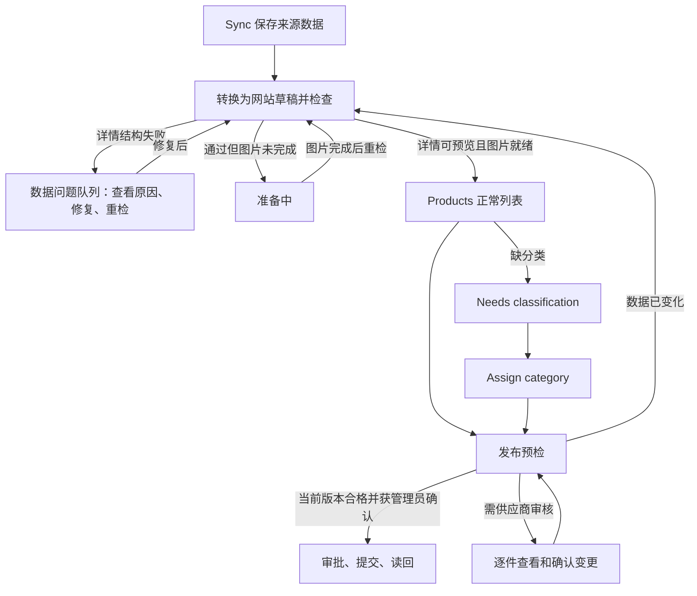

# 网站草稿准入、详情校验和批量发布修复方案

> 当前实施候选已整合为 [Catalog 发布可靠性整合方案](PUBLISH_RELIABILITY_PLAN.zh-CN.md)。本文件保留历史提案/审查记录，不再单独作为实施依据。

状态：设计提案，尚未实施或部署。2026-10-13。

工作目录：`/Volumes/Lexar-Mac/Projects/channel/.claude/worktrees/customer-service-agent-phase2-9e0b73`。
分支：`feat/catalog-alibaba-price-tiers`。设计基线：`a3ce01e046d20145d6c3ba9e7b9b2a2e17ff1c10`。

## 建议

在来源数据转网站草稿时运行网站详情检查，正常 Products 列表只接纳通过该检查的待发布草稿。无法构建详情的记录进入独立的“数据问题”队列，仍能查看字段和修复原因。发布前及编辑后使用同一份准备计划重验；批量发布先汇总可发、需处理和已变化的商品，再逐件提交。

分类 mapping 负责分类；网站草稿投影负责把来源信息转换为网站数据。这次需要在后一个边界补上检查，不能只在分类映射表里增加一个通过标记。

超限是上轮合成数据已复现的失败路径。T142、T157 真实请求只证明 prepare 返回 VALIDATION_ERROR，W203 只复现了单件预览失败。三件实际的字段根因仍待确认；本设计覆盖详情构建、暂存数据校验和版本变化，不把某项超限当作已经确认的根因。

## 当前行为及缺口

| 当前代码 | 已核实的行为 | 需要改变的部分 |
|---|---|---|
| `linking.ts:300-311` | loadAlibabaObservation 只检查来源 observation 合约 | 另行生成网站准备计划，保留完整来源数据 |
| `linking.ts:413-568` | 已观察的来源可创建未发布网站草稿，分类只补充字段；observation 为 null 时也有标题回退 | 失败/缺失来源记录保持可追踪，不能自动成为正常待发布商品 |
| admin `handler.ts:1462-1466,1502-1505` | 列表与待审核计数目前只通过 hidePreparing 排除图片准备中的草稿 | 列表、搜索、分页总数及审核计数使用统一的新准入条件 |
| `catalog-detail-source.ts:163-169` | 构建器错误包含字段原因，prepare 丢弃这些原因 | 返回分阶段、分字段问题，日志保留安全诊断信息 |
| `AdminDetailPreview.tsx` | 首屏走 prepare → review；失败时整个网站布局预览不可用 | 不依赖有效详情 DTO 的问题查看和编辑入口始终可用 |
| `ProductClassificationEditor.tsx:472-501` | 先确认分类保存成功，随后批量发布，再读回 | 保留这项分类保存语义，发布前增加预检和版本确认 |
| admin `api.ts:656,679-691` | 当前最多 20 件，并发 4；每件独立发布 | 大批次由有持久进度的作业分段处理，不能只增加请求上限 |

同步合约宽于网站展示合约本身合理：同步要保留来源证据，网站需要可展示、可审批的数据。缺口是没有做完整投影检查，就把草稿当成可以操作的商品交给用户。

`detailSourceReady` 当前仅表示来源页已暂存齐全，不等于完整网站详情通过校验，也不等于已发布。保留它的原意，不能直接作为新列表准入标记。

## 用户可见流程



- 正常 Products 列表中的未发布商品必须能够通过当前版本的网站详情结构校验。尚缺分类的合格草稿保留在现有 Needs classification 中，用户需要从这里完成 Assign category。
- 数据问题入口显示数量、商品名、失败阶段、字段标签、限制及处理办法。入口可放在现有 Products 状态筛选/提示区；复用 CollectionView、Filters、RecordForm 和现有提示组件，不新建一套页面视觉。
- 数据问题队列是显式模式，由后台查询返回；不能在浏览器收到一页后再过滤。否则每页数量、总数和全选会不一致。
- 问题详情使用独立的安全字段查看器，读取名称、来源状态和结构化问题。它不调用必须成功解码的网站详情组件才能显示。Edit 仍可进入草稿修复；失败不会只剩一句通用报错。
- 修复属于网站可编辑字段时，显示编辑入口；属于来源 SKU/价格冲突时，显示重新同步或待系统修复；不要把所有错误都指引成“去 Edit”。
- 已发布商品收到有问题的新来源数据时，公开版本继续使用已批准的数据，后台显示“新数据有问题”。不因新数据校验失败而自动下架、替换已批准版本或清除供应商审核标记。此类新稿不能批量重新上线。

“详情可构建”“分类完整”“媒体就绪”“需要管理员审核”“本次提交是否成功”分别记录。有效主分类 Misc 加上 None 子分类，按目前规则不能被判为详情结构错误。

## 一个网站准备计划，所有入口复用

建议从现有 prepare 逻辑提取无副作用的 `buildCatalogPreparationPlan`，随后用 `planCatalogDetailApproval` 验证最终生效的内容。来源转草稿、图片准备完成、预览、草稿保存/已发布保存、发布预检、正式审批均使用该计划。只读检查不得导入图片、标记已审核、增加公开引用计数或发布。

计划先按现有字段归属形成生效内容，再验证网站契约：名称、描述、网站价格及管理员选择的照片遵守现有管理员编辑规则；供应商规格、配置和来源价格按现有规则进入候选。未被选择用于网站的供应商长描述可以留在来源检查记录中，不能仅因它超过旧网站描述长度而拒绝管理员已经保留的有效网站描述。来源 SKU 等实际进入候选的错误必须阻止该候选。

以下为目标类型示意，不是已实现接口：

```ts
type CatalogIssue = {
  code: string;
  stage: 'source' | 'projection' | 'content' | 'media' | 'classification' | 'approval';
  path: string;
  severity: 'error' | 'warning';
  expected?: { maxCount?: number; maxChars?: number; maxBytes?: number };
  observed?: { count?: number; chars?: number; bytes?: number };
  remedy: 'edit-website' | 'refresh-source' | 'assign-category' | 'review' | 'system-fix' | 'retry';
};

type CatalogReadiness = {
  schemaVersion: 'catalog-readiness-v1';
  status: 'checking' | 'ready' | 'blocked' | 'stale';
  inputDigest: string;
  policyVersion: string;
  checkedAt: string;
  previewReady: boolean;
  publishEligible: boolean;
  issueCount: number;
  reportId?: string;
};
```

`ready` 表示准备计划当前通过；仍需分类、图片、权限和供应商审核均满足，才有 `publishEligible: true`。它不承诺之后数据库不会忙或来源不会变化。

产品行保存有界的 readiness 摘要，列表无需逐条读取 observation。完整报告按 productId/sourceKey + inputDigest + policyVersion 存在管理员可读、通用 CRUD 不可写的记录中；问题很多时分页，并给出真实总数。

inputDigest 覆盖来源身份及生效内容、网站草稿字段、分类/分类表版本、媒体绑定、转换策略和详情合约版本。不要只依赖 checkedAt、updatedAt 或一个布尔值。共享图片公开引用计数的正常变化不改变内容指纹；提交时仍检查当前图片状态和锁。

同步、管理员编辑、分类修改、媒体绑定变化都会令旧检查失效。生效内容写入与撤销旧 ready 结果应进入同一个受版本保护的 mutation，不能在内容提交后依赖一次可能失败的 best-effort 标记。检查完成后只在输入指纹仍匹配时写回结果。更旧的一次检查不能覆盖新数据的结果。浏览器不能提交一个 ready 标志来绕过后台计算。

来源 observation 在独立集合中更新时，也必须利用现有一对一 source link，核对 link 身份后在同一个受 lease/version 保护的事务中撤销该商品旧的 readiness；没有已链接商品时，后续 materialize 按新来源检查。不能等较晚的 promotion 才撤销 ready，否则更新窗口内列表仍会放行旧结果。这里仅撤销新稿检查结果，不动当前公开审批版本。

## 超限的处理和内容存储

当前网站合约包括属性名 200 字符、属性值 2000 字符、属性数量 100、descriptionText 30000 字符；暂存审批还有单配置 128 KiB、job 512 KiB 的应用保护。这些是本仓库的合约和预算，不是腾讯云平台统一规定的业务字段长度。

| 数据 | 推荐处理 | 不能采取的处理 |
|---|---|---|
| HTML 包装、重复空白、确切重复的属性 | 在可追踪的转换规则中安全清理；来源原件保留。只有值与意义完全相同才去重 | 删除冲突值后假装数据一致 |
| 长描述、较长的说明型属性、超过一屏的规格列表 | 保留全文和顺序，转换为正文/规格分节，按字节预算分页存储、按需显示 | 默默截断、只保存前 100 个属性 |
| SKU 身份、选项标签、名称等有界标识字段异常 | 明确报字段问题，要求来源/映射/用户修正 | 把冲突 SKU 截短或随意改名，造成错误匹配 |
| 价格阶梯重叠、币种或数量格式错误 | 阻止进入可发布状态；合法无价商品继续支持 Request a quote | 将坏价格改成 0 或只取一档让校验通过 |
| 大量 SKU、合法价格阶梯 | 保留全部配置/价格语义，分批处理；全量计算同一版本的列表价格摘要 | 只用第一批配置计算最低价或 MOQ |
| 来源图片多于网站选择数量 | 来源完整保留，网站选择遵守既有图库/描述图规则并显示选择结果 | 自动把任意图片追加到公开页面，或把“来源图片较多”当成全商品不可用 |

长内容采用显式的新详情合约版本，建议 v4。v1-v3 保持原有解码规则。新版本区分摘要和全文引用，不能偷偷把旧字段的完整描述语义改成截断摘要。

建议新增 `catalogDetailContentPages`（名称待实施时按项目规范确认）：

```ts
type CatalogContentBlockV4 =
  | { kind: 'heading'; id: string; text: string }
  | { kind: 'paragraph'; id: string; text: string; partIndex?: number }
  | { kind: 'fact'; id: string; name: string; value: string; partIndex?: number };

type ContentPage = {
  productId: string;
  revision: string;
  section: 'description' | 'specifications' | 'packaging';
  page: number;
  contentHash: string;
  blocks: readonly CatalogContentBlockV4[];
};
```

网站摘要只用于卡片/首屏；全文按 section + page 读取。长段落可拆为带续段标记的块，保留字符、顺序和语义；不得把所有长字段统一塞进一个“超限 JSON”。块、页、整件商品都必须有字节和数量预算。新预算根据真实字段分布和最大页性能测量确定；本提案不凭三个失败商品猜测新上限。

审批先写入该 revision 的不可变内容页和有界 manifest，再在现有审批完成事务中切换已批准版本。最终事务不一次写入全部正文/全部商品，也不进行外部调用。失败或中断时，新页不可公开，旧版本继续可读；相同 operationId 重试核对相同页面 hash。manifest 自身也必须有界，不能通过分页正文把超大对象转移到 job。

公开页只允许读取当前已批准 manifest 引用的内容页，验证 productId、revision 和页 hash，延续发布与媒体访问规则。raw evidence、来源 HTML 和私有 storage 地址不能混进公开内容页。价格、MOQ、列表摘要仍来自同一已批准版本。

## 编辑和批量发布

### 编辑

网站字段可以在草稿中保留不完整值用于修复，同时返回字段提示并撤销 ready 状态。保存草稿不等于批准发布。已发布商品的 Save 继续走现有管理员审批语义；失败时公开版本不更新，界面明确“草稿已保存，网站版本未更新”。Contributors 的权限和已存在的供应商逐字段审核规则保持。

检查不能只放在前端：用户改数据、其他管理员并发保存、sync 更新来源、分类表归档，都必须在后台正式提交时重新确认。

### Assign category → Save and publish

保留现有分类保存成功后再发布的语义。先在现有 Confirm save and publish 面板中，针对用户所选的目标分类做无副作用预检，展示每件发布资格和问题。用户确认后保存分类，再用保存回执所指的产品版本重验；结果和用户确认的集合一致就继续发布，不新增一次固定确认。结果变化时停止受影响的商品并更新面板。分类可以已保存，但发布失败时必须明确区分两种结果。

批量确认不能只显示“将发布 N 件”。应显示可发布数、数据问题数、需逐件供应商审核数、已变化数，并列出需处理原因；用户明确选择“发布通过的商品”后才提交通过集合。

同一批每件保持独立结果。准备检查全部通过也不等于最终写入必定成功：提交时仍检查权限、来源和草稿指纹、媒体锁、已批准 revision，冲突沿用 BUSY 及既有读回规则。字段错误不自动重试；瞬时忙可以重试；版本变化返回“资料已变化，需要重新检查”。已成功商品不能在重试剩余商品时重复发布。

超过 20 件时采用持久化发布作业：冻结商品 ID 和用户确认的版本，分段最多 20 件、并发上限初始沿用 4；每件 operationId、状态和回执持久化。刷新页面可恢复，不以浏览器内存中的 for 循环作为进度。作业最大件数和请求预算由后台配置并强制执行，验收至少覆盖 20、50、100 件，不承诺无限批次。新增作业推进复用项目的有界继续执行模式，不擅自打开既有关闭的 timer。

## 实施单元及可独立验证的交付

### MIU R1：保留失败字段，问题商品仍可查看

Runtime：用户打开时钟 Preview，prepare 返回无具体字段的通用报错。

当前风险代码：

```ts
if (!candidate.ok) return { ok: false, code: 'VALIDATION_ERROR' };
```

Data：内部 issue 具有 stage/path/约束和处理办法，按输入版本保存；API 返回安全 issue/reportId，日志仅记录商品 ID、阶段、字段路径和约束，不记录 token、raw payload 或签名链接。

Design：为构建器错误、SourcePageSchema 错误、暂存一致性错误分别保留原因；预览失败呈现可编辑的诊断面板。不要通过 catch-all 把程序异常伪装成用户填错。

Code translation：改 `catalog-detail-source.ts`、共享错误 DTO、handler 错误映射、AdminDetailPreview；详情查看器独立于 CatalogDetail 解码。

Alternatives：只改通用英文文案仍无法诊断；只增加服务端日志仍使用户无法自助处理。SDK/storage 新能力 N/A，此单元只传递已有校验结果。

Risk/test：真实三件 source observation 重放，明确真实错误字段；合成 101 属性/2001 字符/30001 描述用例返回具体 stage/path；无授权、私有值和 HTML 不能泄露；只读查看零发布/图片导入/审核写入。定向命令复用 Node 24 + `node --import tsx --test`，覆盖 source 与 preview API 测试。

### MIU R2：统一准备计划和版本化检查结果

Runtime：同步通过、mapping 成功，但同一版本无法预览；管理员保留有效文本也可能被未采用的来源文本拦住。

Data：上文 CatalogReadiness、CatalogIssue、准备计划和 inputDigest；归属为单一 sourceKey/productId，actor 权限另行检查。

Design：提取纯准备计划，先解析实际生效的内容，再调用既有详情/审批校验；所有准备消费者复用。照片绑定与内容投影分别报告。检查结果 CAS 写回，同数据/策略版本重复检查幂等。

目标调用形状：

```ts
const plan = buildCatalogPreparationPlan(serverReadInputs, policy);
const report = validatePreparationPlan(plan);
await storeReportIfInputStillMatches(report.inputDigest, report);
```

Code translation：catalog-import 的候选构建、shared 的审批计划、admin prepare、DB readiness facade；不要再维护一套只在 mapping 用的近似 Zod schema。

Alternatives：提升所有字段上限没有解决合约分歧；只用 updatedAt 不能识别来源/策略/分类表变化。技术限制：生产 list 需要有界的行摘要，完整 observation 校验不放进每页 N+1 查询。

Risk/test：所有消费者对相同 effective input 得到相同 issue；来源更新/管理员编辑/媒体绑定/分类表版本使旧结果失效；未采用的新描述不阻止保留的网站文本；不同 source/商品报告不能串用；无价/零 SKU 的合法商品通过。

### MIU R3：正常长内容的完整分节存储

Runtime：合法供应商长文或较多规格超过紧凑详情 DTO 的预算，用户仍需要完整内容。

Data：新详情合约 v4、按 revision 不可变的 ContentPage、有界 manifest；来源 raw 与网站批准内容分离。

Design：将文本/规格按语义和字节预算分页，检查全量配置价格；审批分阶段写页，完成时切换 manifest；前端按需加载完整内容。沿用已经存在的不可变 configuration revision 思路。

目标形状：`stageContentPage(productId, revision, page, hash)` → `sealManifest` → 现有 approval finish。SDK 只沿用已核实的 doc get/set 与事务能力；不能在事务里用 where 取全量页面。

Code translation：shared detail/publication schemas、catalog-import structured-content、DB staging/storage、public detail allowlist/页面端加载器、网站详情组件。引入新集合前明确建表/索引、权限和清理，不假设写入自动创建集合。

Alternatives：静默截断会丢数据；把限制整体调大仍导致超大 job/响应；直接公开 raw storage 路径不符合批准版本与私有媒体规则。

Risk/test：100/101 属性、2000/2001 属性值、30000/30001 描述、Unicode 跨段、冲突重复值、长文分页最后一页；拼接后与批准全文一致；中途断开、缺页/hash 错、旧新 revision 串页均拒绝新版本公开；v1-v3 老版详情继续正常。

### MIU R4：列表准入、编辑及批量发布使用检查结果

Runtime：问题草稿进入正常列表，用户批量发布后才知道哪些商品不能构建详情。

Data：列表模式 normal/issues/preparing 与服务端匹配总数；批量预检结果含 productId、inputDigest、eligibility、issues、operationId；超过 20 件的作业和逐件结果持久化。

Design：新/增量来源及媒体完成触发重检；正常草稿列表要求有效检查结果；失败队列一直可修复。Assign category 回执更新后预检；用户确认通过集合后逐件正式审批并读回。Changed/Removed 继续逐件审核，ready 不绕过 DEC-19。

目标查询形状：normal draft = 当前有效 readiness + 已完成媒体准备；issues = 当前 blocked；published = 当前公开版本有效，可另带新稿问题提示。筛选、排序、分页、计数都在 DB 查询层匹配。

Code translation：linking/promotion/photo-preparation、admin list/review summary、DB 查询条件和索引、CollectionView/RecordForm/ProductClassificationEditor、单件和批量 API。UI 状态由后台返回，不能自己假设 ready。

Alternatives：仅禁用发布按钮不能保证直接 API 安全；完全丢弃问题来源会失去修复入口；浏览器拆成 5 次 20 件请求缺乏恢复和去重。

Risk/test：正常列表不混入 blocked 草稿；needs-classification 中仍能预览并分类；旧 live 新稿坏保留旧 public；20/50/100 件混合有效、无效、BUSY、版本变化；刷新、双击、部分成功后重试剩余、停在第 21 件后恢复；分类已保存与发布未成功的提示准确。

### MIU R5：历史数据检查与启用

Runtime：老商品没有 readiness 字段，直接要求它会使旧草稿或已发布商品突然消失。

Data：按稳定 _id 游标的检查作业、policyVersion、处理结果和断点。缺字段 = 未检查，不等于通过或失败。

Design：先在影子模式检查全部历史来源，汇总字段长度/数量/字节分布及问题类型；重放三件时钟。审阅后仅写 readiness 元数据，不批准或改内容。问题队列及索引已可用、覆盖率核对完成后再启用草稿列表准入。新变化继续触发失效和重检。

目标形状：`plan(afterId, policyVersion)` → 审阅报告 → `applyReadiness`，写回核对 inputDigest。回滚仅关闭新列表准入，保留诊断记录，不回滚/改写公开审批版本。

Code translation：基于已有 audit/backfill 的有界分页模式，新增 readiness backfill 和 dry-run 报告；新索引及列表开关配置。部署/运行回填不属于本次设计执行。

Alternatives：把缺字段默认 ready 会放过全部旧问题；直接默认 blocked 会在队列未准备好时隐藏全部旧草稿。

Risk/test：缺字段、半途停止、重跑、同一游标重复、检查期间源数据变化；数量覆盖与稳定排序；backfill 不改变 published、已批准 revision、分类、图片公开引用计数；开关回滚后可恢复管理。

依赖顺序：R1 → R2；R3 基于 R2 形成的真实分布和严格内容合约；R4 接入 R2/R3；R5 在 R4 的问题入口可用后启用列表准入。R1 要先给出三件真实商品的字段结果，才能宣称这次故障根因已修复。

v4 需先部署兼容 v1-v4 的读端，再启用 v4 写入。声明为 v4 的批准版本若解码或页校验失败，读端明确拒绝，不能落回未审批的 row 数据。已有 v4 公开记录后，回滚列表准入开关不等于可以把读端降级为只认识 v1-v3；读端兼容性必须保留。

## 验收与发布边界

必须同时验收：来源完整保存、正常列表可预览、问题队列可查看和修复、同一候选多入口校验一致、编辑使旧检查失效、批量预检/逐件审批/剩余重试、老公开版本不受新来源错误影响、长内容完整分页，以及旧数据迁移和开关回滚。

实施时先跑对应 node tests，再按仓库要求跑 typecheck、lint、`pnpm verify:cloudbase-sdk`、函数打包和 local admin E2E。SDK 检查是实施门槛；本轮没有修改代码，不把这些待跑验收描述为已通过。

最后才做隔离云验证与真实后台授权验收：按原要求从 Assign category → Save and publish 操作，核对列表/详情/回执，并把测试商品恢复未发布。20/50/100 的合成或隔离环境用例不能代替真实生产验收。

## 约束核对与未决项

当前 SDK 包已从安装路径核对为 `@cloudbase/node-sdk@3.17.2`、`wx-server-sdk@4.0.2`；wx 安装源码存在 runTransaction 包装。`pnpm list` 因本地 store SQLite 无法打开失败，随后用 Node 模块解析核对版本；没有修改依赖。

Context7 工具当前未提供。已使用 CloudBase 官方知识库，并核对[官方事务文档](https://docs.cloudbase.net/database/transaction)：事务有操作数/时间限制，事务内不能使用 where 全量查询。这支持本设计沿用分阶段写入与短事务切换；现有 128/512 KiB 是应用预算，不能标成云平台字段限制。新增 SDK/存储调用仍须在实施时按 `docs/CLOUDBASE_SDK_CONTRACT_VERIFICATION.md` 完成精确契约核对。

尚待真实数据决定：哪些字段实际超限、各字段分布、长内容页预算、单作业最大件数。严格 SKU/价格问题按错误处理的原则、保留全文的原则、失效重检规则和列表分流设计不依赖这些未知值。

最重要的边界：列表通过预检只能保证该输入版本符合结构和业务规则，无法保证未来提交不遇到并发变化或服务暂时忙。正式发布必须继续校验。新准入机制不等于“任何失败都不再发生”。

## 设计阅读与措辞检查

实际对照：现有 AGENTS/Engineering Craft；single-source-of-truth 的 DEC-11/12/15/18/19/20/21；旧 new-product review queue 与当前 linking 实现；handler 列表/计数；cloudbase adapter hidePreparing；ProductClassificationEditor；AdminDetailPreview/approval API；source observation/detail candidate/structured-content/descriptions；shared detail/publication/pricing/public-version；DB source staging/detail staging/immutable variant storage；本次三件诊断记录。

具体措辞修正：“mapping 成功就能发布”改为“分类已映射、网站候选通过检查、媒体就绪及管理员审批是不同状态”；“超限导致三件时钟失败”改为“超限路径已合成复现，三件真实字段根因仍待确认”。当前 Product photos UI 的 ready to publish 文案也应改成仅描述图片就绪。

本轮没有新建分支/worktree，没有修改业务代码、执行部署或运行生产回填；仅形成该设计提案。
