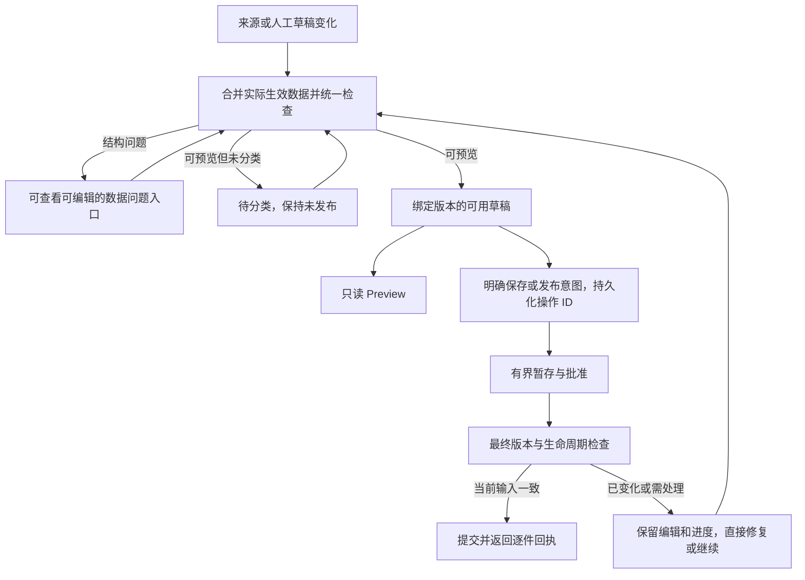

# Catalog 发布可靠性整合方案

状态：用户已于 2026-10-13 批准实施，当前实施中。P1a-e/P1f1-f2、P2a-b、P2c1/P2c2a-f、P3a-c、P4a 已完成对应本地子单元；各大 MIU 的其余门槛及真实 test 验收尚未完成。执行证据见 [实施记录](IMPLEMENTATION_LOG.zh-CN.md)。

本文件是本轮唯一实施方案，替代 `PUBLISH_READINESS_PROPOSAL.zh-CN.md` 的初稿建议。详细验收范围见 [测试矩阵](PUBLISH_RELIABILITY_TEST_MATRIX.zh-CN.md)。当前工作目录为原 Claude checkout，分支 `feat/catalog-alibaba-price-tiers`，审查 HEAD `39705e2323d51d4aa79f1240d66f65608f407649`；正常已部署基线的最近观察为 `a3ce01e`。这些标识在实施开始前须重新核对。

## 1. 审查结论和交付目标

方案可以沿现有“来源数据 → 网站候选 → 分阶段审批 → 批准版本”的结构修正，**目前不把分开存储长内容列为必做项**。本轮复核确认了编辑、重试及检查失效的具体风险，原提案需按本文件修改后实施。三件时钟的真实字段根因已取得：113/121 条来源规格项超过网站 100 行上限；P1b 保留原属性结构、将 facts 容量有界调整到 256；完整数据副本的本地审批与 150 项组合测试已通过，仍未部署或现场修复。证据见 [P0/P1b](P1b_REAL_CLOCK_REPAIR.zh-CN.md)。

把“正常操作 0 错误”作为发版门槛：所有列入支持范围的正常功能、入口、数据形态和并发场景，必须零产品缺陷、零未解释失败、零假成功、零数据丢失。普通瞬时冲突由系统恢复，用户不应反复刷新或去 Edit 补做正常流程。数据冲突、权限拒绝、用户填错及外部服务中断必须有明确结果和可继续的入口。有限测试不能证明未来永不发生任何故障，不能用这句要求作无法兑现的保证。

同样不能通过隐藏合法商品、截断内容、取消并发、绕过审批或跳过测试来满足零错误指标。合法但较大的内容若属于实际支持范围，必须完整处理后才算完成。

设计复核阶段只形成设计和离线反例。用户之后批准按 MIU 实施；提交、测试、部署及商品操作的实际状态统一记在实施记录中。




## 2. 已核实问题与保留的修复

| 编号 | 结论及证据等级 | 风险 | 方案处置 |
|---|---|---|---|
| D01 | **观察：** 来源 observation 校验与网站 detail 校验不同；`detail-candidate.ts` 在合并管理员字段之前解码来源描述/规格；`detail-approval.ts` 之后才替换网站名称、描述、图片和价格 | 未实际采用的来源字段也可能拦住有效网站版本；同步成功不保证可预览 | 先构建实际生效数据，再运行唯一网站校验；来源原件另按来源契约保留 |
| D02 | **离线复现：** `api.ts:542–545` 的分类编辑刷新在读到 live/pending 后再次写 `published:true`，没有版本条件 | 并发下架可能被旧刷新请求重新发布，P1 | 编辑刷新意图不写发布开关；所有入口携带版本和明确生命周期意图 |
| D03 | **独立复核：** 同一反例的最终无保护写入经真实 `planCatalogProductSave` 返回 ready/published=true；加入旧版本条件后返回 stale | 上述风险不能仅靠当前后台批准内容指纹挡住；该指纹有意不包含 published | 在写入层核对操作意图、生命周期版本和内容版本；不能仅靠浏览器按钮禁用 |
| D04 | **离线复现：** `api.ts:581` 手工商品保存响应缺 updatedAt 时将 guard 设为 undefined，随后无保护发布，P2 | 响应异常会让已有保护静默关闭 | 手工/Alibaba 路径同样严格；缺版本先查询同一操作结果，不继续写入 |
| D05 | **观察：** `CollectionView` 普通 Edit 调用 updateRecord 未传编辑开始版本；分类发布有独立 guard | 两个编辑表单可能互相覆盖；不同入口保护不一致 | Edit、创建后发布、行开关、批量、Preview approve 使用同一操作接口 |
| D06 | **观察：** ingest 先写 observation，后续才 reconcile/promote 产品；raw replay、tombstone、通用 observation upsert 也会写来源 | readiness 若只在 promotion 后失效，会放行旧 ready；单纯事务读取来源不能当串行化证明 | 来源写入与已绑定产品 generation/失效在同一受保护事务提交；最终提交与它竞争同一产品记录 |
| D07 | **观察：** 图片引用锁的内部 catch 把获取锁时的事务冲突转成 INTERNAL_ERROR；外层 BUSY 映射无法接管 | 正常并发编辑仍可能报通用失败 | 清理已获得的锁后，仅将确定事务冲突映射 BUSY；其他损坏/不明结果保留独立恢复状态 |
| D08 | **观察：** Preview 当前调用 prepare，会写暂存来源和配置；诊断补丁仍未覆盖 review/begin/finish 的所有拒绝原因 | 预览与写入混在一起，问题原因仍可能丢失 | Preview 走无业务副作用的计划读取；暂存只属于审批操作；所有阶段使用结构化问题 |
| D09 | **推导：** 所有列表行逐件检查完整来源、每次发布再导入图片，或给共享 readiness/taxonomy 加全局写锁都会拖慢并放大冲突 | 新设计可能重演“单件正确、批量失败” | 行摘要查询；每件版本检查；复用现有媒体准备；发布不增加全局 fence 写入 |
| D10 | **已验证保留：** 离线“重试读回另一件商品”的反例被 getRecord 的 ID 检查挡住，测试通过 | 不能把已经正确的保护误报为 bug | 保留并扩充为 ID + operation + 批准 revision 的结果证明 |
| D11 | **上轮现场观察：** T142/T157 prepare 返回 VALIDATION_ERROR；三件 Preview 失败；T142 Edit 能加载；T142 新取 HTML 约 1.6 万字符 | 不能据合成超限或通用提示断言实际根因 | P0 已取真实 observation 并复现 facts 数量上限；P1b 保留完整属性结构、容量和本地审批/组合测试通过，该样本不触发 L1；现场修复仍待后续门槛 |

离线反例执行：3 个检查，2 个失败揭示 D02/D04，1 个通过确认 D10。使用真实 api.ts 函数和模拟网络响应，没有调用线上接口；D03 另用真实后台纯保存计划核对。它们是设计证据，不是修复通过证据。

必须保留 DEC-19/20/21 和 OWN-1：精确来源值的 Keep/Use 决策、配置照片归属、共享照片无变化不写入、删除先查未完成审批任务、审批 1 小时有效期及既有删除宽限、四件并发、有界 BUSY 重试、结果不明时诚实查询、贡献者不批准。历史复盘中价格两份来源、New 草稿被分类发布一概拒绝、19 张描述图误拒绝、图库未预备、私有图走公开地址、GIF 扩展名与真实类型、删除回执 SDK 形状等案例，逐项进入矩阵，不能因主诉是时钟而漏掉。

## 3. 统一规则：字段、状态、版本和操作意图

### 3.1 实际生效的数据只有一套解释

提取 server-only 的 `buildCatalogPreparationPlan(serverReadInputs, proposedEdit?)`。它先按照当前字段归属合并来源及管理员选择，再校验最终网站形态；不得复制另一份只供 mapping 使用的近似 schema。

- 来源完整性、身份、SKU/报价关联先验证；原始响应和未采用的来源文本保留私有。
- 网站名称/描述、人工价格、图库/描述图及配置照片遵守现有人工字段归属与 Keep/Use 规则。
- 来源规格、SKU 选项和来源报价完整进入实际候选；所有配置都检查，不能只看首批 20 个。已有手工配置若被正常 UI 暴露，也要有无损的共享合约投影；不能等发布时才告知“不支持”，更不能丢行后批准。数据语义未定义时须在 P0 解决支持范围，不能静默从矩阵排除。
- 网站内容、分类完整度、媒体可用性、供应商待审核和权限是不同检查维度。Misc/None 合法；无主分类允许正常查看与保存草稿，但不能发布。
- 正常 Preview 读取计划，不导入媒体、不批准、不修改 published、不偷偷保存编辑；审批阶段才保存不可变配置与批准版本。
- 列表、Preview、Edit 的预检、单件发布、分类发布、批量发布与正式审批使用同一规则。后台正式提交不信任浏览器的 ready 标志或 DTO。

目标接口示意（实施时须补 Zod 契约）：

```ts
type ProductIntent =
  | 'save-draft' | 'refresh-live' | 'publish'
  | 'unpublish' | 'archive' | 'restore-draft';

type PreparationReport = {
  productId: string;
  inputDigest: string;
  policyVersion: string;
  previewReady: boolean;
  publishEligible: boolean;
  issues: readonly CatalogIssue[];
};

type CatalogIssue = {
  code: string;
  stage: 'source' | 'effective-content' | 'classification' | 'media' | 'commit';
  path: string;
  severity: 'error' | 'warning';
  expected?: { maxChars?: number; maxCount?: number; maxBytes?: number };
  observed?: { chars?: number; count?: number; bytes?: number };
  remedy: 'edit' | 'classify' | 'retry-media' | 'resync' | 'review-change' | 'system-repair';
};
```

错误由受控 code/path/数值约束生成友好文案；直接截短 Zod message 不等于安全脱敏。日志和响应不输出 token、raw payload、私有字段值或存储签名链接。

### 3.2 三条状态轴，不能压成一个 ready

| 状态轴 | 状态 | 规则 |
|---|---|---|
| 当前草稿可用性 | unchecked/checking/ready/blocked/stale | ready 只对绑定 inputDigest 和 policyVersion 有效 |
| 发布状态 | draft/live/archived | 来源同步及 readiness 回填不改变它；恢复 archive 得到 draft，不自动发布 |
| 用户操作 | accepted/preparing/approving/committing/succeeded/needs-action/expired | 一次操作有稳定 ID；结果查询与继续执行分开；结果不明不是 rejected |

ready 表示可构建，不等于有分类、有发布权限或无需供应商审核。供应商新稿坏时，当前 live 版本保持正常；后台另报新稿问题。所有待处理项都可打开独立问题面板和草稿编辑，不能依赖先成功解码网站详情才能显示修复入口。若批准版本本身损坏或缺失，不能回退未经批准的原始 row 假装正常；实施前审计需识别并单独修复，不把新增 readiness 字段的缺失误判为批准版本损坏。

### 3.3 版本失效须在写入层完成

复用现有产品 revision/身份 CAS，增加有界的内容 generation 和版本化检查摘要。区分内容版本、生命周期版本、分类 revision、来源 revision，避免简单共用 updatedAt 造成审批自己的暂存写入使自己过期。

| 写入入口 | 同一受保护提交内必须做的事 |
|---|---|
| 来源 ingest/selected sync/raw replay/通用 observation 写入/tombstone | 核对 source/link/lease；写来源新 revision；若仍是该产品主来源，推进产品 generation 并撤销旧检查；不改已批准内容或 published |
| link/unlink/主来源变化 | 核对旧 link 与产品身份版本；写新归属；推进 generation；旧来源任务不能再写此产品 |
| Edit/人工价格/图库/描述图/配置照片/供应商决策 | 校验编辑开始版本；保存有效草稿，推进相关 generation 并撤销旧检查；一次写入不能留旧 ready |
| 分类保存 | 复用分类专用事务和 taxonomy 保护；更新分类 revision；内容检查与分类资格分开；无语义变化不制造无谓写入 |
| 分类表修改 | 不全量重写所有产品的内容检查；分类资格按当前规则检查。新增归类需要既有 assignment fence；普通发布不反复写共享 taxonomy |
| 检查结果写回 | 只在 product/source/link/generation/policy 均仍匹配时写回；过期计算丢弃，不能覆盖新结果 |
| 最终批准/发布/下架 | 在数据库写入层检查该操作绑定的版本与生命周期意图；与来源失效及其他管理员编辑竞争同一产品记录 |

必须集中来源写入接口，并用 repo 搜索生成消费者清单验证覆盖；包括 runner 的删除标记和 replay，不只 ingest。仅靠事务读取 observation、异步失效标记、TTL 或时间戳均不足以证明没有旧 ready 窗口。商品创建与 source link 绑定时要读取同一来源 revision，防止绑定瞬间遗漏失效。

共享图片 refCount 的正常增减不改变内容 generation；图片绑定/人工选择的变化才改变。媒体状态和锁在提交时仍须即时检查；不对数百件共用图片的商品做同步全量失效写入。分类准备沿现有专用事务处理，不能把分类 registry 的共享写锁带进每件普通发布。

### 3.4 一个操作接口，覆盖所有发布入口

统一 `startProductOperation / getProductOperation / resumeProductOperation`，入口可以不同，状态机和最终校验不能不同。选择扩展现有 per-product 审批 job/receipt 的版本化有界协议，把 intent、恢复游标与阶段回执收在同一操作记录；generation 收在现有产品行。这样普通提交不因追踪操作而新增一个共享锁或一套审批数据库。不建立超过 20 件的调度平台。旧 job 的 strict decoder、unfinished-job 媒体删除检查和过期清理必须一起适配新版，历史 job 继续可查询；不能只增加字段让旧读取失败。若原集合无法安全承载，须回到设计审查明确替代方案，不能实施中临时并存第二套状态机。

每件操作绑定 actorId、productId、intent、operationId、baseContentGeneration、baseLifecycleVersion、source/link revision、proposedPatchDigest 和已批准 revision；20 件批次冻结 ID 与每件 operationId。浏览器可缓存操作 ID 以便恢复，但服务端 job/receipt 是事实来源，不保存 token、blob URL 或 File 对象。

- **Save draft：** 保存有效网站草稿；发布条件不足给字段提示，不能被误做成发布。来源本身坏时仍能打开问题查看器并修复可编辑字段。
- **Save on live：** 沿 DEC-12 完成本次管理员批准；保持 live 意图，不生成 `published:true` 补写。并发下架/归档后，旧操作停止并保留编辑，不能重新上线。
- **显式 Publish：** 仅批准本次冻结版本，并在最终受版本保护的写入中上线。管理员在打开表单后他人下架、编辑或 source 更新时，不能用陈旧开关自动批准新内容。
- **分类 Save and publish：** 保留“先确认分类保存结果，再逐件发布”的现有语义。预检针对目标分类做，避免先因旧分类缺失误拒绝。分类已保存、发布没成功必须分别显示；不自动回滚合法分类，也不自动批准 Changed/Removed。
- **只保存分类：** 保持既有分类生效规则；当前分类在列表、路由和详情标签使用同一分类投影。不能将公开读取字段的变化隐藏成详情批准成功；与内容审批的结果分别可见。
- **下架/归档：** 使相应生命周期版本前进；旧 approve/refresh/publish 请求不能覆盖。即使当前已是 draft，显式 Disable 也必须取消更早的 pending publish，不能按同状态无操作处理。回退不删除批准历史，不倒灌旧的坏来源。
- **创建并发布：** 创建意图也幂等。创建成功、发布失败返回原草稿 ID；丢失 create 响应时查询原操作，不能创建第二件。

请求重复、BUSY 和续接复用同一个 operationId。权限、身份、输入版本变化不盲重试；过期 job 用新检查启动新的操作。结果成功的证明包括同一 productId/operationId/批准 revision 和发布状态；旧的 published=true、另一管理员的新批准或错误 ID 均不能冒充本次成功。

最后一次批准版本切换、该操作必需的生命周期变更、引用计数差值及成功回执需要处于同一提交协议；如果必须分阶段，阶段间须持久化、可幂等续接，外部看不到假成功。审批 job complete 只证明批准，不自动等于已经发布；所有查询区分两者。涉及立即公开的 family/category/slug/SKU 字段须明确沿现有分类/身份事务保护，并验证不存在路由或标签与实际批准内容相互矛盾的窗口。

## 4. 列表准入、长内容与容易使用的恢复

### 4.1 列表查询

正常草稿列表接纳当前版本可预览、所需媒体已准备的商品。Needs classification 接纳可预览但缺主分类的草稿。blocked 商品进入 Data issues；checking/preparing 单独显示真实进度。已发布商品仍显示当前有效公开版本，可以带“新数据待处理”。问题商品可查、可修、可定向 resync，不能消失得无处可找。

筛选、排序、分页、计数、全选范围都在后台按同一模式查询；不先拉一页再在浏览器过滤。列表只读有界摘要，不每页 N+1 读取完整 source/SKU。刷新响应按请求代次接受；旧查询/旧选品不得覆盖新操作对象。选择冻结为明确 ID，不能在执行中按当前页面行号重新取商品。

隐藏问题只是防止错误流入正常操作；三件时钟及合法大内容须真正修复并恢复正常可查看，不能用移到 Data issues 代替修好。

### 4.2 内容容量决策

网站 facts 数量原为 100，P1b 经全量 1109 条来源计数及实际审批预算验证后调整为 256；属性名 200/值 2000 字符、描述 30000 字符以及 128 KiB 配置/512 KiB job 是应用合约或预算，不能冒称腾讯云业务字段限制。

先取真实长度、数量、UTF-8 字节及故障分布。未采用的长来源说明不拦住有效网站文本。对实际采用的合法大内容：优先检查现有结构是否能完整承载；若不能，才启用独立的 L1 长内容分支。只改大数字不能替代 job/响应/事务预算检查，静默截断或丢弃冲突属性也不能接受。

L1 启用条件：真实支持数据需要，且读写预算实验通过。使用版本化详情合约、按 productId+revision 不可变分页、内容 hash 和有界 manifest；先部署兼容读端，再启用写端。缺页/错 hash/串 revision 拒绝新版本公开；中断时保留旧公开版本；同操作重试核对页 hash。清理只能删已过安全期、无当前公开/草稿/活跃 job 引用的孤立页；先 dry-run，不能因列表开关回退删正文。出现新版本后，读端不得降级为不认识它的版本。

L1 不在没有数据时直接实现；若真实合法样本需要它，则本次验收在该分支完成前不能称为全通过。

### 4.3 恢复方式

| 情况 | 自动处理 | 用户能做的下一步及保留内容 |
|---|---|---|
| 短暂事务冲突/新鲜图片锁 | 相同操作有界退避；维持逐件进度 | 超出预算只重试受影响件，其他成功件保留 |
| 服务器已提交但响应丢失 | 先查操作回执，不立即重发新操作 | “检查结果/继续未完成项”，不能仅让用户刷新列表猜状态 |
| 源数据或同字段被别人改动 | 停止旧版本提交；不自动采纳新的价格/图文 | 保留我的编辑，展示新旧差异；无冲突字段可安全合并，冲突字段让用户选 |
| 正在编辑时他人下架/归档 | 旧发布意图失效，保持当前生命周期 | 告知已被下架；可保留草稿，重新上线需明确的新操作 |
| 登录过期/权限撤销 | 停止启动新的写入，保存操作 ID 和有效草稿 | 登录后继续同一 actor 的操作；他人不能续接被撤权用户的写入 |
| 图片源 404/403/坏文件/缺绑定 | 明确永久不可用或暂时失败，不循环下载 | 保留已成功图片；重试失败项、上传替代图或显式为配置选择图库图。不能虚构图或删除全部原图库 |
| 描述图超过 18 | 沿已确认规则首次取前 18；人工明确选择优先 | 可在 Edit 选择其他图片；不得自动替换已有选择 |
| 检查不通过 | 字段级原因与对应修复入口，来源全文保留 | Edit / Resync / Review change；系统缺陷归 system-repair，不能让用户去修不存在的字段 |
| 过期/遗留任务、陈旧锁 | 查询状态及所有者/时间，依据已有 TTL 和 CAS 恢复 | P4 提供受鉴权的“检查并恢复”，复用已有 stale-holder acquire/release 原语；新鲜锁不接管，损坏锁不盲清。后台恢复尚未实现前不承诺可用 |
| 页面刷新、关闭后返回、重复点击 | 按服务端操作 ID 恢复状态，重复提交幂等 | 已完成不再发布，未完成可继续；本地未上传 File 不能伪装可恢复，关闭前清楚提示 |
| 预览图/脚本/某一子面板加载失败 | 保留主体和当前编辑，子面板独立重试 | 有明确 Retry；不能一个附属请求失败就让整个 Edit 打不开 |

不能声称已安排自动后台恢复而实际依赖 Sync 页面开着。维持现有 scheduler 开关；恢复入口必须可以主动推进受保护的有界步骤。未启用 worker 时明确显示需要继续，不擅自打开旧 timer。

## 5. 批量、共享媒体与事务预算

首期一批 1–20 件，逐件状态与回执，发布并发沿用 4。第 21 件在选品时明确拆批，不到写入时才拒绝。50/100 件在隔离测试中作为连续多批恢复与累计引用计数压力，不表示提供新的 100 件作业功能。

四个并发 worker 共用有界请求预算；状态查询与重试也应有限并发，不能一次冲出 20 个读回请求。不同商品互不回滚；一个输入错误不停止其他正常件；授权拒绝或持续服务不可用则停止新写入并列明未尝试对象。取消只停止未来步骤，不声称撤回已完成提交。

DEC-21 的共享图库/描述图/SKU 图片规则保持：无引用变化只读；真正上线/下架时才原子增加/减少计数。对图片删除、上传终结、引用修改、审批、下架的交错分别测 race。重复 finish/publish/disable 不重复改变计数。共享图在另外的公开商品仍引用时继续可公开，不应在回退测试里错误要求它 404。

当前 finish 的图片上限 46 来自“固定操作 + 媒体读写”预算。优先把 generation 和操作阶段放入本来已读写的 product/job，避免给每件 finish 额外增加记录操作。涉及 source/version/意图/身份/回执的最终设计仍必须重新计算最坏读写总数，不能未经证明原封不动沿用 46，也不能简单降低上限让原来合法操作报错。若一个合法组合超过预算，须先解决分阶段协议或表示方法，再进入实施，不能把它当作发版后再处理的边角。分阶段 SKU 写入继续有界，最终事务不放 provider 调用、全文解析或 where 全量查询。

[CloudBase 官方事务文档](https://docs.cloudbase.net/database/transaction) 当前列出单事务最多 100 个操作、30 秒，以及事务内使用 doc 而不支持 where；本仓库函数还有更紧的自身预算。设计保留余量并测试边界，不把平台最长时间当性能目标。Context7 本会话未提供；已核对该官方文档与本地 node-sdk 3.17.2、wx-server-sdk 4.0.2、database 1.4.3 及现有 runTransaction 适配实现。新增接口和返回形状仍须通过仓库 SDK contract gate，不能复制官网示例猜测包装返回值。

## 6. 性能验收（以下为目标，不是已测结果）

基准区分冷/热请求、照片已准备/需准备、0/20/105 SKU、独立/共享媒体、首次/重新批准，记录浏览器端到端 P50/P95、服务端分段时间、请求数、重试数、事务操作数和读取量。使用与客户接近的网络区域及实际 test 环境复测。

| 流程 | 初始目标 | 判定 |
|---|---|---|
| 点击后的反馈 | 200 ms 内出现本地进度/禁用重复提交 | 没有长时间无反应 |
| 正常列表/筛选/分页 | 热请求 P95 ≤3 s | 查询不逐件加载完整来源；旧响应不覆盖新页 |
| Edit 首个可用表单 | P95 ≤3 s | 供应商/图片面板并行或按需加载，不阻塞主表单 |
| 正常 Preview，≤20 SKU | P95 ≤3 s；冷请求另记 | 已预备数据无需重复暂存或下载供应商图片 |
| 普通草稿保存/下架 | P95 ≤3 s | 不触发整条审批或全量同步 |
| 已准备单件发布/已发布保存 | P95 ≤8 s | 复用服务端批准快路径；不退回 8–9 次串行网关请求 |
| 已准备 20 件分类并发布 | P95 ≤60 s；进度逐件更新 | 四件并发；慢件不阻塞已经成功的回执 |
| 图片复制/105+ SKU 等慢路径 | 独立预算、有界继续、页面可恢复 | 不能把外部下载耗时隐藏在普通发布按钮中；每步在函数软预算内返回 |

至少采集 100 次正常单件操作、20 轮隔离 20 件操作作为 P95 基准；实际 test 客户对象仍只按明确 manifest 做一轮现场验证和恢复，不为凑性能样本反复修改客户商品。冷启动和慢路径单独列出样本数与分布；没有这些样本不能把一个速度快的演示称为性能达标。

若现场实测不达标，应先定位网关、解析、DB、媒体或额外预检的成本并修正；不得为了发版临时放宽门槛。所有新增缓存必须有版本条件；优先减少重复请求和无用共享写入，不通过去掉验证提速。没有现场性能样本时状态保持未验证。

## 7. MIU 顺序与退出条件

每个 MIU 都需有具体红测、实现、inline review 和针对性验证记录；本轮无子 agent、无新分支/worktree、无新 PR。完整集成通过后才提交部署候选。

| MIU | 可独立验收的产出 | 主要落点 | 必须先成立的证据 |
|---|---|---|---|
| P0 真实故障与范围取证 | 三件坏 observation/映射/媒体/阶段的只读报告；现有操作入口清单；容量分布；稳定复现 fixture | 原始证据、现有 read/log 接口，诊断补丁复审 | 真实错误字段明确；敏感值脱敏；无发布/分类副作用。取不到样本就保留根因未知，不靠再次部署诊断绕开设计门槛 |
| P1 唯一生效计划与问题契约 | 相同输入在 Preview/Edit/发布得到相同候选和 issue；未采用来源长文不误拒；问题查看器可读 | catalog-import/detail-candidate、shared/detail-approval、admin/source/workflow/错误 DTO | 有效、无价、0 SKU、全部 SKU、管理员保留字段、真实坏 fixture 的红绿测试；所有阶段拒绝均有 remedy |
| P2 版本、准入与失效 | 所有写入入口原子失效；normal/issues/preparing 查询与计数一致；旧公开版本保留 | observation upsert、ingest/replay/runner、linking/promotion/photo preparation、DB 查询 | 来源更新↔检查、来源↔link、编辑↔检查写回的 race tests；不出现旧 ready 放行；无 N+1 |
| P3 统一操作与提交 | 明确 intent、稳定 operationId、保存/批准/发布的阶段回执；修 D02–D05；创建响应丢失不重复 | admin API、审批 job/receipt、产品 CAS/身份事务、所有 UI 调用 | 并发下架不能被编辑/重试复活；缺版本不降级；阶段断点/双击/重复 finish/同 actor 恢复；计算新事务预算 |
| P4 媒体与交互恢复 | 修 D07；所有 fallback 可直接操作；20 件逐件恢复；附属失败不瘫痪表单 | 媒体锁、现有照片准备、RecordForm/Preview/Classification/CollectionView | 共享照片、永久/瞬时失败、上传期间 Save/Close、锁过期/任务过期、选择变化、登录过期；保留已有成果 |
| L1 条件分支 | 仅在 P0 证明需要时提供完整大内容读写 | 版本化内容合约、不可变页、manifest/清理 | 全文一致、UTF-8 字节、缺页/串页/hash、中断重试、旧版兼容和反向兼容发布；不得跳过必要分支 |
| P5 历史修复与启用计划 | 影子报告、稳定游标、断点、定向修复/resync runbook、启用及关闭开关 | 原 audit/backfill 模式、readiness 查询/索引 | 缺字段=unchecked；数量/哈希核对；回填不改 published/批准内容/分类/计数；问题入口先可用，再切换 |
| P6 整合审查、本地全量验证与构建 | 所有矩阵用例的执行证据、性能报告、可部署同一 SHA | 原测试与构建流水线 | 0 产品缺陷、0 未解释失败、0 关键 skipped、SDK/产物/本地实际 UI 通过；测试对象清理成功 |
| P7 test 部署与现场验收 | 同一已审查 SHA 的部署、全功能隔离对象测试、真实 20 件发布及恢复报告 | 原 test 流程、定向后台操作 | 部署 health/产物一致；按步骤恢复；现场结果和耗时通过，才称本次修复完成 |

原 R1–R5 的需求均保留：R1→P0/P1，R2→P1/P2，R3→L1，R4→P2/P3/P4，R5→P5。拆分是为了让每段有可独立验证的结果，不代表已完成。

## 8. 测试与发版门槛

测试矩阵覆盖 24 个功能组和 24 类异常/边界组；这些是计划分组，实际用例须拆开登记，不等于已执行 48 个测试。每组按适用数据展开：Alibaba/manual/旧导入商品，new/changed/removed/edited/live/archived，0/1/20/21/50/105 SKU，独立/共享媒体，旧字段缺失/空值/新字段有效及损坏形态。发布入口逐一实际经过，不拿一个底层函数测试替代所有 UI 入口。

验证顺序：

1. 用真实坏样本及上述两个反例建立失败测试；保留旧 DEC-21 等已通过行为。
2. 纯计划/接口测试 + DB 事务/权限/版本/引用计数测试；每个重要提交断点做故障注入。
3. 在真实前后端和独立 JSON 数据库跑浏览器流程，再验证安装 SDK 的真实返回形状。关键路径测试至少对一个防护做临时 mutation，确认测试会红，随后撤销 mutation。
4. 本地 lint、全量 typecheck、相关与完整 tests、SDK gate、函数打包、部署运行时产物 smoke、site build、secret scan、两种浏览器及性能测试。使用项目/CI 固定运行时；本机 Node 24 通过不能代替部署 Node 20 产物检查。
5. 复核 diff、契约、状态机、全部入口/来源写入消费者、测试有效性、旧记录兼容和回滚。全绿时才形成待部署 SHA；之后任何改动使对应 gate 失效。
6. 按已确认范围部署 test；需要真实 CloudBase race 的用例使用隔离资源，不能在客户实际选品集合注入损坏、撤权或锁死。新资源/凭证准备遵守既有授权，未取得不得把 vendor 验证记为通过。
7. 现场实际 UI 与公开 API 一致性验收、对象恢复和性能验收完成，才标记成功。

建议命令复用现有 pnpm 脚本与文件，不构建一套绕过 CI 的“快验收”：`pnpm lint`、`pnpm typecheck`、`pnpm test`、`pnpm verify:cloudbase-sdk`、`pnpm package:functions`、部署 Node 20 运行 `smoke-function-artifacts.mjs`、`pnpm build`、`E2E_CATALOG_FORMAL=1 pnpm test:e2e:catalog-admin-local`，并接入新增矩阵 specs。明确枚举 specs 的脚本/CI 都要同步接线。

每份执行报告须有 SHA、环境/数据集、具体命令、用例 ID、executed/passed/failed/skipped 数、恢复结果、截图/断言和耗时。性能压力 lane 与普通 correctness lane 分开配置时长和隔离资源，不把压力轮次塞进已有 35 分钟 job 后让它超时。关键 lane retries=0；失败修正后重跑可以，自动重跑变绿不能擦掉第一次失败。全部 skipped、空选择、错误 endpoint 的 404、仅 HTTP 200、只有截图、只有 lint 通过均不算业务验收。现有全局 pre-commit 的无效 Biome --silent 命令不能作为 lint 成功证据。

## 9. test 实际选品与恢复

- 分清共享 test 环境与真正隔离数据库。全功能编辑/新建/媒体/异常测试用专用可恢复测试对象；不拿客户实际商品修改价格、删除图片或注入坏数据。
- 重新核对现场用户/环境/健康标识，保存本次明确对象清单和状态；不能复用旧的公开总数。上轮 20 件候选为 Misc/None 的未发布时钟，含 T142/T157/W203；实施时重新查询确认，状态变了就不擅自使用。
- 在修复部署后，对三件坏数据定向 resync。记录 source/link/产品身份及刷新前后 revision；不安装全量分类 mapping、不自动给无主分类商品分类、不覆盖管理员照片/描述/人工价格。若现有 resync 改了这些字段，本身算失败。
- 三件分别验证 Edit、Preview、配置/报价/照片，再将适用的已分类未发布商品选满 20 件。保持现有分类，经 Assign category → Save and publish 验证，不用表格 Publish 代替。
- 校验 20 个逐件操作回执、published 状态、批准 revision、公开卡片/详情/配置报价/MOQ/图片及列表摘要；不只看“20 published”。此前失败的三件必须在修复验证中明确出现。
- 无论断言成功或失败，都执行 finally/断点恢复：仅下架本次实际发布成功的 IDs；未确认结果先查询，不盲目补写。逐件确认公开详情不可访问、原分类/人工字段保留、共享图片计数回到基线差值；其他商品不受影响。
- 坏数据修复是需要保留的结果，恢复测试状态不把旧坏 observation 倒写回来。批准历史可保留私有；如果某项测试需要还原字段，使用受版本保护的正常编辑入口，不直接改批准记录或计数。有人并发修改的对象停止自动覆盖，保留可执行恢复清单。
- 临时本地 DB/云端隔离对象清理核对成功才结束；清理失败必须标记验收失败并提供对象 ID/下一步，不能写“已经恢复”。实际记录不做永久删除。

## 10. 剩余风险、决策和本轮证据

方案在结构上有可行的修正路径，但下列证据尚不能由阅读代码替代：三件真实坏字段、源写入原子失效在真实 CloudBase 的交错结果、新最终事务的最坏操作数、目标网络的 P95、历史影子检查覆盖、实际 20 件全流程及恢复。它们都是进入下一阶段的硬门槛，不是上线后观察项。

若 P0 发现三件来自另一个字段或步骤，修改具体根因修复项及 fixture，不能为了符合初稿去强行引入长内容存储。若 P2/P3 的最坏事务预算不能满足，就先调整分阶段协议再实现，不以减少校验或取消计数事务规避。正常功能中的未解释错误或恢复缺口存在时不发版。

设计复核阶段证据：读取现有 API、后台保存计划、审批准备/工作流/暂存、来源 ingest/replay/tombstone/link/photo preparation、分类与编辑 UI、DESIGN 的 DEC/OWN、历史故障复盘、现有回归与 E2E、SDK contract 文档和部署 gate。离线探针与输出存入同目录 `design-review-evidence/`。设计复核阶段没有执行真实后台写入、业务实现、提交、CI 或部署；实施阶段的后续证据不由本段推定。

写作复核：将“分开存储一定要做”改为由真实数据决定；将“0 错误保证”落实为支持矩阵的发版门槛与异常恢复；将“已批准=已发布”“有 ready=可发”“测试变绿=现场完成”拆开。实际对照源码、探针和现有测试名，不以规则或 skill 名称作为执行证据。React 专用 companion skill 在可见本地目录未找到；本轮未写 React 代码，UI 方案依据现有组件与仓库 Frontend Islands/E2E 规则复核，实施前补足相应参考。
