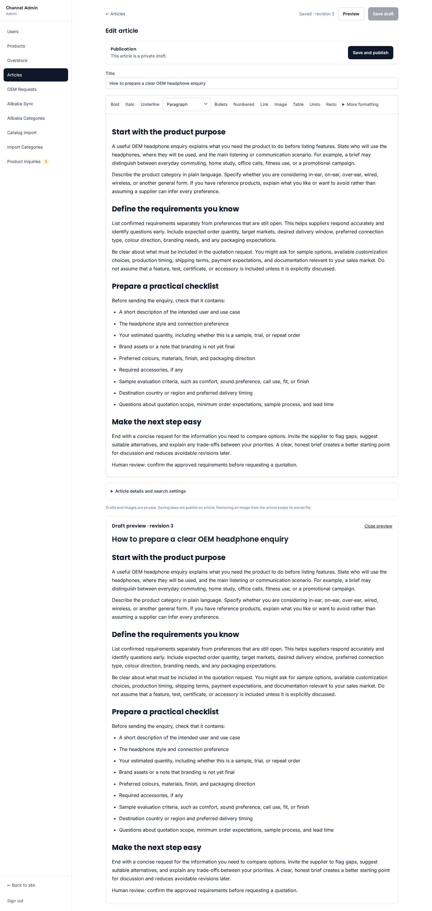
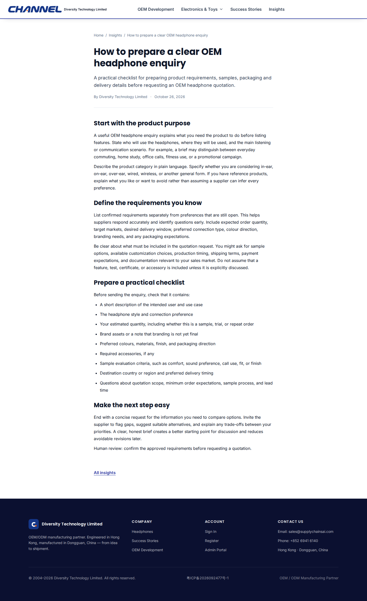

# 在企业微信群测试网站草稿

目标：你在群里提出主题，内容助手创作，发布小助手保存网站草稿，给你一个真实后台链接。你登录后补图、预览、确认上线。助手没有直接公开权限。

这是生产接线说明；本地原生 Hermes 到网站的闭环已经通过，生产 HermesInfra 的配置和群内实际测试仍须按下列步骤完成，不能据此说已接通。

[看完整时序图](../diagrams/wecom-draft.html) · [复制群测任务](TEST-PROMPT.zh-CN.md)

## 你最后会看到什么



收到编辑链接后，仍需原网站管理员登录。草稿是私有的，普通访客看不到。保存草稿不会改变当前已公开文章。图片可以在后台上传并填写 alt，然后点击 Preview。



人工点击发布后，CloudBase 保存公开版本，文章服务器返回 HTML；无须 GitHub 构建或五分钟等待。上图是已完成验收的截图，不代表本次微信群已经执行。验收文章后来已撤回，草稿保留。


## 网站这边需要什么

| 项目 | 值或作用 |
| --- | --- |
| API 地址 | `https://diversity-123-d9grnqfux221323bb-1443560658.ap-shanghai.app.tcloudbase.com` |
| 建草稿 | `POST /api/integrations/v1/article-drafts` |
| 查自己保存的结果 | `GET /api/integrations/v1/article-drafts/{operationId}` |
| 身份 | 本轮发布助手独立集成 `hermes-wecom-supplychainsai` |
| 凭证 | `keyId.secret`，通过 `Authorization: Bearer ...` 发送；不放 URL、提示词或群里 |
| 权限 | 仅创建私有草稿、查询自己的导入；不能发布、撤回、读其他人的文章或操作商品 |
| 有效期 | 本轮群测凭证从登记时起十四天；不能自动延长或重新启用已停用的密钥 |

网站只保存密钥摘要；明文只保留在服务器的私有文件。之前本地测试用的密钥已经停用，不能复用。

## 本轮群测的范围

先只测试 supplychainsai.com 这一站和 TEST-PROMPT 中这一篇文章。生成的私有配置同时固定任务号和草稿号，工具拒绝另开任务。不要把这份凭证直接安装到多客户共用的发布助手；共享场景还需要用可信的群/客户身份选择独立连接，不能让模型指定客户或靠提示词隔离。生产助手若有任意文件或终端工具，也不能把“密钥没放进提示词”理解为它受到操作系统级隔离；正式多客户接入需要另外落实凭证隔离。

## 服务器操作人怎样安装

先确认真实部署的机器和 Compose 目录，再执行。仓库中已有 `agent-publisher` 服务及持久卷，但不能据此假定生产服务器与本机仓库完全相同。不要重建全部助手或覆盖整个 Hermes 配置。

1. 在部署目录检查 `docker compose ps agent-publisher`，再执行 `docker compose exec -T agent-publisher node --version`。本包已在 Node 20.19 实际运行；生产版本仍需读回。若没有兼容 Node，停止安装，不临时升级整套助手镜像。
2. 从本次已通过 CI 的 `hermes-blog-tool-<提交号>` 下载 `channel-blog-mcp.mjs`，核对交付记录中的 SHA-256。它已包含依赖，不需要在生产容器运行 npm，也不需要复制整个网站仓库。
3. 用 `tools/hermes-blog/create-credential.mjs <新的私有目录>` 生成本轮凭证。命令只输出目录和登记摘要，不输出明文；目录 0700、文件 0600。网站操作人用已有人工入口选择 `blog-import-setup`、`initialize`、`integration_profile=wecom`，将 `registration.json` 的 keyDigest 交给入口。摘要不是可调用 API 的凭证。登记成功后，保留实际 expiresAt。
4. 通过 SSH/scp 等已有安全通道把工具和 `credential.json` 放到**发布助手**的持久目录，例如容器内 `/root/.hermes/channel-blog/`。文件由运行助手的用户拥有，凭证权限 0600。不要把凭证发到群里、提交 Git 或放入工具调用参数。
5. 备份发布助手现有 `~/.hermes/config.yaml`，只合并下面的 `mcp_servers.channelblog` 一项。保留其他 MCP、模型、工具、群绑定及认证配置。若已有同名项，先核对，不能直接覆盖。

```yaml
mcp_servers:
  channelblog:
    command: node
    args:
      - /root/.hermes/channel-blog/channel-blog-mcp.mjs
    env:
      CHANNEL_BLOG_CREDENTIAL_FILE: /root/.hermes/channel-blog/credential.json
    trust: full
```

这里不在 YAML 里写密钥。实际 Hermes 版本须支持这套 MCP 字段；本机原生版本验证过，生产要再确认。若生产用了显式 tools.include，只在原清单增加此工具组，不能换成“只有两个工具”的本地验收配置，否则会移除发布助手已有能力。

6. 在发布助手运行环境执行工具发现，确认新增 `channel_blog_create_draft`、`channel_blog_get_import`，其他原有工具仍在。这里只发现工具，不应先创建客户文章。按生产 Hermes 的重载方式生效；如必须重启，先确认没有进行中的群任务，仅重启 `agent-publisher`，不动内容助手和协调器。
7. 为发布助手增加这条操作说明：用户明确要求“存到网站草稿”才用这两个工具；同一任务保存稳定编号；成功后查询结果并返回真实编辑链接；不得把 `ready` 说成公开上线；图片先作为附件交人，不自动下载任意 URL。
8. 由你发送 TEST-PROMPT 中的任务。现有内容助手→发布助手的 A2A 转交沿用 HermesInfra；本轮没有替它新增或证明生产路由。转交失败时记录实际任务号和错误，再查现有协作设置，不能让其他助手共用凭证来掩盖问题。

## 本轮验收怎样算通过

| 步骤 | 实际要看到的结果 |
| --- | --- |
| 群内创作 | 没有编造企业事实，正文和配图建议齐全 |
| 发布助手保存 | 工具返回 `ready` 和真实编辑链接；不是只把文章发在群里 |
| 网站权限 | 未登录不能读私有草稿，公开 URL 还不可见 |
| 人工编辑 | 登录可见正文，补图、alt、刷新和预览正常 |
| 重复投递 | 同一任务仍是原草稿；已人工修改的内容不被覆盖 |
| 人工发布 | 正文、图片、列表和 sitemap 一致；日常发文不启动 GitHub |
| 收尾 | 记录群任务号、草稿链接和修订号；测试结束后明确保留草稿或撤回，不删客户文章 |

## 出问题如何退出

找不到工具：恢复该项配置备份，不动其他工具。凭证有误或泄露：用同一登记入口选择 revoke，停用本轮发布助手密钥，保留已保存草稿；不靠删除文章处理凭证问题。接口超时：查原 operationId，重试保留原编号和正文。出现重复草稿、私有图片泄露或非预期公开时，停止继续投递，保留证据。

网站代码恢复与文章内容分开。恢复程序不会把已公开内容或撤回状态退回旧版本。Blog 目前仍禁止搜索收录；群测通过也不自动解除这个开关。
