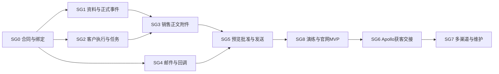

# 详细执行方案

2026-10-29 SG3.2：可调用准备模块完成本地实现、分轮复核与 14 项真实 HTTP/MySQL 模块端到端；50 项针对性、15 项旧归档回归和 19 项定向缺陷注入通过。实际内容模型、自动触发和发送仍未接通，见[本轮交接](evidence/SG3.2-PREPARATION-HANDOFF.md)。本轮未提交、推送或部署。

2026-10-29：SG3.1离线销售准备模块已有代码与验证，23项针对性及8样例通过，见[本轮交接](evidence/SG3.1-PREPARATION-HANDOFF.md)。不代表已接真实模型、询盘自动生成或邮件发送；企微交互仍只做设计，暂停/接管后置。

2026-10-29 第一期开通范围：先完成自动准备、邮件摘要/完整查看、同群引用改稿与精确审批发送；暂停/恢复/接管及主动任务终止后置，设计保留。见[本期交互范围](evidence/2026-10-29-MVP-INTERACTION-SCOPE.md)。运行时间/次数/费用限额、撤权门禁、发送幂等与结果未知对账仍不能省略。本轮继续SG3.1离线销售准备校验，不等待交互功能实施。

2026-10-29 补充：SG2.3 成果归档切片已有实现及本地验证，完整模块仍部分完成，生产新 run 与重试调度未接入。见[本轮归档交接](evidence/SG2.3-ARCHIVE-HANDOFF.md)。官网与企微控制只交付设计样稿，未改交互运行逻辑。

2026-10-28 实施进度：用户已授权分步实施D1；[SG0.3共同协议](evidence/SG0.3-VALIDATION.md)及[SG1.3读取门禁](evidence/SG1.3-VALIDATION.md)已有代码与验证。Hermes持久读取授权已完成本地与远端验证，见[SG2.4报告](evidence/SG2.4-REPORT.md)。自动来源核验／授权签发、任务独立上下文及真实模型工具循环仍待接入，live仍关闭。下文10/26暂停／待确认描述为当时状态。

2026-10-26 复核：以[权限与真实工具设计 D1](SECURITY-AND-TOOLS-DESIGN.md)为本轮补充，开发暂停。现有单元完成状态只覆盖原验收范围；任务级授权、可信来源核验、安装归属及真实接线待补。
2026-10-28 · 23个原始实施单元，加SG0.3／SG1.3／SG2.4三个D1补齐单元，共26项。当前状态见plan.json及IMPLEMENTATION-TRACE.md。模块说明规定设计；本文件与`plan.json`规定单元依赖，二者由检查脚本核对。

## 实施顺序

先做SG0.1共同合同及SG1.0代码基线盘点。再以fake provider完成资料接口、客户runtime、任务归档、Sales内容、邮件适配、控制及审核页，最后打开受控测试发送。真实客户数据读取依赖授权和隔离负向测试；真实外发依赖客户同意及SG8.2中对应上线检查。

官网闭环完成后接Apollo，再扩其他渠道与维护。SG6.0/SG7.1的文档和fake合同可提前准备，但不得绕过客户授权或官网外发验收去启动活动。一个模块做完一个可验证结果，再继续下一个；不一次派发全部工作。

图表达交付顺序；下面是精确依赖，例如SG8审计基础先于正式发送就要完成。

## 可独立交付的单元

| 单元 | 依赖 | 写入边界/产物 | 必须证明 |
|---|---|---|---|
| [SG0.1 共同schema与假服务](modules/SG0-boundary.md) | 无 | packages/sales-contracts/；Hermes只消费固定版本 | 结构校验、未知版本拒绝、跨语言同fixture，fake不调用网络 |
| [SG0.2 客户连接与动作授权](modules/SG0-boundary.md) | SG0.1 | 客户绑定/工具scope/连接撤销tests，不改公开客服权限 | A/B工具、连接、业务和操作者负向测试；无默认客户 |
| [SG1.0 选定代码基线和三入口接线证据](modules/SG1-channel.md) | 无 | 只读路由/开关/持久化盘点与证据 | 记录OEM/单品/客服入口、旧dummy、有效提交条件和选定SHA |
| [SG1.1 询盘产品附件只读接口](modules/SG1-channel.md) | SG0.2, SG1.0 | sales-integration路由＋资料adapter，复用批准产品读取及提交事实 | 越权/未提交/附件跨归属拒绝；实时查询并保留审核依据 |
| [SG2.1 客户Sales执行边界](modules/SG2-hermes-runtime.md) | SG0.2 | Sales专属runtime/工具代理/记忆和目录适配 | A/B同时运行不读错知识/文件/连接；遗漏scope拒绝 |
| [SG2.2 事件接收根任务与可靠派发](modules/SG2-hermes-runtime.md) | SG0.1, SG0.2, SG2.1 | sales_flow事件接入＋复用assignment/outbox | 重复事件一个根task，崩溃恢复不丢已确认接收事件 |
| [SG1.2 询盘通知与补偿扫描](modules/SG1-channel.md) | SG1.1, SG2.2, SG1.3, SG2.4 | OEM/单品保存后最小hook及source reconciler | 保存成功后通知丢失可补扫；附件回滚和历史记录不误发 |
| [SG2.3 运行成果manifest与固定版本](modules/SG2-hermes-runtime.md) | SG2.2 | 运行目录/manifest/归档与旧run限制 | 并发run/符号链接/伪造hash拒绝；旧run不覆盖当前版本 |
| [SG3.1 业务规则Sales skill与样例](modules/SG3-sales.md) | SG0.1, SG1.0 | 新规则/skill/schema/evaluation，不改Phase2客服循环 | 模糊采购、缺价、恶意输入和跨业务样例有预期 |
| [SG3.2 资料到正文附件完整准备](modules/SG3-sales.md) | SG1.1, SG2.3, SG3.1 | 准备流水线/事实校验/成果提交 | 自动形成带来源、缺项、HTML/text及附件的审核版本 |
| [SG4.1 Resend邮件适配器](modules/SG4-resend.md) | SG0.2 | 草稿/显式发送/reply/fake合同及错误映射 | HTML附件roundtrip、实际reply收件人、幂等和超时证据 |
| [SG4.2 Resend回调联系人与回信通知](modules/SG4-resend.md) | SG4.1, SG2.2 | 回调接收/去重/联系资格/线程映射 | 伪造回调/错inbox/重复乱序不产生新任务或复活许可 |
| [SG5.1 操作者身份与精确批准](modules/SG5-human-control.md) | SG0.2, SG2.2, SG2.3 | 企微身份/任务定位/改稿与批准记录；控制动作后置 | 对象不明不发；旧版本/无权限/撤权均拒绝 |
| [SG5.2 摘要预览与完整内容查看](modules/SG5-human-control.md) | SG5.1, SG3.2 | 原生消息摘要、附件清单、完整查看；必要portal预览 | 个人身份/权限检查、HTML sandbox、私有附件、失效版本 |
| [SG8.1 持久审计结果回执和告警](modules/SG8-operations.md) | SG2.3, SG4.2, SG5.1 | 审计投影/告警/成本；ChannelReceipt可选 | 批准人/版本/发送ID可追溯，回执失败不重发邮件 |
| [SG5.3 受控发送与竞争恢复](modules/SG5-human-control.md) | SG3.2, SG4.1, SG4.2, SG5.1, SG5.2, SG8.1 | 固定payload/唯一send_operation/outbox及对账 | 两入口批准、旧版本/撤权、超时已成功、24h窗外不盲重发 |
| [SG4.3 确认模板一次发送与切换](modules/SG4-resend.md) | SG1.2, SG5.3 | 只停旧询盘确认hook，新确认共用发送账 | 两条确认路径互斥、历史不补发、密码重置不变 |
| [SG8.2 官网MVP演练与小范围启用](modules/SG8-operations.md) | SG1.2, SG3.2, SG4.2, SG4.3, SG5.3, SG8.1 | 端到端tests/runbook/客户接入与采样表 | dry-run→测试收件人→获批真实询盘；退出与回滚可操作 |
| [SG6.0 Apollo客户授权和回复正文证据](modules/SG6-apollo.md) | SG0.2 | workspace/连接/sequence规则/授权收件来源证据 | Partner与Agent授权分开；证明真实回复正文获得路径 |
| [SG6.1 独立活动准备与批准执行](modules/SG6-apollo.md) | SG6.0, SG3.1, SG5.1, SG8.1 | ICP/受众/序列版本及批准/启动/暂停adapter | 未批准不启动；受众/发件人/内容变化重新批准 |
| [SG6.2 回复停发分类与Resend交接](modules/SG6-apollo.md) | SG6.1, SG4.2, SG5.3, SG8.1 | 持久reply事件、stop确认、正文匹配和路由 | 停发失败不继续外发；OOO/拒绝/缺正文不当营销许可 |
| [SG7.1 一个其他渠道的联系人接入](modules/SG7-sources-maintenance.md) | SG0.2, SG4.2 | 获准文件导入或官方接口、来源/业务/许可映射 | 重复导入不重复；多来源不覆盖拒绝，归属不明隔离 |
| [SG7.2 独立维护活动](modules/SG7-sources-maintenance.md) | SG7.1, SG3.2, SG5.3, SG8.1 | 受众/内容固定版本、资格过滤和活动结果 | 入库不等于可营销；审批后退订发送前排除 |

## D1补齐单元

| 单元 | 依赖 | 结果与验证 |
|---|---|---|
| SG0.3共同任务读取协议 | SG0.2 | 五种新合同、TS/Python策略及同组授权反例；旧合同不变 |
| SG1.3 Channel强制读取门禁 | SG0.3、SG1.1 | 服务凭据后再核对task/run/lease、真实来源和在线permit；所有私有路径覆盖 |

| SG2.4 Hermes持久任务读取授权 | SG0.3、SG1.3、SG2.2 | 从真实客户任务库读取当前状态；独立控制凭据、请求摘要持久绑定、暂停/终态拒绝 |

原SG1.2现依赖SG1.3和SG2.4。细节和每步证据见[本批计划](evidence/D1-IMPLEMENTATION-PLAN.md)，不能跳过后续自动来源核验／签发及真实运行接线去启用线上。

## 每个单元的工作方法

1. 读本模块、共同合同和当前代码。先记录实际SHA、现有测试/部署状态，确认修改范围。没有的能力标为缺口，不照旧报告重写已实现功能。
2. 为上表验收写一个能暴露当前缺口的测试或可复现证据，再实现最小行为。文档/配置盘点单元只做证据，不为低影响改文档补空洞测试。
3. 跑对应包/模块的针对性检查；涉及真实DB并发就使用真实测试DB，不能用内存stub证明事务和租约。
4. 核对客户、业务、操作人、版本、外部不可逆动作、历史数据和回滚，再检查相关原有测试。
5. 交接本单元的提交、变更文件、测试/失败项、未验证部署部分和下个单元。不将planned改成完成，除非验收结果有依据。

## 代码与协作规则

- 当前销售集成分支已有SG0／SG1的基础代码，基线及验证见README和交接；本轮按已获批准的D1逐项补齐，再恢复原DAG；不整批merge未审查分支。
- Channel负责询盘事实/API/提交后交接；Hermes负责私有任务/运行/控制；Sales流程包负责业务规则；发布工具负责Resend/Apollo adapter。通用Hub不硬编码Channel产品/报价。
- 不默认每模块建分支或PR；当前这条工作流使用此设计worktree，后续每仓库实施分支策略由实施范围决定。同一checkout同一时刻一个写入者，共同schema由SG0维护。
- Hermes源码不在此仓库；开始其实施单元时另建/指定Hermes工作区，遵守该仓库AGENTS，不直接改正在运行或有他人改动的checkout。
- 不自动创建Linear/Symphony任务、PR或发群消息。这份方案不等于客户已签约或已授权真实账号对接。

## 建议的验证命令

以下是实施后要提供的目标命令，尚未创建的包/脚本不能现在宣称通过。先固定工具版本和测试环境，再在SG0.1/相关模块创建实际scripts。

| 范围 | 目标命令及说明 |
|---|---|
| 本轮设计检查 | `python3 docs/sales-agent/check_design.py`，只查文档/数据/DAG，不执行真实业务 |
| Channel共同合同 | `pnpm --filter @vibelingan-channel/sales-contracts test`及`typecheck`，SG0.1建立 |
| Channel集成 | `pnpm --filter @vibelingan-channel/sales-integration test`，SG1建立；既有单品/OEM tests继续跑 |
| Hermes Sales后端 | 按所选Hermes分支现有测试框架接入`test_sales_*`；SG2.1记录真实命令，不在未核对依赖时假造框架 |
| Hermes审核网页 | 该仓库`web`目录`npm run check`＋浏览器检查，依其现有npm/package-lock |
| 外部服务 | 客户授权后用受控测试收件人跑adapter contract/投递/附件/线程，保留脱敏证据 |

## 官网MVP验收清单

- OEM、正式单品、已准备好的客服确认入口均可自动形成稳定Sales根任务；未提交聊天不触发。客服入口依赖原Phase2完成时先验收已接入口并明确partial，不能把两入口通过当三入口完成。
- 保存成功但通知丢失可恢复；历史询盘默认不补发；附件失败回滚不触发。
- 内容与附件完整生成，资料缺失能请人补充；真实价格/交期有来源。
- 所看/所批准/所发送绑定同客户、任务、发件人、收件人、正文附件版本。Web/企微有具体操作人权限；网页个人身份不足时只读并标记审批partial。
- 第一期改稿/新来信/来源或连接撤权阻止尚未提交旧稿；已提交结果正确显示，不宣称能撤回。暂停/接管入口后置。
- 重复命令/回调不重发；超时未知对账不盲发；同一封默认一个发送通路。完整人工接管竞争在后续启用该功能前验收。
- 固定确认只发一次，切换时旧路径停用，密码重置不受影响。
- 全过程有持久成果、批准和执行记录；可选Channel回写失败不影响发送幂等。
- A/B客户运行、知识、文件、连接及查询负向测试通过；本地通过不替代部署身份验收。

## 上线前才需要的业务输入

负责人/备份批准人和可批准的承诺；可信产品价格资料；首批渠道/联系许可范围；留存及退出政策。未提供时采用draft_only，不自行决定真实商务承诺或永久留存。Resend预览/内部接口/事务由工程负责，不再列为客户要决定的技术问题。

## 交付状态

整体设计和实施图已完成。SG0.1、SG0.2、SG1.0、SG1.1已完成合同/假服务、连接授权、源码核对和受控读取；SG2.1、SG2.2在独立Hermes分支完成客户执行边界和可靠接收，隔离Docker/MySQL CI通过。尚未全部验收的单元按plan.json继续：SG2.3已有归档切片，仍缺生产新run与重调度；SG3.1离线范围本轮已完成。未部署、未接通线上Hermes或真实邮件；后续仍按实际线上Infra执行分层验收。
