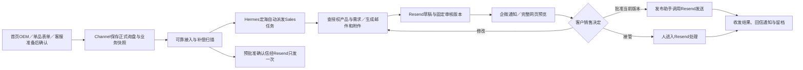

# 整体设计

2026-10-23。下文是实施目标，不代表当前代码或线上系统已完成。源码核对与官方能力分别见 [依据](evidence/BASELINE.md) 和 [外部服务](evidence/PROVIDER-CAPABILITIES.md)。

## 推荐的组织方式

保留现有 HermesInfra 中枢，把网站接待和后续销售准备分成两个岗位。官网智能客服在 Channel 原有公开工具范围内回答、推荐并准备询盘，买家确认提交后才进入正式跟进。Sales 在 HermesInfra 内处理已提交需求、查授权资料并生成邮件和附件。定海派发任务，内容工厂提供内容能力，发布助手调用邮件与同步工具。

网站询盘、主动获客和客户维护使用不同的流程配置。它们可以共用身份、任务、文件、邮件和审批接口；不会因为联系人在同一 Resend Team，就把不同业务的模板、产品和报价混用。客户环境与获准业务范围由后端确定，模型不选择客户的密钥或数据库。

## 模块分工

| 模块 | 做什么 | 放在哪里 |
|---|---|---|
| SG0 客户边界与共同规则 | 客户、业务、连接、操作人、数据格式及默认禁止外发 | 通用规则归 Hermes 平台，业务字段归流程包；此目录先定义接口 |
| SG1 官网接入与业务资料 | 三种正式询盘入口、可靠触发、询盘/产品/附件的授权读取 | Channel；不重写现有询盘持久化 |
| SG2 调度、运行与成果 | 创建任务、派发、客户独立执行、明确归档 | HermesInfra；复用任务/outbox基础 |
| SG3 销售准备 | 理解需求、查产品、判断缺项、生成正文附件 | Sales 流程包；按需调用内容工厂 |
| SG4 Resend 工具 | 联系人、草稿、收发、事件、执行结果 | 发布助手的受控工具适配层 |
| SG5 人工控制与审批 | 预览、改稿、批准、暂停、接管与恢复 | Hermes 控制后端；企微为主入口，网页共用后端 |
| SG6 Apollo 获客及交接 | 客户独立公司空间、活动审批、回复停发与分类交接 | 独立获客流程；复用 SG0/2/4/5/8 |
| SG7 多渠道与维护 | 联系人归并、来源与资格、单独维护活动 | 独立同步程序与维护流程配置 |
| SG8 运行、审计和验收 | 失败恢复、告警、记录、留存、退出服务及工时验证 | 各服务产生记录，Hermes 留任务档；不另建监控产品 |

[交互模块图](diagrams/modules.html) 可以单独打开。图中的 SG0、SG8 是贯穿能力，不是每封邮件都要再经过一次的审批步骤。

## 官网这一条怎样跑

销售不必发“开始处理”指令。指令用于后面的判断和调整，例如“为这条询盘补一个低预算方案”“把数量改为 800，重新生成附件”“批准任务 X 的 v3，发给列出的两位收件人”“暂停 X，由我接管”。模糊的“可以发”不能自动套到群里最新一项任务。

固定接收确认、Sales 准备、联系人同步是分开的分支。确认信模板提前获批；邮件或联系人服务故障不能让已保存的询盘消失。同步失败也不应阻塞销售准备。正式切换前停用旧询盘确认路径，密码找回等其他网站邮件仍沿用既有路径。

## 人在哪里看、批准和接管

客户主要在企微操作。通知包含任务身份、当前版本、收件人摘要和完整预览链接；不要求在群里阅读长 HTML 和附件。网页可批准，也可以只看后回企微批准，两者由同一个后端验证操作人和版本。

建议做一个很小的、需登录的审核页，展示固定版本的 HTML、纯文本、附件和产品依据。它是 Hermes 销售流程的通用审核入口，不是 Channel 通用任务中心。以后确有需要，可以由 Channel 提供入口或展示结果。Resend 草稿仍保留给客户查看和人工工作，但自动代发采用已批准的固定内容，不依赖发送时仍可修改的草稿。

这一点是本轮对先前设想的技术补充：官方发送草稿接口没有公开的条件版本参数，异步的改稿通知也不能形成原子锁。远程批准后应从固定内容调用 Resend 发送接口；回复线程则使用明确的目标邮件及固定回复内容。普通发送是否完整显示在客户 Inbox 线程，需要接入验收，不把邮件发送能力等同原生界面所有行为均已联调。

客户选择在 Resend 自己编辑和发送时，先请求接管任务，系统撤销旧批准并停止新代发。若有发送在途或结果未知，先核对，明确后才移交人工发送权；等待时可查看但暂不手动发送。Resend 外部操作通知只能帮助发现变化，不能锁住原生发送按钮。跨原生界面与我们的发送服务同时操作，无法仅靠 webhook 保证绝不双发；试点采用同一任务同一时刻一个发送通路。此限制在操作说明和验收中明确保留。

## 数据各归哪里

| 数据 | 主记录归属 | 其他系统保留什么 |
|---|---|---|
| 官网正式需求、产品/配置快照 | Channel | Hermes 按权限获取处理所需副本和版本 |
| 官网公开对话 | 现有客服 BFF/存储 | 正式询盘只带买家确认的摘要，不自动传完整聊天或 conversation id |
| 候选买家、开发活动与行为 | 客户 Apollo 公司空间 | 交接只传必要联系人、来源和已取得的回复内容 |
| 联系人、订阅、草稿、邮件线程及收发事件 | 客户 Resend Team | Hermes 保存关联ID及必要审核/执行证据 |
| 任务、运行、成果版本、批准、控制与执行日志 | HermesInfra 客户专属范围 | Channel 可异步保存少量关联/最终结果，无须复制聊天和全部任务 |
| 商业产品、价格、MOQ、交期依据 | 客户批准的业务资料 | 生成内容必须带来源版本；缺项交人补充 |

官网买家与我们的签约客户是不同角色。`client_id` 指签约客户公司，`contact_id` 指买家联系人。相同 email 可以跨来源出现，合并来源不等于合并业务或营销许可。

## 客户环境怎么分

每家客户自己的 Apollo 公司空间和 Resend Team 分开。Partner Seat 是我们获授权进入客户 Apollo 的身份；它不会替代客户空间，也不自动授权 Agent 连接或 Resend。第一期为试点客户配置独立 Sales 运行资料、工具凭据、记忆、文件和知识范围；任何会接触客户全文的定海/内容/发布环节都遵守同一边界。

共用程序和平台运维不等于共用客户私有状态。现有 Hermes 本地代码有客户归属基础，但尚未证明完整运行隔离，实施前须通过负向测试。此轮不承诺把 Hermes 全部重建为多租户平台。

## 先交付哪一部分

先交付“正式网站询盘 → 自动准备 → 人审 → Resend 发送 → 回执”。没有 Apollo 也能完成这条线。客服 Phase 2 未完成时，先用已验证的表单入口接入；客服确认入口在原工作流准备好后按相同接口接入，不重复实施公开客服功能。

随后接 Apollo：主动开发活动审批后运行，发现回复先停/暂停适用序列，再按真实回复内容分类。采购兴趣交跟进，拒绝/退订停联系，自动回复暂停，无法判断交人。发现回复的事件不一定带正文，缺正文时不让模型猜。

再按客户批准的范围接国际站、环球资源、展会导入和维护活动。联系人入库与有权营销分开。每轮实质对外内容或活动范围由人批准，修改后重审。

本轮不增加完整 CRM、自动商务报价、全自主回信、全部渠道实时同步或通用 Agent 控制台。工时模型继续使用明确假设，试点记录真实审核、返工和接管时间后再算收益。
