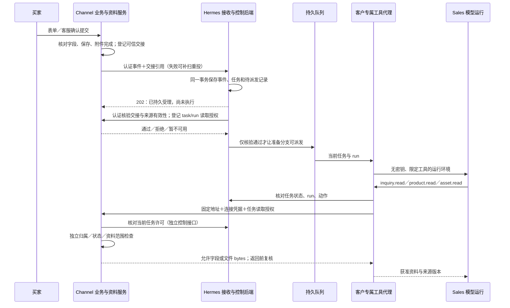

# Sales 权限与真实工具接入设计

2026-10-26 · 修订 D1 · 待确认，开发暂停。

本轮只更新设计与图。已有代码、测试结果和远端提交保持原样。本文对权限粒度、来源核验、工具接线和产品资料的规定，优先于此前模块文档的简写；`reference/` 中的历史讨论不改动。

## 先看结论

Hermes 制定通用权限协议并执行任务门禁，Channel 独立执行业务资料门禁。模型负责理解需求、挑选获准产品、生成内容；身份、权限和批准均由服务器程序判断。

推荐第一期采用现有服务凭据，加由 Channel 保存的短时任务读取授权。运行环境每次调用工具都核对当前任务；Channel 再核对这次请求的连接、授权和资料归属。模型没有服务密钥、数据库或对象存储入口，也不能自行更换客户、任务和收件人。

现有连接授权、客户目录保护、事务接收和派发可继续复用。仍须补任务级授权、可信来源交接、历史数据归属约束及真实 Agent 工具接线。已有单元的隔离测试不能代替这些缺口的验收。

产品准备按最新批准资料查询；保留买家提交时的事实，并在审核时固定正文、附件和实际采用的资料依据。无需为这轮另建完整产品版本仓库。

[整体模块图](diagrams/modules.html) · [系统门禁与流程图](diagrams/security-boundaries.html) · [可转发的图文 PDF](diagrams/security-design-review.pdf)。两张图都表达目标设计，不表示已上线。

## 1. 谁负责什么

| 层与位置 | 必须负责的判断 | 不由这一层决定 |
|---|---|---|
| 官网表单／公开客服，Channel | 字段格式、必填、长度、现有反滥用；客服让买家确认后提交 | 不签发 Sales 私有工具权限，不因聊天说“我是管理员”扩大权限 |
| 业务记录与交接，Channel | 询盘确实保存并最终有效、联系方式格式有效、来源归属正确；附件已完成；保存可信交接记录 | 不把模型输出的 `submitted=true` 当提交证据；不证明邮箱一定属于提交人 |
| 通用任务与权限，Hermes | 认证调用者、固定客户／业务／安装／环境；任务、当前 run、控制版本、暂停与接管；允许的动作 | 不代替 Channel 判断某条记录或文件究竟属于谁 |
| 工具代理，Hermes 客户专属服务 | 只接受白名单工具和有限参数；从已登记 run 注入身份；持有连接与任务授权；调用固定地址 | 不接受模型提供密钥、URL、客户身份、SQL或发送批准 |
| 资料服务，Channel | 独立核对连接与任务读取授权；检查真实记录／文件／资料范围；只返回允许字段与 bytes | 不因“已过 Hermes”而略过业务归属检查 |
| 模型与内容工厂，客户专属运行 | 理解采购需求、提出建议、生成正文附件、标明缺项 | 不裁决权限，不批准，不直接调用 Resend，不修改原询盘 |
| 控制与发送服务，Hermes／发布助手 | 认证操作人；批准绑定任务、发件人、全部收件人和正文附件版本；发送前复核状态并记唯一发送账 | 不将群聊一句模糊“可以”直接当批准；不让生成模型自由选择邮箱 |

“每次请求检查权限、默认拒绝”来自 [OWASP 授权指南](https://cheatsheetseries.owasp.org/cheatsheets/Authorization_Cheat_Sheet.html)。本项目据此采用两端检查；这份表是本项目的设计决定。

## 2. 我们要防什么，安全承诺到哪里

必须防住模型传错 ID、恶意询盘和附件中的指令、A 客户冒用 B 的连接、同客户任务串资料、猜测文件引用、旧授权重放、撤权后继续读取、并发改稿后发旧稿，以及重试导致重复处理。把模型完全替换为恶意脚本，这些系统规则仍须有效。

第一期使用每客户独立的 Sales 服务进程、数据库及数据库用户、私有目录、连接密钥和外部账号范围；数据库用户只获得本客户数据库权限。可复用同一套镜像和调度代码。共享中枢只处理路由所需标识；接触私有正文的定海步骤、内容工厂和发布步骤都必须进入同一客户范围，不能回退到当前全局文章 Agent。

私有根目录与容器保护不能抵御宿主机 root、平台管理员或云账号整体失陷。若合同要求这类故障也不得跨客户，就须使用独立主机或云账号、独立密钥及运维权限，并扩大验收范围。当前未承诺或实现这种等级，也不能承诺软件“绝不出错”。

模型服务和错误追踪服务同样可能接触正文：调用方必须核对获准供应商、客户对应会话、日志与缓存隔离、留存配置。不能只证明容器没有网络，却把全部客户上下文放进同一未分隔的宿主会话。

## 3. 通用协议怎样保持可复用

Hermes 规定通用身份、任务、动作、授权到期、撤销、幂等及回执规则。Channel 的适配器把自己的 OEM／单品记录映射成资源，不把产品类别、价格或询盘表名写入通用权限判断。

可选方式有三种：

| 方式 | 结果 | 本轮建议 |
|---|---|---|
| 只有客户级服务密钥 | 实现少，但同客户的任务可读过宽；拿到密钥便绕过任务状态 | 不能作为最终读取入口 |
| 只让 Hermes 签一张票，Channel 完全信票 | Channel 无法独立约束真实资料归属；短期票过期前的撤权仍需处理 | 不采用 |
| 服务身份＋Channel 任务读取授权＋Hermes 当前任务检查 | 沿用已有凭据；两端各有可检查的记录；代价是读取依赖两端在线 | 推荐。试点量小，优先可撤销和可排查 |

这里的“任务读取授权”是服务器保存的一条授权记录，通过不可猜测的短时句柄引用。服务器同时还要认证连接，单独取得句柄不能读取。句柄由安全随机源产生不少于32字节随机值，数据库保存摘要并关联范围／到期，不能从任务ID推导。句柄只在受信任服务之间传递，模型和企微消息都拿不到。建议有效期 5 分钟，按同一任务续期；时间是待实现时配置的工程初值，不是撤权的唯一保障。

共同协议暂命名 `sales-auth/1`，本轮只是设计；不新增运行 schema 或改生成类型。现有 `InquirySubmitted 1.0` 继续表达业务事实，新增认证与交接信息放在版本化信封中。通用协议的语义和准入标准由 Hermes 平台负责；为复用已有共同包，第一期仍在 Channel 的 packages/sales-contracts 物理维护唯一合同源，Hermes 平台维护者审核通用授权部分，Channel 负责来源／产品适配。双方用同一组 TS／Python 样例验证，Hermes 固定版本消费；本轮不迁库或另造第二套 schema。

### 3.1 三种记录，各有明确主人

| 记录 | 谁创建、保存 | 作用与约束 |
|---|---|---|
| 来源交接记录 SourceHandoff | Channel 服务器，在业务最终有效后创建 | 关联客户、安装、环境、来源类型、原记录、提交摘要版本和事件身份；不靠模型声称已提交。保存随机交接引用的摘要，引用自身不授予资料访问权 |
| 任务和运行授权 TaskPermit | Hermes 控制后端，依已持久任务与当前 run 判断 | 关联客户／业务／安装／环境、task、run、动作、请求 ID、规范化参数摘要、当前客户与任务控制版本；只能由受信任服务器确认 |
| 任务读取授权 TaskReadLease | Channel，在认证 Hermes 连接并核验来源交接后登记 | 绑定来源交接、具体 task／run、允许的询盘与附件、允许的产品资料集、连接、目标服务、到期时间及撤销状态；不得自行扩大资源范围 |

不同方向使用独立权限和凭据：Channel→Hermes只准事件交接，Hermes→Channel只准指定资料与授权交换，Channel→Hermes控制查询只准核对任务许可。不可复用一个全能key；每条连接均绑定固定客户、环境和服务目标，通过HTTPS传输。密钥轮换要能撤销旧连接，句柄、Authorization和正文不得写入普通日志。

跨服务 task／run 标识采用共同合同的字符串形式。现有 SG2.2 本地task主键和接收回执使用整数，真实工具适配时必须在受信任边界建立唯一的显式映射；不得靠字符串／数字宽松比较或截断大整数匹配。当前内部回执继续按原合同验证，新协议和适配测试完成后才开放跨服务。

共同字段还包括协议版本、签发与过期时间、接收服务标识、审计关联 ID。客户身份从认证后的服务器绑定取得，请求中的同名字段只做一致性校验。未知版本、缺字段、类型不符、业务不匹配或身份冲突均拒绝。

客户级 `control_epoch` 继续用于整体撤权／配置失效；复用共同控制合同中已有的任务版本概念 `task_revision`（命令带 `expected_task_revision`），把它补进实际任务存储和工具校验，用来处理单项任务暂停、接管与恢复，避免暂停一条询盘就停掉全客户任务。它不因普通进度心跳而递增；安全状态、当前run或授权依据变化才推进。邮件内容版本和新来信的 `context_epoch` 各自保留。

此前状态文档把任务暂停也写成递增 `control_epoch`，与已实现客户绑定中的同名字段层级混淆；本轮明确分开。现有 Approval 1.0 尚无任务版本字段，不能靠沿用旧结构就声称已防旧批准。后续升级共同协议时显式绑定客户控制版本、任务版本、上下文和正文版本；需要新增必填授权字段就同步升级主版本，拒绝旧授权，不静默改变同名字段含义。

### 3.2 一次资料读取的完整判定

1. 工具代理从数据库里的当前 run 找到 task 和客户绑定，不采用模型传来的 task 或客户字段。
2. Hermes 核对任务仍可准备、run 是当前 run、动作获准；确认本次工具参数、预算与大小限制。
3. 代理用固定 Channel 地址、服务身份和 TaskReadLease 发请求；不跟随重定向，不接受任意 URL。
4. Channel 核对已认证连接、部署归属、lease 对象／动作／目标／到期／撤销状态；再向固定 Hermes 控制接口询问该 task／run／动作／请求摘要是否当前有效。此接口独立于 Agent 执行进程，不反向调用 Channel，避免循环依赖。
5. Channel 按真实资料检查归属和最终状态，只投影允许字段；附件检查文件所属询盘、完成状态、MIME、大小、摘要与路径。
6. 返回前再查当前绑定、lease 与 Hermes 任务状态；无法确认或版本变化即丢弃结果。私有附件先有界缓存并完成检查，再发本次 bytes；分段下载的每个请求都重查。
7. 代理检查返回的请求关联、来源 ID、资料版本和类型，记录读取依据，再把获准内容给模型。

正向许可不跨请求缓存。Hermes 或 Channel 暂不可用时，读取失败并由队列重试；不能回退到直连数据库、全局工具或无限期旧授权。部署新协议时必须同时关闭旧的“只带客户级密钥便可读取”通路；未知协议或缺少任务授权不能落回SG1.1旧认证模式。

错误对模型只给通用拒绝／暂不可用，完整原因留受限审计日志。越权和不存在的私有资源对外保持相同响应，不泄漏记录是否存在。

上面的双重当前状态检查限制撤权后的继续读取，但无法让已返回的数据从模型上下文消失。定义读取的授权时点为 Channel 返回 bytes 前最后一次成功校验；暂停在此时点之后发生，刚完成的读取可能已返回。暂停成功后不再启动新调用或生成新的可提交成果；在途结果回到代理时再次检查，旧 run 的结果不得归档为当前成果。不能宣称跨服务零时间差撤回。

## 4. 正式询盘如何自动接进来

Channel 与 Hermes 没有跨库事务。Channel 负责可靠交接记录与补扫；Hermes 负责已受理事件、核验状态和派发记录的持久化。202 后即使 Channel 暂不可用，任务仍留在“等待来源核验”，重启后重试，不失踪。只接收成功的事件不能立即生成确认信或推送联系人；这些有外部影响的分支同样等待来源通过。

当前 SG2.2 已能事务保存并派发，但只信任来源 service token；需要在它的派发之前增加上述核验状态。错误交接或来源失效进入拒绝／人工检查，不自动改成有效。重试保持同一根任务，不由核验器再造任务；来源摘要改变按明确修订事件处理，不能作为同一 immutable 事件偷偷覆盖。

模型对采购意图的判断可以帮助客服引导，但正式提交由业务系统确认。“预算未定、型号未定”可以是有效询盘；邮箱格式错误、超长字段、未完成附件、未知来源等客观约束由程序拦截。是否验证邮箱控制权是另一个业务要求，现有格式检查不能证明这一点；试点沿用现有表单，不能把无验证邮箱描述成已核实买家身份。

确认信继续采用预批准模板，通过唯一 Resend 路径发送一次；正文准备独立自动进行。切换前网站旧确认逻辑保留原样，正式启用新路径时先确保旧路径互斥停用。没有人工“开始处理”步骤。

## 5. Channel 的独立业务门禁

### 5.1 历史记录缺归属字段怎么办

当前 `sources.ts` 的 `belongsToInstallation` 对缺少 `client_id`、`business_line`、`source_installation_id` 的历史行按部署固定归属放行。这仅在整个受访问数据集确属单一客户时成立，不能用于混合客户库。

推荐试点维持单客户 Channel 安装，不重构原询盘表。新增受运维控制的安装归属记录，绑定实际 CloudBase 环境、所读集合／存储范围和客户；启用时核对实际环境 ID、数据来源及集合是否单客户。缺任一可核验证据，禁用 legacy 放行。已有行若明确写了归属字段且与安装不符，无条件拒绝，不能用部署归属覆盖。

如果发现数据库混放或无法证明唯一归属，先拒绝旧行，并做可审计归属映射或迁移；不能设置一个“单客户=true”便当证明。是否需要迁移由只读盘点结果决定，本轮不改历史数据，也不动 pricing／SEO 表结构。

### 5.2 各资源能给多少

| 资料 | 默认范围 | 额外条件 |
|---|---|---|
| 询盘联系资料和需求 | 当前 task 绑定的唯一来源记录 | 最终有效、版本匹配；不开放客户全部询盘列表给模型 |
| 买家附件 | 当前询盘实际挂载且授权记录允许的附件 | 沿用文件归属、完成状态、hash、大小、MIME校验；不能靠知道引用读取 |
| 产品目录 | 本客户、当前业务获准的产品资料集 | 可跨 SKU 推荐，避免只准读取已选产品；不因此开放其他客户或内部底价 |
| 私有价格／报价依据 | 明确登记给该业务和角色的数据投影 | 来源缺失返回 missing；没有审批过的商务承诺不得自动编入正式报价 |
| 历史邮件／其他询盘 | 默认不读 | 后续若要读，显式增加关联资源和权限；仅 email 相同不能自动放行 |
| 对象存储 | 模型和代理均不直接访问 | Channel 用自身受控访问读 bytes，临时地址只留服务端 |

读取返回时还要带来源版本、取得时间及可用性。限制每次 ID 数、分页、附件块大小、累计读取量、超时和客户速率；已有大小／分页限制可复用，累计预算和客户速率仍待接线。禁止万能数据库查询和任意 URL 抓取工具。

## 6. 真实工具怎么接，哪些还没接上

当前 Boundary 有校验方法和容器启动参数，工具执行依赖传入的受信任 callback。生产代码尚未有完整 Sales 模型循环、真实 Channel HTTP 适配器和这套受限容器启动闭环；不能把测试调用 callback 算作已经接通在线定海。

目标接线分为四段：

| 位置 | 复用 | 补齐／修改 |
|---|---|---|
| Hermes `deploy/hub/sales_flow/boundary.py` | 固定 Scope、fresh binding、根目录 owner、路径／symlink／hardlink保护、工具白名单和容器限制 | 将 task／run／资源授权与当前任务检查接入每次 tool/read；不能只校验客户级 Scope |
| Hermes Sales worker／模型循环，SG3 | 既有模型和内容生成能力，先核对其会话、日志及配置支持 | 新建有限工具协议，宿主通过 stdin/stdout代理模型／工具；启动当前任务容器、设置截止时间／预算、取消与旧结果丢弃；不向容器注入密钥 |
| Hermes ChannelReader，候选新增于 sales_flow | SG1.1 已有真实 HTTP 路由、响应、Range 与版本规则 | 固定地址，认证凭据，任务 lease，有限重试，类型／来源校验，分块摘要核对与审计；`product.read` 的 ID 列表映射到现有 query 形状 |
| Channel `apps/functions/sales-integration/src/handler.ts`、`sources.ts`、`index.ts` | 服务认证、绑定核对、投影、当前批准产品 reader、附件 bytes与完整性检查 | 任务 lease 及在线任务许可检查、可验证安装归属、每个资源的任务关系；默认关闭绕过路径 |

准备模型只看到 `inquiry.read(kind,id)`、`product.read(ids)`、`asset.read(ref)` 这类工具。模型可选合法产品 ID；询盘 ID 和附件即使语法正确，也必须在当前任务授权内。创建／更新 provider 草稿由受信任编排根据已归档成果执行；生成模型不拿任意发件工具。成果归档必须归当前 run 并通过 manifest/hash 检查，之后才进入待审。

ID 查询已具备；自然语言产品搜索不在现有 SG1.1 的 ID reader 内。首期可先使用已有询盘产品 ID 和批准的候选列表；若需要推荐新 SKU，再复用已核实的目录检索工具，仍经过相同授权和投影，不在本轮暗加全文搜索平台。

### 6.1 记忆和文件也要跟任务权限一致

现有容器挂本客户 HOME、知识目录和当前 run，能约束客户边界，但整个客户 HOME 可能含另一条询盘。只加 HTTP 任务授权仍挡不住从共享记忆读到这些资料。

因此建议第一期将可写 HOME 改为 task／run 专属，准备模型默认不载入整个客户历史。知识目录仅挂当前业务批准、可共享的产品／品牌规则，查询缓存和向量索引也按授权范围分开。私有询盘、原始邮件和附件进当前 run 的受控资料区；同一任务续办时经授权恢复该任务的成果和上下文。若未来需要跨任务客户关系记忆，另建显式可授权的读取方式。

目录创建、防链接和 owner 保护继续复用；原“客户 HOME 直接挂载”的策略需要收紧。当前没有完整跨任务记忆授权系统，不以文件夹名称替代访问检查。

## 7. 实时产品加必要留档

| 时点 | 用哪份资料 | 保存什么 |
|---|---|---|
| 买家提交 | 买家当时选择和填写的事实 | 原询盘、选中产品／配置引用、已有单品快照及提交时间；保留已存在字段 |
| Sales 准备 | 最新批准产品接口；默认不传旧 revision | 本次实际取得的必要字段、revision、取得时间、来源引用和摘要；未查到就说明不可用 |
| 人工审核 | 固定的邮件 HTML／text、收件人、附件及用到的商务依据 | 不可变审核版本与来源依据。只存 hash 不足以复盘，要保存实际引用字段或可重取的不可变证据 |
| 发送前 | 再核对批准与任务；关键商务依据是否仍有效 | 若依赖的价格、MOQ、交期等发生相关变化或撤销，失效旧批准、重新准备；无关文案变化不必自动重写全部稿件 |
| 已发送后 | 以实际发送版本为准 | provider ID、发送状态、批准人／版本／时间；资料后来更新不改写历史邮件 |

“实时”指每次准备读取当时最新获批的接口结果，不是自动获得实时库存或工厂交期，也不把目录价等同给该买家的已批准报价。接口缺数据就保留缺项，由人提供依据。

现有查询的 revision 是可选项，可复用当前批准 reader；已有询盘快照继续作为历史事实。`product_snapshot_refs` 在业务事件中保留兼容，不再把它解释成“Sales 必须使用旧产品资料”。正式实施时共同合同说明和样例一起澄清。

关键资料在批准前或发送前变化时需要重新核验。外部服务查询与发送不能组成数据库原子事务；本期不提供自动价格锁定或库存预留。若客户要求报价在一段时间内具有强约束，需另设报价批准／有效期规则。

## 8. 审批、暂停、接管和外发

企微与网页可以共用审批后端，不复制另一套 Channel Agent 控制中心。每次批准都验证个人身份、客户业务权限、当前 task、收件人、发件身份、正文／附件版本与控制版本；预览链接自身不授予查看或批准权。模型只能提出指令候选，由控制后端确定对象和动作；对象不明确时要求选定任务与版本。

暂停由 Hermes 控制后端先持久改变任务状态并增加 task_revision，再返回成功。工具代理停止新调用，读取端的在线检查阻止旧 run 继续取得新资料；晚到成果只能归档为旧产物。恢复要有独立权限并建立新 run／授权，不复活旧批准。

发送执行与任务控制共用持久状态及排他发送权。发送前在事务中核对当前批准／epoch／收件人和唯一逻辑邮件，只有获准执行者能取得发送权。暂停若先提交，发送就拒绝；发送若已取得不可逆派发权或已交 provider，暂停显示在途／待核对，不能声称撤回成功。超时未知先对账，不能重发。

默认收件人来自本次正式询盘的联系资料。人要变更／增加收件人需显式确认并生成新审核版本，不能从模型提取出的任意 email 自动追加。抄送、密送、reply目标、附件和所有外链同属审核内容；未经允许的跨任务资料不得附上。

固定确认信通过预批准模板规则核验来源、固定收件人、唯一身份及发送账，可自动发；Sales实质跟进邮件仍由人批准。发布助手经受控接口使用客户 Resend 凭据。原生 Resend 人工发送仍须先接管并核对在途发送；仅靠 webhook 无法锁住原生发送按钮。

## 9. 现有实现逐项去留

核对版本：Channel `33e9f504`（读取实现 `e2f51c7c`）；Hermes `2fbc50c`。2026-10-26 从当前两个销售检出读取源码，未修改运行代码。

| 已有单元／路径 | 当前可确认 | 设计要求的差距 |
|---|---|---|
| SG0.1 `packages/sales-contracts/` | 数据格式、双语言校验、fake样例 | 新增通用认证信封、来源交接／任务授权合同；schema不会自己授予权限 |
| SG0.2 `src/access.ts` | 服务器核对服务凭据、连接、scope、动作、fresh registry和撤销；无模型参与 | 当前 scope 没有 task／run／资源限制。保留认证原语，增加任务授权层；mail.send 的连接许可不能代替真实批准 |
| SG1.0 源码盘点 | OEM／单品入口和最终完成条件差异已记录 | 继续引用；不是生产环境验收 |
| SG1.1 私有资料函数 | 已有受控询盘、批准产品、现代OEM附件读取及边界测试 | 加任务门禁、安装归属证据和真实调用适配；当前 legacy 缺字段可放行的默认需收紧 |
| SG2.1 Boundary | 客户绑定、目录 owner、限定容器参数；Docker A/B测试 | 加任务状态与资源授权；可写HOME缩到任务，接真实容器／模型循环；测试容器不是线上定海 |
| SG2.2 Intake／Dispatcher | 事务保存任务／outbox，重复去重、崩溃恢复及真实MySQL测试 | 增加来源核验等待状态，核验通过才执行；目前 worker accepted不代表模型运行 |
| SG1.2、SG2.3、SG3及以后 | 仍是待实施设计 | 通知补扫、成果归档、模型工具接线、邮件草稿／审批／发送均不可描述为已完成 |

SG0.1／0.2／1.0／1.1／2.1／2.2 的既有测试记录不删除，状态保留为当时范围内完成／已核对。整个方案仍被这次设计确认及新增安全验收阻断，不把单元状态加起来当上线许可。

## 10. 确认后怎样补，怎样验

以下顺序是候选实施顺序，本轮未开始，也不自动创建工单、分支或 PR。

| 补齐阶段 | 所属模块／仓库 | 可独立检查的结果 |
|---|---|---|
| A 通用协议与可信来源身份 | SG0.1／0.2补充，Channel合同维护方；Hermes固定版本消费 | 同一批 TS/Python样例；未知／错客户／错环境／过期／撤销全部拒绝；模型不存在时仍有效 |
| B Channel来源与任务资料门禁 | SG1.1补充＋SG1.2，Channel | 真实有效记录才能取得交接；不同任务即使同客户不能串私有询盘；旧归属不明拒绝；补扫恢复不丢不重 |
| C Hermes来源核验、任务控制与工具代理 | SG2.1／2.2补充＋必要SG5控制基础，Hermes | 202后核验失败不执行；暂停后旧授权不能新读；当前run检查、每任务HOME、网络／密钥边界全部通过 |
| D 真实工具、成果与内容准备 | SG2.3＋SG3，两个仓库受控接口联调 | 不用fake的HTTP读资料；正常和恶意A/B与同客户双任务并行；生成HTML／附件并固定依据，仍无发送权限 |
| E 草稿、审批、唯一发送和线上演练 | 按现有SG4／5／8依赖 | 个人身份批准；企微与网页重复批准只发一次；改稿／暂停／回信失效；Resend测试账号实际可追溯 |

细分单元和 plan DAG 在设计通过后再调整。本轮只增加全局阻断说明，不悄悄把新的任务状态、授权表或接口写入产品。

至少覆盖以下反例；这些是待执行的验收要求，不是本轮新增测试通过记录：

- A凭据＋B身份／B文件，拒绝；同A的任务1读任务2私有资料也拒绝。
- 同客户可读取本业务其他获准产品以推荐，但不能读取内部未授权字段。
- 伪造来源引用、未最终完成OEM、失效附件，不能触发任何外部分支。
- 事件重复、进程重启、核验中断，不丢任务且不多发；来源变更不被旧event吞掉。
- 任务暂停／run替换／凭据撤销时的在途读取、晚到成果；明确校验时点和显示状态。
- 错任务授权、过期lease、泄露句柄但无连接密钥、正确密钥但无lease，均不能读。
- Hermes控制查询超时、错误类型或未知schema，一律拒绝；不走默认全局工具。
- 恶意模型给出URL、SQL、其他邮箱或shell参数，代理不执行；附件里的指令没有权限效果。
- 客户HOME里放另一条询盘canary，当前任务运行不可见；客户B目录、缓存、日志与向量范围不可见。
- 产品改变后原提交事实不变；当前准备取新资料；相关商务依据变化使旧稿重审。
- 容器确实以预期用户／挂载／网络运行，实际数据库用户无法读其他客户库；用真实目标环境证据核验。

定向负向测试、独立代码复核、隔离环境联调、部署后身份与权限核验分开记录。此前 OCR 因未配置 endpoint 没有独立模型审查报告，不改写这条限制。

## 11. 本轮建议确认的选择

1. 采用两端门禁和服务器保存的短时任务授权；单项暂停通过独立 task_revision控制。
2. 首期保持单客户Sales服务／DB凭据／私有目录；Channel旧数据只在可证明单客户安装内兼容，无法证明就拒绝。
3. 客户共享知识只放获准业务资料；私有上下文默认按任务恢复，暂不加载整客户历史记忆。
4. 产品准备查最新批准资料；提交事实和审核依据留档，相关商务资料变化重新审核。

这四项是本版推荐，尚未获得实施批准。客户对宿主机／云账号故障的隔离等级、留存期限和报价有效期可作为后续业务／运维输入；实现接口、重试和前端技术选型由工程负责，不再反复抛给客户。

## 12. 核对依据与阅读位置

源码核对：Channel `packages/sales-contracts/src/access.ts`；`apps/functions/sales-integration/src/{handler,sources,index}.ts`；Hermes `deploy/hub/sales_flow/{boundary,intake,service}.py`、相关tests。阅读发现与代码对应的缺口：access scope无任务、sources历史行缺字段放行、Boundary客户HOME挂载、Intake无Channel来源核验、service尚未启动Sales模型循环。

现有证据：[SG1.1](evidence/SG1.1-VALIDATION.md)、[SG2.1／SG2.2](evidence/SG2.1-SG2.2-VALIDATION.md)、[线上验收计划](evidence/LIVE-TEST-PLAN.md)。它们记录的是既有验证，不证明本轮目标已经实施。

设计参考：[OWASP 多租户安全](https://cheatsheetseries.owasp.org/cheatsheets/Multi_Tenant_Security_Cheat_Sheet.html)要求把客户上下文与认证身份绑定，并落实数据与存储边界；[OWASP Agent 安全](https://cheatsheetseries.owasp.org/cheatsheets/AI_Agent_Security_Cheat_Sheet.html)要求在执行层控制工具、隔离记忆，并绑定高影响动作的审批对象。本版的协议形状、短时授权和模块分工是结合代码提出的项目设计，未把参考指南当产品认证。
