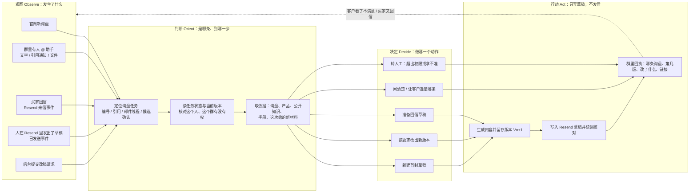
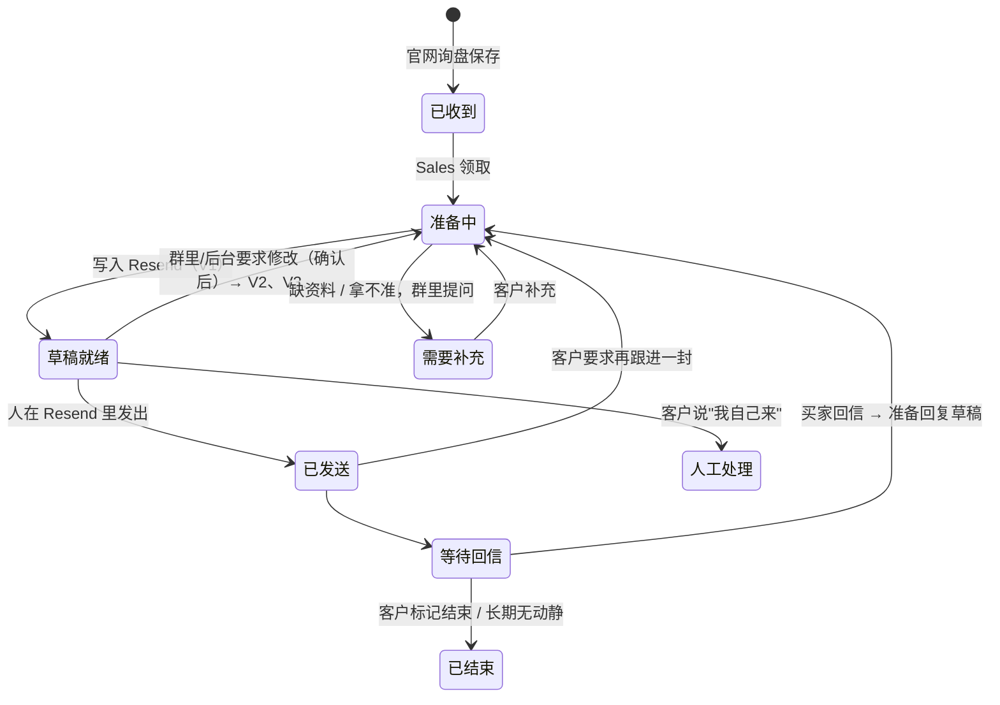
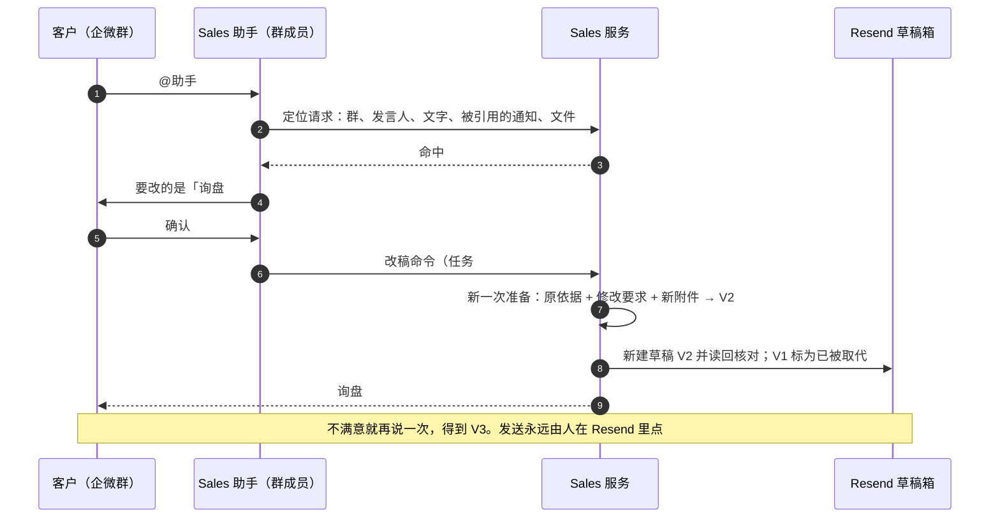
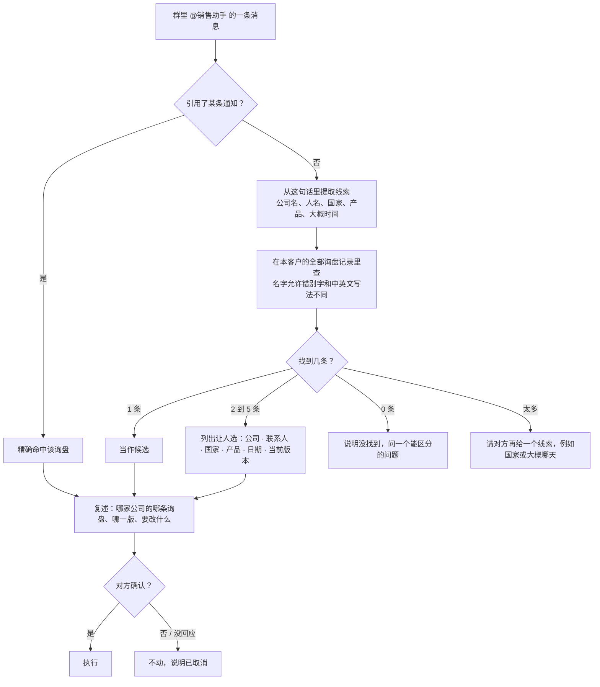
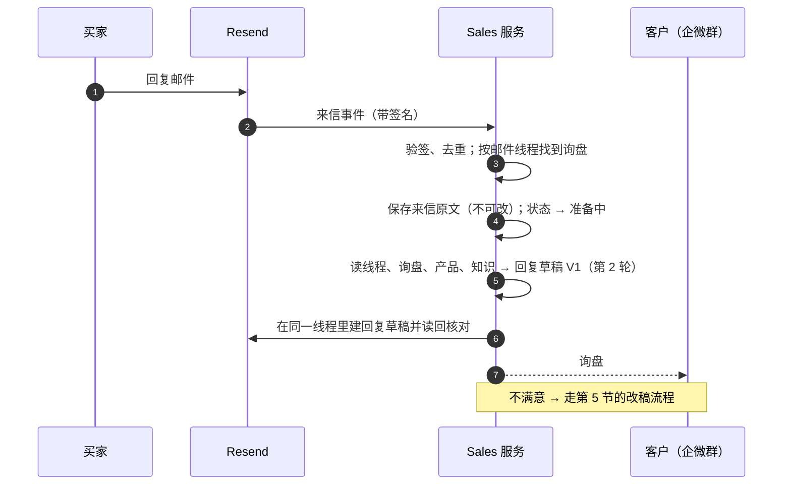

# 询盘草稿不是一次性的：群里改稿、买家回信跟进、使用手册

2026-11-12，设计稿，待负责人确认后实施。对应原计划里尚未实现的 SG5.1 / SG5.2（群内定位任务与改稿）
和 SG4.2（Resend 回调与回信通知），这里把它们收窄成一条能先上线的最小闭环。

## 一句话

一条询盘从进来到成交会被处理很多次。每一次都是同一个循环：**看到一件事 → 弄清是哪条询盘、现在到哪一步 →
决定做什么 → 产出新一版草稿并通知群里**。系统永远只写草稿，发不发由人在 Resend 里决定。

## 0. 负责人已确认的决定（2026-11-12）

| 事项 | 决定 |
|---|---|
| 入口 | 群里有一个**销售助手**（Sales Agent 对人的入口），和内容助手一样可以拉进企微群。它负责所有和销售有关的事：查询盘、改草稿、看回信、解释流程、以后的 Apollo 获客，不只是总结询盘 |
| 怎么指询盘 | 人不会说编号。助手要能按买家公司名、联系人名字，或"前几天问耳机的那个人"这样的模糊说法，自己去翻全部询盘记录，找准了再确认 |
| 谁能要求改稿 | 群里任何成员 |
| 通知显示什么 | 企微只支持文字和 Markdown，不做 HTML 或多媒体卡片。显示询盘编号、买家公司名、联系人、国家或地区、产品、版本、改了什么、链接。信息够认出是谁即可，不堆砌 |
| 在群里直接看邮件 | 每一版草稿同时生成一份图文并茂的 PDF 发到群里（复用内容助手已有的出 PDF 能力），不必去 Resend 草稿箱才能看到邮件长什么样 |
| 手册 | 不是给人看的说明书，而是销售助手自己的**岗位卡**：能做什么、不能做什么、每条流程怎么走、每一步人会看到什么结果。助手按它执行，也按它回答使用者的问题。先做 Resend 这部分，Apollo 等后续资料 |
| 材料归属 | 每条询盘一个案卷，里面的文件和文字都标明来自谁，买家给的和我方加的不混在一起（见第 4.1 节） |

## 1. 现在已经有什么（事实）

| 环节 | 现状 |
|---|---|
| 官网询盘 → Sales | Channel 保存询盘后可靠交给 Hermes 的 Sales 服务（`channel-website` 实例） |
| 准备草稿 | Sales 读询盘、产品和允许的附件，调用模型，生成有依据的跟进内容 |
| Resend | 在客户固定的收件箱里创建草稿并读回核对；**程序没有发送能力** |
| 企微通知 | 两条固定文字：`官网询盘 #N 已收到…`、`官网询盘 #N：跟进邮件草稿 V1 已准备好，尚未发送` + 草稿箱链接。单向推送，群机器人 Webhook |
| 版本 | 库里草稿按 `任务号 + 版本号` 存（`sales_provider_drafts`、`sales_artifact_versions`），旧版本不可改写；已有"为同一任务新建一次准备"的存储能力 |
| 看草稿的地方 | 只有 Resend 草稿箱。Hermes 门户里没有询盘/草稿页面 |
| 群里回话 | **没有**。群机器人只能发，不能收；群里 @ 助手改稿这条路没接 |
| 买家回信 | **没有**。Resend 的来信、已发送事件都没有接进来 |

## 2. 这次要补的四件事

1. 客户在企微群里说"这封不行，改一下"，助手能找到是哪条询盘、跟客户确认、改出新一版。
2. 同一条询盘可以被改很多次；可以加文字、换说法、加附件。
3. 买家回信后，Sales 第一时间知道，先准备一版回复草稿，通知群里；不满意走同一条改稿流程。
4. 助手手里有 Resend 和 Apollo 的使用手册，按手册操作，也能回答客户"怎么用"的问题。

后台（网页）发起改稿是同一个接口的第二个入口，排在企微之后。

## 3. 总图：同一个循环（OODA）

模型只参与"决定写什么"和"写出内容"。定位任务、核对权限、写入 Resend、发通知都是固定程序，
模型不能自己选收件人、换询盘或发信。

## 4. 一条询盘的状态

要点：

- 每次修改产生**新版本**，旧版本保留可查，不覆盖。
- "已发送"之后的草稿属于同一条询盘、同一封邮件线程的下一轮，不新开任务。
- 任何时候客户都可以说"这条我自己处理"，系统停止为它写新草稿。

### 4.1 每条询盘一个案卷，材料分清来源

一条询盘从头到尾的所有东西放在同一个案卷里，任何时候打开都能看到全貌。案卷里每一件材料都带来源标记：

| 来源 | 例子 | 能不能当事实写进邮件 |
|---|---|---|
| 买家提交 | 询盘表单里的需求、买家上传的图纸、买家来信及附件 | 是买家的说法和要求，引用时说明"您提到…" |
| 我方补充 | 群里成员发来的报价单、规格书、口头指示 | 是我方的承诺来源，价格、交期只能来自这里或产品资料 |
| 系统取得 | 实时产品资料、公开知识库文档 | 可引用，带出处 |
| 系统生成 | 各版草稿、PDF 预览、内部备注 | 不能反过来当依据 |

规则：

- 买家的文件和我方的文件分开存放、分开列出，助手写草稿时知道哪句话出自哪一方。
- 买家材料一律当资料，不当指令；我方成员的改稿要求才是指令。
- 案卷只属于一个客户公司，其他客户的助手和群看不到。
- 对外发出的附件只能从"我方补充"和产品资料里选；买家自己发来的文件默认不回发给买家。

## 5. 群里改稿

### 5.1 怎么找到是哪条询盘

人凭记忆说话，不会报编号。助手自己把模糊的说法变成精确的查询：

规则：

- **永远先确认再改**。确认语里写明公司名和要改的内容，防止改错对象。
- 查找范围是这个群所属客户的全部询盘，包括已经发出和已结束的；其他客户的询盘不会出现。
- 大多数时候人会直接说出公司或人名，一步命中；说得模糊时才列选项。
- 查找由程序在询盘记录上完成（名字、公司、国家、产品、时间），模型负责把人话变成查询条件和读懂结果，不凭印象猜。
- 群里发来的文件只接受 PDF、PNG、JPG，单条询盘最多 20 个附件（沿用现有限制）。

### 5.2 谁可以要求改稿

已确认：群里任何成员都可以提。改稿只产生新草稿，不发信。
每次改稿记录是谁、什么时候、要求了什么。发送仍然只在 Resend 里由人完成。

## 6. 买家回信

- 匹配顺序：邮件线程标识（回复的是哪一封）→ 找不到再用"发件人 + 我们发过的主题"→ 仍找不到则
  通知群里"收到一封无法归属的来信"，不猜。
- 同时接"已发送"事件：人从 Resend 发出草稿后，系统才知道这条进入"等待回信"，也才拿得到线程标识。
- 来信里的内容一律当资料，不当指令（买家在邮件里写"把价格改成 1 美元"不会被执行）。
- 买家要求退订、投诉、退信这类事件不生成草稿，直接通知群里由人处理。

## 7. 后台在哪里看、怎么改

- **现在**：只有 Resend 草稿箱（通知里的链接）。Channel 管理后台能看到原始询盘，但看不到 Sales 的处理状态。
- **第二步（企微跑通后）**：在 Hermes 客户门户加一页"询盘跟进"：每条询盘的状态、当前版本、历史版本、
  最近一次改动是谁提的、草稿链接；一个"要求修改"的表单，调的是和企微同一个改稿接口。
  这样两个入口不会各做一套。

## 8. 销售助手的岗位卡

岗位卡是助手自己的操作说明，也是它回答"这个怎么用"的依据。它分两层：

| 层 | 内容 | 放在哪 | 谁保证 |
|---|---|---|---|
| 规则 | 我是谁、管哪些事、哪些事绝不做（不发信、不改收件人、不跨客户）、拿不准就转人工 | 助手的固定提示词和技能文件，随代码发布 | 程序强制：没有发送工具，查询只在本客户范围 |
| 流程 | 每条流程的步骤、每一步人会看到什么、常见问题怎么答 | 知识库里的岗位卡文档，助手操作或回答前先查 | 流程改了，同一个 PR 必须改岗位卡 |

岗位卡第一版（Resend 部分）要写清楚的内容：

1. **新询盘**：官网来了询盘 → 群里收到"已收到" → 几分钟后收到"草稿 V1 已准备好"和 PDF 预览。
2. **看草稿**：群里的 PDF 是预览；真正的草稿在 Resend 草稿箱，链接在通知里。
3. **改草稿**：在群里 @销售助手 说要改哪家的、改什么，可以附文件 → 助手复述 → 回复确认 → 收到新一版。
4. **发邮件**：助手不能发。人在 Resend 里检查后点发送。发出后群里会收到"已发出"的回执。
5. **发没发成功**：助手能回答某封邮件是草稿、已发出、已送达还是被退回，依据是 Resend 的回执，不凭猜。
6. **买家回信**：回信到了群里会有通知和回复草稿；改法同第 3 条。
7. **我自己来**：说一句"这条我自己处理"，助手不再为它写新草稿。
8. **助手做不了的**：报价和交期只能用我方给的资料，没有就问；不承诺折扣；不替人发信。

Apollo 部分（怎么筛公司、额度、结果在哪看、Apollo 发没发邮件）等负责人提供筛选资料、流程定下来后补上，
结构相同。岗位卡放在客户的内部工作区和一个各客户助手共用的"平台岗位卡"工作区，不进公开工作区。

## 9. 要改动的东西（最小）

| 位置 | 改动 |
|---|---|
| Sales 服务 | ① 定位接口：给群、发言人、文字、引用 → 返回候选任务；② 改稿命令：任务、基于哪一版、要求、材料 → 新一次准备；③ Resend 回调入口：验签、去重、线程匹配；④ 任务状态补上"已发送 / 等待回信 / 需要补充 / 人工处理" |
| Resend 适配 | 现在只有"建草稿、读草稿"。需要：把旧版标为已取代（改标题或删除）、在线程里建回复草稿、读来信详情 |
| 企微 | 新增**销售助手**作为群成员，接收 @ 消息和文件（走 Hub 现有的助手接入方式，目前还没有这个助手）；通知改为带公司、联系人、国家、产品的文字或 Markdown；每版草稿附 PDF 预览；改稿回执 |
| 助手规则 | 定位 → 复述 → 等确认 → 下改稿命令；先查手册；拿不准转人工 |
| 知识库 | 销售助手岗位卡（先 Resend 部分）；"平台岗位卡"工作区；每条询盘的案卷索引 |
| 询盘查找 | 按公司、人名、国家、产品、时间在本客户全部询盘里查，容错别字和中英文写法 |
| PDF 预览 | 把每版邮件（正文、图片、附件清单）排成 PDF 发群，复用内容助手已有的出 PDF 能力 |
| 门户（第二步） | "询盘跟进"页和改稿表单 |

不改的：程序没有发送能力；模型不能选收件人；买家联系方式不进群；每个客户的数据彼此隔离。

## 10. 分三步上线

| 步 | 交付 | 怎么算通过 |
|---|---|---|
| 1 | 销售助手进群；按公司名或模糊说法定位、确认、V2/V3、附件；通知带公司和国家；每版附 PDF 预览；岗位卡第一版 | 测试群里只说公司名就能命中；说得模糊时列出选项；对同一条询盘连改 3 次，版本号递增、旧版可查；买家文件和我方文件在案卷里分开；问助手"怎么发邮件""这封发出去了吗"能按岗位卡答对；另一个客户的群里查不到这条询盘；全程 0 封邮件发出 |
| 2 | 已发送事件 + 买家回信 → 回复草稿 → 通知；改稿流程对回复草稿同样可用 | 用测试邮箱回信，群里在几分钟内收到通知和草稿；伪造的回调被拒；同一封来信重复投递只生成一份草稿 |
| 3 | 门户"询盘跟进"页；Apollo 手册 | 网页和企微对同一条询盘发起改稿，结果一致、版本不打架 |

## 11. 还需要负责人定的

已定的见第 0 节。剩下三项：

1. 旧版草稿在 Resend 里是删除，还是保留并在标题上标"已被 V2 取代"？（建议标记后保留，避免误删人已经手改过的草稿）
2. 买家回信后是"自动准备回复草稿"，还是"先通知，等人说一句再准备"？（建议自动，反正不发）
3. "平台岗位卡"工作区是否对所有客户的助手开放。（建议开放，里面只有平台用法，没有任何客户的数据）

## 12. 实施前要先核实的

- Resend 草稿接口能否更新或删除草稿、能否在指定线程里建回复草稿（现有适配只用到新建和读取）。
- Resend 的"来信"和"已发送"回调在这个账号上是否可用，回调里带不带线程标识。
- 企微群里 Sales 助手用哪种接入（现有内容助手的接入方式能否收到文件）。
- 内容助手现有的出 PDF 能力具体怎么调用，能否直接用来排邮件预览（含图片）。
- 线上 `channel-website` 实例当前是否在自动消费新询盘（文档记录到 11 月 9 日为止企微通知尚未启用）。
