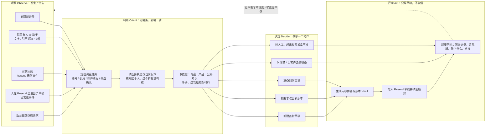
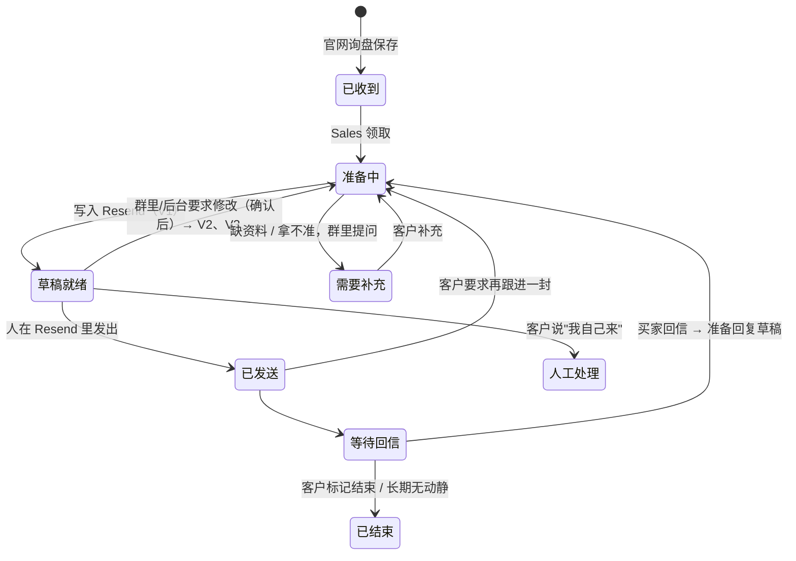
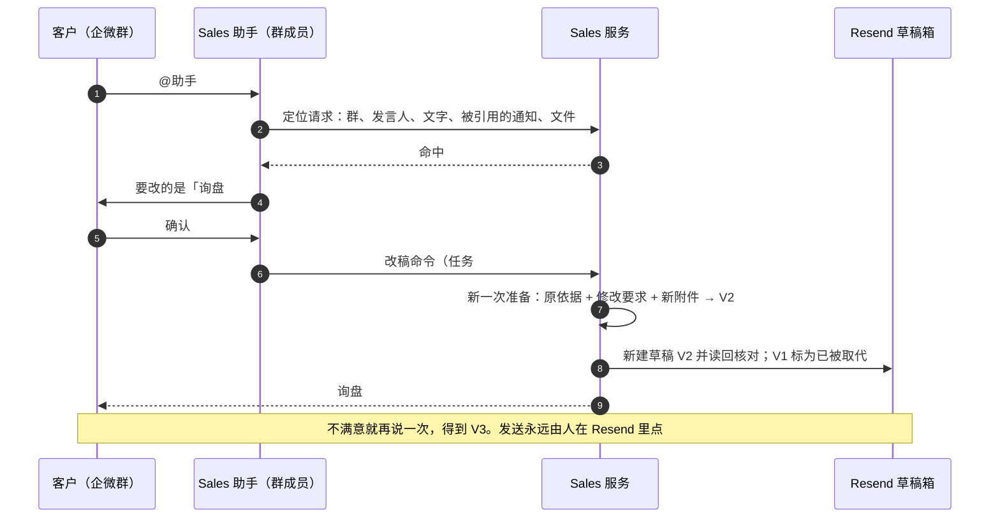
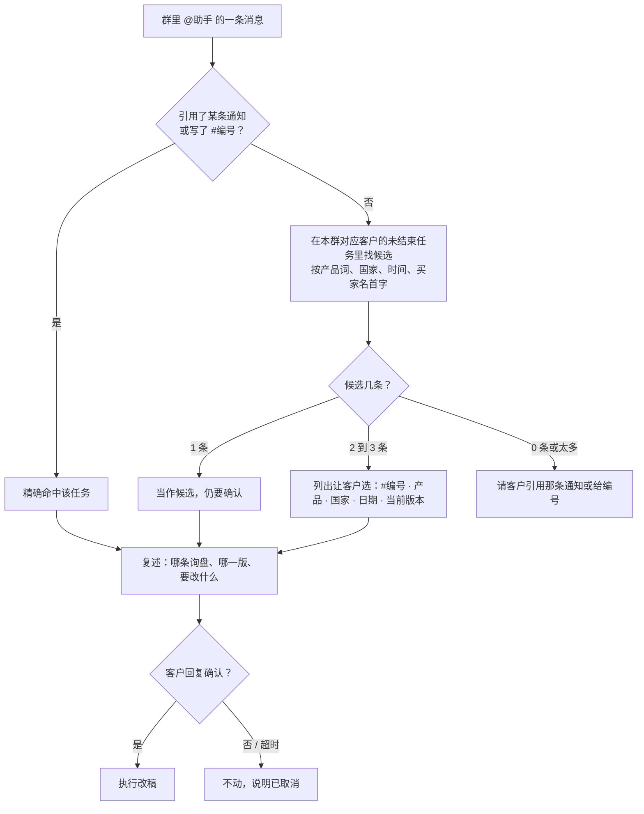
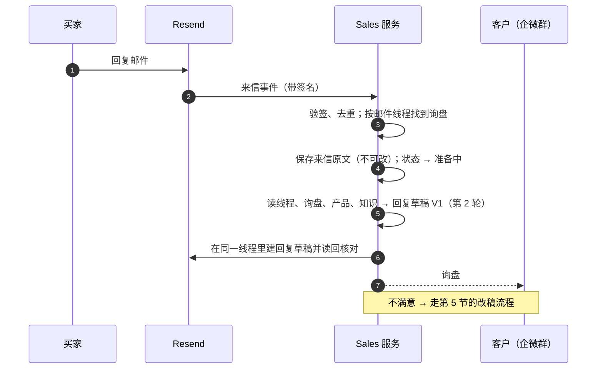

# 询盘草稿不是一次性的：群里改稿、买家回信跟进、使用手册

2026-11-12，设计稿，待负责人确认后实施。对应原计划里尚未实现的 SG5.1 / SG5.2（群内定位任务与改稿）
和 SG4.2（Resend 回调与回信通知），这里把它们收窄成一条能先上线的最小闭环。

## 一句话

一条询盘从进来到成交会被处理很多次。每一次都是同一个循环：**看到一件事 → 弄清是哪条询盘、现在到哪一步 →
决定做什么 → 产出新一版草稿并通知群里**。系统永远只写草稿，发不发由人在 Resend 里决定。

## 1. 现在已经有什么（事实）

| 环节 | 现状 |
|---|---|
| 官网询盘 → Sales | Channel 保存询盘后可靠交给 Hermes 的 Sales 服务（`channel-website` 实例） |
| 准备草稿 | Sales 读询盘、产品和允许的附件，调用模型，生成有依据的跟进内容 |
| Resend | 在客户固定的收件箱里创建草稿并读回核对；**程序没有发送能力** |
| 企微通知 | 两条固定文字：`官网询盘 #N 已收到…`、`官网询盘 #N：跟进邮件草稿 V1 已准备好，尚未发送` + 草稿箱链接。单向推送，群机器人 Webhook |
| 版本 | 库里草稿按 `任务号 + 版本号` 存（`sales_provider_drafts`、`sales_artifact_versions`），旧版本不可改写；已有"为同一任务新建一次准备"的存储能力 |
| 看草稿的地方 | 只有 Resend 草稿箱。Hermes 门户里没有询盘/草稿页面 |
| 群里回话 | **没有**。群机器人只能发，不能收；群里 @ 助手改稿这条路没接 |
| 买家回信 | **没有**。Resend 的来信、已发送事件都没有接进来 |

## 2. 这次要补的四件事

1. 客户在企微群里说"这封不行，改一下"，助手能找到是哪条询盘、跟客户确认、改出新一版。
2. 同一条询盘可以被改很多次；可以加文字、换说法、加附件。
3. 买家回信后，Sales 第一时间知道，先准备一版回复草稿，通知群里；不满意走同一条改稿流程。
4. 助手手里有 Resend 和 Apollo 的使用手册，按手册操作，也能回答客户"怎么用"的问题。

后台（网页）发起改稿是同一个接口的第二个入口，排在企微之后。

## 3. 总图：同一个循环（OODA）

模型只参与"决定写什么"和"写出内容"。定位任务、核对权限、写入 Resend、发通知都是固定程序，
模型不能自己选收件人、换询盘或发信。

## 4. 一条询盘的状态

要点：

- 每次修改产生**新版本**，旧版本保留可查，不覆盖。
- "已发送"之后的草稿属于同一条询盘、同一封邮件线程的下一轮，不新开任务。
- 任何时候客户都可以说"这条我自己处理"，系统停止为它写新草稿。

## 5. 群里改稿

### 5.1 怎么找到是哪条询盘

规则：

- **永远先确认再改**，包括写了编号的情况。确认语里复述询盘和改动，防止改错对象。
- 只在"本群绑定的那个客户"的任务里找，别的客户的任务不会出现在候选里。
- 候选只显示产品、国家、日期这类不敏感的信息；买家姓名、邮箱、报价不进群。
- 为了让客户认得出是哪条，通知里除了编号要再带一个短标签（如"无线耳机 · 德国"）。
  现在的通知只有编号，这是一处要改的地方，标签显示什么由客户配置决定。
- 群里发来的文件只接受 PDF、PNG、JPG，单条询盘最多 20 个附件（沿用现有限制）。

### 5.2 谁可以要求改稿

改稿只产生新草稿，不发信，所以门槛比"批准发送"低：本群里通过企微身份验证的成员都可以提。
每次改稿记录是谁、什么时候、要求了什么。发送仍然只在 Resend 里由人完成。

## 6. 买家回信

- 匹配顺序：邮件线程标识（回复的是哪一封）→ 找不到再用"发件人 + 我们发过的主题"→ 仍找不到则
  通知群里"收到一封无法归属的来信"，不猜。
- 同时接"已发送"事件：人从 Resend 发出草稿后，系统才知道这条进入"等待回信"，也才拿得到线程标识。
- 来信里的内容一律当资料，不当指令（买家在邮件里写"把价格改成 1 美元"不会被执行）。
- 买家要求退订、投诉、退信这类事件不生成草稿，直接通知群里由人处理。

## 7. 后台在哪里看、怎么改

- **现在**：只有 Resend 草稿箱（通知里的链接）。Channel 管理后台能看到原始询盘，但看不到 Sales 的处理状态。
- **第二步（企微跑通后）**：在 Hermes 客户门户加一页"询盘跟进"：每条询盘的状态、当前版本、历史版本、
  最近一次改动是谁提的、草稿链接；一个"要求修改"的表单，调的是和企微同一个改稿接口。
  这样两个入口不会各做一套。

## 8. 使用手册怎么给到助手

两份手册，都写成"遇到什么情况 → 怎么做"的问答式短文，中英各一份：

| 手册 | 内容 | 给谁用 |
|---|---|---|
| Resend 使用手册 | 在哪看草稿、怎么改、怎么加附件、怎么发、发错了怎么办、买家回信在哪看、通知里的编号和版本是什么意思、怎么让助手改稿 | 客户；助手回答"怎么用"时引用 |
| Apollo 使用手册 | 获客流程是什么、助手能查什么不能查什么、额度怎么算、结果在哪看、试用期限制 | 客户；助手操作时遵守 |

- **放在哪**：知识库。平台通用的部分放一个所有客户助手都能读的"平台手册"工作区；某个客户特有的
  （比如他的发件邮箱、收件箱名字）放在该客户的内部工作区。不进公开工作区，官网访客读不到。
- **助手怎么用**：助手的规则里加一条——回答 Resend / Apollo 的使用问题、或执行这两类操作之前，
  先查手册，按手册说的做，答不上来就说不知道并转人工。
- **怎么保持不过时**：手册里每一条都对应一个真实可验证的操作；流程一变，改流程的那个 PR 必须同时改手册。
- Apollo 手册要等新的受限密钥到位、流程定下来之后才能写准；Resend 手册现在就可以写第一版。

## 9. 要改动的东西（最小）

| 位置 | 改动 |
|---|---|
| Sales 服务 | ① 定位接口：给群、发言人、文字、引用 → 返回候选任务；② 改稿命令：任务、基于哪一版、要求、材料 → 新一次准备；③ Resend 回调入口：验签、去重、线程匹配；④ 任务状态补上"已发送 / 等待回信 / 需要补充 / 人工处理" |
| Resend 适配 | 现在只有"建草稿、读草稿"。需要：把旧版标为已取代（改标题或删除）、在线程里建回复草稿、读来信详情 |
| 企微 | Sales 助手作为群成员接收 @ 消息和文件（走 Hub 现有的助手接入方式）；通知加短标签；改稿回执 |
| 助手规则 | 定位 → 复述 → 等确认 → 下改稿命令；先查手册；拿不准转人工 |
| 知识库 | 两份手册；"平台手册"工作区 |
| 门户（第二步） | "询盘跟进"页和改稿表单 |

不改的：程序没有发送能力；模型不能选收件人；买家联系方式不进群；每个客户的数据彼此隔离。

## 10. 分三步上线

| 步 | 交付 | 怎么算通过 |
|---|---|---|
| 1 | 群里改稿：定位、确认、V2/V3、附件、通知带标签；Resend 手册第一版进知识库 | 测试群里对同一条询盘连改 3 次，每次版本号递增、旧版可查；故意不写编号时会让人选；另一个客户的群里查不到这条询盘；全程 0 封邮件发出 |
| 2 | 已发送事件 + 买家回信 → 回复草稿 → 通知；改稿流程对回复草稿同样可用 | 用测试邮箱回信，群里在几分钟内收到通知和草稿；伪造的回调被拒；同一封来信重复投递只生成一份草稿 |
| 3 | 门户"询盘跟进"页；Apollo 手册 | 网页和企微对同一条询盘发起改稿，结果一致、版本不打架 |

## 11. 需要负责人定的

1. 通知和候选列表里的短标签显示什么（建议：产品名 + 国家）。买家公司名要不要显示？
2. 群里任何成员都能要求改稿，还是只限指定的人？
3. 旧版草稿在 Resend 里是删除，还是保留并在标题上标"已被 V2 取代"？
4. 买家回信后是"自动准备回复草稿"，还是"先通知，等人说一句再准备"？（建议自动，反正不发）
5. "平台手册"工作区是否对所有客户的助手开放。

## 12. 实施前要先核实的

- Resend 草稿接口能否更新或删除草稿、能否在指定线程里建回复草稿（现有适配只用到新建和读取）。
- Resend 的"来信"和"已发送"回调在这个账号上是否可用，回调里带不带线程标识。
- 企微群里 Sales 助手用哪种接入（现有内容助手的接入方式能否收到文件）。
- 线上 `channel-website` 实例当前是否在自动消费新询盘（文档记录到 11 月 9 日为止企微通知尚未启用）。
