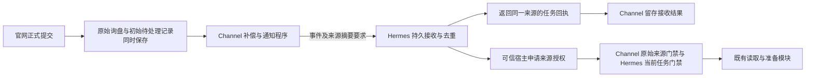

# SG1.2：官网询盘可靠接入交付记录

2026-10-29。SG1.2 的本地实现、独立评审和约定验收已完成。交付范围是“正式保存的询盘可靠到达 Hermes，成为可授权处理的任务”；未部署、未连接客户账号、未调用真实模型、未发邮件。

关于编号、两边数据库职责和上一轮耗时，先看[详细解释](SG1.2-EXPLAINED.md)。本轮仍使用 SG1.2，不再增加对外子阶段编号。

## 现在具体能做什么

单品询盘复用原有批准快照、限流、幂等和保存事务。在新记录分支，同一事务保存询盘、服务端归属、最终提交证明、不可变接入登记和初始 pending。已有记录重试只返回原 ID，不补归属、补登记或补发。

OEM 的现代上传和无附件提交在 Sales 开关启用后，复用现有 secret、single-winner claim、实际下载及字节验证，再由专用事务一起创建项目、激活已验证附件、保存最终证明、登记和 pending。事务中途失败不会留下“有项目、附件却没完成”的可派发半成品。提交结果未知时，不会盲目把可能已提交成功的 active 附件改成 failed。

来源和启用时间只取服务端配置。关闭开关或尚未到 cutover 时，买家照常保存，暂不进入 Sales；以后重试也不把旧记录补发。普通提交及泛型 CRUD 不能伪造这些归属／完成字段。有效现代附件即使附带未使用的旧 drawingData 字段，也仍按现代路径登记一次。

通知程序读取持久 pending，通过固定连接向 Hermes 发出事件。失败或回执丢失可恢复；同一业务记录重投复用同一任务。领取、重试和接收结果都要求当前执行身份，旧进程不能覆盖新尝试。网络不占用数据库事务。

补偿只扫描 pending／retry／inflight，不扫描全部旧询盘，也不让 accepted 历史占满队列页。已验证 1,000 条 accepted 历史不会拖住新的待处理记录。游标可回绕，晚到记录和单个坏登记不会永久挡住后续工作。

## Channel 与 Hermes 如何交接

Hermes 的可选 `source-v1` 回执会返回被接受事件的规范摘要，Channel 同时检查 202、任务／run、queued 状态、协议及摘要。旧调用不带该要求时，响应保持原样。这个摘要通过已认证连接绑定事件，不是另造一套数字签名协议。

图中从任务到准备的后半段，在本轮跨仓测试中由可信测试宿主显式执行。**Hermes accepted 表示已经持久接收，不表示生产模型已经自动消费或发出邮件。** 自动消费者、实际模型和 Resend 仍按原后续模块接入。

## 实际读取接线也已补齐

单品实际 runtime 原来通过公共 `get()` 读取未注册私有集合，会报 Unknown collection。现在使用限定 OEM／单品询盘／文件三个集合的专用读取口，不把私有询盘开放给泛型 CRUD。新增测试直接从 `createSalesRuntime` 的配置、SDK 查询及授权路径读取单品，未替换 readDoc 绕过接线。

producer、reader 和通知程序共用来源投影与规范事件算法；SDK 成功、缺失与错误包使用同一严格判断。环境凭据引用只来自受信任 registry，并支持安全 POSIX 名字，真实仓库的小写后缀 fixture 也已覆盖，模型或请求不能选择环境变量名。

## 验证结果

| 检查 | 最终结果 |
|---|---|
| DB 包 | 233 项通过，0 跳过 |
| Admin 包 | 245 项通过，0 跳过 |
| Public API 包 | 115 项通过，0 跳过 |
| Local server 包 | 153 项通过，0 跳过，包含文件重启持久化 |
| Sales integration 包 | 108 项通过，0 跳过，包含实际 runtime、sender 和真实 SDK 序列化探针 |
| 新官网纵向验收 | 8/8，通过实际保存、登记、sender HTTP、Hermes MySQL、原 Dispatcher；40.443 秒，0 失败／错误／跳过 |
| 原来源授权回归 | 14/14，25.532 秒，0 失败／错误／跳过 |
| Hermes 全量 Hub | 执行 293 项；208 项通过，85 项因未启用所需环境而跳过。单独的两组纵向验收没有跳过 |
| 定向缺陷注入 | 来源授权 5/5、通知／补偿 9/9、可选回执 3/3，均由指定行为断言抓出 |
| 交付检查 | 五包类型检查、SDK 合同、函数构建、双入口打包／冷启动、Black、Pyflakes、工作流 YAML 和差异检查通过 |

五个 Node 包合计 854 项通过。focused 和大回归中重复执行的用例不再加进这个数。

两个纵向套件顺序使用各自的临时 MySQL，前一组清理后才启动后一组；实际 tmpfs 均为 1GiB。最终两仓被消费源码摘要前后一致，也与准备提交的源码相同。自有容器和卷已清理。它们证明真实 MySQL 事务、连接和重试，不证明数据库重启或掉电耐久性。

本地保留了调试及失败证据：一次清单文件名错误在创建测试容器前被拦下；一次新 SDK 探针的加载／序列化预期不匹配已修正，并独立验证源码与打包 CJS 的启用 factory；一次缺陷注入的干净基线加载超时没有执行 mutant，隔离后按原时限复跑 9 项通过。这些不计作业务测试或缺陷注入成功。

独立评审明确复现并关闭两个 P2：本地 future cutover 阻止正常保存、现代附件附带旧字段导致漏登记。事务未知结果、领取权、失败写入、实际 SDK 查询和启用入口另作复核。没有尚未关闭的阻断性发现。

## 与 pricing／SEO 的兼容边界

已只读比较 pricing `30b84b18` 和 SEO foundation `01438e52`。DB adapter／facade 的专用方法是可协调的增量；冲突主要是同处新增的 import、配置字段、package exports 与 lockfile，需要正式合并时保留双方并重新生成锁文件。没有改对方工作树，也没有把这些普通文本冲突写成“无交叉”。

当前没有发现业务逻辑不可调和的冲突。这个结论是源代码及冲突段复核，不代表已经把三个分支合在一起跑过完整回归，见[比较记录](SG1.2-COMPATIBILITY.json)。

## 上线前还要做什么

部署前按[运行说明](SG1.2-DELIVERY-RUNBOOK.md)准备私有集合／索引、固定客户及安装配置、独立凭据和周期调用。部署包包含服务端 `reconcile.js`；本轮没有安装线上定时器或增加公开控制路由。不开启生产开关时原业务路径保留。

CloudBase 来源库和事务在跨仓验收中是合成适配器；实际 SDK 合同与序列化另有验证，仍须上线环境验收。旧 inline 附件可继续保存，但不自动登记；智能客服在正式确认提交入口完成前不冒充表单。OEM 原表单没有提交幂等键，本轮保证同一持久登记的任务去重，不承诺买家重新填一张表单也零重复。

后续继续接任务自动消费者、私有模型适配器，再进入 Resend 草稿、完整预览和人工审批发送。暂停、恢复、人工接管界面继续后置，未在这次实现。

## 文字与事实复核

本记录核对了原保存入口、共用投影、实际 runtime 读取、SDK 适配器、投递状态机、扫描游标、打包入口、五包回归以及两组跨仓报告。把“官网询盘自动处理完毕”明确为“官网正式记录可靠进入 Hermes，自动模型和外发未接入”，同时区分 Node 回归通过、环境跳过、测试 setup 失败和线上未验收。

## 远端复验补充

首个 Channel 远端运行已通过合同、Sales 接线及定向缺陷注入，但全包 Local server 回归中的两个既有测试会从 site 包加载 React／共享前端模块。原来的过滤安装只包含后端依赖图，CI 缺少 site 的包内依赖，导致导入失败。本地完整依赖下这两项已通过。现将实际被测试消费的 site 依赖图加入锁文件安装范围，不修改测试断言、不改产品代码；对应代码与环境修正分别提交，最终以修正后的远端运行结果为准。
