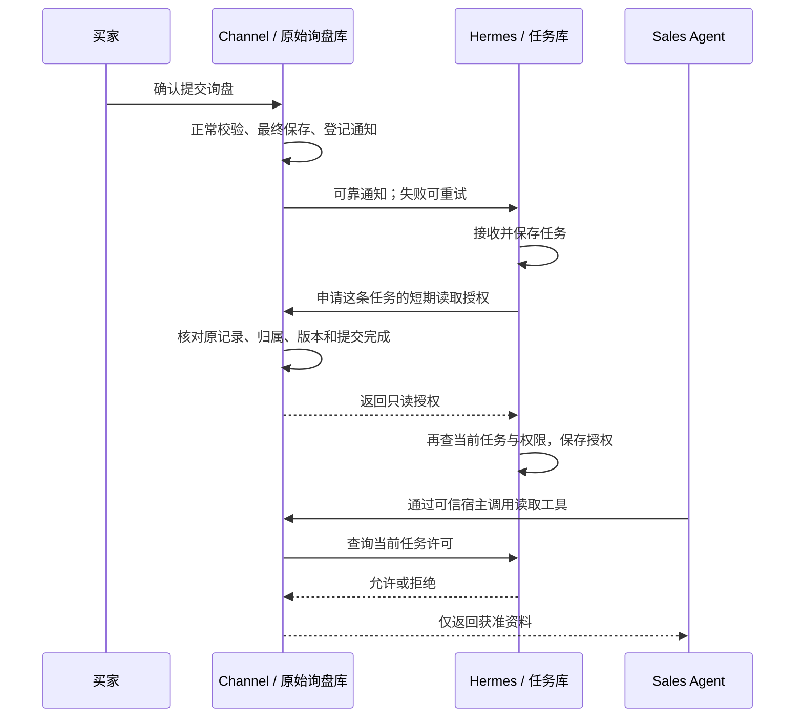

# SG1.2：这轮做了什么、谁校验什么、时间花在哪里

2026-10-29。按已经提交的 Channel `fe44c5df`、Hermes `f57c5eb` 及测试报告说明。这里说的是本地实现和验证，不代表已经上线。

## 先回答你的判断

你的理解大体正确：上一轮主要补的是系统权限和可信来源校验，两边都参与。Channel 确认“这份询盘确实属于这个客户，而且已完整提交”；Hermes 确认“当前处理这份询盘的任务仍有效，并且允许这些动作”。这两件事分别由拥有原始资料和拥有任务状态的系统负责。

正式提交的表单不需要模型再判断一次“这算不算询盘”。权限门禁也不由模型决定。客户在智能客服里聊到一半、没有确认提交，则仍是聊天，不会因此自动产生销售任务。

## 为什么从 1.2 又变成 1.2a、1.2b

原计划的 SG1.2 是“询盘通知与补偿扫描”。之后按你的安全要求，增加了必须在系统层完成的来源核验、任务授权和真实工具接线；前面的读取门禁已有 SG1.3、SG2.4，首次来源签发还缺一段。上一轮补的是这段前置能力。

字母是我给同一模块的内部交付步骤起的名字，不表示又出现了一组新产品功能。但对外这样汇报，会让你难以判断原来的 SG1.2 到底完成多少。这是汇报方式的问题。

后续保留原模块编号 SG1.2，用“来源授权已完成／官网提交与可靠通知进行中／模块验收完成”说明状态。内部仍可以分步开发、测试和提交，不再把每个步骤当成新的对外阶段。历史文件名保留，避免已有链接失效。

## 不是所有权限都放在同一个数据库

| 系统与保存位置 | 保存什么 | 校验什么 |
|---|---|---|
| Channel 云文档库：`oemProjects`、`catalogQuoteRequests`、`files` | 客户实际提交的询盘和附件元数据 | 原记录存在，客户／业务／网站归属明确，提交完成，内容版本和附件归属一致 |
| Channel 云文档库：安装、绑定、handoff、lease 和请求记录 | 接入配置、来源交接、短期读取权限及去重记录 | 这个服务和连接能否访问此客户；旧交接是否撤销；同一凭据是否被挪用或重复签发 |
| Hermes 服务器受控绑定配置文件 | 客户、业务、运行环境、连接及动作范围 | 当前服务身份属于谁，允许使用哪些连接与工具；这部分目前不是全部存 MySQL |
| Hermes 专用 MySQL：任务、run、授权、接收及审计记录 | 已接收的询盘任务、当前执行批次、任务动作上限和结果状态 | 是否当前任务／当前 run，是否仍可执行，权限是否已收窄，旧运行是否过期或失效 |

Channel 不持有 Hermes 的全部任务状态。Hermes 也不能仅凭自己数据库里的事件就断言 Channel 的原记录一定有效。

## 一条询盘具体怎样走

以“客户提交 500 个耳机的采购需求”为例：

1. **官网先做正常业务校验和保存。** 必填项、产品及附件规则继续由现有表单接口负责。保存失败就没有正式成功的询盘。
2. **最终保存成功后，登记待通知事项。** SG1.2 剩余工作要接这一段：网络暂时不通也能重试，不让买家重新提交。OEM 附件还没有激活成功时不能通知。
3. **Hermes 持久接收任务。** 收到事件后先保存任务。这个时点只是“收到待处理事项”，还没有凭空获得读取全部私有资料的权力。
4. **可信宿主向 Channel 申请读取授权。** Channel 重读原始询盘和当前配置，核对客户、来源版本、附件及提交完成状态，再保存最长 300 秒的读取授权。有效期和读取范围不能由模型指定。
5. **Hermes 返回后再查自己的任务状态。** 申请期间可能已经换了 run 或收窄了权限，因此不能直接把旧结果落成有效状态。通过后才保存授权和审计记录。
6. **Agent 每次读资料仍走受控接口。** Channel 检查原记录、短期凭据和任务范围，再向 Hermes 查询当前许可。读取实时产品也经过同样的系统门禁。模型只接触准许它看到的业务数据。

图中的官网登记和可靠通知是本轮继续接入的内容；上轮测试由测试宿主显式安排各步骤，不能据此说生产官网已经自动运行整条链。

## 为什么已经落盘，Channel 还需要校验

“数据库里有一条记录”只证明写过数据，不能证明这次来读它的 Agent 有权访问。Channel 还要防止：

- A 客户的 Agent 拿着 B 客户的记录 ID 过来读取。
- OEM 项目行先建好了，但附件激活失败，补偿删除又没有成功。
- 通知里的联系人或版本和原始记录不一致，或者通知被伪造、重复投递。
- 安装或连接已撤销，旧凭据继续使用。

这些是系统来源和访问权限问题，不是在重新判断买家有没有采购意向。正常询盘不增加人工审批步骤；系统自动核对。

Hermes 要防的则是：旧任务仍在运行、重试已经创建了新 run、任务权限被收窄后又被续期恢复。它保存当前任务，因此最后的任务许可由它提供。两边检查的依据不同。

## 代码量有多少

以下按两个实际实现提交的 `git show --numstat` 统计新增物理行，不把它当成完成度或质量分数：

| 类别 | Channel `fe44c5df` | Hermes `f57c5eb` |
|---|---:|---:|
| 运行代码 | 593 行 | 562 行 |
| 测试和测试资料 | 670 行 | 1,224 行 |
| 测试运行器 | 0 行 | 211 行 |
| 文档及结构化证据 | 61 行 | 1,858 行 |
| 其他配置及合同资料 | 100 行 | 10 行 |

两边运行代码合计新增 1,155 行，测试和测试资料新增 1,894 行。Hermes 的核心授权类约几百行只是其中一部分。上一轮没有开发完整的新 UI、邮件客户端或营销流程，所以业务功能的可见增量确实比文件数量小。

## 48 分钟具体花在哪里

你看到的约 48 分钟是整轮耗时。现有记录没有把实现、讨论、阅读、评审和写文档逐项完整计时，我不能把剩余分钟编成精确工时账，也不能把整轮都算作测试。

能够直接从结构化报告核实的运行时间是：

| 可核实的运行 | 实际耗时 | 结果 |
|---|---:|---|
| 第一轮跨系统 MySQL／HTTP 联调 | 469.57 秒，约 7 分 50 秒 | 13 项执行，1 项在清理测试数据库时超时，整轮按失败保留 |
| 第二次环境启动核验 | 13.59 秒 | tmpfs 探针取错字段，测试尚未开始就停止，不算通过 |
| 修正环境和代码后的最终联调 | 35.89 秒 | 14 项全部通过，0 跳过 |

这三次按顺序运行合计约 8 分 39 秒。初次主要有临时 MySQL 启动、逐用例建表与清理的等待；最终使用有边界的内存文件系统后，仍跑同一 SQL 引擎和真实事务，没有放宽业务时限。

整轮还包含实现、两仓接线、独立评审、修复、单元回归、定向缺陷注入、构建打包、文档、提交及远端 CI。其中有的并行进行，不能简单相加。模型生成更快也不会让数据库启动或远端 CI 按相同比例加速。

核验投入确实较多，原因是这里写错时不一定报错，可能表现为“成功读到了不该读的资料”。但也有可改进的执行开销：测试环境启动慢、运行中缺少进度、对外拆分过细。它们已分别改为更合适的临时存储、逐用例进度和按原模块汇报。

## 测试实际抓到了什么

- **续期会扩权。** 系统已经把任务的附件读取权移除，普通续期却会恢复它。现在保存 Channel 许可和当前任务许可的交集。
- **读取错误被当成“不存在”。** SDK 返回错误包时，旧适配器可能把它看作没有旧授权，再走新建路径。现在错误包直接拒绝，只有明确的空结果才算不存在。
- **只测试第一次写失败不够。** 已补第 1／2／3／4 次写入失败，确认前面已暂存的记录不会留下半成品，恢复后同一请求仍可重试。

最终跨系统 14 项通过；Hermes 定向破坏 8 项检查、Channel 定向破坏 5 项检查，测试都能在预期断言发现错误。全量 Hub 执行 277 项，200 项通过、77 项因缺少所需环境而跳过；单独的跨系统 14 项没有跳过。两个实现提交的远端 CI 已通过。

这些结果证明所测模块和边界，不证明线上 CloudBase、真实模型、实际邮件投递或所有可能的攻击都已经验证。

## 接下来按 SG1.2 继续什么

继续把真实 OEM／单品保存流程接到可信来源登记和可靠通知：服务器固定客户归属，只有最终成功才登记；失败通知可恢复，重复通知只接收为同一任务，历史记录默认不补发。原有输入、限流、产品版本、附件和幂等保护继续复用。

SG1.2 的完成条件是“官网正式记录可靠到达 Hermes 并成为可授权的任务”，不是“已经接入真实模型并发出邮件”。自动执行器、模型适配器和 Resend 审批发送分别按原计划后续模块接入，不在这里悄悄改变完成标准。

本说明复核了两仓实现、客户端、来源适配器、任务授权、三份联调报告、缺陷注入记录和实际提交行数。将“一句话完成可信来源”改成按保存、登记、接收、来源核对、任务核对、读取分别说明，避免让阶段名称代替实际行为。
