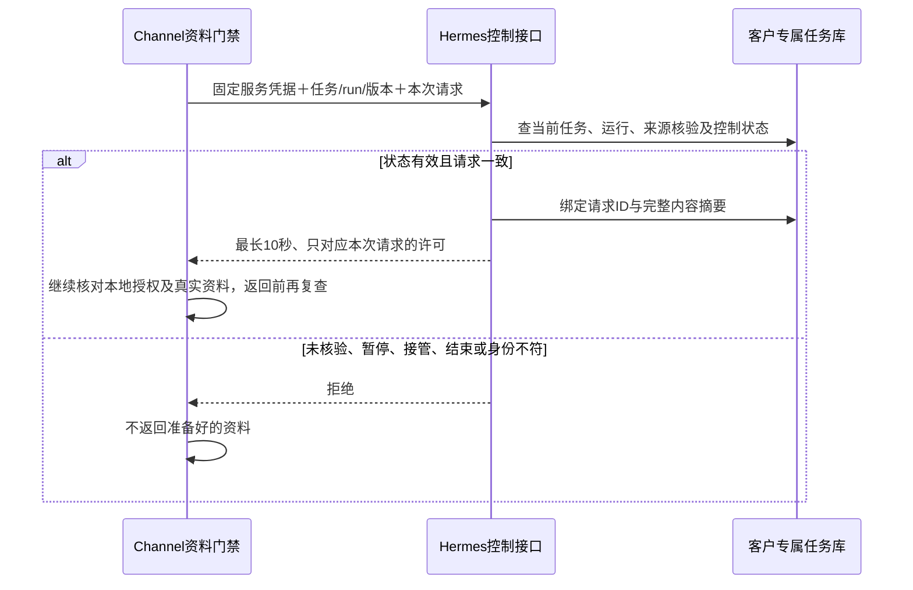

# 这一步完成了什么：Hermes 从任务库判断能不能读资料

2026-10-28。实施单元 SG2.4；前提是上一轮 SG0.3 共同规则和 SG1.3 Channel 门禁已经完成。最终代码与检查结果见文末验证表。本轮没有上线或接客户账号。

## 为什么接着做这一项

上一轮 Channel 已经会检查客户连接和任务短期授权，并向 Hermes 询问“这项任务现在还能不能继续读资料”。但那时 Hermes 只有判断规则，没有能查真实任务状态的 HTTP 接口；测试用的是合成控制服务。

这次把 `POST /sales/authorize-read` 接到 Hermes 的客户专属 MySQL。它每次读取当前任务记录再决定，不接收模型或调用方自己填写的“我已经获准”。这段代码在 Hermes 仓库的 Sales 专用适配包里，没有改变通用 Hub 或其他 Agent 的行为。

## 实际怎样判断

假设有一条“采购500份礼品”的询盘。Sales 的工具代理准备读取它时，Channel 先检查自己保存的授权及资料归属，再向 Hermes 查询这次任务许可。

两个系统各管自己的事实：

| 要确认的事 | 负责方 |
| --- | --- |
| 询盘和附件实际属于谁；授权是否到期或撤销；产品是否是获准资料 | Channel，继续复用上一轮实现 |
| 当前是哪一项任务、哪一次运行；是否已核验来源；是否暂停、人工接管或结束 | Hermes，本轮从数据库查询 |
| 解释买家需求、挑选产品、生成邮件 | Sales Agent，后续接入真实模型和工具循环 |

Hermes 本轮还同时检查已有调度记录。即使某张控制表过时、仍写着“准备中”，只要调度任务已经取消、完成或失败，也不能发出读取许可。这是本轮复核后补上的一项保护。

## 新增的数据放在哪里

没有把任务数据搬进 Channel，也没有新增全局共享任务库。仍使用前面 SG2.2 建立的客户专属 Sales 数据库，增加两张表。

`sales_task_authorizations` 保存这项任务的当前运行、控制版本、来源核验结果、交接摘要、工作状态和允许动作。新询盘在原来的接收事务里同时写入等待记录；授权记录写失败，任务、run 和 outbox 都回滚，不会留下“任务存在但安全记录丢了”的半成品。

`sales_read_requests` 保存 task/request_id 与完整请求摘要的对应关系。Channel 读取前后检查相同请求、或网络丢了响应后重试，都可以再次查询；同一个请求ID换了产品、动作、参数、run 或版本，就不能继续沿用。

这两张表不是邮件草稿库，也不保存模型的长期记忆。模型没有直接访问它们的工具。数据库迁移仍是单独、明确执行的安装步骤，正常服务启动不自动改表或给旧任务补权限。

## 凭据和新任务默认状态

控制查询使用独立的 `SALES_CONTROL_TOKEN`。原来的询盘接收凭据、worker 凭据不能调用这个接口；控制凭据未配置时也拒绝。它绑定固定的客户服务部署，调用方不能通过修改JSON切换客户或环境。

新任务默认保存为“来源未核验、禁用、等待中”。收到202或worker已接收，只说明任务已经可靠排队，不能用来顶替资料读取权限。旧任务如果没有这条授权记录，也不会默认放行。

这并不是给销售增加一次手工放行。下一步要接的是服务器之间的自动来源核验和短期凭据签发。当前没有用于把任务强行改成已核验的HTTP入口；测试只在隔离数据库中布置合成的已核验状态，用来检验门禁，不作为生产操作方案。

## 怎样验证

先看到路由缺失导致404的失败，再接入接口。真实MySQL复核又发现三个终态仍放行的反例：取消、完成、失败。补检查前均是“应拒绝但未拒绝”；修复后再跑数据库回归。

还使用 Channel 仓库中原有的 TypeScript 客户端，直接调用这次的 Python HTTP 服务和真实 MySQL。正常合成任务能取得有效许可；数据库保存暂停和新版本后，同一客户端会拒绝。这个检查没有使用替身许可服务，但它仍是本地合成联调，不是线上定海或客户账号验收。

本地和对应代码提交的远端结果均已确认：

| 检查 | 状态 |
| --- | --- |
| 本地 Hub 回归 | 90项：65通过，25项明确按依赖跳过 |
| 既有 dispatcher 自检 | 33通过 |
| 新增真实 MySQL 授权测试 | 13项全部通过，0失败/0跳过 |
| Channel实际客户端→Hermes HTTP→MySQL | 1项通过，覆盖许可与暂停拒绝 |
| 静态检查、格式和diff检查 | 通过 |
| 远端真实 MySQL 与 A/B Docker | 通过：既有MySQL10项、新授权13项、A/B容器1项 |

Hub回归跳过的25项是既有MySQL10项、本轮MySQL13项、Docker1项及另一个检出的跨仓联调1项；这些依赖项要看各自实际执行记录，不能把skip写成通过。本地已有SQLite测试的未关闭连接警告继续保留，没有为本单元修改它的代码。

## 离完整业务流程还有多远

这一轮完成的是读取许可查询，还没有让真实官网询盘自动跑完销售准备。接下来要自动核验 Channel 的正式提交和最终完成状态，登记 handoff、签发与 task/run 绑定的短期读取授权，再启动任务独立上下文中的实际工具与模型循环。

企微/网页操作者认证、暂停和恢复入口、邮件草稿、审核及受控发送仍属于后续模块。本轮验证的是“状态已经在数据库改变后，门禁是否拒绝”，没有假称已经交付暂停按钮。

跨系统查询仍存在网络在途窗口，已经返回的数据不能撤回。Channel 返回资料前继续复查，不能把本轮事务测试当成跨服务原子撤权或绝对安全的证明。上线前还要验证真实客户的数据库权限、网络与TLS、运行目录和服务身份。

工程计划见[SG2.4计划](SG2.4-PLAN.md)。通用语义仍按[D1权限与工具设计](../SECURITY-AND-TOOLS-DESIGN.md)；10月26日图/PDF保留为设计快照，这轮没有改变既定业务流程。

技术依据：[MySQL锁定读取](https://dev.mysql.com/doc/refman/8.0/en/innodb-locking-reads.html)、[唯一键冲突处理](https://dev.mysql.com/doc/refman/8.0/en/insert-on-duplicate.html)。测试环境RSA认证依赖按[PyMySQL官方说明](https://pymysql.readthedocs.io/en/latest/user/installation.html)和实际安装包metadata核对，未降低生产TLS要求。

## 提交与交接

Hermes实现代码 `6b36a9dc6a3fb1d4f9ea34b351c457ab966d5abc` 已推送到 `feat/sales-agent-runtime`，对应[Sales runtime 40643073628](https://github.com/vibelingan/hermesinfra/actions/runs/40643073628)成功。后续文档提交不改变这个代码验证身份。Channel本轮只有销售设计和交接资料更新，没有改运行代码。两个检出均继续使用原销售分支。

本轮创建的合成MySQL容器已停止并移除。机器可核对的结果和源码hash见[结构化验证记录](SG2.4-VALIDATION.json)。该记录只用于追溯本次验证，不能代替未来部署验收。
