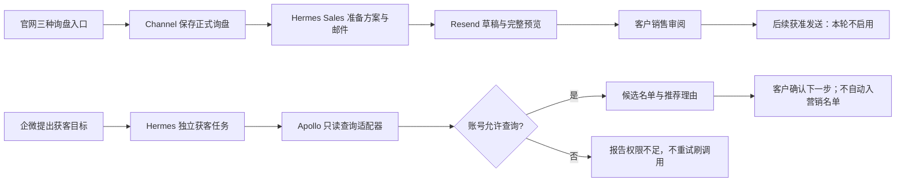

# SG6 Apollo 独立获客：当前接入设计

2026-11-06。本次以现有客户独立 Apollo 空间做只读试点；SG6.0 为连接与权限验收，SG6.1 为候选查询，SG6.2 为未来回复交接。下方旧活动/发信设计保留为后续参考，不作为当前已批准实施范围。

## 当前真实结果与决定

- 专用 Key 已安全接收；auth/health 和 users/api_profile 均返回 200，账号匹配预期登录邮箱。
- 人员搜索 mixed_people/api_search、新公司搜索 mixed_companies/search 各做一次最小查询，均返回 403。进一步核对错误类别为 `API_INACCESSIBLE`，错误明确提到当前 Free 计划及升级要求；当前Free计划不能完成搜索。Key范围也必须匹配相应接口；不反复重试、不改用其他客户凭据、不自动开试用/付费。
- 官网询盘与主动获客独立。官网提交成功仍走 Channel → Hermes 销售准备 → Resend 草稿/审阅；不会为了 Apollo 403 阻塞这条线。
- Apollo 首期只负责发现候选，不接邮箱、不启动 Sequence、不发邮件。客户已询价的后续邮件与陌生人冷开发的发送资格分开；Resend 的反垃圾规则不能因接通 Apollo 被绕过。

## 最小业务流程



入口、调用人权限和客户工作空间由宿主配置确定，模型只填获客条件。只读连接没有跨平台写入，不新增消息队列、同步库、轮询器或 Channel 任务页面。现有定海、内容工厂、发布助手可复用岗位和工具，但当前不改它们的在线部署。

## SG6.0 / SG6.1 详细设计与 MIU

现有代码：Hermes 的 `sales_flow/resend_drafts.py` 已采用 httpx、固定服务地址、不跟重定向、受限响应和安全错误；复用相同依赖及固定服务/错误处理惯例；合同 parser 禁止所有小数，Apollo响应另用标准库 Decimal 解码并验证输出字段。网站询盘的授权协议绑定 inquiry，不能伪造一条询盘来承载获客活动。

实现代码位于 Hermes `feat/apollo-readonly-20261106`（a294eb1）。当前低层连接/查询已有代码，岗位任务接线仍待后续；不把下面接口当成业务已上线。

目标接口：`ApolloReadClient(expected_workspace_id, credential)`，显式 `authenticate()` 一次确认 profile.team_id；随后 `search_people(filters)` / `search_companies(filters)` 每页仅一次 POST；人员关键词用 `q_keywords`，公司关键词用 `q_organization_keyword_tags`。Key 与 workspace 不进入模型参数。每个客户/工作单独创建实例，不跨客户复用；既有宿主认证/客户绑定必须先完成，才可把查询函数注册为工具。本单元不新增对公众开放的 HTTP 路由。

| MIU | 用户能得到什么 | 关键数据/约束 | 验证与停止条件 |
|---|---|---|---|
| SG6.0 连接 | 确认 Key 对应指定空间，错误空间不能查 | workspace_id 来自宿主；凭据 repr 隐藏；固定 HTTPS | 正常 profile、错空间、401/403、输入错误；真实 profile 通过即停止健康轮询 |
| SG6.1 只读查询 | 根据明确条件取一页候选 | 每页最多25，页码最多5；单实例最多5次查询尝试；无自动翻页/补邮箱 | 两页仅2次 POST；403 不再重复同接口；429/超时不自动重试；结果只投影最小字段 |
| SG6.1 岗位接线（后续） | 企微目标 → 定海任务 → 查询 → 候选预览 | 复用真实客户任务入口与当前授权，不能默认全局Agent有权限 | 账号权限放开后真实候选验收；宿主鉴权/任务关联与UI未完成前不声称全链路可用 |
| SG6.2 交接（后续） | 有真实回复的联系人进入适当跟进 | 原文、停发、业务、同意资格分别核对 | 不从当前只读接口推导收信/营销授权 |

性能预算按调用数验证：每个短任务最多 1 次身份读取 + 5 次查询，不为每个 helper 加健康读取；查询拒绝不重试。每次网络操作 socket timeout 10秒、connect 5秒；响应最多262144字节，读取过程另检查15秒截止（允许最多一个正在等待的 socket read 收尾）。这些是小规模试点的上限，不是吞吐承诺；无需另建缓存、分布式限流或队列。收到权限错误先结束当前查询，后续明确恢复权限再创建新的连接实例。

测试以接口和业务故障机理分组，不做全部过滤条件的排列组合。单元检查错误身份、非法输入、额度、响应投影、403/429/超时；一条本地HTTP合同检查真实序列化与固定路由；真实客户账号只做有限只读验收。针对“未认证仍调用”和“403后自动继续刷调用”做小范围缺陷注入，编译/超时不计作抓到缺陷。

官方依据：[认证](https://docs.apollo.io/reference/authentication)、[人员搜索](https://docs.apollo.io/reference/people-api-search)、[公司搜索](https://docs.apollo.io/reference/organization-search)。公司搜索每页消耗1 credit；人员搜索不返回邮箱或电话号码。真实使用超出当前范围前另行确认权限与额度。

---

## 后续活动与回复交接参考（尚未实现）


实施单元：SG6.0、SG6.1、SG6.2。可在官网MVP之后接入；不阻塞SG1-SG5离线开发。

## 客户账号和授权

每家客户拥有自己的Apollo公司空间。我们人工代管优先使用获批Partner Seat；Agent的OAuth/API连接另行授权。普通Team/名单不是客户隔离边界，父子代理商模式不作为实施前提。本轮不迁移现有共享账号的数据；先登记现有资产归属，客户另行同意后再制定迁移。

API key按workspace权限执行，不能假设低权限用户生成key就低权限；MCP无头master key范围更大。Agent只通过白名单adapter调用获准搜索/研究/活动工具，不同时拿到全部客户master key。开发序列启动、批量入列或外发均属于对外动作，受人批准的活动范围约束。

## 活动与询盘分开

活动保存ICP/目标条件、业务、排除名单、发件邮箱、受众快照/授权选择规则、内容/序列版本、额度、日历及结束条件。人批准的是这一活动范围，不是允许Agent以后任意扩大名单和改稿。重大变更重新批准。活动不附Channel询盘，不借用网站报价模板；官网主动询价的新买家也不因此进入冷开发。

## 回复交接要有原文

```text
Apollo Email replied/活动变化
 → 原生规则先finished/pause，集成核对与补偿stop
 → 从获授权收件邮箱/转入Resend的邮件取得真实回复
 → 固定规则＋Sales分类
 → 有兴趣：明确业务交接；拒绝/退订：禁止相应联系
 → 休假：暂停；缺正文/不明确：人工判断
```

Apollo活动API可发现replied，但Get Email Content只返回己方已发邮件，不提供inbound/replies。不能把该事件ID当作回复正文。reply正文来源是SG6.0的准入证据：授权邮箱转入Resend、其他明确获准接口或人工提供。拿不到时保留reply_detected/needs_human_review，禁止自动升级营销资格。

原生reply rules、OOO与退订策略先登记并测试；再用序列状态API核对停止。停止失败不继续另一边发送；交接记录标stop_pending并通知人。联系人可以入库待分类，不能以入库成功等同停发成功或邮件历史已迁移。已发邮件及Sent/Read/原始线程不自动跨平台完整同步。

```ts
// 目标逻辑
if (!handoff.apolloStopConfirmed) return markStopPending();
if (!handoff.verifiedReplyBodyRef) return requestHumanClassification();
const intent = classifyVerifiedReply(handoff.verifiedReplyBodyRef);
return routeWithinBusinessScope(intent); // 不由分类模型自行授予营销许可
```

## 切片和验收

- SG6.0：workspace/操作者/Agent授权、reply正文来源、序列规则和工具可用性证据。无客户授权时仅准备配置清单，不索要聊天中的密码。
- SG6.1：ICP/候选研究、活动固定版本和批准、受控入列/启动/暂停；保留Apollo本来就有的发送能力，不当Agent新增收益。
- SG6.2：回复事件/补偿扫描、stop确认、正文关联、意图路由和Resend交接。活动API只保留有限近期活动，不能以它作为无遗漏历史流；结合持久webhook和邮箱来源对账。

目标用例 `workspace_a_key_never_used_for_b`、`unapproved_campaign_cannot_start`、`changed_audience_requires_reapproval`、`reply_event_without_body_requests_human`、`stop_failure_blocks_handoff_send`、`ooo_is_not_marketing_optin`、`unsubscribe_not_reimported_as_allowed`、`purchase_reply_uses_authorized_business_only`。

审批例：活动批准人决定受众/文案/发送范围；具体报价批准人确认价格/交期等商务承诺。两者可同一个人，但活动批准不替代未授权的商务报价。客户实际人员分工在接入前填写，不影响先做fake合同。
