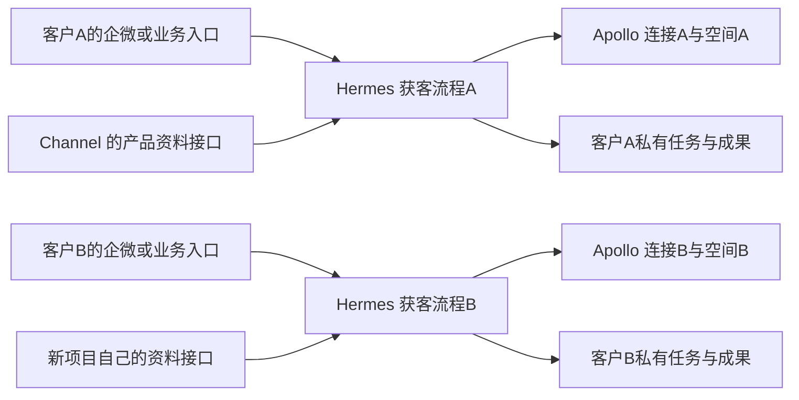

# Apollo 当前能力、跨项目归属与下一步

2026-11-09 更新。**当前试用空间已能通过 `POST /api/v1/organizations/search` 返回真实公司；不能继续把两个新搜索端点的 403 说成整个 Apollo 无法搜索。** 现有获客代码却固定使用被拒的 `mixed_companies/search`，因此还需要接入选择修正，才能让已有任务流程真正取得这些候选。本次只做源码／配置核对、有限真实查询和文档修正，没有修改代码、权限或部署。

## 1. 本轮实际能用什么

已有专用 Key 仍来自仓库外的安全文件；`users/api_profile` 返回 200，team_id 与本客户空间一致。Chrome 当前仍为同一公司试用空间；未切换到其他客户、未创建或扩大 Key、未购买套餐。

| 能力 | 本轮证据 | 结论 |
|---|---|---|
| 公司发现 `organizations/search` | 官方 Key 创建页可选；现有 Key 实际两次 200，返回 `organizations` 与分页 | 当前账号可用。当前公开文档未给它独立合同，不能臆测已废弃或保证长期不变 |
| 新公司搜索 `mixed_companies/search` | 403，正文明确 Professional (Trial) 不包含；Key 页 disabled | 仅这一端点被套餐拒绝，不代表旧路由也被拒 |
| 新人员搜索 `mixed_people/api_search` | 同样的套餐拒绝；Key 页 disabled | 此路径未通，不推导所有人员相关能力都不可用 |
| 公司补全 `organizations/enrich?domain=apollo.io` | 403，正文明确当前 Key 未包含该 endpoint scope；Key 页可选 | Key 权限缺项，不能说成整个 Trial 不支持补全 |
| Apollo Assistant Task `agents/task` | 当前 Key 授权页 disabled；本轮没有创建任务 | 自然语言研究能力确实存在，但尚未在此账号接通 |
| `mixed_people/organization_top_people` | Key 页可选；官方 OpenAPI 用量示例也提到名称，但没有完整请求／响应合同 | 值得后续核对人员候选能力；不能猜参数或提前承诺邮箱、费用和成功 |

### 两次真实公司查询

第一笔传 `q_organization_domains_list=["apollo.io"]`、page=1、per_page=1，返回 Apollo.io。请求号 `c3e95463-78de-456e-b861-2be40a3db37d`。随后网页余额从 85 变成 84，确认这笔消耗 1 credit。

第二笔直接用获客条件，不提供已知公司名：

```json
{
  "q_organization_keyword_tags": ["consumer electronics"],
  "organization_locations": ["United States"],
  "page": 1,
  "per_page": 3
}
```

`POST /api/v1/organizations/search` 返回 200，3 家公司为 Google、Amazon、Netflix，总匹配 26,985 条。返回 breadcrumbs 明确回显总部美国及关键词 ANY 条件；三条结果的总部字段均为美国，但当前投影未保留公司关键词，不能独立证明关键词匹配正确，仍需核验依据。请求号 `8b00741c-6298-451b-876c-ba6989524a95`。

**这证明真实公司发现可用，不证明这三家是合格的 OEM 耳机买家。** “消费电子”太宽，品牌、分销／批发、规模、采购角色和排除项还需要筛选与研究。当前代码只给模型公司 ID、名称、网站，资料不足以支持有依据的买家判断；这也是业务质量缺口，不能用 67 项程序测试掩盖。

本轮只做两页公司查询和一次被拒的公司补全，没有自动翻页、补邮箱、保存联系人或发送邮件。按公司查询每页 1 credit 的公开规则，第二笔预计再用 1；本轮未额外刷新余额确认第二笔结算。无密钥的结果保存在忽略目录 `output/apollo/20261109/available-reads.json` 和 `real-company-candidates.json`，不提交运行产物。

## 2. API 到底怎么处理需求

### 已有代码：我们的模型解释目标，Apollo 按条件查询

用户说“找美国消费电子买家”，Hermes 的模型先把目标转成上面的 JSON。普通搜索接收筛选字段，查询 Apollo 的 B2B 公司数据库，返回公司数组和分页；它不承诺公司有采购意向。Apollo 没有公开足以还原其底层索引／排序算法的资料，不能自行说它每次都临时全网爬取。

人员候选、人员资料／邮箱补全是后续不同动作。当前公司结果里没有采购联系人。公开的 People Search 返回人员资料和联系方式可用性标记，不直接返回邮箱／电话；补全可能消费 credits。新人员端点被拒后，也应继续核对其他已获准人员能力，而不是笼统宣布“人员都不能查”。依据：[公司搜索](https://docs.apollo.io/reference/organization-search)、[人员搜索](https://docs.apollo.io/reference/people-api-search)。

### 另一条官方能力：让 Apollo 自己研究

`POST /api/v1/agents/task` 接收自然语言 `instruction`，返回 task_id；之后按建议间隔读任务状态和消息，而不是立即得到固定公司列表。官方 MCP 可将需要解释、筛选和研究的目标交给 Apollo 的 agent，使用网页、Google Maps 或目录等来源。这条路线确实接近用户所描述的方式，上一版调查漏评估了它。依据：[Assistant Task](https://docs.apollo.io/reference/run-an-assistant-task)、[Apollo MCP](https://docs.apollo.io/docs/apollo-mcp)。

这条代理能力与只读查询的边界不同：官方明确，限制 Key 可访问的 endpoint 并不能限制 Assistant 内部执行哪些动作；它按 acting user 的权限工作。公开 REST 也没有 read_only、allowed_actions 或最高 credits 参数，运行中发送新 instruction 会被忽略，停止轮询不等于停止服务端任务。因此不能只写“不要发信”的提示词就承诺具有相同的系统保护。本轮没有创建这类任务或新增 Master Key。

官方 MCP 是 `https://mcp.apollo.io/mcp`：交互连接可 OAuth 登录，无人值守的静态 Key 方式要求 Master Key；仍受账号能力限制。它可以作为 Hermes 的一种供应商连接，不必成为 Channel 的专有能力。

### 85 credits 是什么

它是可以消费的余额，不是所有端点的通行证，也不是只能找到 85 家公司。公开规则：公司搜索每页 1 credit，文档端点每页最多 100 条；公司补全每家公司 1；人员搜索 0 但不返回邮箱／电话；常规人员资料／邮箱补全通常 1，手机另加 8。Trial 还有每次选择条数等独立限制，旧路由本轮只实测到每页 3 条，不据此保证其最大页数。费用与资格分别核对。依据：[API 计费](https://docs.apollo.io/docs/api-pricing)、[Trial 说明](https://knowledge.apollo.io/hc/en-us/articles/5288168088205-Access-a-Free-Trial-of-Apollo)。

## 3. 最初设计和当前代码放在哪里

最早模块设计 `Channel@2c55a667`（2026-10-23）的 HIGH-LEVEL 已把 Sales 执行放在 Hermes；Channel 存整体方案、共同合同和自己的官网接入代码。文档所在仓库与程序执行位置不能混为一谈。

| 部分 | 当前设计／实现位置 | 对新项目的意义 |
|---|---|---|
| 官网客服、产品和正式询盘 | Channel | 网站业务的原始资料；别的项目不应被迫依赖这些字段 |
| Apollo 连接、获客任务、成果与预览 | Hermes `deploy/hub/sales_flow/` 的独立流程包 | 复用同一代码，按客户配置目标、凭据、资料接口和私有结果 |
| 平台通用任务／权限／工具接入 | Hermes 平台能力 | 不在共享 dispatcher 或定海全局提示词里硬编码 Channel 产品、报价或客户名单 |
| Apollo 公司／联系人资产 | 对应客户的 Apollo 空间 | 持久保存名单是显式动作，本轮仅查询并将任务结果留 Hermes，没有写 Apollo 联系人 |
| 邮件线程／草稿 | 对应 Resend Team | 官网询盘与冷开发流程分开；本轮没有发送 |

建议的跨项目结构：



A/B 复用代码和通用能力，不共用私有名单、记忆或审批。可以同仓库维护，不需要此刻拆新平台；业务规则放流程包／客户配置，Channel 只是其中一个业务资料来源。谁付费、谁持有 Apollo 账号，是另一项经营决定，不由任务运行在哪个仓库决定。

## 4. 有没有另一套已经接好的 Apollo

已 fetch 并独立核对 Hermes 全部 8 个远端 heads。与 Apollo 有关的实施历史只找到我们的 `a294eb1 → 41523e4 → e1f112b`；main/no-geo-cn/dinghaigeo-cn-production/domestic-geo/react-router 分支没有另一套 Apollo 连接。`geo-prospect` 是本机 JSON 的 GEO 客户管道，`a1-lead-planner` 是社媒项目规划，均不是 Apollo 找买家。

三台实际运行机器也做了只读核对：Hub、内容工厂机、发布机的 `~/.hermes/config.yaml`／`customer_mcp.json` 没有 Apollo MCP；实际运行用户和 HOME 路径已对照进程及定海源码。没有读取别的客户正文／联系人、调用其任务，或直连旧的无 TLS Hub 数据库。**目前没找到“另一客户已经打通”的可复用连接证据；不能排除其他未知机器、私有脚本或未启用数据库配置。**

Hub 安装的 `client-marketing-materials/SKILL.md` 确有 Apollo 多客户方案举例，并把 Apollo 列作“我们的生产力工具，客户不用买”。这能解释为什么会有另一种交付设想，但它是营销材料规则，不是连接、隔离或账号许可的实测。需要统一的是账号／费用口径，不能把“客户不用另买”自动理解成“所有客户共用同一个数据空间”。本轮没有改这份规则或任何他人的工作。

## 5. 当前代码、测试与业务完成度

Hermes 实现 `41523e4`、最终测试 `e1f112b`，分支 `feat/apollo-prospecting-flow-20261109`。当前代码固定 `mixed_companies/search`，所以已有主流程尚不能取得本轮用旧路由验证的真实候选，不能继续把这个接入选择缺口全归咎于套餐。

`prospecting_mcp.py` 用的是 **MCP 官方 Python 协议库**，给 Hermes 暴露自建 `prospecting_prepare/get`，内部仍调我们自己的 REST 适配器。前文“官方 MCP”表述不准确：**没有接上 Apollo 官方 MCP，也没有实现 Apollo Assistant Task**。

[最终 CI 42560758323](https://github.com/vibelingan/hermesinfra/actions/runs/42560758323) 的 67 项及两项缺陷注入通过，证明任务／模型协议／MySQL／自建 MCP 接线与原询盘回归；不证明目标客户质量或 Apollo 官方智能研究已经可用。此前 Hub 7.62 秒的真实模型路径验证了新路由拒绝留档；32.78 秒路径使用合成候选、真实模型和真实库。这些事实保留，但不能算真实获客成功。

下一轮应先做一个有业务意义的闭环：

1. 把已验证可用路由显式接进客户连接配置，保持固定服务地址和白名单，不自动猜 URL 或偷偷换路由；对账号可用路由做合同回归。
2. 明确“哪些公司才是 OEM 买家”，加入必要筛选／排除和研究依据，保留足够的公司业务资料；不让模型仅凭名称、网站声称有采购意向。
3. 对筛出的少量公司，分别验收人员候选和必要联系方式权限／费用，再决定如何接入定海／企微。
4. 对比 Apollo 官方智能研究与现有受控查询的实际效果、动作权限和成本，复用供应商已有能力；不重复造研究引擎，也不把授权交给提示词。

当前不必等客服放开两个新搜索接口，才开始验证公司发现。此轮没有改代码、上线入口、原 Agent 或客户邮件。

## 6. 仍保留的历史拒绝与支持申请

两个新搜索的明确拒绝仍然成立：公司请求号 `3cf4e1eb-3d87-4449-8854-b487c4c23528`，人员请求号 `45c8fad6-52a6-4d5e-ac47-09fb32fad18e`，均为 Professional (Trial)／API_INACCESSIBLE／AUTH.AUTHORIZATION.ENDPOINT_ACCESS_DENIED。公司补全则是 Key scope 问题，请求号 `1fef11f7-ecde-47dc-b1c5-d7942a743d2c`。同为 403 不能混成一个原因。

已在用户授权后向 Apollo 应用内客服提交新端点试用申请。机器人明确人工离线、无法排队建单；没有人工工单号。官方备用支持邮件因 Gmail 断网未发出，取消后恢复为草稿。本轮未再发消息或付费。原申请可以用于后续人员／新端点资格核对，不再作为公司发现必须等待的前提。

公开的 [Reddit 同类试用问题](https://www.reddit.com/r/UseApolloIo/comments/1ttvc1h/api_is_not_accessible_with_this_access_token_on_a/)和 [Make 2024-02-21 讨论](https://community.make.com/t/apollo-api-403-error/28133)没有客服特批后成功的可靠回报，因此不承诺申请必定成功。

## 复核依据与写作修正

官方：[搜索](https://docs.apollo.io/reference/organization-search)、[人员搜索](https://docs.apollo.io/reference/people-api-search)、[公司补全](https://docs.apollo.io/reference/organization-enrichment)、[Assistant Task](https://docs.apollo.io/reference/run-an-assistant-task)、[MCP](https://docs.apollo.io/docs/apollo-mcp)、[API 计费](https://docs.apollo.io/docs/api-pricing)、[Key 范围](https://docs.apollo.io/docs/create-api-key)、[OpenAPI](https://docs.apollo.io/openapi/apollo-rest-api.json)。旧 `organizations/search` 在当前 Key 页和 OpenAPI 用量示例均出现；OpenAPI 缺独立路由 schema，未找到明确弃用公告，也未核对其弃用响应头。

源码：[Hermes 获客执行](https://github.com/vibelingan/hermesinfra/blob/e1f112b7378f2277f5bc90b9ba15c878c398ca08/deploy/hub/sales_flow/prospecting.py)、[REST 适配器](https://github.com/vibelingan/hermesinfra/blob/e1f112b7378f2277f5bc90b9ba15c878c398ca08/deploy/hub/sales_flow/apollo.py)、[自建 MCP](https://github.com/vibelingan/hermesinfra/blob/e1f112b7378f2277f5bc90b9ba15c878c398ca08/deploy/hub/sales_flow/prospecting_mcp.py)、Channel `2c55a667` 的原 HIGH-LEVEL 与 SG6、Hermes 全部远端分支及三机的非密钥配置投影。

将“真实获客搜索尚不可用”更正为“旧公司路由真实可用，现有任务代码尚未采用”；将“官方 MCP 已通”更正为“官方协议库的自建工具通过测试”；将“返回名单”与“合格买家／可联系邮箱”分开。未将凭据、客户数据、运行 JSON 或其他作者未提交内容放进 Git。
