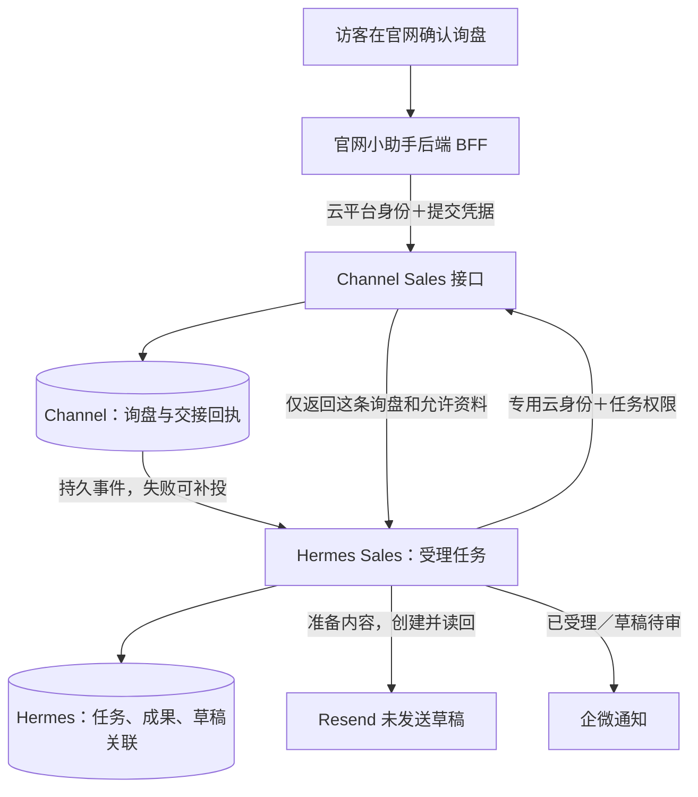

# 官网与 Sales：生产接入安全复核及整改设计

2026-11-09。按用户反馈重写说明。本文讨论官网询盘保存以后，Channel 与 Hermes 两个后台如何互相核实调用权限。CAM 新接法仍是整改设计，不是已经接好的生产能力。本轮仅核对代码与官方文档、修正文档和全局表达规则，没有改代码、云权限或运行服务。

## 先说明整件事：为什么两个后台需要互相调用

例如，访客在 Channel 官网确认“要采购 500 个耳机”。Channel 要保存这条询盘，Hermes 要为它建立销售任务、读取必要资料、准备跟进邮件，Resend 保存未发送草稿。因此它们需要通过后台接口交换信息。接口就是供另一个程序发送请求的网址；这里没有要求访客或销售人员先登录腾讯云。

“进入 Channel”“进入 Hermes”的原写法省略了调用方和目的，应改为下面这些具体请求：

| 顺序 | 谁向谁发请求 | 请求做什么 | 接收方要核对什么 |
| --- | --- | --- | --- |
| 1 | 官网小助手的后端程序 → Channel 询盘接口 | 保存访客已确认的询盘 | 拟增加的腾讯云调用检查；已有提交凭据、会话、确认内容及重复提交检查 |
| 2 | Channel 后台 → Hermes 任务接收接口 | 通知“这条询盘已保存，请建立销售任务” | 发送方凭据、登记的客户与网站来源、重复通知 |
| 3 | Hermes 的 Sales 程序 → Channel 资料接口 | 读取这个任务对应的询盘、产品及允许附件 | 拟增加的腾讯云调用检查，以及已有客户、任务、资料范围检查 |
| 4 | Channel 后台 → Hermes 任务权限接口 | 交出资料前，确认任务现在仍有读取许可 | 独立服务凭据、当前任务、运行编号、权限状态及有效期 |
| 5 | Hermes 的 Sales 程序 → Resend | 保存并核对跟进邮件草稿 | Resend 的专用凭据、目标邮箱及草稿内容；不发送邮件 |

第 2 步和第 3 步是两条独立请求：Channel 先告诉 Hermes 有事要做，Hermes 处理时再向 Channel 取资料。第 4 步又是一次反向核对，因为 Hermes 保存着任务当前状态。“Channel 验证”和“Hermes 验证”各有自己的对象，不是 Channel 给 Hermes 整个平台做一次登录认证。

HTTPS 表示请求在传输途中加密，两个方向都要使用。服务凭据是后台程序保管的专用秘密，接收方用它核对调用权限。HTTPS 本身不证明业务客户是谁，服务凭据也不能仅因有效就获得全部询盘资料。模型不决定任何一步是否放行。

## 腾讯云检查究竟检查什么，客户身份由谁确认

Channel 的 Sales 接口目前部署在腾讯云的“云函数”服务上：我们上传一段处理询盘的后台程序，由腾讯云负责运行。函数 URL 就是腾讯云为这段程序提供的调用网址。CAM 是腾讯云的访问管理机制，可以要求访问这个网址的程序带上获授权的云调用凭据及签名；腾讯云先检查该凭据代表的身份是否有权调用这个函数。[官方说明](https://cloud.tencent.com/document/product/583/96100)。

**CAM 通过只证明云调用身份有权访问该函数，不等于“已确认是 Channel 这个业务客户”，也不证明请求来自某台指定物理机器。** 随后仍由 Channel 的程序查询服务器上的连接登记，核对客户编号、网站安装、运行实例、环境、权限版本和允许动作，再核对本次任务及资料范围。

例如，合法调用身份带着 A 客户的连接，却请求 B 客户的询盘，即使腾讯云允许它调用这个函数，Channel 的客户和任务检查仍应拒绝。A 的正确任务也只能读它被分配的资料，不能把请求里的客户编号改成 B 就扩大权限。客户和任务归属来自服务端登记及真实记录，不从模型的自述或聊天文字推断。

下列三件事应分开理解：

| 检查 | 谁执行 | 证明什么 | 不证明什么 |
| --- | --- | --- | --- |
| 云调用权限 | 腾讯云接收 Channel 函数请求时 | 这份云调用身份可调用这个函数 | 它属于哪家业务客户、能读哪条询盘 |
| 客户与任务权限 | Channel 与 Hermes 各自的业务程序 | 登记的连接属于谁，这个任务能做什么、读什么 | 自动获得整个数据库或发信权限 |
| Channel 程序自己的查库权限 | 腾讯云数据库服务 | 运行中的 Channel 程序可访问哪个云环境、做哪些数据操作 | 当前外部请求属于谁，模型是否应获准取资料 |

## 客户不使用腾讯云时，Hermes 还能不能用

可以，需要分清两个场景：

1. **程序部署在 AWS、自有服务器或其他地方，但请求的仍是 Channel 接口。** 它可以在外部服务器保管获授权的云调用凭据、对请求签名后访问 Channel。服务器不用迁入腾讯云，客户本人也不用为了每次询盘登录腾讯后台。这项集成配置由技术侧完成。
2. **另一位客户自己的业务系统本来就不在腾讯云。** 那个系统采用它自身支持的服务认证方式，Hermes 不应强制它使用 CAM。Hermes 仍要核对客户、任务、资料与动作范围；更换的是连接外部业务系统的认证接法。

因此通用的 Hermes 客户与任务协议不应绑定腾讯云。CAM 放在“连接腾讯云托管的 Channel 接口”这一层。共用 Hermes 主机、云账号或外部服务额度，也不能替代客户和任务隔离。

## “HTTP 函数不能沿用 Event 初始化”原话是什么意思

原话过于绝对，也缺少背景。SDK 是代码里访问腾讯云数据库、存储的工具库；它除了知道目标数据库环境，还需要访问凭据。一个问题是“外部程序有没有权向 Channel 要这条询盘”，另一个问题是“Channel 自己有没有权去云数据库取出这条记录”。这里说的 SDK 凭据属于后者。

腾讯云有两种相关的运行方式：

- **事件函数（Event Function）**：平台把请求或其他触发事件整理成对象，再调用我们导出的处理函数。项目原有部分云函数用这种方式，数据库工具依赖运行环境取得访问身份。
- **Web／HTTP 函数**：我们运行一个接收 HTTP 请求的小型后台服务，腾讯云把原始请求转给它。现在这份 Sales 程序使用这种方式。它仍然可以使用数据库 SDK，不存在两种 SDK 天生不能通用的问题。

腾讯云官方说明，Web 函数绑定运行角色后，平台可在内部请求中附带短期访问凭据；角色是给这段后台程序配置的权限集合。这些凭据由平台交给函数，让它访问云资源，不是访客的登录信息，也不是 Hermes 送来的客户 Token。[官方说明](https://cloud.tencent.com/document/product/583/56124)。

本轮源码核对发现：Sales 启动时只调用 `initCloudBase(envId)`，共享初始化只填环境编号并缓存 SDK，HTTP 接收层没有显式处理上述平台凭据。因此准确结论是：**还没有证明这个 HTTP 运行方式下，现有 SDK 能自动取得查库凭据；不能仅凭代码就断言线上已经发生了缺凭据错误。**

先用合法调用验证能否查库。若 SDK 已能从可信运行环境取得凭据，就不为此重复造接线；若拿不到，再从可信平台上下文取短期凭据，传给本次请求使用的数据库工具，不把它写到日志、返回给调用者或写进全局变量。这样既说明具体要补什么，也保留“尚未验证”的边界。

## 设计阶段究竟遗漏了什么，如何纠正

原设计已经有业务凭据、客户归属、真实来源和任务授权。本次复核暴露的是以下验证缺口，不能把责任归结成“用了 Bearer”：Bearer 是携带服务秘密的一种方式，配合 HTTPS、合理权限和密钥管理，可以用于生产。

| 遗漏 | 为什么原测试没证明它 | 具体整改 |
| --- | --- | --- |
| 没把真实网络入口及平台调用要求一起定清楚 | 本机拒绝错误 Token，只证明应用拒绝逻辑；不证明正式入口可供合法程序调用 | 先选定一个真实入口，验证合法身份成功、无身份及错误身份拒绝，并确认没有绕过入口 |
| 没证明 HTTP 运行方式能正确取得查库身份 | 只填环境编号不说明凭据来自哪里；本地账号能查不代表线上函数能查 | 核对平台及安装 SDK，再用函数本身的身份执行最小只读查询，之后才判断是否需改初始化 |
| 单项权限检查通过，但整条链路调用成本未验收 | 多个工具层重复查权限、来回请求，业务正确也可能变慢 | 在完整任务边界统计调用数及耗时，复用同一阶段的检查结果；保留撤权、版本及资料范围的必要复核 |

推荐使用腾讯云原生函数 URL 加 CAM，是针对当前 Channel 托管环境的具体选择；尚未实施。此前考虑的另一条路是“让腾讯云网关不做平台登录检查，全部交给应用的服务凭据验证”；该操作被自动审批拒绝，路由和放开调用权限都没有成功。后续不会换工具绕过拒绝。两条路的差异是外层由谁做调用认证，都不能取消业务客户和任务门禁。

当前源码仍从 `Authorization: Bearer …` 读取业务凭据，没有 CAM 签名和 `X-Sales-Authorization` 适配。实施新方案前，必须明确云调用身份、函数自身查库身份及合法请求验证。本轮只修说明和设计记录，没有修改这些代码或权限。

## 此前部署记录（原报告时点快照）

下表保留原报告时点的部署事实，本轮没有重新登录云端验证这些状态。官网回复显示问题随后已按 `0b9a78f6` 热修复上线、五项真实问答通过；这不代表本报告的 CAM 接法或完整 Sales 新链路已经验收。

| 部分 | 已观察到的结果 | 不能据此声称什么 |
|---|---|---|
| 官网及 AI 后端 | 充值后恢复；BFF 就绪检查和真实模型问答通过 | 新助手界面和整个生产询盘流程已经验收 |
| 官网发布 | `test@2a21a3d9` 的代码、浏览器检查通过；发布在函数安装包检查处停止 | 新界面已经发布。当前真实网页仍是旧助手 |
| 发布检查修复 | 已复现缺少 Sales 合成凭据的原因；`a77aa00e` 本地 Node 20 检查及三函数安装包检查通过，已推 fix 分支 | 修复已进 test、已重新发布 |
| Channel Sales | 独立 HTTP 函数及正式来源登记已创建；错误／不完整凭据的本机独立包拒绝测试通过 | 正确身份已能在真实 HTTP 函数中访问云库 |
| Hermes Sales | 专属 `channel-website` 服务、数据库及客户身份已安装；运行代码 `b356d437`，完整 CI 通过 | 定海现用共享任务库或聊天会话已统一调度这条业务 |
| 自动处理 | 确认新实例 task、run、outbox、草稿均为 0 后，dispatch／consume 已停止并取消自启；serve 保留 | 官网新询盘已自动处理。当前是在等待入口验收，不是正式启用 |
| 后续发布开关 | 已将正式来源捕获／投递、BFF 询盘及前端询盘四项开关关闭并读回；原有普通表单保持 | 后续其他人发布时会自动启用未经验证的接线 |
| Resend | 原受控试运行已有真实、可见的未发送草稿 | 新正式身份已从真实官网完成首轮草稿生成 |
| 企微 | 已在 Test only 创建「Sales 询盘通知」消息推送；地址保存在仓库外的私有文件 | 正式通知已接线，或询盘／草稿消息已实际送达 |

旧 Agent、原 pilot、Hub 原有 20 项未提交文件及旧服务进程未被覆盖或重启。新服务使用独立系统用户、限库账号和私有目录。

还有两项需要纠正完成口径：目前 Sales 模型负责产品查询、缺项等结构化决策，邮件正文由程序模板组装；尚未实现自由定制文案，也没有直接查询 VibeKB。它是 HermesInfra 工程内的独立执行单元，尚未登记到现用定海的共享管理界面。上述能力不能因“同机部署”或“模型调用成功”就算完成。

## 详细整改设计：调用、权限与验收（尚未实施）

以下保留详细技术方案，供实施及审阅使用。前面的白话说明是完整正文，不要求读者先读这一节才能理解结论。

### 哪些系统需要互相调用

Channel 主动告诉 Hermes“有一条已保存的询盘”；Hermes 再取处理它需要的资料。这能避免把整个产品库、附件和客户库复制到 Agent 中。两边不会互相获得数据库管理员权限。

也比较过只让 Hub 定时拉取的办法：它可以取消 Channel 主动投递事件的入口，但会增加空轮询和发现延迟；如果仍保留当前任务许可回查，也并没有真正变成单向调用。要彻底单向，还要重做任务授权证明。本期已有可靠投递和任务门禁，又要求询盘保存后立即处理，因此推荐保留事件交接和受限读取，先消除重复回查，不为减少箭头重写整个协议。

业务记录归属保持明确：询盘事实和交接回执在 Channel；任务进度、成果版本及草稿编号在 Hermes；邮件工作副本在 Resend。官网询盘不需要销售先在群里下指令才开始处理。

两次正常通知统一由 Hermes 的程序发出：任务和待办同事务保存后，通知“已收到，已交给 Sales 准备”；Resend 草稿读回核对且成果保存后，通知“草稿待审，尚未发送”。第一条不声称模型已经开始生成。交接延迟时，Channel 保留成功回执和待投递记录；通知失败不重跑模型或重建草稿。

## 计划中的四种身份分别负责什么（尚未配置完成）

| 身份 | 用途和允许范围 | 不授予的能力 |
|---|---|---|
| 运维身份 | Sean／CI 配置和部署已获授权的资源 | 不交给运行中的模型、Hub 或浏览器 |
| 调用程序身份 | BFF、Hermes 各一份，只准 `scf:InvokeFunctionUrl` 到 Sales 这一个函数资源 | 不管理函数、不直接读写云库、不调用其他客户的函数 |
| 计划配置的函数运行身份 | 拟为 Sales 函数配置专属角色和短期凭据，只允许指定 Channel 环境的必要数据操作 | 不复用本机环境管理 Key；不修改共享 `TCB_QcsRole` |
| 客户和任务授权 | 固定客户、业务线、安装、runtime、epoch、task/run、资源、动作和有效期 | 模型不能改客户身份、扩大资料范围或获得发信权限 |

云平台认证核对“这份云调用身份是否有权调用此函数”，并不证明物理机器或业务客户；任务门禁核对“服务器登记的这次任务允许读取哪条询盘”。前者通过不代表后者通过。错误客户、旧权限、未登记来源或不属于任务的附件仍由服务器拒绝。

腾讯云官方明确 `InvokeFunctionUrl` 支持具体函数资源授权。普通 `Invoke`／`InvokeFunction` 的权限粒度不能被想当然地当成相同的单函数权限，因此不推荐为了入口问题先重写 Event 适配层。[函数 URL 认证](https://cloud.tencent.com/document/product/583/96100)、[SCF 授权粒度](https://cloud.tencent.com/document/product/598/70005)。

当前实际环境的 Backend 已读回为 `scf`，所以这个方案适用于本次选型；仍须以目标函数的真实创建、正确调用和错资源拒绝验证落地，不能只凭官方页面记为已接通。

## 需要改哪些地方，哪些可以复用

### SG0.2／SG1.3：入口和客户门禁

复用现有严格请求结构、六类分权服务凭据、来源校验、300 秒任务读取 lease、短期 permit、epoch 和资源归属检查。

外层 `Authorization` 留给腾讯云 TC3 请求签名；原应用 Bearer 改放专用的 `X-Sales-Authorization`。入口只做明确的头部适配，内部仍调用原业务门禁；重复、冲突或无法确认的头直接拒绝，不能因签名通过就跳过客户／任务检查。客户端固定目标 URL、校验证书、不跟随重定向，凭据不交给模型。

先使用只限定到该函数的专用调用身份。能复用平台短期角色凭据时使用短期凭据；若调用方没有可用运行身份，只能另配最低权限的服务调用凭据，并登记轮换和撤回，不能借用环境管理 Key。当前 BFF／Hub 的这项运行身份尚未配置。

### SG1.3：函数自己如何访问云库

原报告部署快照中，函数已绑定 `TCB_QcsRole`。当前源码初始化没有显式读取 HTTP 平台凭据；SDK 是否能通过其他可信运行上下文取得身份、函数能否实际查库，还未用合法请求验证。SCF 官方说明运行角色可提供不可由调用者自定义的 `X-Scf-Secret-Id`、`X-Scf-Secret-Key`、`X-Scf-Session-Token`。这些是函数查库的工作凭据，不是调用方身份，也不返回给调用方。[SCF HTTP 函数说明](https://cloud.tencent.com/document/product/583/56124)。

先验证现有 SDK 能否正确取得运行身份；若不能，再采用下面的显式接线。它是条件性整改方案，不是仅凭代码就认定必须重写初始化：

- 每次请求根据可信平台上下文创建独立 SDK app，缺失或冲突时拒绝。
- `createSalesRuntime` 接收该 app 和产品 reader；来源、授权、outbox、附件读取都使用本次请求的 app。
- 把现有批准产品读取逻辑提取为可传入 `get/list` 的 reader；原 public-api 导出保留既有行为，Sales 复用同一投影及发布校验。
- 不向全局 `process.env` 写临时密钥，不覆盖全局 SDK／adapter，不依赖未经验证的异步凭据 hook。

Sales 使用新专属运行角色，按实际需要允许该环境的数据查询、写入和事务动作；附件只给必要的读取权限。**官方管理端 SDK 的 CAM 粒度是环境＋动作，不能承诺云权限细到某个集合。** 集合、客户和任务范围仍由业务门禁执行。[CloudBase 环境级权限](https://docs.cloudbase.net/cam/access-manage)。

新运行角色的准确动作和资源表达式，必须用“目标环境能用、其他环境拒绝、部署／删除等管理动作拒绝”的真实探针收敛；不因策略不通而放成 `resource:*`。保持已有共享角色和其他函数初始化不变。

### SG1.2／SG8：可靠交接与部署

保留询盘与待投递事件的原子保存、稳定业务键、受理回执、任务／派发同事务、重试和 Resend 草稿去重。消息不是由模型凭聊天内容判断客户身份后随意派发。

上线顺序为：安全入口与 SDK 身份只读验收 → 部署正确的公开知识版本及前端 → 带 TEST 标记的真实浏览器询盘 → 恢复新实例处理 → 读回同一条任务和 Resend 草稿 → 验证两次 Test Only 通知。邮件发送始终不启用。

## 调用量也要整改

Hub 元数据实际为法兰克福，Channel 在上海。现未核实有可直接复用的跨地域私网，nginx 也没有现成 mTLS 客户端校验，不能把它们当作已经存在的保护。

按当前源码，普通单品、一次产品查询、无附件场景，要读取四次资料：初读询盘、查询产品、交稿前复核询盘、复核产品。每次资料读取又有两次 Channel → Hermes 许可回查。因此 Channel／Hermes 之间为：

`1 次事件 + 1 次来源授权 + 4 次资料读取 + 8 次许可回查 = 14 次 HTTP`

这不含 BFF 保存、模型、Resend、企微和重试；不是已测耗时。每次资料读取的 helper 还重复加载约 16 次授权配置文档，不能当成“只查一次权限”。

先做不改变权限语义的整理：每个请求建立一份已核验的授权上下文，同阶段复用，返回前明确重新核对撤权与版本；不要各 helper 再查一遍同一资料。保留产品批量读取和附件分块完整性检查。两次跨站许可是否能安全收敛为一次，须用“读取期间撤权、资料变更、超时”的反例验证；不在没有证据时直接删除保护，也不为此先造新的签名票据系统。

正常询盘保存后立即交接，不批量等待。异常补偿与正常派发分开；建议无积压时采用 1–5 分钟有界退避，有失败积压再缩短，避免每天无事也固定打约 2880 次空补偿。当前空闲数据库连接频率也应采样后降下来，保持到达任务的开始时间可验收，不扩大并发掩盖问题。

OWASP 同样区分服务身份和业务授权，并说明在线权限回查会增加延迟及依赖；安全检查应放在明确边界，网络位置本身不能替代授权。[微服务安全指南](https://cheatsheetseries.owasp.org/cheatsheets/Microservices_Security_Cheat_Sheet.html)。

## 放行前要看到哪些证据

1. 没有 CAM 身份、错误签名、过期凭据、正确身份调用别的函数，均被云平台拒绝；不开放旧匿名替代路径。
2. 云身份正确但客户／任务／动作错误，应用仍拒绝；模型参数不能提供运行角色或扩大权限。
3. HTTP 函数以真实短期身份完成只读云库查询；并发请求不混用 SDK 身份；缺凭据拒绝且日志不含密钥。
4. 同一条浏览器询盘确认前不保存，确认后只保存一次；交接丢回执仍返回同 task/run，不重复草稿。
5. 真实模型和知识库回答正确；推荐来自公开产品；停止、失败恢复、手机布局和聊天内确认均有截图。
6. Resend 实际草稿的收件人、正文、产品依据及附件与询盘一致，状态未发送；通知只在对应事实持久化后发出。
7. 专属任务库完成备份／恢复验证，记录实际峰值内存和调用数。当前 TLS、限库账号及本机持久化可用，尚不等于备份和恢复保障齐全。

普通旅程通过后，只补与关键故障有因果关系的测试及缺陷注入，不组合遍历所有 helper。现有共享 Agent 和业务数据不作为故障注入对象。

## 原报告时点的其他内容与交付问题（历史快照）

以下 VibeKB、通知及开关信息保留原报告时点记录，本轮没有重查云端。不能将这些历史状态自动当成当前状态。

真实 VibeKB 查询已观察到 `knowledge_search` 和文档 12 引用；文档仍写旧品牌／旧公司名，早于官网已批准的 #70 名称更正。模型是在引用旧资料。应新增官网专属公开资料版本，再切换本助手的文档范围，保留共享原文；新正文已准备，尚未写入。BFF 和 worker 的配置摘要也需一致，不能只改一端后仍把旧审计身份记为新配置。

原报告时点，发布检查失败的原因已复现并修复，修复在 fix 分支，当时尚未重新发布。随后旧版回复热修复 `0b9a78f6` 已上线；完整新助手及本文 CAM 接法仍未完成上线验收。用户帮助打开企微创建页后，原报告已记录创建 Test only「Sales 询盘通知」，并观察到客户端成功页及该群的添加提示。Webhook 仅保存在仓库外、权限为 0600 的私有文件；未放入文档、Git 或群消息。原报告时点生产通知未启用、未发送验收消息，不能把创建成功当成通知链路通过。

为避免等待设计确认期间被后续部署误启用，已将 GitHub test 环境的 `SALES_SOURCE_CAPTURE_ENABLED`、`SALES_SOURCE_DELIVERY_ENABLED`、`AI_INQUIRY_ENABLED`、`PUBLIC_AI_INQUIRIES` 设为 `0` 并读回。保留已准备的专用身份及凭据，不修改原表单、其他 Agent 或整个环境权限。

目前先交付这份整改设计，不把正式闭环记为完成。后续按上述顺序补接线和实际验证，沿用现有模块编号报告，不再把“设计、代码、安装、常驻、真实验收”合并成一个“完成”。

复核依据包括现网资源详情、真实 BFF 事件、VibeKB 原文元数据、Channel 安装包、权限模块、Hermes 部署记录及独立审查。具体措辞已把“所有错误请求不查库”改为“权限核验可能查询控制记录，未通过不获得业务资料”，把“Sales 已部署完成”改为“独立执行单元已安装，生产入口和闭环尚未验收”。

## 本轮实际执行核对（说明修订，不是新一轮部署）

源码基准是本分支原提交 `fd6a9491`，Hermes 只读核对基准为 `9c30d4b`。本轮读过 Channel 的 `inquiry-client.ts`、Sales 的 `index.ts`、`server.ts`、`handler.ts`、`task-gate.ts`、`permit-client.ts`、`inquiry-sender.ts`，共享 `access.ts`、`task-access.ts`、`cloudbase-adapter.ts`，以及 Hermes 的 `channel_reader.py`、`intake.py`、`authorization.py`。官方来源为本文所链的函数 URL 认证、Web 函数运行请求头及 CloudBase 环境级访问控制文档；没有读取业务密钥或查询客户数据。

本轮独立审阅纠正了四处具体问题：给 BFF → Channel 补上拟增加的云调用检查；统一将旧部署记录标成历史；将专属运行角色标成计划配置；把模板里可能被理解为 HTML 的“网页格式请求”改成“网络请求原样转给 Sales 后台服务”。这些修改没有证明生产接线完成，只证明本轮说明已经处理这四项反馈。

| 规则类别 | 本轮做了什么／证据 | 状态与适用范围 |
| --- | --- | --- |
| 目标、事实和反例 | 围绕调用关系、客户归属和 SDK 凭据核对代码、官方文档；用“云身份正确却请求别家询盘”的例子检验结论 | 说明核对完成，未执行线上鉴权测试 |
| 工作范围与阶段区分 | 仅修改本报告、全局表达规则、回答模板和用户要求的记忆更新；将 CAM 接法写明为提案 | 未继续开发、部署、扩权或发送 |
| 现有工作与分支 | 接手先读状态并刷新原分支；保留原有 7 项未跟踪条目，不新建分支／PR，不改 SEO 或 Pricing | 只提交本报告的文档改动 |
| 核对与协作 | 一次只读源码复核、一次有限语义审阅；未启动生产 Agent、Symphony 或批量派工 | 审阅不等于生产验收 |
| Humanizer 与 OOODA | 读过 skill 和白话表达参考；补齐背景、逐步调用关系、术语定义、例子、原因和下一步 | 用实际改写说明执行，不以 skill 名字代替证据 |
| 全局规则及每次执行证明 | `~/.codex/AGENTS.md` 新增“技术解释与逐次执行核对”；模板在 `~/.codex/references/technical-explanation.zh-CN.md`；已读回、核对原规则保留和模板一致 | 本机全局文件已更新，不宣称自动同步其他电脑 |
| 记忆 | 按用户明确要求，在 `~/.codex/memories/extensions/ad_hoc/notes/` 新增一条表达与执行证据要求 | 只新增更新说明，没有修改主记忆库 |
| 工程判断与测试取舍 | 文档及规则安装检查、代码事实对照、一次有限语义复核；不跑无关组合测试或整站 E2E | 没有代码变化，不伪称代码测试或上线 |
| CloudBase 与 SDK | 核对本地 CloudBase／工程规则、初始化源码及官方运行说明；保留合法请求验证缺口 | 未改 SDK、类型声明、资源或权限，未运行存储集成门禁 |
| UI、图像、媒体和公共页面 | 本轮没有界面、图稿、私有预览或公开路由改动 | 图像模型、UI 截图、SEO 构建和媒体对象 URL 检查不适用 |
| 项目启动、Symphony 和浏览器 | 本轮不是新项目、不做自动派工，不通过浏览器操作账号；技术来源用只读官方网页查询 | 不安装项目框架，不借设计说明启动服务 |
| 安全、授权与外部动作 | 不接收／打印密钥，不更改共享角色、线上 Agent、云库或网页；不发送群消息和邮件 | 没有因此新增用户授权事项 |

规则文件存在、安装检查通过和读者实际看懂是三种不同结果。新的模板要求每次最终回复附可观察的执行核对，并要求主回复本身解释完整；仍需要按具体回复检查，不能承诺加一段规则以后永远不会再出现歧义。
