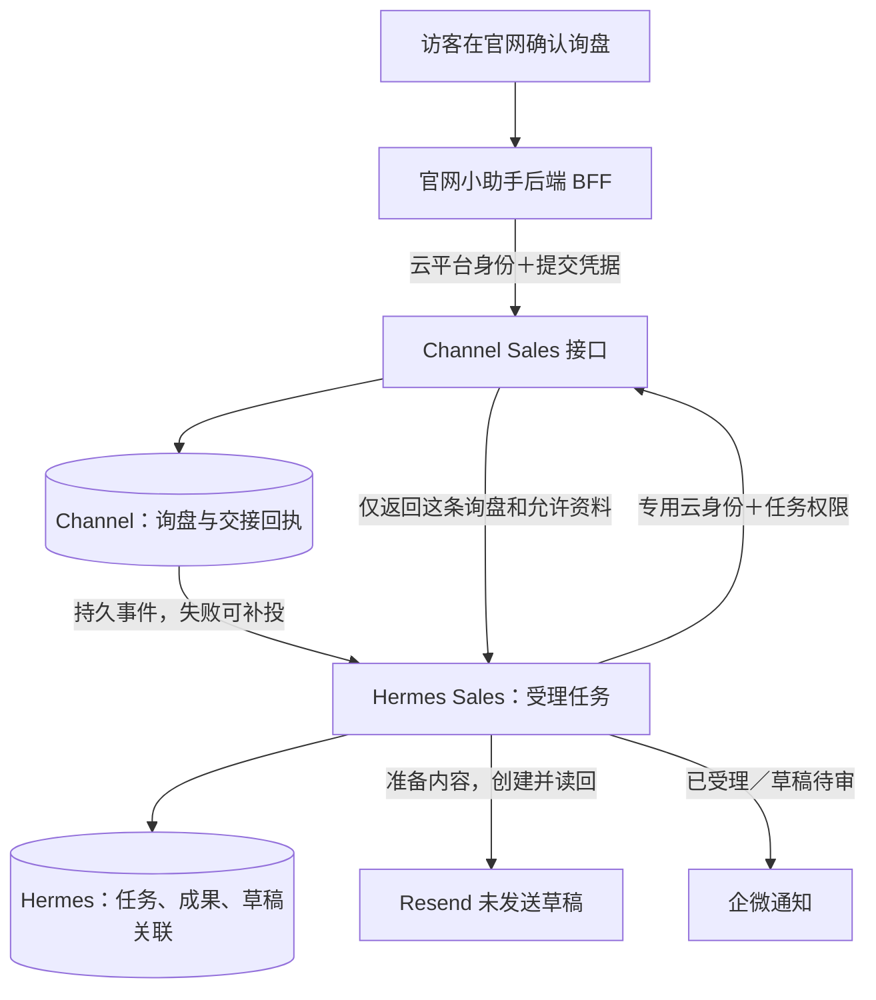

# 官网与 Sales：生产接入安全复核及整改设计

2026-11-09。设计复核版，尚未按新方案实施。覆盖 SG0.2、SG1.2、SG1.3 和 SG8；保留旧设计和验收记录，不用本报告覆盖历史结果。

## 推荐结论

保留业务分工：**Channel 保存客户确认的询盘；Hermes 保存和处理销售任务；Resend 保存未发送草稿；企微接收两次简短通知。** 服务间调用是实现这项分工的正常手段，但每次读取不应让多个 helper 反复做相同远端检查。

Channel 的网络入口采用 **SCF 原生 Function URL，开启 CAM 身份认证**。CAM 是腾讯云对调用程序身份和权限的检查；BFF 和 Hermes 分别使用专用调用身份，只准调用这一项 Sales 函数。进入函数后，再检查客户、来源、任务、资料和动作权限。模型不参加是否放行的判断。

这里有两个方向，保护方式不能混说：**BFF／Hermes → Channel** 使用上述云平台认证；**Channel → Hermes** 的事件投递和读取许可回查，仍使用现有固定 HTTPS 地址及各自独立的应用凭据。后者不是腾讯云函数，不能因前者改成 CAM 就宣称两个方向都已有云平台认证。

不采用此前准备的 CloudBase 匿名网关方案，不给 Hub 云环境管理 Key，不为此修改整个环境或共享角色。不另建 OAuth 中台、服务网格或跨地域专线。原生 URL 使用腾讯云生成的 HTTPS 地址，不需要客户修改网站 DNS。

这是按本项目现状作出的推荐，**不是已经验证成功的生产接法**：实际 URL、最小调用身份和请求内数据库凭据接线还没有建立。完成下述小范围验收后才恢复自动消费。

## 为什么这次会在部署时卡住

原设计和代码有服务凭据、客户归属、真实来源及任务授权；缺的是把它们与真实云平台接起来的完整设计及验证。主要遗漏有三处：

1. 把“程序有 Bearer 校验”直接当成了生产入口方案，没有先验证腾讯云可提供的原生机器身份认证。
2. 新部署的是 HTTP 函数，不能直接沿用 Event 函数的 SDK 初始化假设。平台提供临时运行凭据，还需要代码把它安全地交给本次请求的 SDK。
3. 权限检查分布在多层 helper，叠加出了重复查询和跨地域回查。单项门禁通过，不证明整个调用链的成本合理。

本轮匿名入口操作被自动审批审核拒绝，没有创建该路由，也没有成功放开函数调用 ACL。现在改为先完成这份设计；不会换个工具绕过拒绝。

## 当前真实状态

| 部分 | 已观察到的结果 | 不能据此声称什么 |
|---|---|---|
| 官网及 AI 后端 | 充值后恢复；BFF 就绪检查和真实模型问答通过 | 新助手界面和整个生产询盘流程已经验收 |
| 官网发布 | `test@2a21a3d9` 的代码、浏览器检查通过；发布在函数安装包检查处停止 | 新界面已经发布。当前真实网页仍是旧助手 |
| 发布检查修复 | 已复现缺少 Sales 合成凭据的原因；`a77aa00e` 本地 Node 20 检查及三函数安装包检查通过，已推 fix 分支 | 修复已进 test、已重新发布 |
| Channel Sales | 独立 HTTP 函数及正式来源登记已创建；错误／不完整凭据的本机独立包拒绝测试通过 | 正确身份已能在真实 HTTP 函数中访问云库 |
| Hermes Sales | 专属 `channel-website` 服务、数据库及客户身份已安装；运行代码 `b356d437`，完整 CI 通过 | 定海现用共享任务库或聊天会话已统一调度这条业务 |
| 自动处理 | 确认新实例 task、run、outbox、草稿均为 0 后，dispatch／consume 已停止并取消自启；serve 保留 | 官网新询盘已自动处理。当前是在等待入口验收，不是正式启用 |
| 后续发布开关 | 已将正式来源捕获／投递、BFF 询盘及前端询盘四项开关关闭并读回；原有普通表单保持 | 后续其他人发布时会自动启用未经验证的接线 |
| Resend | 原受控试运行已有真实、可见的未发送草稿 | 新正式身份已从真实官网完成首轮草稿生成 |
| 企微 | 已在 Test only 创建「Sales 询盘通知」消息推送；地址保存在仓库外的私有文件 | 正式通知已接线，或询盘／草稿消息已实际送达 |

旧 Agent、原 pilot、Hub 原有 20 项未提交文件及旧服务进程未被覆盖或重启。新服务使用独立系统用户、限库账号和私有目录。

还有两项需要纠正完成口径：目前 Sales 模型负责产品查询、缺项等结构化决策，邮件正文由程序模板组装；尚未实现自由定制文案，也没有直接查询 VibeKB。它是 HermesInfra 工程内的独立执行单元，尚未登记到现用定海的共享管理界面。上述能力不能因“同机部署”或“模型调用成功”就算完成。

## 哪些系统需要互相调用

Channel 主动告诉 Hermes“有一条已保存的询盘”；Hermes 再取处理它需要的资料。这能避免把整个产品库、附件和客户库复制到 Agent 中。两边不会互相获得数据库管理员权限。

也比较过只让 Hub 定时拉取的办法：它可以取消 Channel 主动投递事件的入口，但会增加空轮询和发现延迟；如果仍保留当前任务许可回查，也并没有真正变成单向调用。要彻底单向，还要重做任务授权证明。本期已有可靠投递和任务门禁，又要求询盘保存后立即处理，因此推荐保留事件交接和受限读取，先消除重复回查，不为减少箭头重写整个协议。

业务记录归属保持明确：询盘事实和交接回执在 Channel；任务进度、成果版本及草稿编号在 Hermes；邮件工作副本在 Resend。官网询盘不需要销售先在群里下指令才开始处理。

两次正常通知统一由 Hermes 的程序发出：任务和待办同事务保存后，通知“已收到，已交给 Sales 准备”；Resend 草稿读回核对且成果保存后，通知“草稿待审，尚未发送”。第一条不声称模型已经开始生成。交接延迟时，Channel 保留成功回执和待投递记录；通知失败不重跑模型或重建草稿。

## 四种身份分别负责什么

| 身份 | 用途和允许范围 | 不授予的能力 |
|---|---|---|
| 运维身份 | Sean／CI 配置和部署已获授权的资源 | 不交给运行中的模型、Hub 或浏览器 |
| 调用程序身份 | BFF、Hermes 各一份，只准 `scf:InvokeFunctionUrl` 到 Sales 这一个函数资源 | 不管理函数、不直接读写云库、不调用其他客户的函数 |
| 函数运行身份 | Sales 函数通过专属角色和短期凭据访问指定 Channel 环境的必要数据操作 | 不复用本机环境管理 Key；不修改共享 `TCB_QcsRole` |
| 客户和任务授权 | 固定客户、业务线、安装、runtime、epoch、task/run、资源、动作和有效期 | 模型不能改客户身份、扩大资料范围或获得发信权限 |

云平台认证解决“是哪台程序在调用”；任务门禁解决“这次允许它处理哪条询盘”。前者通过不代表后者通过。错误客户、旧权限、未登记来源或不属于任务的附件仍由服务器拒绝。

腾讯云官方明确 `InvokeFunctionUrl` 支持具体函数资源授权。普通 `Invoke`／`InvokeFunction` 的权限粒度不能被想当然地当成相同的单函数权限，因此不推荐为了入口问题先重写 Event 适配层。[函数 URL 认证](https://cloud.tencent.com/document/product/583/96100)、[SCF 授权粒度](https://cloud.tencent.com/document/product/598/70005)。

当前实际环境的 Backend 已读回为 `scf`，所以这个方案适用于本次选型；仍须以目标函数的真实创建、正确调用和错资源拒绝验证落地，不能只凭官方页面记为已接通。

## 需要改哪些地方，哪些可以复用

### SG0.2／SG1.3：入口和客户门禁

复用现有严格请求结构、六类分权服务凭据、来源校验、300 秒任务读取 lease、短期 permit、epoch 和资源归属检查。

外层 `Authorization` 留给腾讯云 TC3 请求签名；原应用 Bearer 改放专用的 `X-Sales-Authorization`。入口只做明确的头部适配，内部仍调用原业务门禁；重复、冲突或无法确认的头直接拒绝，不能因签名通过就跳过客户／任务检查。客户端固定目标 URL、校验证书、不跟随重定向，凭据不交给模型。

先使用只限定到该函数的专用调用身份。能复用平台短期角色凭据时使用短期凭据；若调用方没有可用运行身份，只能另配最低权限的服务调用凭据，并登记轮换和撤回，不能借用环境管理 Key。当前 BFF／Hub 的这项运行身份尚未配置。

### SG1.3：函数自己如何访问云库

现函数已绑定 `TCB_QcsRole`，当前初始化没有显式读取 HTTP 平台凭据；能否实际查库还未用合法请求验证，不能依赖隐含假设。SCF 官方说明运行角色可提供不可由调用者自定义的 `X-Scf-Secret-Id`、`X-Scf-Secret-Key`、`X-Scf-Session-Token`。这些是函数查库的工作凭据，不是调用方身份，也不返回给调用方。[SCF HTTP 函数说明](https://cloud.tencent.com/document/product/583/56124)。

最小接线使用显式依赖注入：

- 每次请求根据可信平台上下文创建独立 SDK app，缺失或冲突时拒绝。
- `createSalesRuntime` 接收该 app 和产品 reader；来源、授权、outbox、附件读取都使用本次请求的 app。
- 把现有批准产品读取逻辑提取为可传入 `get/list` 的 reader；原 public-api 导出保留既有行为，Sales 复用同一投影及发布校验。
- 不向全局 `process.env` 写临时密钥，不覆盖全局 SDK／adapter，不依赖未经验证的异步凭据 hook。

Sales 使用新专属运行角色，按实际需要允许该环境的数据查询、写入和事务动作；附件只给必要的读取权限。**官方管理端 SDK 的 CAM 粒度是环境＋动作，不能承诺云权限细到某个集合。** 集合、客户和任务范围仍由业务门禁执行。[CloudBase 环境级权限](https://docs.cloudbase.net/cam/access-manage)。

新运行角色的准确动作和资源表达式，必须用“目标环境能用、其他环境拒绝、部署／删除等管理动作拒绝”的真实探针收敛；不因策略不通而放成 `resource:*`。保持已有共享角色和其他函数初始化不变。

### SG1.2／SG8：可靠交接与部署

保留询盘与待投递事件的原子保存、稳定业务键、受理回执、任务／派发同事务、重试和 Resend 草稿去重。消息不是由模型凭聊天内容判断客户身份后随意派发。

上线顺序为：安全入口与 SDK 身份只读验收 → 部署正确的公开知识版本及前端 → 带 TEST 标记的真实浏览器询盘 → 恢复新实例处理 → 读回同一条任务和 Resend 草稿 → 验证两次 Test Only 通知。邮件发送始终不启用。

## 调用量也要整改

Hub 元数据实际为法兰克福，Channel 在上海。现未核实有可直接复用的跨地域私网，nginx 也没有现成 mTLS 客户端校验，不能把它们当作已经存在的保护。

按当前源码，普通单品、一次产品查询、无附件场景，要读取四次资料：初读询盘、查询产品、交稿前复核询盘、复核产品。每次资料读取又有两次 Channel → Hermes 许可回查。因此 Channel／Hermes 之间为：

`1 次事件 + 1 次来源授权 + 4 次资料读取 + 8 次许可回查 = 14 次 HTTP`

这不含 BFF 保存、模型、Resend、企微和重试；不是已测耗时。每次资料读取的 helper 还重复加载约 16 次授权配置文档，不能当成“只查一次权限”。

先做不改变权限语义的整理：每个请求建立一份已核验的授权上下文，同阶段复用，返回前明确重新核对撤权与版本；不要各 helper 再查一遍同一资料。保留产品批量读取和附件分块完整性检查。两次跨站许可是否能安全收敛为一次，须用“读取期间撤权、资料变更、超时”的反例验证；不在没有证据时直接删除保护，也不为此先造新的签名票据系统。

正常询盘保存后立即交接，不批量等待。异常补偿与正常派发分开；建议无积压时采用 1–5 分钟有界退避，有失败积压再缩短，避免每天无事也固定打约 2880 次空补偿。当前空闲数据库连接频率也应采样后降下来，保持到达任务的开始时间可验收，不扩大并发掩盖问题。

OWASP 同样区分服务身份和业务授权，并说明在线权限回查会增加延迟及依赖；安全检查应放在明确边界，网络位置本身不能替代授权。[微服务安全指南](https://cheatsheetseries.owasp.org/cheatsheets/Microservices_Security_Cheat_Sheet.html)。

## 放行前要看到哪些证据

1. 没有 CAM 身份、错误签名、过期凭据、正确身份调用别的函数，均被云平台拒绝；不开放旧匿名替代路径。
2. 云身份正确但客户／任务／动作错误，应用仍拒绝；模型参数不能提供运行角色或扩大权限。
3. HTTP 函数以真实短期身份完成只读云库查询；并发请求不混用 SDK 身份；缺凭据拒绝且日志不含密钥。
4. 同一条浏览器询盘确认前不保存，确认后只保存一次；交接丢回执仍返回同 task/run，不重复草稿。
5. 真实模型和知识库回答正确；推荐来自公开产品；停止、失败恢复、手机布局和聊天内确认均有截图。
6. Resend 实际草稿的收件人、正文、产品依据及附件与询盘一致，状态未发送；通知只在对应事实持久化后发出。
7. 专属任务库完成备份／恢复验证，记录实际峰值内存和调用数。当前 TLS、限库账号及本机持久化可用，尚不等于备份和恢复保障齐全。

普通旅程通过后，只补与关键故障有因果关系的测试及缺陷注入，不组合遍历所有 helper。现有共享 Agent 和业务数据不作为故障注入对象。

## 另外发现的内容与交付问题

真实 VibeKB 查询已观察到 `knowledge_search` 和文档 12 引用；文档仍写旧品牌／旧公司名，早于官网已批准的 #70 名称更正。模型是在引用旧资料。应新增官网专属公开资料版本，再切换本助手的文档范围，保留共享原文；新正文已准备，尚未写入。BFF 和 worker 的配置摘要也需一致，不能只改一端后仍把旧审计身份记为新配置。

新助手发布检查失败的原因已复现并修复，修复在 fix 分支，尚未重新发布。用户帮助打开企微创建页后，已创建 Test only「Sales 询盘通知」，并观察到客户端成功页及该群的添加提示。Webhook 仅保存在仓库外、权限为 0600 的私有文件；未放入文档、Git 或群消息。生产通知仍未启用，尚未发送验收消息，不把创建成功当成通知链路通过。

为避免等待设计确认期间被后续部署误启用，已将 GitHub test 环境的 `SALES_SOURCE_CAPTURE_ENABLED`、`SALES_SOURCE_DELIVERY_ENABLED`、`AI_INQUIRY_ENABLED`、`PUBLIC_AI_INQUIRIES` 设为 `0` 并读回。保留已准备的专用身份及凭据，不修改原表单、其他 Agent 或整个环境权限。

目前先交付这份整改设计，不把正式闭环记为完成。后续按上述顺序补接线和实际验证，沿用现有模块编号报告，不再把“设计、代码、安装、常驻、真实验收”合并成一个“完成”。

复核依据包括现网资源详情、真实 BFF 事件、VibeKB 原文元数据、Channel 安装包、权限模块、Hermes 部署记录及独立审查。具体措辞已把“所有错误请求不查库”改为“权限核验可能查询控制记录，未通过不获得业务资料”，把“Sales 已部署完成”改为“独立执行单元已安装，生产入口和闭环尚未验收”。
