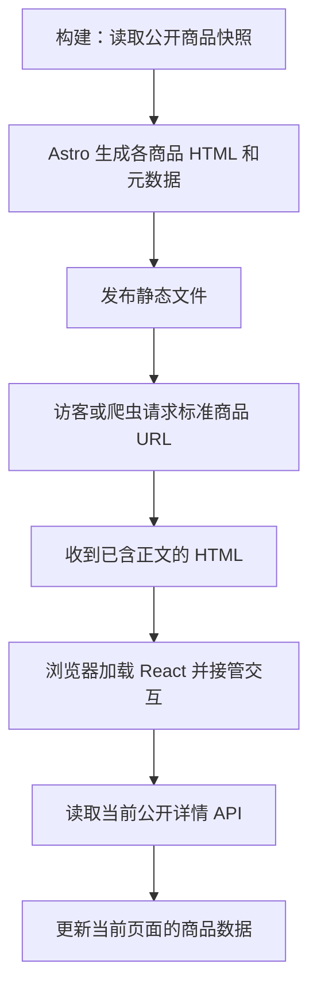

# 商品 SSG、数据更新与发布容错设计

2026-10-20 后续进展：已核验实际线上 1,032 文件备份；部署前捕获/归档备份已接入原 workflow 的分支代码。只读恢复计划、执行内核和缓存增量/反向参数已实现，云端恢复适配、锁内缓存修改与真实验收尚未执行。完整 CI/CD 图为 `output/hosting-2026-10-20/hosting-delivery.html`；当前事实和操作顺序集中维护在 [HOSTING_ACCEPTANCE.zh-CN.md](HOSTING_ACCEPTANCE.zh-CN.md)，本设计中的未来态不代表已上线。

更新至 2026-10-20。核对基线：`feat/seo-foundation` / `f5150e5`。10 月 19 日只补设计；10 月 20 日开始实现专用 404、托管检查和显式采集步骤，尚未部署或修改云配置。当前没有独立线上测试环境，仓库里的 `Deploy Test`、`test` environment 是现有命名，不能据此假定另有隔离环境。按用户最新要求不使用 Tunnel。

**建议结论**：继续使用 Astro 静态页面 + React 接管 + 当前公开 API。商品变化不频繁，构建时生成正文适合这个场景。下一阶段先设计发布恢复、缓存和异常测试，再实现自动内容发布。保留现有 CI/CD 的入口与检查，共用一个发布协调器；需要增加内容触发入口，但不复制一套互不协调的部署系统。

## 1. SSG 在哪里发生，访客会拿到什么

SSG 在构建机器运行 `astro build` 时发生。访问页面、Google 抓取、菜单点击和刷新，都不会在静态托管上临时启动构建。开发模式的按需开发服务器行为不作为线上静态交付的依据。Astro 默认在构建时预渲染；`client:load` 在已有 HTML 上加载并接管 React 交互。[Astro 渲染方式](https://docs.astro.build/en/guides/on-demand-rendering/)、[框架组件与 hydration](https://docs.astro.build/en/guides/framework-components/)。

| 页面/入口 | 当前初始 HTML | 进入后的数据和交互 |
| --- | --- | --- |
| 首页、OEM、Portfolio 等 Astro 页面 | 原本就生成静态 HTML，正文来自仓库内容 | 各自需要的 React 交互再启动 |
| `/headphones/` 等分类页 | 静态标题、分类介绍、导航和页面框架 | 商品目录、筛选和分类页内详情由现有 API 驱动；没有给所有目录列表增加构建时商品快照 |
| `/products/p-<ID>/` | 本轮新增的商品独立页面，含该商品公开正文、图片元素、metadata 和 schema | React 用相同 bootstrap 接管，再调用公开详情 API |
| 分类页普通点击商品卡片 | 沿用分类页内展开；不会跳去下载独立商品 HTML | 挂载原详情组件并读取 API |
| 商品卡片新标签、复制链接、直接访问标准 URL | 下载已生成的独立商品 HTML | 挂载后重新读取 API |
| `/products/item/?id=...` 或旧 query 入口 | 仍是旧入口壳；静态构建不能从任意 query 生成各商品正文 | 浏览器解析参数并请求详情；该入口的现有索引策略保留 |
| 登录、账户、后台等 | 可以有静态页面壳，但不代表私人数据进了静态产物 | 登录、授权和私人数据仍在运行时处理 |

所有人访问同一标准 URL 都获得同一种页面，不按 Googlebot 和真人分流。Google 可以执行 JavaScript，但初始 HTML 有正文能减少对渲染的依赖，其他抓取工具也能读取。[Google JavaScript SEO](https://developers.google.com/search/docs/crawling-indexing/javascript/javascript-seo-basics)。

源码入口：`apps/site/scripts/prepare-product-seo.ts`、`apps/site/src/lib/seo/product-snapshot.ts`、`apps/site/src/pages/products/[publicKey].astro`、`apps/site/src/islands/shop/ProductLanding.tsx`。

## 2. 没有重新构建，刷新能否看到更新

当前标准商品页的一次完整打开/刷新按下面顺序工作：

1. 先收到上次发布的 HTML，正文是当时的快照。
2. React 用同一份数据初始化，保留已有正文并接管图库、变体选择、询盘等操作。
3. `CatalogDetailController` 挂载后的 effect 发起第一页请求，**不携带构建时的 revision**，取得当前公开版本。后续分页固定这次拿到的 revision 和实际 pageSize。
4. 请求成功后更新当前商品 UI；修订版本改变时重新组织详情，不把新版本页面接到旧版本变体集合里。

这个请求目前直接使用 `fetchCatalogDetailPage`，不是 React Query。它的 `fetch` 设置 `cache: 'no-store'`、`credentials: 'omit'`；后端详情路由也返回 `Cache-Control: no-store`。因此它请求的是当前公开详情，不是构建 JSON，也不把管理员的未发布编辑或 Alibaba 上游尚未发布的变化当作公开内容。代码合同已经存在；实际域名的网关/CDN 是否覆盖这些头，本轮没有在线验证。

需要明确几条边界：

- API 成功后，浏览器中的商品正文可以比 HTML 快照更新；title、description、JSON-LD 仍是构建结果，当前没有随 API 刷新一起重写。它们需要后续构建发布保持一致。
- 新商品尚未构建时，分类页可能已经能从 API 展示并展开它，独立标准 URL 还没有文件。自动发布要覆盖这个间隔，不能只考虑已有商品修改。
- 一直开着的标签页目前没有轮询、推送、重新聚焦刷新或 bfcache 恢复刷新。客户端能“感知更新”是可以实现的，但本轮代码没有这些机制。
- API 超时、离线或 503 时，没有办法保证显示最新服务端数据。当前临时错误会保留正文并显示重试；必须把它视为未验证的新鲜度，而不是声称最新。浏览器详情请求还需要补有限超时，目前只有取消信号；快照采集的每请求 20 秒超时不能替代浏览器超时。
- 静态 HTML 及已经发送到浏览器的旧内容不能被远程收回。真实撤回后，API 404 能阻止继续按原数据操作，但初始旧正文和原 HTTP 200 要靠发布/路由处理。纯 SSG 不能承诺撤回瞬间所有请求都得到最新状态码。

建议增加一组共用的新鲜度策略：完整挂载必查；`pageshow` 从 bfcache 恢复时查；重新联网时查；重新聚焦或恢复可见时按上次成功校验时间判断是否需要查。事件要合并、取消过期请求，避免 focus/visibility/online 同时造成重复请求。30～60 秒可作为讨论中的聚焦刷新阈值，尚未作为实现或性能承诺。首期不需要 SSE、WebSocket 或持续轮询。

React Query 支持初始数据和后台重取；网站后台已经使用，公开详情尚未接入。应统一公共 transport、领域 API、query options 和业务 hooks，同时保留 revision、变体分页与公开投影。初始数据的时间应来自快照，不能把挂载时间假装为内容更新时间。[TanStack 初始数据文档](https://tanstack.com/query/latest/docs/framework/react/guides/initial-query-data)。考虑 pricing 正在并行开发，本轮只完成[公共请求层设计](REQUEST_LAYER_DESIGN.zh-CN.md)，暂不迁移公共调用方。

## 3. CatalogDetailController 的职责与 hooks

组件负责把网络结果、用户选择和分页状态交给纯状态机，再交给现有展示组件。`CatalogDetail` 和 `CatalogVariantGallery` 继续负责 UI。它没有承担静态 URL 枚举或 CI 构建工作。

| 位置 | 当前作用 | 判断 |
| --- | --- | --- |
| `useState(() => initialProductDetailState(bootstrap))` | 构建渲染和浏览器首轮都从 ready 状态显示同一商品 | 必需；如果只在 effect 中填数据，初始 HTML 仍会是 loading |
| 第 72 行 effect | 挂载、productId 改变或重试时读取数据；有 bootstrap 则 refresh，普通入口则 open；清理时取消请求 | 有明确网络生命周期，不应为了减少 effect 数量直接删除 |
| 第 90 行 effect | requestedId 改变时恢复变体选择，不重新获取商品数据 | 当前双层状态设计下需要；可在后续统一选择状态来源后简化 |
| 第 96 行 effect | 详情 ready 后，在需要时把键盘焦点移到标题；避免反复抢焦点 | 属于 DOM 与可访问性工作；标准落地页默认 `focusOnOpen=false`，不会主动抢焦点 |
| ProductLanding 外层 effect | 首轮接管完成后读取 URL variant，监听并清理 popstate | URL 是浏览器外部状态；避免构建阶段读 window，也保证首轮 hydration 一致 |

React 官方把 effect 用于网络、浏览器 API 等外部系统同步；effect 不在服务端渲染时运行。因此“构建 HTML 的正文”靠初始 state，而不是靠网络 effect。[React useEffect](https://react.dev/reference/react/useEffect)。

其余几个结构也有实际用途：

- `apply()` 先计算 next state，同步保存到 `current.current`，再交给 React 更新 UI。异步分页循环能立刻拿到同一份 next state，不从 setState 回调里偷取数据。
- `AbortController` 终止上一次读取；`generation` 和 productId 校验再拒绝迟到响应。取消与身份检查各有用途。
- `perform()` 只在现有详情协议要求 collecting 时继续取下一页；paged 模式保留用户分页，并非无限自动拉取所有变体。
- 变体点击、翻页和错误区域内的重试直接由事件处理，不通过新增 effect 间接触发。

应把请求/取消/新鲜度交给公共请求层与 React Query，再由业务 hook 组合商品状态；不能继续按页面复制一套网络 effect。还需约束 bootstrap 对象身份、统一 URL 与内部选择、缩小聚焦 effect 的依赖。当前三个 effect 在现有结构下各有用途，迁移后网络 effect 可以移除，DOM 聚焦等 effect 仍保留。重构要保留初始正文、URL 恢复、revision、取消与迟到响应等行为测试。

## 4. 当前 CI/CD 已接入什么

| 入口 | 已实现 | 未实现 |
| --- | --- | --- |
| `.github/workflows/ci.yml` | 第 177 行生成本地 fixture，第 180 行注入快照构建，第 198 行做初始 HTML 和现有购买交互验收 | 不会采集线上全量商品；没有内容更新触发 |
| `.github/workflows/deploy-test.yml` | 显式采集公开快照，再通过 `SEO_CATALOG_SNAPSHOT` 文件构建；上传前保存站点和快照恢复输入，上传后执行普通 URL/404/缓存/产物 hash 检查 | 没有选择快照模式的输入；新 workflow 尚未在线运行 |
| `scripts/deploy-cloudbase-test.mjs` | 先检查商品构建与 404 产物，再只读核对现有缓存，失败在任何云写入前退出；下次部署错误文档指定为 `404.html` | 没有内容触发、完整商品撤回差异、发布世代协调或原子切换/已演练的恢复入口 |

独立采集已接为显式步骤，构建只读这次保存的快照。采集、构建、保留恢复输入均失败即停止，没有空快照降级或 `continue-on-error`。恢复输入包含完整站点和公开快照，artifact 名含代码 SHA/run ID；它仍不等于可直接激活的线上备份或成功回滚记录。

构建失败发生在上传前时，只会导致本次发布失败，已在线的静态文件仍在服务。进入现有云函数部署或静态逐文件上传之后，才存在部分更新的发布风险；它与“采集失败”必须分开处理。

请求量按已验收快照的 487 个结构化商品推导：两遍清单各 11 页，详情读取与复核各 487 次，单次完整采集约 `2×ceil(487/48)+2×487=996` 次。它不是实际请求日志计数，也不表示当前线上仍是 487 个商品。采集并发上限为 4，每请求超时 20 秒；当前没有自动重试整个采集。普通 CI 读 fixture，不承担这批线上请求；访客也不会执行这批全量采集。

## 5. 推荐的发布入口与 skip 语义（待实现）

保留现有 CI/CD，复用一个发布协调器。代码发布与商品内容更新可以有不同触发入口，共用 artifact 格式、锁、世代检查和验收。

建议把 `skip` 明确为下面这些操作，而不是允许空商品构建：

| 建议模式 | 行为 | 限制 |
| --- | --- | --- |
| `fresh`，默认 | 采集当前公开数据，构建、校验再发布 | 失败不切线上版本；记录失败并有限重试 |
| `last-successful`，手动应急 | 跳过新快照采集，使用上一份验证过且与新代码兼容的快照构建 | 明确记录快照年龄、来源、hash、schema；不能跳过业务/schema/索引检查，不能伪装成最新内容 |
| `backend-only`，手动应急 | 只交付兼容的后端修复，保持网站静态版本 | 必须验证旧网站能调用新 API；目前现有部署脚本未支持独立目标 |
| `rollback` | 恢复已保存的完整兼容 release，不重新采集、不重新安装依赖 | 内容撤回规则优先，不得借回滚复活已撤回商品 |

`last-successful` 适合“当前采集链路有问题，但要发布别的修复”。它跳过的是新采集，仍执行 Astro 构建。彻底禁用商品 SSG、退回 CSR 也能另行设计，但不是现有代码里加一个布尔值即可：静态标准 URL 仍需要商品身份清单，页面与 sitemap 还要保持一致。当前不建议把“返回空 getStaticPaths / 删除商品 sitemap / 清空商品目录”当作故障降级。

应急旧快照不能自动成为常态，也不能压过之后的内容变更。特别是撤回：需要独立可靠的撤回记录/清单参与发布；旧快照必须剔除当前已撤回商品。若无法确定撤回状态，拒绝把旧快照当作新内容发布，保留当前已验证 release 并暴露待恢复状态。首次上线没有上一份 artifact 时，也不能凭空启用该模式。

只有采集失败时允许选择兼容旧快照；模板异常、schema 不兼容、页面正文缺失、索引/路由检查失败都必须修复，不能通过 skip、continue-on-error 或忽略测试变成成功。

## 6. 发布一致性、撤回和回滚（待实现）

1. **变化记录可恢复。** 公共内容真正变化后记录 durable event/outbox，短时间多次修改可以合并成一次构建。发布状态应区分：API 公开版本已变化、静态发布排队/构建中、静态交付完成。具体事件接口要与 pricing 的发布边界对齐，本轮不改其实现。
2. **一次 release 有明确身份。** 保存 code SHA、全局内容世代、每商品 revision、schema 版本、公开 origin、快照 hash、构建 hash、资源与页面 manifest。现有每商品 revision 校验不等于拥有全局内容世代。
3. **所有同目标写入走同一发布锁。** 内容发布和代码发布不能各上传一次。上线前再检查目标世代和当前 active release；迟到的旧构建不能覆盖较新的内容。GitHub concurrency 用于串行化，但不能替代版本新旧判断。回滚是显式操作，也要过同样的锁。[GitHub 并发控制](https://docs.github.com/en/actions/how-tos/write-workflows/choose-when-workflows-run/control-workflow-concurrency)。
4. **缺页不是撤回。** 采集某条失败会中止完整快照，不把该商品从 sitemap 静默消失。只有明确的公开清单变化/撤回事件才能产生删除计划。
5. **只删除当前发布器拥有的商品路径。** 比较先前和新 manifest，列出精确差异。CloudBase 现有上传为增量覆盖，不会删除本地已经没有的远端文件。带 hash 的 JS/CSS 需保留兼容旧页面的一段历史，不能跟着商品撤回一起扫掉。
6. **部署具备可恢复边界。** 在任何替换/删除前保留上一份可用产物和路径清单；上传后对正文、状态、元数据、sitemap 和资源做读回；缓存清理失败不能宣称发布完成。
7. **回滚使用保存的产物。** 不等重新安装、采集和构建。恢复兼容的代码/页面/manifest，处理新版本新增路径，再清缓存并读回。数据库和客户编辑不随前端回滚。撤回记录优先：直接恢复旧完整快照可能复活已撤回商品，所以回滚也要过撤回检查；需要重新裁剪的内容必须提前准备可用方案。

现有 `manageHosting upload` + 原地逐文件覆盖没有证明具备原子版本切换。10 月 20 日线上 GET 已确认缺失路径返回 HTTP 404，但正文为首页；本轮为下次部署准备专用 404。原子切换与恢复能力仍需真实托管演练，不能靠本地服务器证明。

建议优先核对现有 CloudBase 托管是否有可用的版本化发布和切换机制。若没有，至少采用资源先上传、页面后切换、manifest 最后提交、旧资源保留与失败恢复，并明确这仍有发布中的混合版本窗口。若要求完整原子切换与更快回滚，则需要版本目录配合受控路由/入口切换能力；不能在设计里假设一个尚未验证的平台 API。SDK/托管方法需在下一阶段对官方合同、实际安装版本与现有域名配置完成核对。当前无 Context7 工具，本文只采用官方网页与已提交源码，不据此承诺具体控制台能力。

## 7. 缓存要分别管理（待配置/扩展）

CDN purge 清理 CDN 的副本，无法清掉每个已打开标签页的内存、所有浏览器 HTTP 缓存或 bfcache。`no-cache` 的意思是复用前必须校验，不是禁止保存。旧的长缓存也不会因为现在改了响应头就立即从所有浏览器消失。[MDN HTTP 缓存](https://developer.mozilla.org/en-US/docs/Web/HTTP/Guides/Caching)。

| 对象 | 建议规则 | 当前证据/待验证 |
| --- | --- | --- |
| 商品 HTML、sitemap、可变 manifest | 浏览器 `no-cache` + 正确 ETag；共享缓存也须校验，后续保留 TTL 需明确 purge 与读回 | 已测首页/分类/缺失路径允许 `max-age=300, s-maxage=600`，不满足该规则；网站使用 DIRECT 网关接入静态托管，不能据此断言已启用边缘缓存 |
| 公开详情 API | 请求及响应 `no-store`；网关/CDN 不覆盖为长缓存 | 请求和函数响应已经如此；线上网关待验 |
| 目录/旧详情等 API | 按公开/角色投影分别验证；保留权限隔离，避免统一长期共享缓存 | 现有 catalog 为 private/no-cache；需要跨入口检查实际行为 |
| `/_astro/` 带内容 hash 的 JS/CSS | 长缓存、immutable；旧版本保留 | 只对内容寻址资源适用，不能把同样规则套到商品 HTML |
| 商品图片 | 内容变化时换图片身份/版本 URL；若同 URL 内容可变，需要再校验或清缓存 | 更新 API JSON 不代表浏览器一定重取同 URL 的旧图片 |
| 标签页/React 内存/bfcache | 挂载、恢复、联网和有节制的聚焦校验；保留选择与未提交询盘 | 自动恢复刷新待实现；不能直接强制整页跳转导致用户丢输入 |

CloudBase 官方当前文档支持在特定自定义域名接入模式下分别管理边缘/浏览器缓存，并支持跟随源站。具体适用域名、规则优先级、API 与静态路由是否共用规则，仍须读取实际配置后确认；本文没有修改线上缓存。[CloudBase 缓存配置](https://docs.cloudbase.net/service/cache)。

保证目标应写成：“网络正常且公开 API 可达时，完整刷新后的数据校验成功后显示当前公开版本；没有成功确认时不能把旧数据标成最新。”无法承诺断网时仍拿到服务器最新值，也无法承诺 SSG 在重新交付前已输出更新后的 HTML。已有长缓存的浏览器迁移还要单独验收，不能只用新的无痕窗口。

## 8. 撤回与 SEO

永久撤回且没有对应替代内容：从内链和 sitemap 移除，返回真实 404/410；有确切替代页面才重定向到相关页面。临时缺货但仍需要保留商品资料：可保留页面并清楚显示状态，是否撤回由业务含义决定。[Google 当前故障处理说明](https://developers.google.com/search/docs/crawling-indexing/troubleshoot-crawling-errors)。

正常移除会失去该 URL 自身的搜索入口，搜索引擎处理也有延迟；这与网站遭受整体处罚是不同的。Google 说明正常 404 不会因此伤害其余有效页面。无需用“大量商品对冲撤回”作为设计前提；应减少错误撤回、无意义重复 URL 和断掉的内链。[Google 关于 404 的说明](https://developers.google.com/search/blog/2011/05/do-404s-hurt-my-site)。

不能只在浏览器中删掉正文或显示 Not Found，同时继续让原 URL 以 200 返回旧 HTML。当前发布脚本的错误文档配置需要纳入真实 HTTP 状态验收。

## 9. 没有独立环境时怎样验证

按用户要求不使用 Tunnel，执行两层验证：

1. **基础本地验证。** 做请求、发布 adapter、失败顺序等确定性测试，构建真实 HTML 并核对 UI 截图。当前不为平台能力另搭本地模拟环境，不把模拟结果当作 CloudBase 验收。
2. **实际网站部署后的验收。** 使用现有 `test` 交付目标，核对真实域名、API、路径、缓存和版本。用已有缓存的浏览器与新 context 对照，再做受控更新/撤回/恢复。只读检查默认执行；写入演练使用事先约定、带 run ID 的测试商品/询盘，明确通知去向并 finally 清理。Google/Bing 的索引观察在站点交付检查之后进行。

## 10. 下一阶段测试清单与实施顺序

下表是计划，不是已经执行通过的结果。

| 范围 | 必测场景 | 可以在哪里证明 |
| --- | --- | --- |
| 初始 HTML / hydration | JS 关闭仍有正文；API 慢、失败、返回新 revision 时不清空正文；首轮不发生 hydration 错误 | 本地实际 build + 浏览器 |
| 各种进入方式 | 标准 URL、普通卡片展开、新标签、刷新、URL variant、前进后退、bfcache、重复聚焦、联网恢复 | 基础浏览器检查；实际目标部署后完整验收 |
| 缓存 | 先缓存旧页再发布；有效/错误 ETag、304；HTML 与 API 分别测；旧 JS、同 URL 图片变化；旧浏览器 context 与新 context 对比 | 单元负向用例 + 真实站点部署后验收 |
| API 与状态机 | 404/409/403/429/503、断网、无响应、取消、过大响应、乱序、切商品后旧响应迟到 | 单元/本地集成 + 浏览器 |
| 采集 | 中途列表/详情变化、部分失败、重复 ID、明确零商品与异常空数据、完整重试、并发压力、总超时 | 本地可控 API |
| 发布 | A 旧构建比 B 晚完成；代码与内容同时发布；断在上传/删页/purge/读回；重复事件；撤回后旧快照尝试复活 | 本地发布 adapter 故障注入；真实托管受控演练 |
| skip | fresh 不可用；兼容旧快照成功；不存在/过期/错误 origin/不兼容快照拒绝；没有上一版不能伪成功；后台独立修复兼容旧站点 | 本地 CI 测试 + 手动入口合同 |
| 业务 | 原图库、变体和询盘不变；刷新不能丢联系人/需求；失效 revision 或撤回由后端确认拒绝，不能只靠前端按钮 | 本地全流程；线上约定测试记录 |
| SEO 状态 | title、canonical、schema、sitemap 与正文一致；永久撤回真实 404/410；未知 URL 不落回首页 200；恢复后 URL 正确 | 本地构建；最终真实域名 GET |
| 回滚 | 不采集、不构建恢复上一份兼容产物；旧资源仍在；无撤回商品复活；缓存和版本恢复；测恢复耗时 | 本地故障演练；真实托管演练 |

建议按这个顺序做：先验证托管 404/缓存/版本切换和回滚能力，并确定 freshness/skip 合同；再实现共用发布协调器与快照 artifact；随后接入内容事件和浏览器新鲜度策略，完成本地故障测试；最后按实际站点的上线/验收/恢复清单执行。后续继续在原 `feat/seo-foundation`，不新建 SEO 分支，不在本轮修改 pricing、Blog 或 Hermes。

恢复时间需要实测，不能把“有回滚脚本”当成快速恢复的证据。上线前必须记录一次完整演练的触发、恢复完成与读回确认时间；若只能原地重传，恢复时间会受文件量和 CDN 收敛影响。

## 核对记录

实际核对：Astro 配置与页面、ProductLanding、CatalogDetailController、详情状态/transport、分类页面/卡片/旧详情、公开 API http-adapter 与 catalog-detail、CI/deploy workflow、hosting-integrity、部署脚本、PUBLIC_PAGE_CONTRACT、PRODUCT_PAGES_STATUS、ENGINEERING_CRAFT 的 Frontend Islands/E2E/Deploy/Test 分组、CloudBase SDK 合同文档。规则参考为 TypeScript、React 和 CloudBase/Web skills；技术事实另与本文链接的官方文档对照。

措辞修正：“进入页面触发 SSG”改为“构建时生成，访问时下载”；“React Query 拉取”改为当前实际的 fetch + 状态机；“测试环境验收”改为“本地/临时预览验证，再在真实网站验收”；“刷新看到最新”限定为公开 API 校验成功后的可见数据，并保留 HTML/meta、网络失败和浏览器历史缓存的边界。
