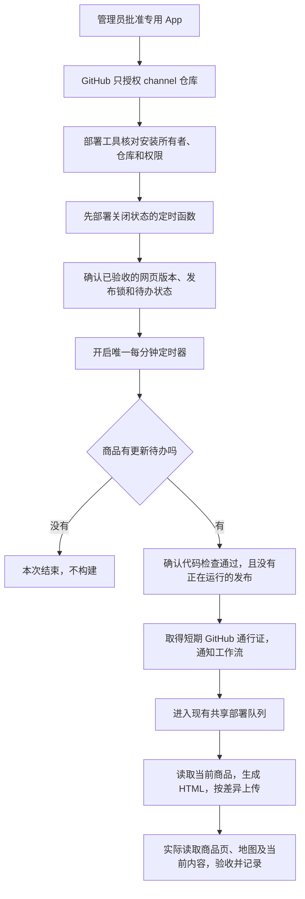

# 一次性开通商品更新通知

## 为什么不是加一个 SSH 公钥

SSH 密钥让服务器下载或推送 Git 代码。此次需要的是：腾讯云发现商品有更新后，通知 GitHub 启动已经写好的网页发布工作流。这是 GitHub API 的权限，仓库 SSH 公钥不能代替。

选择专用 GitHub App，是为了不把管理员自己的登录令牌长期放进云函数。它只安装到 `vibelingan/channel`，只申请读取源码、读取仓库基本信息和 Actions 读写。它不能直接修改源码或管理仓库。Actions 权限在 GitHub 上覆盖该仓库的工作流；本项目代码再固定允许启动的工作流、分支和输入。App 私钥用于换取短期安装令牌，程序自动换新，不需要客户每十四天重新配置。这里的令牌是 GitHub 给云函数的短期通行证，与 AI token 无关，不调用模型。

## 安装在哪里，之后谁负责运行

这次有三个位置，各有用途：

|位置|保存或运行什么|怎样查看|
|---|---|---|
|GitHub 的 vibelingan 账号|专用 App 及其对 channel 仓库的安装授权|Settings → Developer settings → GitHub Apps；安装范围在 Installed GitHub Apps 查看|
|channel 仓库的 test 环境|App ID、安装 ID和加密保存的私钥|仓库 Settings → Environments → test|
|现有上海 CloudBase 环境|catalog-seo-clock，每分钟查看一次是否有商品更新待处理|云函数详情和定时器；不新增公开网址|

Mac 上的 127.0.0.1 页面只负责这一次创建过程，将 GitHub 返回的私钥安全写进本机文件。正式启用以后，关闭这个页面或 Mac 都不影响自动检查。

GitHub 的 Actions 读写权限本身可以操作该仓库工作流；程序另外固定可调用的工作流、分支和输入。不能把程序里的限制说成 GitHub 授权本身只能启动某一个工作流。App 无源码写权限，也无仓库管理权限。

下面的创建、安装操作可由账号持有人亲自完成，也可由已经获得明确授权的 agent 代办。GitHub 再次要求密码或二次验证时，由用户自行输入；浏览器要求实际授权前确认时，保留当前页等待用户确认。

## 创建与安装步骤

1. 在当前 Mac 打开本次授权说明页。临时地址只在本机监听；过期后在原 SEO 项目执行 `node tools/catalog-seo/github-app-setup.mjs`，使用它输出的新链接，不要重复创建另一套应用。
2. 点击“查看 GitHub 授权范围”。检查当前 GitHub 账号为 **vibelingan**。如果是其他账号，在浏览器里自行切换；不用提供密码给 agent。
3. 页面上的名称为 **Channel Catalog HTML Delivery**。确认权限只有 Actions 的读写、Contents 的读取和 GitHub 自动带的 Metadata 读取，再点击创建。
4. GitHub 自动返回本机，页面显示“应用已创建，私钥已安全保存”。私钥保存到 `~/.config/channel-catalog-seo/github-app.json`，文件权限 0600。不贴群、不发聊天、不提交 Git。
5. 点击安装链接。选择 **Only select repositories**，只选 **channel**。确认后安装，回复“已安装”。不要选择全部仓库。

这些操作需要 GitHub 账号所有者的授权。SSH 到腾讯云服务器并不能代替这份授权。本模块不需要登录内容助手或发布助手机器。

## 之后由部署程序完成

读取 App ID、安装 ID及私钥，先确认安装所有者为 vibelingan、范围为指定仓库，再交给独立 CloudBase 定时函数；不复用个人 gh 登录凭证或范围未知的 GH_PAT。不设置公开 HTTP 路由，数据库状态仅云函数可读写。

先保持定时函数关闭：真实 HTML 和恢复验收完成，再安装 App 并用它核对仓库范围、空队列、通知与故障补漏，最后开启每分钟检查。其余网站发布仍使用原来的共享部署队列。普通发 Blog 不受此定时器控制，文章仍由文章服务器实时返回。

## 停用与换钥匙

临时停止自动更新：先关闭 `CATALOG_SEO_CLOCK_ENABLED`，正常网站仍可访问、手动部署仍可运行。需要撤销权限时，在 GitHub → Settings → Applications → Installed GitHub Apps，找到本应用后暂停或卸载，影响仅此自动通知。

私钥轮换：在同一个 App 生成新私钥 → 用新私钥核对指定仓库并完成一次通知 → 更新定时函数 → 读回确认 → 撤销旧私钥。不要先删除旧钥匙，也不要更换 App 身份或新建相似名称的应用。

## 已核对的官方依据

- [GitHub App 的清单创建方式](https://docs.github.com/en/apps/sharing-github-apps/registering-a-github-app-from-a-manifest)
- [腾讯云定时触发器](https://docs.cloudbase.net/cloud-function/timer-trigger)：采用七字段表达式 `0 * * * * * *`，每分钟检查一次；定时任务可能重复触发，通知租约和现有部署锁仍然必须保留。

## 管理员可以照做的命令

先在原 SEO 项目运行 `node tools/catalog-seo/github-app-setup.mjs`，保持终端运行，在它给出的本机链接完成上面五步。若提示已存在私钥文件，先确认它属于本次应用，不删除后重建。

安装完成后，可在 GitHub 网页进入 `vibelingan/channel → Settings → Environments → test`：

1. 将 App 页面显示的 App ID 添加为环境变量 `CATALOG_GITHUB_APP_ID`。
2. 从安装详情地址的 `/installations/<数字>` 取得安装 ID，添加为环境变量 `CATALOG_GITHUB_INSTALLATION_ID`。它与 App ID 不是同一个数字。
3. 将本机私有 JSON 中的 `privateKey` 值添加为环境密钥 `CATALOG_GITHUB_PRIVATE_KEY`。只将 PEM 本身写入密钥，不复制整个 JSON，不贴到群里。
4. 让部署程序先检查 App 安装所有者、仓库及权限。若代码提交已变化，先对当前提交运行 `catalog-clock-stage` 保持关闭，再运行 `catalog-clock-enable`。此前必须已有通过验收的网页程序和对应接受版本；检查失败就保持关闭。
5. 读回函数开启状态、程序提交和唯一的每分钟定时器，再看一次实际商品待办的处理记录。此时才能称自动更新已开启。

也可以由已获得授权的本地 agent 通过 `gh secret set ... --env test` 直接从权限为 0600 的文件读取并设置，避免手工复制。不要在 shell 参数、日志或聊天里显示私钥。不需要新增仓库 SSH 公钥。

## 启用后的第一次现场验收

先确认没有尚未完成的发布或客户商品待办，再给一个现有商品安排“重新核对当前公开内容”的任务。这次不修改商品名称、价格或发布状态，必须等真实定时器通知 GitHub，不能用人工点击工作流冒充自动触发。

记录定时函数的通知编号、对应 GitHub 运行、最终发布验收结果；前后比较商品和文章内容、公开时间以及网站状态。还要观察同一待办运行期间不会再次启动发布。此次证明自动通知和真实交付通了，不等于在客户商品上做了一次内容修改试验。

若授权范围不符、站点有未处理写入、出现不明发布或实际页面验收失败，停止后续写入并关闭定时函数，先查清当前状态。关闭此函数不会撤销客户商品或文章，也不影响网站继续访问。
