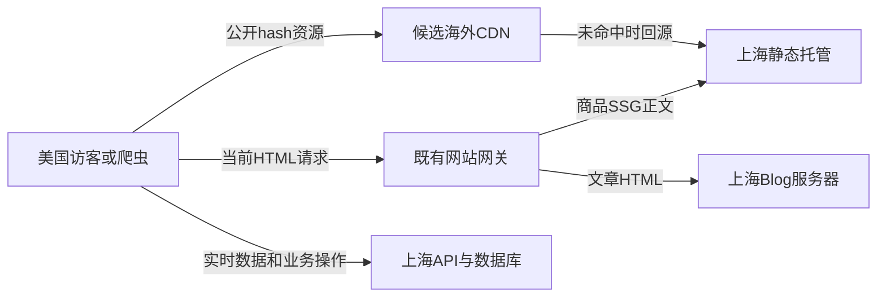

# 静态海外分发试验

## 已观察到的配置

CloudBase环境仍在上海；主域及www均AccessType=DIRECT。通过官方DescribeZones接口按zone-name=supplychainsai.com查询：TotalCount=0；这只证明当前账号可见范围内没找到本站，不能推广为客户所有账号没有CDN。原始只读结果在edgeone-discovery.json，未创建站点、购买套餐或修改DNS。

## 首期方案

后端、数据库及文章服务器留上海。优先使用独立静态子域，通过CNAME接海外/全球边缘节点，源站仍为既有静态托管。先提供候选域，不接管根域及其他应用。首批允许缓存：带内容hash的公开JS/CSS、字体及明确公开的网站图片/视频；第一步先不缓存HTML；API、登录、询盘、会员价格、AI、私有预览始终排除。商品SSG生成的HTML也是静态资源，第二步可纳入，但必须先接通发布/撤回/恢复对应的精确失效和读回。单纯只加JS/CSS CDN不会解决Google首份HTML的上海往返；这个限制须在试验结果里明确。只加静态子域不会加速仍走上海API的商品图片，不能宣称覆盖了商品LCP瓶颈。

文章公开图片仍有发布引用检查，不能简单按文件后缀长缓存：撤回文章后边缘缓存可能继续提供图片。接入前必须定好发布引用验证、派生图版本和撤回失效；私有预览始终走鉴权字节接口，不向DOM暴露存储链接。未完成失效联动前保留当前路径与源站缓存约束。

## 平台选择与费用

腾讯EdgeOne作为候选，现阶段不将ECDN旧产品当作新建入口。先确认客户账号、加速地域、套餐、流量计费、证书和DNS权限；开新付费套餐要客户确认实际报价与预算后再购买，不因已有腾讯云权限自动开付费资源。独立CDN不需要新建美国数据库或复制业务函数。

官方来源：https://edgeone.ai/document/46435 、https://intl.cloud.tencent.com/document/product/1145/54208 。套餐实际费用尚未报价，不写猜测金额。

## 对照与停止条件

美国同一出口、同一浏览器/限速，分别测当前源站、候选CDN冷缓存、同节点热缓存。记录cache状态、Age/命中头、TTFB、下载时间、完整长度/SHA、页面LCP和功能。随机加查询参数不等于可靠冷缓存，应使用测试资源新版本或限定URL清缓存并读回。至少3次/条件，保留失败。不能把本机改GPS当美国访问。

停止：源站host/证书错误、CORS或字体失败、内容摘要不符、撤回图仍暴露、HTML/API被缓存、费用超预算。回退先恢复前端静态域配置，让新页面使用原路径；旧hash资源保留，避免旧标签页404。DNS回退受TTL影响，因此不承诺立即恢复，也不先删除CDN资源。正常发布先上传新hash资源并读回，再发布引用它的HTML；恢复旧程序仍保留旧资源，不回退数据库。

## 请求经过哪里

该图是候选方案，不是已部署拓扑。第二步如果缓存商品HTML，只有发布协调器在CDN精确失效完成、普通请求/强制重验证/新浏览器读到对应新版本后才记为交付成功。任何边缘任务未知时保留待确认，不能先报已完成。私有草稿和临时地址禁止进入公开缓存，会员或登录Cookie请求绕过缓存。

## 本次权限检查和主域跳转的关系

现有CloudBase管理角色TCB_QcsRole可以查询站点，但查询可购套餐缺少teo:DescribeAvailablePlans权限。本次收到明确CAM拒绝，未购买或切DNS。管理员只读查询/报价后再批准套餐、域名接入和预算，步骤见[权限说明](AUTHORIZATION.zh-CN.md)。官方国际站的免费/促销套餐只作为候选，不直接当成当前中国站账号报价。

主域原生HTTP_TO_HTTPS实测307而非目标301，试改已撤回。静态子域CDN可继续独立设计试验，但不会顺便修复主域HTTP状态。若最后要在边缘完成主域301，就需要单独审查主域回源及未缓存Blog/API透传，不能未经确认扩展本期静态子域范围。
