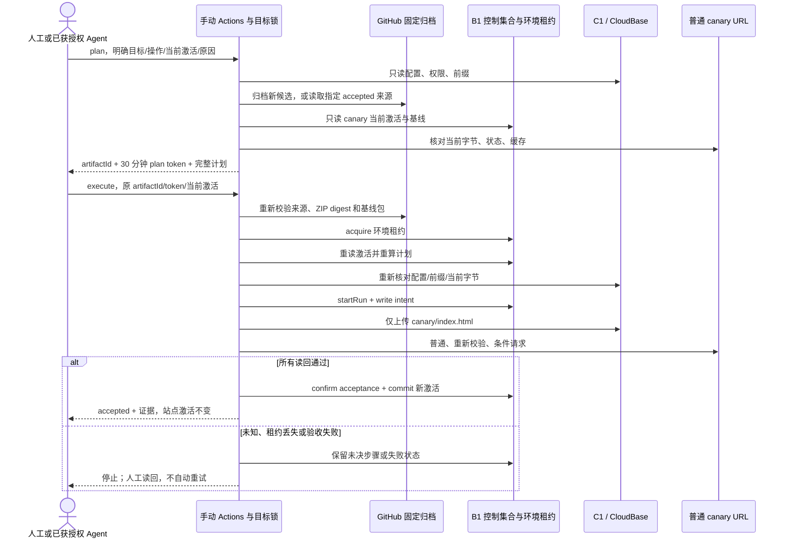

# 04 CI/CD 与恢复入口

D1 的静态 canary 人工入口已实现；2026-10-22 又接入生产版本观测、兼容测试/报告及人工函数恢复模式，见[本轮交付](module-04-function-entry.zh-CN.md)。两个 execute 开关均保持关闭。整站正常发布接入、失败运行接管和 D2 自动恢复仍待实施。继续原 `feat/seo-foundation`；普通 Deploy Test、E2E、AI CloudRun 及 pricing/product-sync 保持原样。下文原静态范围和历史准备记录继续保留，最新状态以本轮交付及现场结果为准。

## D1 当前交付范围

入口是 `.github/workflows/seo-static-canary.yml`，执行器是 `scripts/run-static-canary.mjs` 和 `scripts/release/orchestrator.mjs`。A1 校验包，A2 生成并执行托管计划，B1 保存环境锁和 canary 独立激活，C1 完成上传与普通 URL 读回。恢复时使用当前工具解析旧包的数据；不执行旧包脚本，不重新构建网站，不读取全量商品 API。

固定目标写在 `scripts/release/static-canary-policy.json`：候选 EnvId `diversity-123-d9grnqfux221323bb`、origin `https://supplychainsai.com`、区域 `ap-shanghai`。这个 pin 不能代替现场确认：运行时还要求 Actions 的非敏感目标变量完全相同，并用 SDK 验证目标环境和域名路由。本轮没有对这个目标执行上传、配置修改或控制集合写入。

唯一静态写入路径是 `__release-canary/index.html`，只能是代码内固定的 A/B HTML：无脚本、外链、表单，带 `noindex,nofollow`。不写首页、商品、sitemap、robots、验证文件、函数或业务数据；不修改全局 404/缓存配置，不调用 CDN purge，也不删除任何托管文件。数据库写入只包括 B1 的四个发布控制集合，不能把它表述成“完全不写数据库”。

四个控制集合必须事先存在：`siteReleaseTargets`、`siteReleaseScopes`、`siteReleaseRuns`、`siteReleaseSteps`。入口不创建集合，也不改权限。它读取 ADMINONLY 配置和两个 OPA 配置，执行时还要求完整权限响应的 hash 与仓库内经过审查的 `controlPlaneReviewSha256` 相同。ADMINONLY 旧接口本身不能证明 OPA 下的有效权限；开放前必须核对实际鉴权策略和浏览器拒绝访问的结果。未知策略形态或取不到证据就停止，不用管理员凭证读写成功冒充客户端权限安全。

## 操作和输入

| 输入 | 用途 |
| --- | --- |
| `mode=plan` | 只读云端；生成计划。新候选会先归档到 GitHub，再基于固定 artifact ID 计算计划 |
| `mode=execute` | 使用已有 artifact 和 plan token；不能在执行过程中生成替代候选 |
| `action=initialize` | 首次创建 canary；SDK 前缀清单必须为空，普通 URL 和重新校验 URL 必须都是可正确展示的 404 |
| `action=publish` | 当前 canary 已验收后，交付下一个 A/B 候选 |
| `action=restore` | 选择明确已验收的 `restore_run_id`，从 B1 seal 取得原 artifact；不选择 latest |
| `artifact_id` | publish/initialize 的 execute 必填；恢复时可由已验收 run 解析，手填不同 ID 会拒绝 |
| `expected_activation_id` | 当前 canary 激活 ID；仅初始化使用 `none` |
| `plan_token` | dry plan 输出的 `hash:reviewedAt`，有效 30 分钟；执行器 SHA、原因、目标、归档、激活或 scope version 变化都会失效 |
| `reason` | 人工原因，保存在计划和 Actions 报告中 |

首次 initialize 没有旧 canary 可恢复，因此不能叫“已备份 A”。它只允许在证明未占用的前缀下创建 A。A 的字节与缓存读回通过并提交后，A 才成为可恢复基线。若第一次创建失败，保留 intent/未知状态，人工核对现场；不自动删除文件或伪造旧基线。B1 新增的 initialize 类型只允许 canary，不能用来绕过 site 的 baseline 要求。

人工恢复先覆盖已经验收且现场仍匹配的 B，恢复已验收 A，并生成新的 activationId。当前入口只支持这个干净状态的闭环。遇到 pending、dirty、stalled 或执行到一半的失败运行，会停止并要求读回/协调；本轮没有提供“强制解锁”“忽略状态”或失败运行恢复按钮。

## 执行顺序和时序

1. Actions 只接受 `workflow_dispatch` 和 pin 的 SEO ref。与已有交付共用 `cloudbase-deploy-test`，`cancel-in-progress:false`；拿到 Actions 队列位置后仍需 B1 环境租约。其他控制台/本地写入不会天然受 Actions 锁保护，演练窗口必须排除这类写入。
2. checkout 固定 SHA，按 lockfile 安装依赖并关闭 lifecycle scripts。通过 GitHub REST 确认这个 SHA 的 offline push CI 已成功，才能读取云端目标。
3. plan 生成 A/B 数据包或解析指定恢复来源。新的 payload 用 upload-artifact 固定 ID 归档，之后才计算可执行计划。恢复来源和当前基线都要下载、校验有效期、seal、manifest 和内容；未归档或过期输入不能执行。
4. GitHub 适配器检查真实 artifact/run 元数据：仓库、原仓库身份、workflow 路径、事件、branch、SHA、run、attempt、artifact 名称和过期时间。执行时来源 run 必须成功结束；仅当前 plan 允许读取自己尚在运行的候选。
5. 下载 ZIP 的 SHA256 必须匹配 GitHub `digest`。签名存储下载不携带 GitHub token；解包只接受四个数据文件，拒绝链接、重复、额外成员、路径越界和超限文件。
6. 读取 B1 状态、SDK 前缀清单、当前配置和普通 URL；当前 B 必须仍匹配已验收内容，且 A 恢复包完整。缓存或初始缺失页不满足 C1 约束就停止，不修改配置来“帮忙通过”。
7. execute 校验原 token，取得 B1 租约后重读状态、现场和包，重算同一计划。之后依次记录 intent → SDK 上传 → 普通/重新校验/条件请求 → 配置保持原值读回 → 最终验收 → B1 提交新激活。
8. SDK 结果未知、验收失败、租约丢失或硬取消后，保留未决状态；不重复上传、不自动启动恢复。提交成功之后的诊断归档失败不回退已接受的激活。全程不发送搜索通知。

## 开放线上演练前的门槛

当前 `enabled:false`、权限审查 hash 为 null。2026-10-21 已通过仅新增 workflow 文件的默认分支提交注册入口，维护模式的记录归档和共享锁已实际运行；云端 execute 尚未运行。历史 orocsy 账号的 403 已通过用户授权管理员账号解决，SEO 精确分支规则已加入，后续维护运行已实际执行；这不是当前待用户处理的阻塞。不能移除环境限制绕过权限。见[F1 现场记录](module-06-verification.zh-CN.md)。

开放前先说明并核对：唯一目标 EnvId/origin、唯一静态路径、四个控制集合及有效权限、现有全局缓存/404 是否已符合要求、路径确实未占用、排除其他写入的演练窗口、artifact 保存期限和受信任 ref。按审查结果更新 policy，跑同 SHA CI，再生成正式 plan。更改全局缓存/404 或创建控制集合是另外的明确写入范围，不能夹在 canary execute 里执行。

恢复方案是 A → B → 指定 accepted A，新建恢复激活，保留全部历史和控制记录。每次写前，A/B 原包均须仍存在且未过期。超过 GitHub 保留期限后必须重新归档并建立可信基线；本期没有无限期恢复承诺。旧浏览器已有缓存还需 F1 现场验证，本地 Node GET 不能证明它已刷新。

停止条件：目标/ref/来源不一致、CI 未成功、archive 过期或损坏、基线不可信、非空初始前缀、普通 URL/缓存不符、计划超时或目标变化、未决 intent、dirty/stalled 状态、租约丢失、任何非预期 SDK 结果。停止后先读回，不能只因为 job 结束或 TTL 已过就抢锁或重跑。

## 后续整站 D1 与 D2

现有 Deploy Test 仍不走新执行器。C2 函数包兼容与 B2 全部公开内容写入方接好前，不开放整站恢复、商品回退或函数发布。catalogMode 的 fresh/reuse/retain-public 合同保留在总体设计中，本轮没有新增跳过 SEO/lint/test 的开关。

D2 仍按 journal 区分 prewrite、unknown 和已知可恢复失败。lint/build/test 等写前错误不恢复；unknown 先读回；符合条件的同次发布最多恢复一次，不递归。失败运行即使恢复成功也保留失败结论。当前没有工作流级 `if: failure()` 自动恢复钩子。

验证与实际状态见[模块 04 验证记录](module-04-verification.zh-CN.md)。真实 A/B/A 结果归 F1；本地通过不能替代该结果。
